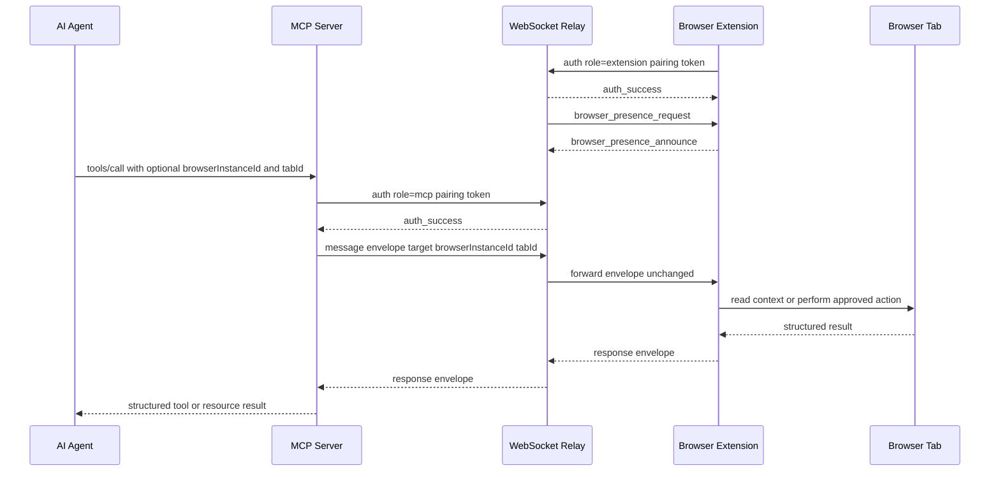

# Architecture Overview

Brijio connects remote AI agents to the browser session a user already controls.
Instead of launching a separate browser, cloning sessions, exporting cookies,
or streaming screenshots, it lets an agent collaborate with the live,
authenticated browser through an explicit request/response chain:

```text
Agent -> MCP Server -> WebSocket Server -> Browser Extension -> Browser Session
```

The browser remains the source of truth. Agents never receive a cloned browser
or a continuously streamed view of the page; every read or action is initiated
by an explicit MCP tool or resource request and answered with a structured
result. This boundary is stated as a non-negotiable product invariant in
`AGENTS.md` and reinforced by the security posture in
[Security and Trust Model](security.md).

## Core chain

The diagram below shows the runtime path of a single agent request and its
structured response, including the per-call `browserInstanceId` and `tabId`
targeting carried in the protocol envelope.



_The core request/response chain: agent call, MCP translation, relay routing,
extension execution against the live browser, and structured response back._

## Core components and ownership boundaries

`AGENTS.md` assigns each behavior to a single owning layer. Decide which layer
owns a change before editing, and keep protocol definitions in one place rather
than duplicating them across packages.

### Shared package (`packages/shared`)

Owns the protocol and browser-agnostic logic used by both the server-side code
and the browser extensions. `packages/shared/src/index.ts` re-exports the
shared modules, and `packages/shared/src/protocol.ts` is the canonical source
of truth for the WebSocket envelope, roles, auth and presence messages, browser
capabilities, tab-listing shapes, and upload/download status shapes. Shared
page-context extraction, page-content chunking, the background controller,
page-reader helpers, and logging also live here. See
[Protocol and Data Model Guide](data-and-protocol.md) for the shapes and
[Major Domains](domains.md) for the domain split.

### WebSocket relay (`servers/websocket`)

Owns relay authentication, presence, and routing. It authenticates each client
(both `extension` and `mcp` roles) against the local pairing token, derives a
`scopeKey` from that token, tracks browser presence in runtime memory, and
routes messages to the correct browser instance. Presence is intentionally
state-light and disappears when a socket closes. The relay answers
`list_browsers` locally from its presence table and forwards all other requests
to the selected extension socket, carrying `target.browserInstanceId` and
`target.tabId` through unchanged. Its entrypoint is
`servers/websocket/src/server.ts`.

### MCP server (`servers/mcp`)

Owns the agent-facing API surface: resources, tools, prompts, and skills
exposed through the Model Context Protocol. It translates MCP calls into relay
messages and returns structured results to the agent. The HTTP runtime is
assembled in `servers/mcp/src/http-server.ts` using the streamable HTTP
transport, with bearer-token authentication (`MCP_HTTP_AUTH_TOKEN` is required),
per-request MCP server instantiation, and an `/health` endpoint. Do not look
here for an exhaustive tool list; see the MCP tool surface page for that.

### Browser extensions (`clients/extensions/chrome`, `clients/extensions/safari`)

Own browser-specific integration and stay thin: they wrap the shared
background controller and page-reader logic with platform-specific adapters and
packaging. Chrome is the first implementation; Safari is a parallel
implementation with full Chrome feature parity that shares logic from
`@brijio/shared` (ADR 0019). Extensions connect only after explicit user action,
authenticate with the relay, announce presence, and answer explicit browser
requests. They are reactive: they do not publish ambient browser state. Adapter
internals (page-reader and action dispatch via the shared background
controller) are documented in [MCP to WebSocket to Extension Flow](architecture/mcp-extension-flow.md).

## Request flow

The typical end-to-end flow is:

1. The user starts the browser bridge in the extension UI.
2. The extension authenticates to the WebSocket relay with the pairing token.
3. The relay requests presence and the extension announces its browser instance.
4. The agent calls an MCP tool or reads an MCP resource, optionally targeting a
   specific `browserInstanceId` and `tabId`.
5. The MCP server authenticates to the relay and sends a structured request
   envelope.
6. The relay selects the target browser instance (or rejects with a
   `browser_unavailable` error) and forwards the envelope to that extension.
7. The extension reads browser state or performs an approved action against the
   targeted tab.
8. The structured result flows back through the relay to the MCP server and on
   to the agent.

This explicit request/response model is a core product boundary. Tool and
resource results use predictable structured responses, and progressive
disclosure returns structured context before larger page content. The detailed
runtime path, including how `tabId` threads through the stack, is documented in
[MCP to WebSocket to Extension Flow](architecture/mcp-extension-flow.md).

## Why this architecture exists

Brijio is intentionally not a remote desktop, browser cloning, or surveillance
system. The architecture exists to preserve authenticated sessions, reduce
privacy exposure, and keep browser control with the user. That is why the repo
favors:

- short-lived, explicit requests over background monitoring;
- shared protocol types over duplicated client/server schemas;
- browser-agnostic logic in `packages/shared` with thin platform adapters at
  the edges;
- progressive disclosure — structured context first, larger content only when
  requested.

The capability matrix records these as intentional non-goals rather than
missing features: no cookie export, no session cloning, no continuous browser
streaming, and no background surveillance.

## Change guidance

When changing architecture, start by deciding which layer owns the behavior:

- protocol and data-shape changes usually belong in `packages/shared`;
- relay authentication, presence, and routing changes belong in
  `servers/websocket`;
- agent-facing tool, resource, prompt, and skill changes belong in
  `servers/mcp`;
- browser capability and platform-integration changes belong in the browser
  extensions and shared adapters, keeping adapters thin and shared behavior
  shared.

When a change touches a protocol or browser capability, check the full path:

```text
shared protocol -> WebSocket relay -> MCP surface -> shared controller
                -> Chrome adapter -> Safari adapter -> integration tests
```

Preserve explicit per-call browser and `tabId` targeting: do not introduce
hidden selected-browser or selected-tab session state, and when `tabId` is
optional preserve the documented active-tab fallback.

If you add or change a cross-cutting flow, check the relevant ADRs under
`docs/architecture/decisions/`, especially the recent tab-targeting decisions
(ADR 0060 and ADR 0062) and the client-side action-approval decision (ADR 0048).
ADR 0048 establishes that approval-gated operations such as `submit_form`,
`fetch_resource`, and `download_file` require an in-memory, per-connection user
approval step that is cleared when the bridge disconnects; do not bypass
approval checks. ADR 0060 and ADR 0062 establish explicit tab listing and
threading `tabId` through the action stack with a backward-compatible active-tab
fallback. Also consult the [Security and Trust Model](security.md) before
changing authentication, routing, or browser-state exposure, since many of these
design choices are security choices.
