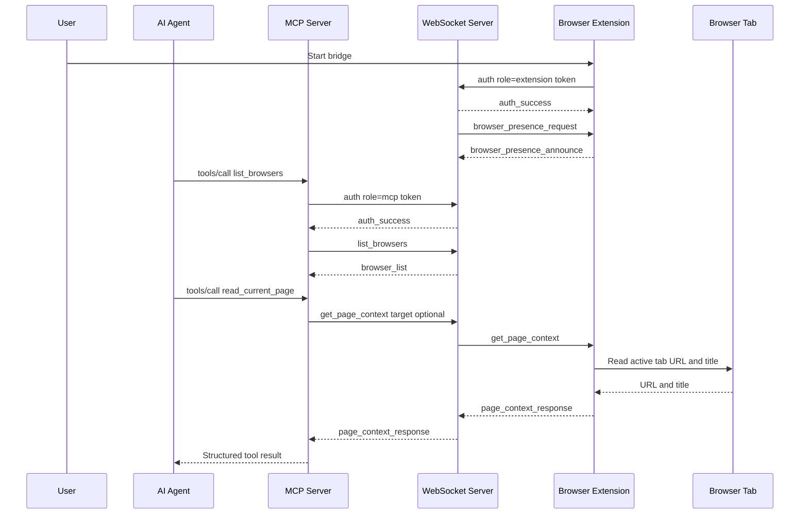

# Architecture Overview

Brijio connects remote AI agents to the browser session you already control. Its runtime is a simple, explicit chain:

```text
Agent -> MCP Server -> WebSocket Server -> Browser Extension -> Browser Session
```

The browser remains the source of truth. Agents never get a cloned browser, an exported cookie jar, or a continuously streamed view of the page. Every observation is the result of a short-lived, explicit request; the browser does not stream screenshots, DOM updates, or history in the background. This reactive posture is what lets Brijio preserve authenticated sessions, keep control with the user, and minimize privacy and token exposure.

The chain is described in the root `README.md` and in `docs/architecture/ARCHITECTURE.md`; the end-to-end request path is detailed in [MCP ↔ WebSocket ↔ Extension Flow](architecture/mcp-extension-flow.md) and the protocol shapes in [Data and Protocol](data-and-protocol.md).

## Runtime flow



_The reactive request/response path: the extension announces presence only after explicit user action, and each agent request is a discrete, forwarded call — never a background stream._

The typical flow is:

1. The user starts the browser bridge in the extension UI.
2. The extension authenticates to the WebSocket relay with a pairing token.
3. The extension announces browser presence (instance ID, label, capabilities).
4. The agent calls an MCP tool or resource.
5. The MCP server authenticates to the relay and sends a structured request.
6. The relay forwards the request to the target browser instance.
7. The extension reads browser state or performs an approved action.
8. The structured result flows back through the relay to the MCP server and the agent.

This explicit request/response model is a core product boundary. It is reinforced by the security posture in `docs/security/THREAT_MODEL.md` and the capability matrix in `docs/project/CAPABILITY_MATRIX.md`.

## Core components

### MCP server (`servers/mcp`)

The MCP server is the agent-facing API surface. It exposes resources and tools, translates MCP calls into relay messages, and returns structured results to the agent. The runtime is assembled around `servers/mcp/src/http-server.ts`, which wraps the official TypeScript MCP SDK Streamable HTTP transport: Brijio code owns the HTTP boundary checks (path matching, origin allowlist, bearer auth, method guard), page-reading behavior, and WebSocket request routing, while the SDK owns protocol framing, initialization, and tool/resource dispatch.

The tool surface is registered in `servers/mcp/src/mcp-server.ts`. It includes the read/navigation tools (`list_browsers`, `list_tabs`, `read_current_page`, `navigate_to_url`, `open_tab`), the write/form action tools (`click_element`, `fill_input`, `fill_editable`, `set_checked`, `select_options`, `upload_file`, `submit_form`), the batch tool (`perform_batch`), download tools (`download_status`, `download_file`), session-backed fetching (`fetch_resource`), and `capture_screenshot` (ADR 0064), which returns a viewport JPEG to vision-capable agents. Resources include `browser://page/current` (`current-page-context`), `browser://page/current/content/{index}` (`current-page-content`), and the injected `brijio-context` skill resource.

Every browser tool and resource accepts optional `browserInstanceId` (and most accept `tabId`). When `browserInstanceId` is omitted, the WebSocket server auto-routes only when exactly one browser is online for the pairing token; `BRIJIO_BROWSER_INSTANCE_ID` can set a default target for all requests from a given MCP server.

### WebSocket server (`servers/websocket`)

The WebSocket server is the local relay. `servers/websocket/src/server.ts` authenticates clients with the pairing token (or a configured set of additional tokens), scopes presence by token-derived scope key, tracks browser presence in an in-memory map, and routes messages to the correct browser instance.

Routing distinguishes two roles: `extension` sockets announce presence and respond to pending requests; `mcp` sockets send `list_browsers` (answered directly from presence) and forward all other requests to a selected browser, registering the request ID as a pending request so the extension's matching response can be routed back to the originating MCP socket. The relay holds no page content — it only forwards envelopes and tracks presence and pending requests.

### Shared package (`packages/shared`)

`packages/shared` contains the protocol and browser-agnostic logic used by both extensions and server-side code. `packages/shared/src/index.ts` re-exports the main shared modules — protocol, page-context, page-content, background controller, content handler, batch handler, bridge settings, and logging — so both extensions and the MCP/WebSocket packages depend on one canonical schema rather than duplicating client/server types.

### Browser extensions (`clients/extensions/*`)

Chrome and Safari each provide thin, browser-specific adapters around the shared logic. They connect only after explicit user action, authenticate with the relay, announce presence, and answer explicit browser requests. Safari reaches Chrome feature parity using shared logic plus Safari-specific adapters (ADR 0019). The Firefox extension is **planned but not implemented**; `clients/extensions/firefox/` exists only to reserve the client boundary, and its packaging, permissions, and user-control behavior must be designed in a separate ADR before implementation.

## Daemon and CLI operational layer

The MCP package also ships the operational layer that runs the stack. The `brijio` (and legacy `browserbridge`) binary at `servers/mcp/bin/brijio.mjs` is the single entry point: it auto-generates `BRIJIO_PAIRING_TOKEN` / `MCP_HTTP_AUTH_TOKEN` when unset, mirrors renamed env vars for backward compatibility, starts both the WebSocket relay and the MCP HTTP server, and manages graceful shutdown.

Beyond plain `run`, the same binary owns the daemon lifecycle and diagnostic commands — `install`, `uninstall`, `start`, `stop`, `restart`, `status`, `logs`, `doctor`, and `print-config` — implemented in `servers/mcp/src/daemon.ts`, `servers/mcp/src/doctor.ts`, and `servers/mcp/src/print-config.ts`. `install` provisions a LaunchAgent (macOS) or systemd user unit (Linux) with persisted tokens in `~/.brijio/.env`; `status` probes both `/health` endpoints; `doctor` runs preflight checks (config, ports, network, Node version); and `print-config` emits ready-to-copy blocks for specific agents (Claude Desktop, Codex, Gemini, Hermes, etc.). These are covered in detail in [Daemon and CLI](operations/daemon-and-cli.md).

## Why this architecture exists

Brijio is intentionally not a remote desktop or browser cloning system. The architecture exists to preserve authenticated sessions, reduce privacy exposure, and keep browser control with the user. That is why the repo favors:

- short-lived, explicit requests over background monitoring
- shared protocol types over duplicated client/server schemas
- browser-agnostic logic in `packages/shared`
- thin browser-specific adapters at the edges

Progressive disclosure follows the same principle: agents first request lightweight page context, and only request heavier content chunks when necessary, reducing token consumption and latency.

## Change guidance by layer

When changing architecture, start by deciding which layer owns the behavior:

- **Protocol and data shape changes** usually belong in `packages/shared` (`packages/shared/src/protocol.ts`), because both extensions and the MCP/WebSocket packages consume the canonical types. See [Data and Protocol](data-and-protocol.md).
- **Routing and authentication changes** belong in `servers/websocket` (`servers/websocket/src/server.ts`) — presence maps, pending-request routing, and token scoping.
- **Agent-facing tool/resource changes** belong in `servers/mcp` (`servers/mcp/src/mcp-server.ts` plus the per-tool modules), including HTTP boundary behavior in `http-server.ts`.
- **Browser capability changes** belong in the browser extensions and shared adapters (`packages/shared/src/background-controller.ts`, `page-reader.ts`, and the per-browser `background.ts`).
- **Operational/lifecycle changes** (install, start/stop, doctor, print-config) belong in `servers/mcp/src/daemon.ts` and the binary in `servers/mcp/bin/brijio.mjs`.

If you add or change a cross-cutting flow, check the relevant ADRs under `docs/architecture/decisions/`. The newest decisions most likely to constrain a change are:

- **ADR 0061 — Forward error codes through MCP:** the MCP server must forward the original error code and message from the WS server and extension rather than flattening them to generic `browser_error` / `"Received an invalid Brijio response."`, so agents can distinguish permanent unsupported-capability errors from transient ones.
- **ADR 0063 — `open_tab`:** adding tab-creating capability requires a paired `open_tab` / `open_tab_response` protocol message and an `openTab` adapter on both Chrome and Safari (only HTTP/HTTPS URLs; returns the new `tabId`), keeping the user's original tab untouched.
- **ADR 0064 — `capture_screenshot`:** visual action verification is an explicit, viewport-only JPEG (quality 80) tool returning MCP image content; it is not auto-capture and stays active-tab-only. Full-page scroll-stitch is deferred to a later tier.

Earlier tab-targeting decisions (ADR 0060 explicit tab listing/selection, ADR 0062 threading `tabId` through the action stack) established the `tabId` model that 0063 and 0064 build on.
