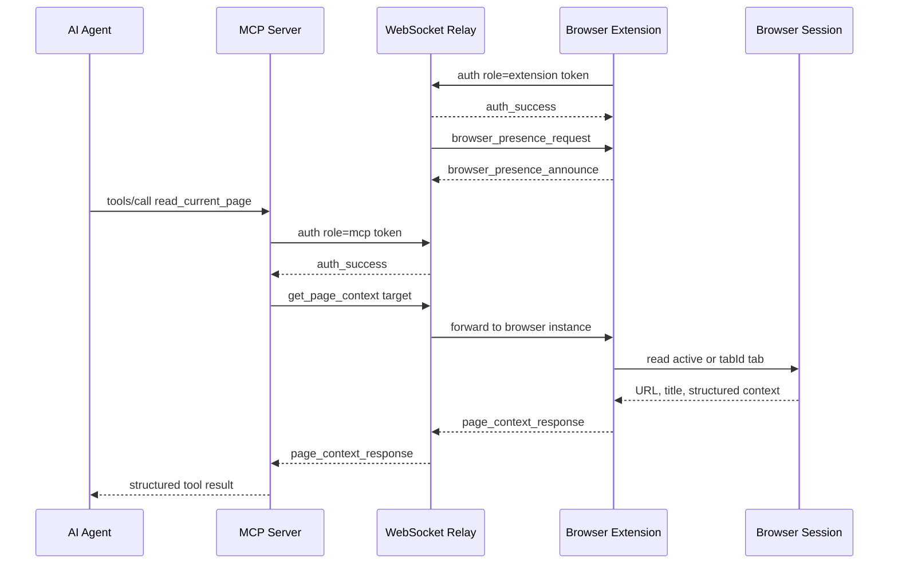

# Architecture Overview

Brijio connects remote AI agents to the browser session a user already controls. The runtime is a single explicit request/response chain. There is no cloned browser, no continuous page stream, and no background surveillance: the browser stays local and is the source of truth.

```text
Agent -> MCP Server -> WebSocket Relay -> Browser Extension -> Browser Session
```

The important property is that every browser read or action is initiated by an explicit MCP tool or resource request and answered with a structured result that flows back through the same chain. This boundary is reinforced by the non-negotiable invariants in `AGENTS.md` and the security posture in [Security and Trust Model](security.md).

## Runtime chain

The chain below traces one explicit request from agent to browser tab and back. The MCP server opens a short-lived WebSocket connection to the relay per request; the extension holds a long-lived authenticated connection. The relay authenticates both peers against the same pairing token, tracks browser presence, and routes each request by `browserInstanceId`, returning the extension's structured response to the waiting MCP socket.



_One explicit request flowing through the relay to a connected browser and back. The extension is reactive: it answers requests and returns structured results; it never publishes ambient state._

## Core components

### MCP server (`servers/mcp`)

The MCP server is the agent-facing API surface. It exposes tools, resources, and a session-start prompt, translates MCP calls into protocol envelopes, forwards them to the relay, and returns parsed structured results to the agent. Its package entrypoint is `servers/mcp/src/index.ts`, which derives options from environment and calls `startBrijioMcpHttpServer`. The HTTP/MCP runtime is assembled around `servers/mcp/src/http-server.ts`: a Node HTTP server exposes `/health` and an MCP endpoint (default `/mcp`), applies bearer-token authorization (`MCP_HTTP_AUTH_TOKEN`) and origin checks, then wraps the Streamable HTTP transport around a fresh `McpServer` built by `createBrijioMcpServer` in `servers/mcp/src/mcp-server.ts`. The tool/resource registrations live in `mcp-server.ts`; each tool delegates to a thin tool module and ultimately to the per-request WebSocket client in `servers/mcp/src/websocket-client.ts`.

### WebSocket relay (`servers/websocket`)

The relay is the local message broker between agents and browsers. Its entrypoint is `servers/websocket/src/index.ts`, which reads `WEBSOCKET_HOST`/`WEBSOCKET_PORT` (default `0.0.0.0:8787`) and calls `createWebSocketServer` in `servers/websocket/src/server.ts`. The relay authenticates each peer against a configured pairing token (`BRIJIO_PAIRING_TOKEN`), derives a token-scoped `scopeKey`, tracks browser presence in a per-scope map, and routes MCP requests to the selected browser instance. `list_browsers` is answered directly from the presence table; all other requests (including `list_tabs`) are forwarded to the extension, whose response is routed back to the waiting MCP socket via a pending-request map keyed by `scopeKey:requestId`.

### Shared package (`packages/shared`)

This package owns the protocol and browser-agnostic logic used by both extensions and the server-side code. `packages/shared/src/index.ts` re-exports the main shared modules, and `packages/shared/src/protocol.ts` defines the canonical envelope and message/data shapes (see [Protocol and Data Model Guide](data-and-protocol.md)). The `BrijioBackgroundController` in `packages/shared/src/background-controller.ts` owns the extension's connection lifecycle, presence announcement, keepalive, reconnect/backoff, and per-request dispatch to the browser adapters.

### Browser extensions (`clients/extensions/*`)

Chrome and Safari each provide thin browser-specific adapters around the shared logic. Both instantiate `BrijioBackgroundController` with platform adapters (tabs, scripting, downloads, approval, screenshot, tab listing) in their respective `background.ts`. They connect only after explicit user action, authenticate with the relay using the pairing token, announce presence with their `BrowserCapability` set, and answer explicit browser requests. Firefox is planned but not implemented; its directory reserves the client boundary pending a separate ADR.

## Request flow

The typical flow is:

1. The user starts the browser bridge in the extension UI (explicit action).
2. The extension authenticates to the WebSocket relay with the pairing token.
3. On `auth_success`, the relay requests presence and the extension announces `browser_presence_announce` with its `browserInstanceId`, label, and capabilities.
4. The agent calls an MCP tool or resource.
5. The MCP server opens a short-lived WebSocket connection to the relay, authenticates, and sends a structured request envelope with an optional `target` (`browserInstanceId` and `tabId`).
6. The relay selects a browser instance from its presence table and forwards the envelope to that extension socket unchanged.
7. The extension's shared controller reads browser state or performs an approved action on the targeted tab (falling back to the active tab when `tabId` is absent).
8. The structured result flows back through the relay's pending-request map to the MCP socket and is returned to the agent.

This explicit request/response model is a core product boundary. The capability matrix in `docs/project/CAPABILITY_MATRIX.md` records the current support status of each tool and browser.

## Agent-facing surface

The MCP server registers a fixed set of tools in `mcp-server.ts`: `list_browsers`, `list_tabs`, `read_current_page`, `click_element`, `fill_input`, `fill_editable`, `set_checked`, `select_options`, `submit_form`, `upload_file`, `navigate_to_url`, `open_tab`, `perform_batch`, `download_status`, `download_file`, `fetch_resource`, and `capture_screenshot`. Most tools accept optional per-call `browserInstanceId` and `tabId` targeting inputs; `open_tab` returns the new `tabId` for subsequent targeting. Resources expose `browser://page/current` (page context), `browser://page/current/content/{index}` (paginated readable content), and one `skill://{name}` resource per skill markdown loaded from `servers/mcp/skills/`. A `brijio-context` prompt injects connected browsers, available skills, and pitfalls at session start.

## Why this architecture exists

Brijio is intentionally not a remote desktop or browser cloning system. The architecture exists to preserve authenticated sessions, reduce privacy exposure, and keep browser control with the user.

That is why the repo favors:

- short-lived, explicit requests over background monitoring
- shared protocol types over duplicated client/server schemas
- browser-agnostic logic in `packages/shared`
- thin browser-specific adapters at the edges
- progressive disclosure: structured context before larger content or visual data

## Change guidance

When changing architecture, start by deciding which layer owns the behavior:

- protocol and data shape changes belong in `packages/shared`
- relay authentication, presence, and routing belong in `servers/websocket`
- agent-facing tools, resources, prompts, and skills belong in `servers/mcp`
- browser-specific integration belongs in `clients/extensions/chrome` and `clients/extensions/safari`; keep adapters thin and shared behavior shared.

When a change touches a protocol or browser capability, check the full cross-layer path from `AGENTS.md`:

```text
shared protocol -> WebSocket relay -> MCP surface -> shared controller
                -> Chrome adapter -> Safari adapter -> integration tests
```

Additional rules from `AGENTS.md`:

- Keep protocol definitions in `packages/shared`; do not duplicate them.
- Preserve explicit per-call browser and `tabId` targeting. Do not introduce hidden selected-browser or selected-tab session state. When `tabId` is optional, preserve the documented active-tab fallback unless an accepted ADR changes it.
- Re-read page context after navigation or a mutation that can invalidate short-lived target IDs.
- When tool behavior changes, update its tests, MCP registration, relevant skills under `servers/mcp/skills`, the capability matrix, and relevant OpenWiki workflow pages.
- Consider both Chrome and Safari for shared browser behavior, and document and test intentional platform differences.

If you add or change a cross-cutting flow, check the relevant ADRs under `docs/architecture/decisions/`. The most recent architecture-relevant decisions are:

- [ADR 0060 — Explicit Tab Listing and Selection](../docs/architecture/decisions/0060-explicit-tab-listing-and-selection.md) (Proposed): `list_tabs` and optional `tabId` targeting on all tools.
- [ADR 0062 — Thread tabId Through the Action Stack](../docs/architecture/decisions/0062-thread-tabid-through-action-stack.md) (Proposed): threading `tabId` end-to-end to the browser adapter with an active-tab fallback.
- [ADR 0063 — Open Tab Action](../docs/architecture/decisions/0063-open-tab-action.md) (Accepted): the `open_tab` tool that creates a tab and returns its `tabId`.
- [ADR 0064 — Visual Action Verification (Screenshot)](../docs/architecture/decisions/0064-visual-action-verification.md) (Proposed): the `capture_screenshot` tool returning MCP image content.

For the end-to-end runtime path through these files, see [MCP ↔ WebSocket ↔ Extension Flow](architecture/mcp-extension-flow.md). For component ownership boundaries across the monorepo, see [Major Domains](domains.md).
