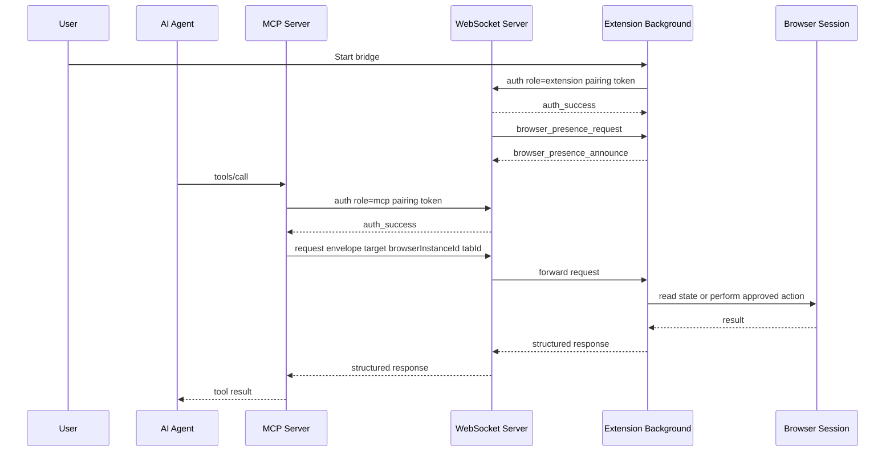

# Architecture Overview

Brijio connects remote AI agents to the browser session a user already controls. Rather than launching a separate browser, cloning sessions, exporting cookies, or streaming screenshots, it routes short-lived, explicit requests from an agent through a relay to the user's own browser. The browser remains the source of truth: there is no cloned browser and no continuously streamed page view.

## Runtime chain

The runtime is a single explicit request/response chain:

End-to-end request/response path: an agent tool call is forwarded by the relay to the user's browser session and the structured result flows back.

This is the same chain documented in the root `README.md` and `docs/architecture/ARCHITECTURE.md`. Two roles authenticate to the relay with the same pairing token: the extension (role `extension`) and the MCP server (role `mcp`).

## Core components

### MCP server (`servers/mcp`)

The MCP server is the agent-facing API surface. Its package entrypoint `servers/mcp/src/index.ts` reads options from environment via `getMcpHttpServerOptionsFromEnv()` and starts the HTTP runtime with `startBrijioMcpHttpServer(options)`. The HTTP/MCP runtime is assembled in `servers/mcp/src/http-server.ts`, which serves a `/health` endpoint, enforces bearer-token auth (`MCP_HTTP_AUTH_TOKEN`) and origin allowlisting, and pairs each request with a `StreamableHTTPServerTransport`. The tool and resource registrations live in `servers/mcp/src/mcp-server.ts`, where `createBrijioMcpServer()` registers the MCP tools (`list_browsers`, `list_tabs`, `read_current_page`, `click_element`, `fill_input`, `fill_editable`, `set_checked`, `select_options`, `submit_form`, `upload_file`, `navigate_to_url`, `open_tab`, `perform_batch`, `download_status`, `download_file`, `fetch_resource`, `capture_screenshot`), the `current-page-context` and `current-page-content` resources, skill resources, and the `brijio-context` prompt. Outgoing relay traffic is built in `servers/mcp/src/websocket-client.ts`, where `requestBrijio()` opens a WebSocket, authenticates as role `mcp`, and sends the request envelope with an optional `target` carrying `browserInstanceId` and `tabId`.

### WebSocket server (`servers/websocket`)

The WebSocket server is the local relay. Its entrypoint `servers/websocket/src/index.ts` reads `WEBSOCKET_HOST`/`WEBSOCKET_PORT` and calls `createWebSocketServer()`. The implementation in `servers/websocket/src/server.ts` authenticates each connection against the pairing token set (`BRIJIO_PAIRING_TOKEN` plus `additionalPairingTokens`), derives a sha256 scope key from the accepted token (`createScopeKey`), and tracks browser presence per scope in an in-memory map. It answers `list_browsers` directly from its presence table, and for every other MCP request it selects a browser by `target.browserInstanceId` (requiring an explicit ID when more than one browser is online) and forwards the full envelope to that extension's socket, recording the pending request so the extension's response can be routed back to the requesting MCP socket by request id. A `/health` HTTP endpoint reports connected browser instances.

### Shared package (`packages/shared`)

This package owns the protocol and browser-agnostic logic used by both extensions and the MCP server. `packages/shared/src/index.ts` re-exports the protocol, page-context, page-content, batch handler, popup, bridge-settings, page-reader, and `BrijioBackgroundController` modules. `packages/shared/src/protocol.ts` defines the canonical `WebSocketEnvelope` shape (`type: 'message'`, optional `id`, optional `target` with `browserInstanceId`/`tabId`, and a `payload`), the `BrijioRole` (`extension` | `mcp`), `BrowserPresence`, `TabInfo`, and the typed request/response payloads plus their constructors and parsers.

### Browser extensions (`clients/extensions/*`)

Chrome (`clients/extensions/chrome/src/background.ts`) and Safari (`clients/extensions/safari/src/background.ts`) are thin, browser-specific adapters around the shared `BrijioBackgroundController`. Each supplies its own `chrome.*`/`browser.*` API surface (`ChromeApi`/`BrowserApi`), permission helpers (`isRegularPageUrl`), approval injection via `chrome.scripting.executeScript` + `tabs.sendMessage`, and download/fetch adapters. They connect only after explicit user action in the extension UI, authenticate to the relay as role `extension`, announce browser presence, and answer explicit browser requests. Per ADR 0019, Safari reuses the shared logic with Safari-specific adapters and MV2 background behavior.

## Request flow

The typical end-to-end flow is:

1. The user starts the browser bridge in the extension UI.
2. The extension authenticates to the WebSocket relay with the pairing token.
3. The relay sends a `browser_presence_request`; the extension announces browser presence.
4. The agent calls an MCP tool or resource.
5. The MCP server opens a short-lived WebSocket to the relay, authenticates as role `mcp`, and sends a structured request envelope (with optional `target.browserInstanceId`/`tabId`).
6. The relay forwards the request to the selected browser instance.
7. The extension reads browser state or performs an approved action on the targeted tab.
8. The structured result flows back through the relay to the MCP server and on to the agent.

This explicit request/response model is a core product boundary. It is reinforced by the security posture in `docs/security/THREAT_MODEL.md` and the capability contract in `docs/project/CAPABILITY_MATRIX.md`, which marks cookie export, session cloning, continuous browser streaming, and browser recording as explicitly unsupported.

## Tab targeting

Tab targeting is per-call and stateless. Every MCP tool accepts an optional `browserInstanceId` (for multi-browser targeting) and an optional `tabId` (for multi-tab targeting within one browser). When `tabId` is omitted the extension falls back to the active foreground tab; when provided it resolves that specific tab. There is no session-level "selected tab" state. This model was introduced by ADR 0060 (explicit tab listing and selection) and threaded end-to-end through the action stack by ADR 0062, so `tabId` flows from MCP tool input through `websocket-client.ts` into `envelope.target.tabId`, through the relay, and into `BrijioBackgroundController.handleSocketMessage`, which extracts it and forwards it to each page reader/action handler. See also the focused [MCP Extension Flow](architecture/mcp-extension-flow.md).

## Why this architecture exists

Brijio is intentionally not a remote desktop or browser cloning system. The architecture exists to preserve authenticated sessions, reduce privacy exposure, and keep browser control with the user. That is why the repo favors:

- short-lived, explicit requests over background monitoring;
- shared protocol types over duplicated client/server schemas;
- browser-agnostic logic in `packages/shared`;
- thin browser-specific adapters at the edges;
- progressive disclosure (structured context first, content only when requested).

## Packaging and startup

The combined `brijio` binary (`servers/mcp/bin/brijio.mjs`) starts both the WebSocket relay and the MCP HTTP server in one process, auto-generates `BRIJIO_PAIRING_TOKEN` and `MCP_HTTP_AUTH_TOKEN` when unset, mirrors legacy `BROWSERBRIDGE_*` env vars for compatibility, and manages graceful shutdown on `SIGINT`/`SIGTERM`. It also dispatches daemon lifecycle commands (`install`, `start`, `stop`, `restart`, `status`, `logs`) via `servers/mcp/src/daemon.ts`, which writes tokens to `~/.brijio/.env` and installs a LaunchAgent (macOS) or systemd user unit (Linux). Default ports are `8787` (WebSocket) and `8788` (MCP at `/mcp`); both must be exposed when running the Docker image.

## Change guidance

When changing architecture, start by deciding which layer owns the behavior:

- **Shared protocol (`packages/shared`)** — protocol and data shape changes, the envelope and payload types, and browser-agnostic controller/reader logic.
- **Relay (`servers/websocket`)** — routing and authentication: pairing-token validation, scope keys, presence tracking, `list_browsers`, browser selection, and pending-request routing.
- **MCP server (`servers/mcp`)** — agent-facing tools and resources: tool schemas, the HTTP transport, bearer/origin auth, and the MCP↔relay client.
- **Browser extensions (`clients/extensions/*`)** — browser capability changes and browser-specific adapters, plus the shared adapters they implement.

If you add or change a cross-cutting flow, check the relevant ADRs under `docs/architecture/decisions/`, especially the recent tab-targeting decisions (`0060` and `0062`). Related pages: [Data and Protocol](data-and-protocol.md), [Domains](domains.md), [Quickstart](quickstart.md), [Security](security.md).
