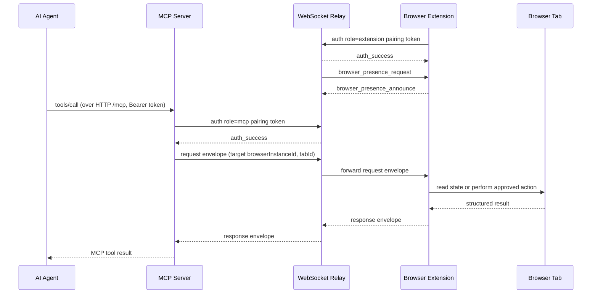

# Architecture Overview

Brijio connects remote AI agents to the browser session a user already controls.
Instead of launching a separate browser, cloning sessions, exporting cookies, or
streaming screenshots, the runtime routes **explicit, short-lived requests** to the
user's authenticated browser and returns **structured** results to the agent.

The runtime is a single explicit chain:

```text
Agent -> MCP Server -> WebSocket Relay -> Browser Extension -> Browser Session
```

The browser remains the source of truth. Agents never receive a cloned browser or a
continuously streamed view of the page; they receive structured responses to
specific requests. This boundary is a product decision, not a missing feature — the
[capability matrix](../docs/project/CAPABILITY_MATRIX.md) explicitly lists cookie
export, session cloning, and continuous streaming as non-goals.

## End-to-end chain

The diagram below shows one full request cycle: the extension authenticates and
announces presence, the MCP server authenticates, an agent tool call is routed to
the target browser, and the structured result flows back the same path.



_One full request cycle: presence setup, agent call, relay routing, browser execution, and structured return._

For the per-tool, per-file runtime path and tab-targeting threading, see
[MCP ↔ WebSocket ↔ Extension Flow](architecture/mcp-extension-flow.md). For the
canonical protocol shapes (envelope, presence, capabilities, tab listing), see
[Protocol and Data Model Guide](data-and-protocol.md).

## Four owned components

Brijio owns four components. Everything else (the agent, the browser itself) is an
external party that speaks a defined protocol.

### Shared package (`packages/shared`)

The shared package owns the **protocol and browser-agnostic logic** used by both
the server-side code and the browser extensions. `packages/shared/src/index.ts`
re-exports the modules; `packages/shared/src/protocol.ts` defines the canonical
`WebSocketEnvelope`, `BrijioRole`, `AuthPayload`, `BrowserPresence`,
`BrowserCapability`, and tab-listing types that every other component depends on.

It also hosts the shared background controller, page reader, content handler, and
browser-agnostic action helpers that the Chrome and Safari extensions wrap with
thin browser-specific adapters.

### WebSocket relay (`servers/websocket`)

The WebSocket server is the **local relay**. Its responsibilities, established by
[ADR 0021](../docs/architecture/decisions/0021-local-pairing-presence-routing.md),
are:

- authenticate MCP and extension connections with the pairing token before routing
- derive an internal scope key from the token so raw tokens are not exposed in logs
  or presence state
- track browser presence **in memory only** (no durable storage)
- route MCP requests to the target browser within the authenticated scope
- return structured errors for no browser, ambiguous target, invalid target, auth
  failure, invalid messages, and timeouts

Its entrypoint is `servers/websocket/src/index.ts`, which reads `WEBSOCKET_HOST`
(default `0.0.0.0`) and `WEBSOCKET_PORT` (default `8787`) and constructs the server
via `createWebSocketServer` in `servers/websocket/src/server.ts`. Presence is
cleared on socket close; pending requests are cleaned up per-socket on disconnect.

### MCP server (`servers/mcp`)

The MCP server is the **agent-facing API surface**. It exposes MCP resources and
tools, translates each tool call into a relay request envelope, sends it over
WebSocket, and returns the structured result to the agent.

Its entrypoint is `servers/mcp/src/index.ts`, which runs the HTTP MCP runtime from
`servers/mcp/src/http-server.ts`. The transport-neutral server factory is
`createBrijioMcpServer` in `servers/mcp/src/mcp-server.ts`; the WebSocket client
that talks to the relay lives in `servers/mcp/src/websocket-client.ts`.

Per [ADR 0023](../docs/architecture/decisions/0023-http-mcp-server-transport.md),
the MCP server is exposed over **MCP Streamable HTTP** (endpoint `/mcp` by default)
and is the default runtime. The HTTP boundary is security-critical:

- MCP HTTP clients authenticate with a **separate bearer token**
  (`MCP_HTTP_AUTH_TOKEN`), distinct from the Brijio pairing token used between MCP,
  WebSocket, and the extension.
- `Host` and `Origin` headers are validated to reduce DNS-rebinding risk.
- The server is **stateless**: each HTTP request constructs and tears down an MCP
  server instance, and no page content, URLs, or action results are stored in the
  HTTP layer.
- `MCP_HTTP_AUTH_TOKEN` is required; the runtime refuses to start without it.

The MCP-to-WebSocket side is unchanged by the HTTP transport: each tool call still
sends an explicit WebSocket request to the connected extension and waits for a
structured response.

### Browser extensions (`clients/extensions/*`)

Chrome and Safari each ship a browser-specific extension built on the shared logic
from `@brijio/shared`. Firefox is reserved but not yet implemented. The extensions:

- connect only after explicit user action (starting the bridge in the extension UI)
- authenticate to the relay with the pairing token and announce browser presence
- answer explicit browser requests (reads, actions, tab listing) and return
  structured results
- inject user-facing approval banners and tab indicators for visibility into
  agent activity

## Request/response boundary

The architecture is **intentionally reactive**. The browser does not continuously
stream screenshots, page updates, DOM changes, or browser history. Agents must
explicitly request information, and receive only what they ask for. This
progressive-disclosure model is why the relay can stay a thin message forwarder
rather than a stateful session broker.

Two consequences follow:

1. **No cloning, no streaming.** The browser is never duplicated; there is no
   background mirror the agent reads from. Every read is a fresh, explicit round
   trip through the chain.
2. **Targeting is per-call, not session state.** `browserInstanceId` and `tabId`
   are carried in the request envelope and resolved per call. There is no hidden
   "selected browser" or "selected tab" session state that can go stale.

## Routing and targeting

Browser discovery and routing come from
[ADR 0021](../docs/architecture/decisions/0021-local-pairing-presence-routing.md).
The `list_browsers` MCP tool returns browser instances online in the authenticated
scope. Browser tools accept an optional `browserInstanceId`; when omitted, the relay
routes automatically only when exactly one browser is online, and returns
`ambiguous_browser_target` when more than one is present.

Tab-level targeting was added by the recent tab ADRs and is threaded through the
whole action stack:

- [ADR 0060](../docs/architecture/decisions/0060-explicit-tab-listing-and-selection.md)
  — `list_tabs` MCP tool and a per-call `tabId` parameter on every tool.
- [ADR 0062](../docs/architecture/decisions/0062-thread-tabid-through-action-stack.md)
  — threading `tabId` from MCP input through the relay to the extension adapters,
  so a background tab can be targeted instead of always falling back to the active
  tab.
- [ADR 0063](../docs/architecture/decisions/0063-open-tab-action.md) — the
  `open_tab` action that creates a new tab and returns its `tabId`.
- [ADR 0064](../docs/architecture/decisions/0064-visual-action-verification.md) —
  the `capture_screenshot` tool for explicit visual verification.

When `tabId` is omitted, the system remains backward compatible and targets the
active tab.

## Action approval

Not every action executes silently.
[ADR 0048](../docs/architecture/decisions/0048-client-side-action-approval.md)
introduces client-side approval for selected browser-mutating operations
(`submit_form`, `fetch_resource`, `download_file` in the first stage). Approval is
gated by a per-action `actionUUID`, held in extension/background memory only, and
cleared when the bridge disconnects. See
[Action Approval](architecture/action-approval.md) for the approval flow detail.

## Configuration and operation

Key environment variables by component:

| Component | Variables                                                                                                                                 | Defaults                  |
| --------- | ----------------------------------------------------------------------------------------------------------------------------------------- | ------------------------- |
| WebSocket | `WEBSOCKET_HOST`, `WEBSOCKET_PORT`, `BRIJIO_PAIRING_TOKEN` (`BRIJIO_TOKEN` legacy)                                                        | `0.0.0.0`, `8787`         |
| MCP HTTP  | `MCP_HTTP_HOST`, `MCP_HTTP_PORT`, `MCP_HTTP_PATH`, `MCP_HTTP_AUTH_TOKEN` (required), `MCP_HTTP_ALLOWED_ORIGINS`, `MCP_HTTP_ALLOWED_HOSTS` | `0.0.0.0`, `8788`, `/mcp` |
| MCP → WS  | `BRIJIO_WS_URL` (legacy `BROWSERBRIDGE_WEBSOCKET_URL`), `BRIJIO_PAIRING_TOKEN`, `BRIJIO_REQUEST_TIMEOUT_MS`, `BRIJIO_BROWSER_INSTANCE_ID` | `ws://127.0.0.1:8787`     |

Both servers expose a `GET /health` endpoint. The WebSocket health response
includes connected extension count and browser presence; the MCP health response
reports version, uptime, and the configured WebSocket URL.

Docker Compose runs both services as independent containers, publishing the
WebSocket port (`8787`) and MCP HTTP port (`8788`) and passing both
`BRIJIO_PAIRING_TOKEN` (private MCP↔WebSocket routing) and `MCP_HTTP_AUTH_TOKEN`
(MCP client access) explicitly.

## Why this architecture exists

Brijio is intentionally not a remote desktop or browser-cloning system. The design
exists to:

- preserve authenticated sessions (no cookie export, no session replication)
- reduce privacy exposure (no continuous streaming, no background surveillance)
- keep browser control with the user (explicit requests, user-started bridge,
  client-side approval for sensitive actions)
- keep the relay dumb (forward messages by scope, do not inspect or store content)

That is why the repo favors short-lived explicit requests over background
monitoring, shared protocol types over duplicated client/server schemas,
browser-agnostic logic in `packages/shared`, and thin browser-specific adapters at
the edges.

## Change guidance

When changing architecture, start by deciding which layer owns the behavior:

- **Protocol and data shape changes** belong in `packages/shared`
  (`packages/shared/src/protocol.ts` is the source of truth for envelope, auth,
  presence, capabilities, and tab identity). See
  [Protocol and Data Model Guide](data-and-protocol.md).
- **Routing and authentication changes** belong in `servers/websocket` (token
  scope, presence registry, request forwarding, error codes). Re-check
  [Security and Trust Model](security.md) first.
- **Agent-facing tool/resource changes** belong in `servers/mcp` (tool registration
  in `mcp-server.ts`, relay client in `websocket-client.ts`, HTTP transport in
  `http-server.ts`). See [MCP ↔ WebSocket ↔ Extension Flow](architecture/mcp-extension-flow.md).
- **Browser capability changes** belong in the browser extensions plus the shared
  adapters in `packages/shared` (background controller, page reader, action
  adapters). Both Chrome and Safari must stay at parity in the same change.

If you add or change a cross-cutting flow, check the relevant ADRs under
`docs/architecture/decisions/`, especially the tab-targeting decisions (0060, 0062,
0063, 0064) and the approval ADR (0048). Changing protocol shapes without updating
the relay, MCP server, and extensions together will usually break interoperability.
