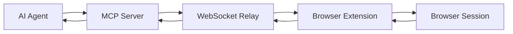

# Architecture Overview

Brijio connects remote AI agents to the browser session a user already controls.
Instead of launching a separate browser, cloning sessions, exporting cookies,
or streaming screenshots, Brijio relays short-lived, explicit requests to the
user's authenticated browser and returns structured results to the agent. The
browser remains the source of truth; the runtime never holds a cloned or
continuously streamed view of the page.



This is a deliberate product boundary, not a remote-desktop or browser-cloning
model. It preserves authenticated sessions, minimizes privacy exposure, and
keeps browser control with the user (see [Security](security.md)).

## Core components

There are four runtime components, each with a distinct ownership boundary
documented in `AGENTS.md`. Tool/protocol inventories live on dedicated pages;
this page describes only the architectural role of each layer.

### MCP server (`servers/mcp`)

The agent-facing API surface. It exposes MCP resources, tools, prompts, and
skills, translates agent calls into relay messages, and returns structured
`ToolResult` responses to the agent. The package entrypoint
(`servers/mcp/src/index.ts`) reads HTTP options from the environment and starts
the HTTP/MCP runtime assembled in `src/http-server.ts`; the actual tool and
resource registration lives in `src/mcp-server.ts`, and relay communication in
`src/websocket-client.ts`.

The MCP server is one of two relay clients: it authenticates to the WebSocket
relay with the same pairing token as the extension and is routed by
`browserInstanceId`/`tabId` targeting, just like any other authenticated
client. It owns the _agent-facing_ contract (tool names, input schemas,
resource URIs, skills), not browser behavior. For the full tool and resource
surface, see [MCP Tool Surface](architecture/mcp-tool-surface.md).

### WebSocket relay (`servers/websocket`)

The local message relay. It authenticates clients (`extension` or `mcp` roles)
with the pairing token, tracks browser presence per scope key, and routes
request/response messages between the MCP server and the target browser
instance. Its entrypoint `servers/websocket/src/index.ts` reads host/port from
the environment and constructs the server in `src/server.ts`.

The relay is intentionally stateless with respect to browser content: it holds
presence records and pending-request correlations, but no page state. It
forwards the full message envelope — including the `target` object
(`browserInstanceId`, `tabId`) — to the extension unchanged. On extension
disconnect it clears the presence record and any pending requests owned by
that socket.

### Shared package (`packages/shared`)

The protocol definition and browser-agnostic logic shared by both extensions
and the server-side code. `packages/shared/src/protocol.ts` defines the
canonical envelope and message/data shapes; `packages/shared/src/index.ts`
re-exports the shared modules (protocol, page-context, page-content,
page-reader, background-controller, batch-handler, content-handler, popup
logic, bridge settings, timers, logger).

The key architectural rule is that protocol definitions live **only** here and
are never duplicated between client and server. Browser-agnostic behavior
(page reading, action handling, the `BrijioBackgroundController`) also lives
here so Chrome and Safari can share it; see [Extension Adapters](architecture/extension-adapters.md).

### Browser extensions (`clients/extensions/*`)

Chrome and Safari each provide thin browser-specific adapters around the
shared controller logic. Firefox exists only as a placeholder. An extension
connects only after explicit user action, authenticates with the relay's
pairing token, announces browser presence (including capability list), and
answers explicit browser requests by reading browser state or performing
approved actions.

Both Chrome and Safari must reach feature parity for any shared browser
behavior; intentional platform differences are documented and tested
separately.

## Request/response chain

The end-to-end flow is an explicit request/response cycle — never a push or
stream from the browser:

1. The user starts the bridge in the extension UI (no background auto-connect).
2. The extension authenticates to the WebSocket relay with the pairing token.
3. The relay requests presence; the extension announces browser presence with
   its capabilities.
4. The agent calls an MCP tool or reads an MCP resource.
5. The MCP server authenticates to the relay and sends a structured request,
   carrying `browserInstanceId` (and optionally `tabId`) in the envelope
   `target`.
6. The relay forwards the request to the target browser instance.
7. The extension reads browser state or performs an approved action in the
   target tab.
8. The structured result flows back through the relay to the MCP server, which
   returns a `ToolResult` to the agent.

Every browser read or action is initiated by an explicit MCP request; the
extension is reactive and returns structured results. There is no continuous
page, DOM, screenshot, history, or browser-state streaming. This explicit
model, with request IDs, structured errors, and timeouts, is a non-negotiable
product invariant. The sequence and protocol shapes are described in detail in
[MCP → Extension Flow](architecture/mcp-extension-flow.md) and
[Data and Protocol](data-and-protocol.md).

### Targeting: browser and tab

Targeting is per-call and stateless, never hidden session state. The
`browserInstanceId` selects which connected extension handles a request; the
optional `tabId` selects which tab within that browser. When `tabId` is
omitted, the documented active-tab fallback applies. Re-read page context
after navigation or any mutation that can invalidate short-lived element
target IDs.

Tab targeting and visual verification are governed by recent ADRs:

- **ADR 0060 — Explicit Tab Listing and Selection** (`Proposed`): adds the
  `list_tabs` tool, a per-call `tabId` parameter on existing tools, and a
  visible content-script banner on the targeted tab. Tab lists are fetched on
  demand (no ambient tab streaming) and filtered to regular HTTP/HTTPS tabs.
- **ADR 0062 — Thread `tabId` Through the Action Stack** (`Proposed`): threads
  `tabId` from MCP input through the relay and `BrijioBackgroundController` down
  to `chrome.tabs.sendMessage(tabId, …)` / `chrome.tabs.update(tabId, …)`,
  with a backward-compatible active-tab fallback when `tabId` is absent.
- **ADR 0063 — Open Tab Action** (`Accepted`): adds the `open_tab` tool and
  `open_tab`/`open_tab_response` protocol pair so the agent can create a new
  tab non-destructively and immediately target it.
- **ADR 0064 — Visual Action Verification — Screenshot Tool** (`Proposed`):
  adds `capture_screenshot`, returning an MCP image content block (JPEG,
  viewport-only) on explicit request only — no auto-capture.

The capability matrix in `docs/project/CAPABILITY_MATRIX.md` is the canonical
product contract for what each tool supports and its browser/feature status;
consult it for the current support matrix rather than inferring capability
from tool presence alone.

## Why this architecture exists

Brijio is intentionally not a remote desktop, browser mirror, or session
cloner. The architecture exists to preserve authenticated sessions, reduce
privacy exposure, and keep browser control with the user. That is why the
repo favors:

- short-lived, explicit requests over background monitoring;
- shared protocol types in `packages/shared` over duplicated client/server
  schemas;
- browser-agnostic logic in `packages/shared` with thin browser-specific
  adapters at the edges;
- progressive disclosure — structured context first, larger content only when
  requested;
- client-side action approval that must not be bypassed.

These properties are reinforced by the security posture in `docs/security/`
and the capability matrix.

## Change guidance

When changing architecture, first decide which layer owns the behavior:

- **protocol and data shapes** belong in `packages/shared` (never duplicated
  into `servers/mcp` or the extensions);
- **relay authentication, presence, and routing** belong in `servers/websocket`;
- **agent-facing tools, resources, prompts, and skills** belong in
  `servers/mcp`;
- **browser-specific integration** belongs in `clients/extensions/chrome` and
  `clients/extensions/safari`, keeping adapters thin and shared behavior shared.

For a protocol or browser-capability change that cuts across layers, follow
the full cross-layer path defined in `AGENTS.md`:

```text
shared protocol -> WebSocket relay -> MCP surface -> shared controller
                -> Chrome adapter -> Safari adapter -> integration tests
```

When tool behavior changes, update its tests, MCP registration, relevant
skills under `servers/mcp/skills`, the capability matrix, and the relevant
workflow pages. For capability, routing, or trust-boundary changes, write an
ADR under `docs/architecture/decisions/` before implementation and wait for
approval. See [Domains](domains.md) for the package/domain ownership map and
[Security](security.md) for the trust boundaries this architecture enforces.
