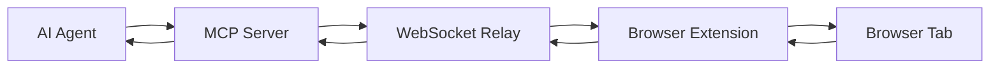
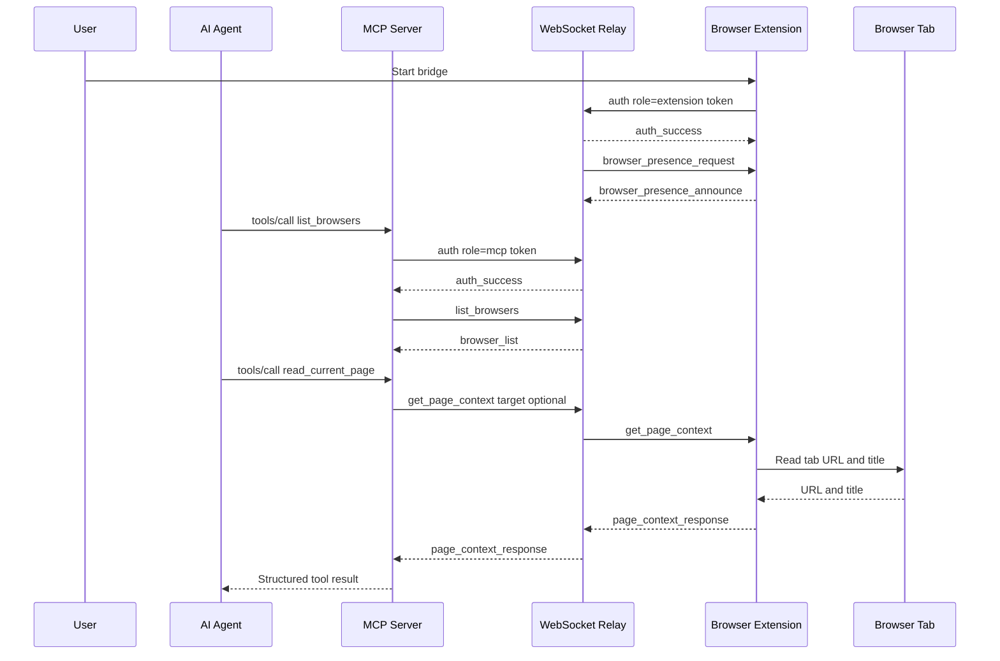

# Architecture Overview

Brijio connects remote AI agents to the browser session a user already controls.
Its runtime is a single explicit request/response chain rather than a cloned or
continuously mirrored browser:

```text
Agent -> MCP Server -> WebSocket Relay -> Browser Extension -> Browser Session
```

The defining property is that **the browser remains the source of truth**.
Agents never receive a cloned browser, a streamed view of the page, or ambient
browser state. Every read or action is initiated by an explicit MCP tool or
resource request, answered by a reactive extension, and returned as a
structured result. Brijio is intentionally not a remote desktop or browser
cloning system.

This page is the hub for the architecture. Each core component has a dedicated
deep-dive; this page covers the chain as a whole, why it exists, and how to
change it safely.

## High-level chain



_The request path flows left-to-right; the structured response returns along the
same chain. No component pushes ambient browser state back to the agent._

## Core components

Each layer owns a distinct responsibility. Links go to the per-system deep-dive
pages.

### MCP server (`servers/mcp`)

The agent-facing API surface. It exposes MCP tools, resources, and skills,
translates agent calls into protocol envelopes, forwards them to the relay, and
returns structured results. The HTTP/MCP runtime is assembled in
`servers/mcp/src/http-server.ts` around the Streamable HTTP transport, and the
tool/resource registrations live in `servers/mcp/src/mcp-server.ts`. The package
entrypoint `servers/mcp/src/index.ts` reads options from environment variables
and starts the server.

See [MCP Server](architecture/mcp-server.md) and
[MCP ↔ WebSocket ↔ Extension Flow](architecture/mcp-extension-flow.md).

### WebSocket relay (`servers/websocket`)

The local transport and routing layer. It authenticates clients with the local
pairing token, tracks runtime-only browser presence, and routes messages between
the MCP server and connected browser extensions. It is intentionally state-light:
presence lives in memory and disappears when the socket closes. The entrypoint
`servers/websocket/src/index.ts` reads `WEBSOCKET_HOST` / `WEBSOCKET_PORT` and
starts the server assembled in `servers/websocket/src/server.ts`.

See [WebSocket Relay](architecture/websocket-relay.md).

### Shared package (`packages/shared`)

The protocol and browser-agnostic logic used by both the server-side code and
the extensions. `packages/shared/src/index.ts` re-exports the shared modules, and
`packages/shared/src/protocol.ts` defines the canonical WebSocket envelope, auth
and presence messages, browser capability names, tab-listing shapes, and the
request/response payload types. Page-context extraction, page-content chunking,
the background controller, and the page reader also live here so both Chrome and
Safari adapters stay thin.

See [Shared Package](architecture/shared-package.md).

### Browser extensions (`clients/extensions/chrome`, `clients/extensions/safari`)

Chrome and Safari each provide a thin browser-specific adapter around the shared
logic. They connect only after explicit user action, authenticate to the relay
with the pairing token, announce browser presence, and answer explicit browser
requests. They are reactive: they do not publish ambient browser state.

See [Browser Extensions](architecture/browser-extensions.md).

## Request flow

The end-to-end path for a typical agent request, grounded in the relay's auth
and presence handling and the MCP tool registration:



_The extension authenticates and announces presence once, then answers explicit
per-call requests. No component streams page, DOM, screenshot, history, or
browser state between requests._

In prose:

1. The user starts the browser bridge in the extension UI.
2. The extension authenticates to the WebSocket relay with the pairing token.
3. The relay sends a `browser_presence_request`; the extension answers with a
   `browser_presence_announce` carrying its capabilities.
4. The agent calls an MCP tool or resource.
5. The MCP server authenticates to the relay (same pairing token, `role: mcp`)
   and sends a structured request envelope.
6. The relay forwards the request to the target browser instance, using the
   envelope `target.browserInstanceId` (and, per-tab, `target.tabId`).
7. The extension hands the request to the shared background controller, which
   dispatches to page reading, navigation, or action handlers.
8. The structured result flows back through the relay to the MCP server and the
   agent.

This explicit request/response model is a core product boundary. It is
reinforced by the security posture in `docs/security/THREAT_MODEL.md` and the
capability matrix in `docs/project/CAPABILITY_MATRIX.md`.

## Targeting: browser instances and tabs

Brijio uses **stateless, per-call targeting** rather than hidden session state.
The `list_browsers` tool targets one of several connected extensions via
`browserInstanceId`; the `list_tabs` tool (ADR 0060) targets a specific tab via
`tabId`. When `tabId` is omitted, the system falls back to the active tab.
Threading `tabId` end-to-end through the action stack is covered by ADR 0062,
opening new tabs by ADR 0063, and visual verification by screenshot by ADR 0064.

## Why this architecture exists

The architecture exists to preserve authenticated sessions, reduce privacy
exposure, and keep browser control with the user. That is why the repo favors:

- short-lived, explicit requests over background monitoring;
- shared protocol types over duplicated client/server schemas;
- browser-agnostic logic in `packages/shared`;
- thin browser-specific adapters at the edges;
- progressive disclosure — structured page context first, larger content or
  visual data only when explicitly requested.

## Change guidance

When changing architecture, first decide which layer owns the behavior. Follow
the full path for cross-layer changes:

```text
shared protocol -> WebSocket relay -> MCP surface -> shared controller
                -> Chrome adapter -> Safari adapter -> integration tests
```

Layer ownership:

| Behavior                              | Owning layer                 |
| ------------------------------------- | ---------------------------- |
| Protocol and data shapes              | `packages/shared`            |
| Routing and authentication            | `servers/websocket`          |
| Agent-facing tools, resources, skills | `servers/mcp`                |
| Browser capability                    | extensions + shared adapters |

Rules:

- Keep protocol definitions in `packages/shared`; do not duplicate them.
- Preserve explicit per-call `browserInstanceId` and `tabId` targeting. Do not
  introduce hidden selected-browser or selected-tab session state.
- When `tabId` is optional, preserve the documented active-tab fallback unless an
  accepted ADR changes it.
- Re-read page context after navigation or a mutation that can invalidate
  short-lived target IDs.
- Consider both Chrome and Safari for shared browser behavior; document and test
  intentional platform differences.
- Check the relevant ADRs under `docs/architecture/decisions/`, especially the
  recent tab-targeting and visual-verification decisions: **0060** (explicit tab
  listing and selection), **0062** (thread `tabId` through the action stack),
  **0063** (open tab action), and **0064** (visual action verification /
  screenshot tool).

For the broader domain map, see [Major Domains](domains.md). For the
end-to-end runtime path with canonical source files, see
[MCP ↔ WebSocket ↔ Extension Flow](architecture/mcp-extension-flow.md). For
security intent and trust boundaries, see [Security](security.md) and
`docs/security/THREAT_MODEL.md`.
