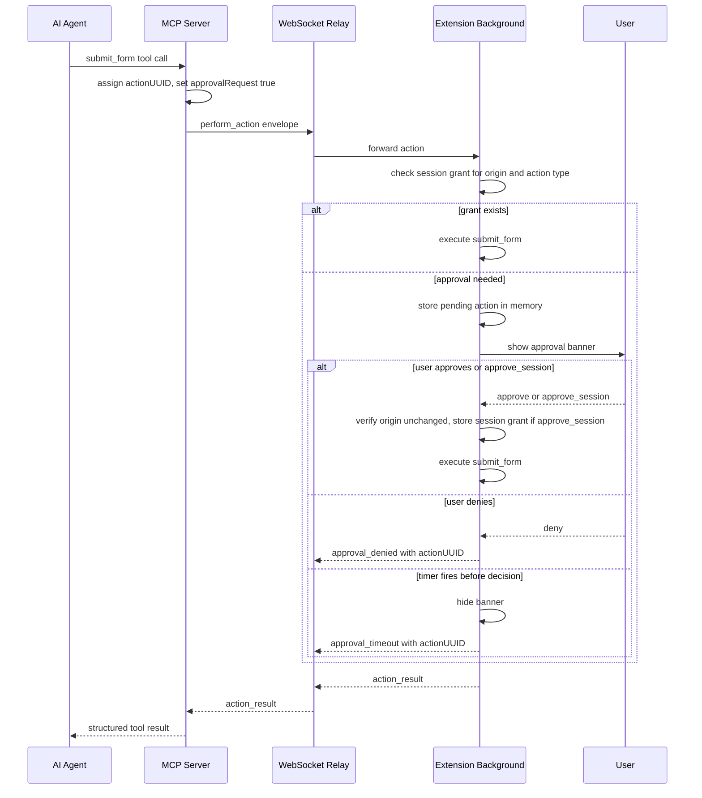
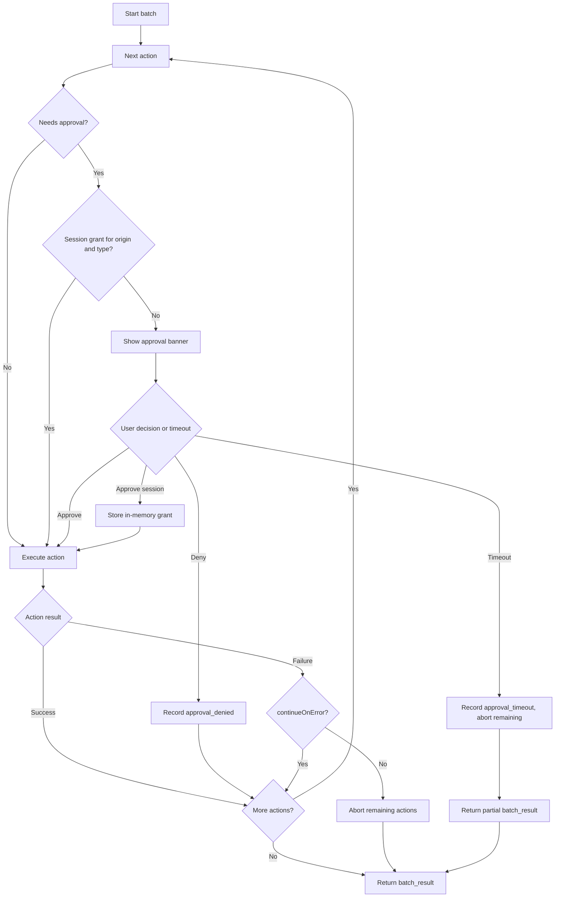

# Client-Side Action Approval

Brijio lets agents drive the browser through explicit MCP tool calls, but a small
set of browser-mutating operations require an explicit, in-browser user approval
step before they execute. This approval layer is the privacy boundary that keeps
agents from gaining silent background authority over actions that can send
user-entered data to a site, fetch authenticated resources, or initiate
downloads. It is specified by [ADR 0048](../../docs/architecture/decisions/0048-client-side-action-approval.md)
and enforced inside the extension background controller, not the MCP server.

## Hard constraint: do not bypass approval

The `AGENTS.md` product invariants require preserving user-visible, client-side
action approval and forbid bypassing approval checks. Any change to the action
pipeline that lets an approval-gated operation execute without going through the
extension background's approval gate is a security regression, not an
optimization. This is a non-negotiable boundary: approval is enforced at the
extension, for the operations listed below, and the MCP server must not be able
to pre-authorize or skip it.

## Which operations require approval

Approval is not required for every action. Only three operations are
approval-gated in the first implementation, and the list is hardcoded:

- `submit_form`
- `fetch_resource`
- `download_file`

Other actions (`click`, `fill_input`/`write_text`, `set_checked`,
`select_options`, `upload_file`, `navigate_to_url`, `open_tab`, screenshots,
page reads) do not require approval and execute without a banner. The
hardcoded policy is implemented by `getApprovalActionType`, which returns the
action type only for those three operations and `undefined` otherwise.

The ADR forecasts three policy-evolution stages: (1) the current hardcoded local
list, (2) future configurable local policy, and (3) an enterprise policy API.
The first implementation keeps policy evaluation behind `getApprovalActionType`
so that later stages can delegate elsewhere without changing the action
execution pipeline.

## Protocol: actionUUID and approvalRequest

Every approval-gated operation carries two extra fields on its action payload:

- `actionUUID` — a unique per-action identifier. For `perform_batch`, every
  batch item gets its own `actionUUID`, so approved, denied, and timed-out
  actions are individually identifiable inside a batch.
- `approvalRequest: true` — marks the operation as requiring approval.

The MCP server assigns these. `createApprovalRequestOptions` mints a fresh
`actionUUID` and sets `approvalRequest: true`; it is used for standalone
`submit_form`, `fetch_resource`, and `download_file` requests.
`addBatchActionApprovalMetadata` assigns an `actionUUID` to every batch item
and additionally stamps `approvalRequest: true` only on items whose `type` is
`submit_form` (the only approval-gated type that can appear in a batch —
`fetch_resource` and `download_file` are standalone tools, not batch actions).

The WebSocket envelope `id` remains the request/response correlation
identifier; the `actionUUID` identifies the specific action within a single
action request or a batch. Approval error responses echo the `actionUUID` so
the agent can map a failure back to the exact action.

The protocol envelopes for the gated operations accept an optional
`ApprovalRequestOptions` and only attach `actionUUID`/`approvalRequest` when
they are present, so non-approval callers are unaffected:

- `createSubmitFormEnvelope` adds them to the `action` object.
- `createDownloadFileEnvelope` and `createFetchResourceEnvelope` add them to
  the top-level payload.

## Approval states and decisions

The user can make three approval choices, surfaced through the extension's
`ApprovalAdapter.requestApproval`:

- `approve` — approve only the current action.
- `approve_session` — approve this action and reuse the grant for future
  matching actions during the same bridge connection.
- `deny` — reject the current action.

### approve_session grants

`approve_session` is scoped to a `{ origin, actionType }` pair. The grant key
is built by `createApprovalGrantKey` as `` `${origin}\u0000${actionType}` ``
and stored in an in-memory `Set` on the background controller
(`approvalSessionGrants`). The origin is computed from the active tab URL at
approval time via `ApprovalAdapter.getActiveOrigin`.

Before executing an approved action, `ensureApprovedAction` re-reads the active
origin and compares it to the origin captured when the user approved. If the
active tab origin changed between approval and execution, the action fails with
`approval_origin_changed` rather than reusing the grant — the extension fails
closed when the page moves away from the approved origin.

When a matching session grant already exists for the current
`{ origin, actionType }`, `ensureApprovedAction` returns `{ ok: true }`
without prompting, so repeated `submit_form` calls on the same site during one
connection do not re-prompt the user.

## Where approval state lives

Approval state — pending actions, approval timeout timers, and session grants —
is held only in the extension background controller's process memory. It is
**not** stored in page `localStorage`, extension storage, IndexedDB, or any
other persistent store. This is deliberate: it keeps policy state out of the
webpage and avoids persisting action payloads or grants across browser
restarts.

The background controller owns:

- the pending-action queue (a single in-flight approval prompt at a time);
- approval timeout timers;
- session approval grants;
- batch sequencing for approval-gated actions;
- final `action_result` / `batch_result` assembly.

### Clearance

Session grants are cleared when the bridge disconnects. `disconnect()` calls
`this.approvalSessionGrants.clear()`. Because the MCP server is commonly
instantiated per tool invocation, it is the wrong place for approval continuity;
the extension background and its WebSocket connection represent the live browser
session and are the correct boundary for grants that span multiple MCP tool
calls. Grants do not survive extension reload or browser session end.

## Timeout behavior

Approval-gated requests use an application-level approval timer owned by
Brijio, not the HTTP transport's generic timeout. The timer must fire _before_
the local MCP HTTP server request timeout so Brijio can return a structured
`approval_timeout` error instead of letting the HTTP server or client produce an
ambiguous generic timeout.

The MCP HTTP server computes the approval timeout from the configured HTTP
timeout and a safety buffer:

```text
approvalTimeoutMs = max(1000, httpTimeoutMs - approvalTimeoutBufferMs)
```

with defaults `BRIJIO_MCP_HTTP_TIMEOUT_MS=60000` and
`BRIJIO_APPROVAL_TIMEOUT_BUFFER_MS=5000`, yielding `approvalTimeoutMs=55000`.
The computed value is threaded through `pageContextConfig.approvalTimeoutMs`
into `BrijioPageActionsConfig.approvalTimeoutMs` and from there into each
request option. The background controller uses
`this.options.approvalTimeoutMs ?? 55000` as the wait budget.

For `perform_batch`, the MCP client uses the same request budget as standalone
tools: when any batch action is approval-gated, the WebSocket request timeout
is set to `approvalTimeoutMs` (falling back to `timeoutMs`) so the whole batch
fits inside one HTTP request timeout.

### What happens on timeout

`waitForApprovalDecision` races `ApprovalAdapter.requestApproval` against a
`setTimeout`. If the timer wins, the adapter's `hideApproval` is called to
dismiss the banner and the decision resolves to `'timeout'`. `ensureApprovedAction`
then returns an `approval_timeout` error carrying the `actionUUID`.

For batches, a timeout is request-level: the current action records
`approval_timeout`, the banner is hidden, and the batch returns a partial
`batch_result`. Already-completed actions keep their results; the timed-out
action and all remaining unexecuted actions are returned as focused failed
entries (`approval_timeout` with `aborted: true` for skipped-after-timeout
entries) so the agent can retry them in a later call.

## Error codes

Approval introduces four action error codes (added to `ActionResultErrorCode`):

- `approval_denied` — the user denied the action.
- `approval_timeout` — the user did not respond before the computed approval
  timeout.
- `approval_unavailable` — the extension could not render the approval UI, the
  `ApprovalAdapter` is absent, the active tab origin is unavailable, or the
  request is missing an `actionUUID`.
- `approval_origin_changed` — the active tab origin changed between approval
  and execution.

Errors include `actionUUID` when available. Batch errors additionally carry the
existing `aborted` flag following batch result conventions.

## Runtime flow

The approval gate sits inside the background controller, between WebSocket
message dispatch and the page action execution. For a standalone
`submit_form`, `fetch_resource`, or `download_file` request, the handler calls
`ensureApprovedAction` first; only on `{ ok: true }` does it proceed to the
browser adapter. For `perform_batch`, `handlePerformBatchRequest` checks
`hasApprovalGatedAction`; if true it routes to `performApprovalAwareBatch`,
which sequences actions one at a time through `ensureApprovedAction` before
each execution.



The approval-gated request flow including deny and timeout paths. The
extension background is the sole holder of approval state; the MCP server only
assigns `actionUUID` and `approvalRequest` and waits for a structured result.

## Batch semantics

Approval-aware batches preserve ADR 0044's ordered batch semantics. The
extension treats every action independently inside `performApprovalAwareBatch`:

1. If the action does not require approval (no `approvalRequest: true` or not
   a gated type), execute it normally.
2. If the action requires approval and a matching session grant exists,
   execute it normally.
3. If the action requires approval and no grant exists, show the approval
   banner for that action only.
4. Continue with the next action only after the current action succeeds, is
   denied, or times out.

User denial inside a batch is a per-action outcome, not a reason to abort the
whole batch: a denied action returns `approval_denied` for its `actionUUID`,
then the batch runner continues to the next action. The `continueOnError` flag
continues to apply to _execution_ failures after an action is approved (stale
targets, unsupported controls, browser errors). Page navigation remains
special: if an executed action navigates the page, remaining actions abort
because previously read page IDs may no longer be valid.



Approval-aware batch control flow. A timeout aborts remaining actions and
returns a partial result; a denial is per-action and the batch continues.

## MCP server remains stateless

The MCP server is commonly instantiated per tool invocation, so it is
deliberately not the holder of approval state. Its only approval
responsibilities are:

- assigning a unique `actionUUID` to each approval-gated action (and to every
  batch item);
- setting `approvalRequest: true` on gated actions;
- using the computed `approvalTimeoutMs` as the request budget so the
  application-level approval timer fires before the HTTP timeout;
- surfacing the structured approval error back to the agent.

All continuity (session grants, pending prompts) lives in the extension
background, tied to the live WebSocket bridge connection.

## Approval UI

The banner and approval UI are browser-specific and are surfaced through the
`ApprovalAdapter` (`getActiveOrigin`, `requestApproval`, `hideApproval`). The
shared background controller depends only on that adapter interface; the
concrete rendering, styling, focus handling, and cleanup live in the
extension packages. See the extension READMEs for browser-specific approval UI
details. If the adapter cannot render the banner (e.g., on restricted pages),
the action fails with `approval_unavailable`.

## Related docs

- [ADR 0048 — Client-Side Action Approval](../../docs/architecture/decisions/0048-client-side-action-approval.md)
- [MCP ↔ WebSocket ↔ Extension Flow](mcp-extension-flow.md)
- [Protocol and Data Model Guide](../data-and-protocol.md)
- [Security and Trust Model](../security.md)
