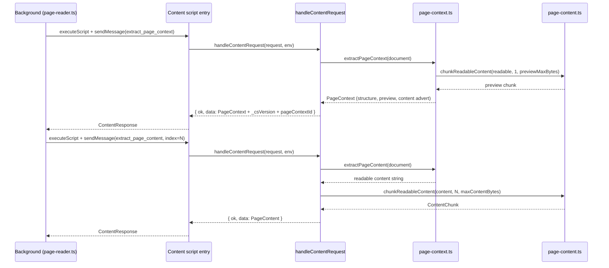

# Browser Content Extraction Pipeline

Page reading and page actions do not run in the extension's background service
worker. The background layer only targets a tab, injects a content script, and
relays a message; the actual DOM work happens **in the page's tab context**
inside a content script. This page describes how a read/action request is
dispatched inside that content script, how shared `@brijio/shared` modules layer
the extraction, how content is progressively disclosed and paginated, and how
stale-context is detected. The end-to-end relay from the MCP server to the
extension is covered in [MCP ↔ WebSocket ↔ Extension Flow](./mcp-extension-flow.md).

## Layering

Content extraction is built as four shared modules in
`packages/shared/src/`, each owning a distinct concern:

1. **`content-handler.ts`** — the dispatch core. Receives a typed
   `ContentRequest`, performs stale-context checks, routes to the right
   operation, and returns a `ContentResponse`. This is what the content-script
   entrypoint calls for every page read or action.
2. **`page-context.ts`** — builds the `PageContext` snapshot: the accessibility
   structure (headings, landmarks, links, images, forms, editables, actions), the
   visible-context identity, and the readable-content preview. It owns
   `ACTION_SELECTORS` and the DOM walking (`extractPageContent`,
   `extractPageContext`, `computeVisibleContextId`,
   `computeVisibleFormStructureId`).
3. **`page-content.ts`** — the pagination layer. Converts the readable content
   string into byte-bounded `ContentChunk`s and renders Markdown fragments
   (links, images, tables). Owns `chunkReadableContent` and the byte-aware
   splitter.
4. **`page-reader.ts`** — the background-side adapter that runs inside the
   extension background context (not the page). It calls
   `scripting.executeScript` to inject the content script, then
   `tabs.sendMessage` to dispatch a `ContentRequest`, and normalizes the
   response. It owns the tab-targeting and injection boundary.

The content-script entrypoints (`clients/extensions/chrome/src/content-script-entry.ts`
and the Safari analogue) are intentionally thin: they register the
`runtime.onMessage` listener and delegate to `handleContentRequest` /
`executeBatch` from the shared package (ADR 0019/0031 shared-code pattern). They
also host the approval banner and tab-indicator UI, but those are unrelated to
content extraction.

## Content-script entrypoint and dispatch

The Chrome entrypoint's module body does two things on load:

1. Calls `registerPageNavigationListener()` to start tracking page-context

<!-- openwiki: broken internal link [#stale-context] heading anchor "stale-context" does not exist in /openwiki/architecture/browser-content-pipeline.md. Fix the href or restore the target, then delete this comment. -->

version (see [Stale context](#stale-context)). 2. Builds an `onMessage` callback and registers it on
`chrome.runtime.onMessage`.

The callback inspects the incoming message `type` and dispatches:

- `show_brijio_approval` / `hide_brijio_approval` — approval-banner UI.
- `show_brijio_tab_indicator` / `hide_brijio_tab_indicator` — tab indicator UI.
- A `perform_batch` message (`isContentBatchRequest`) — delegated to the shared
  `executeBatch`, which runs each action through `handleContentRequest` in
  sequence.
- Anything else — delegated to `handleContentRequest` with a `ContentEnvironment`
  built from the live page (`globalThis.document`, `location.href`,
  `document.title`, `window.getSelection()?.toString()`, and an ISO-timestamp
  `now`).

The key design point: the entrypoint performs **no extraction logic**. It
captures the `ContentEnvironment` (the live DOM plus page metadata) and hands it
to the shared handler, which is the single place that knows how to read or act
on a page.

## Idempotent content-script injection (ADR 0043)

The background adapter (`page-reader.ts`) calls `scripting.executeScript` with
`content.js` **before every** `tabs.sendMessage` — for both reads and actions.
This guarantees the latest content-script code is loaded (important after an
extension update where a manifest-injected script, e.g. Safari, could be stale),
but naïvely it would create a new module scope on every call and accumulate
duplicate `onMessage` and `pageshow` listeners.

ADR 0043 solves this with **listener replacement** rather than a
loaded-once sentinel:

- The new module reads `globalThis.__brijioOnMessageListener`; if a previous
  injection's callback is stored there, it calls
  `chrome.runtime.onMessage.removeListener(previousListener)` before adding its
  own, then stores the new callback back on `globalThis`.
- `registerPageNavigationListener()` does the same for the `pageshow` listener
  via `globalThis.__brijioPageShowListener`, so the page-context version counter
  increments once per navigation rather than once per re-injection.

This keeps at most one active `onMessage` listener per page whose
`pageContextVersion` belongs to the current module scope. A
`globalThis.__brijioContentLoaded = true` sentinel guard was rejected because a
re-injection that destroys the old module scope would leave the new one
guard-skipped and no listener registered at all.

## Progressive disclosure

A page read is two-stage so the agent gets an actionable overview before the
full (potentially large) content body:

1. **Page context** (`extract_page_context`). `extractPageContext` in
   `page-context.ts` returns a `PageContext` containing:
   - `url`, `title`, `timestamp`, `selectedText` (user selection, or `null`).
   - `visibleContextId` — a hash of the visible form-control signature, used for
     stale detection of SPA re-renders.
   - `preview` — the first byte-bounded chunk (`previewMaxBytes`, 4096 in the
     Chrome background) of readable content, with `truncated` flag.
   - `structure` — the accessibility tree: `headings`, `landmarks`, `links`,
     `images`, `forms`, `editables`, `actions`. Each entry has a positional
     `bb-N` id assigned in document order among visible elements, which is what
     action tools reference.
   - `content` — a capability advertisement: `{ available, requestType:
'get_page_content', firstIndex: 1, defaultMaxPayloadBytes }`. This tells the
     agent that more content is fetchable and how to ask for it.
   - `_csVersion` (the `CONTENT_SCRIPT_VERSION`) and `pageContextId` (the
     current page-context version), appended by `handleContentRequest`, for
     diagnostics and stale detection.

2. **Page content** (`extract_page_content`). The agent requests further content
   by 1-based `index`. `handleContentRequest` extracts the full readable content
   from the DOM via `extractPageContent` and calls `chunkReadableContent(content,
index, maxContentBytes)` to return one `ContentChunk`. The response is a
   `PageContent` carrying `index`, `content`, `truncated`, and
   `maxPayloadBytes`; `truncated` is true when more chunks follow, so the agent
   keeps incrementing `index` until `truncated` is false.

### Pagination

`chunkReadableContent` (in `page-content.ts`) is byte-aware, not line-aware. It
splits on blank-line block boundaries first; if a block still exceeds
`maxContentBytes` it falls back to a character-by-character split. Byte length
is measured with `TextEncoder`, so multi-byte UTF-8 content is bounded correctly.
Requesting an `index` beyond the available chunk count throws `invalid_index`,
which `handleContentRequest` maps to an `invalid_index` error response.

_The two-stage read: a context request returns structure plus a preview chunk; a
content request returns the full readable content one byte-bounded chunk at a
time._

## Stale context (ADR 0036)

Elements are addressed by short-lived positional IDs (`bb-1`, `bb-2`, …) generated
during a page read. Between a read and a subsequent action the page may navigate,
re-render (SPA), load lazy content, or inject ads — shifting positions so that
`bb-3` now points at a different element. Acting on a stale ID silently targets
the wrong element, which is worse than an error because the agent gets a false
success signal.

ADR 0036 layers two complementary guards, both implemented in
`handleContentRequest` before any action runs:

- **`pageContextId` (navigation guard).** `registerPageNavigationListener`
  increments a module-scoped `pageContextVersion` on every `pageshow` event
  (bfcache restore or full navigation). Every `PageContext` response carries the
  current `pageContextId`. Action requests optionally echo it back; if it does
  not match `pageContextVersion`, the handler returns a `page_navigated` error
  with `previousContextId`/`currentContextId`, telling the agent to re-read.

- **`visibleContextId` (re-render guard).** `computeVisibleContextId` hashes the
  visible form-control signature (labels, types, required state, values,
  options, validity) into a `ctx_…` id. Action requests may carry the
  `visibleContextId` from the last read; if the current page's id differs, the
  handler returns a `stale_context` error with reason
  `visible_controls_changed`. Form actions additionally recompute
  `computeVisibleFormStructureId` after acting and annotate the result with
  `contextStale: true` if the form structure shifted, so the agent learns the
  page changed even though the action landed.

- **Per-target validation fields.** Beyond context-level guards, action targets
  carry optional `expectedText` / `expectedHref` (links) / `expectedRole`
  (actions) / `expectedLabel` (form controls). `performClick`'s
  `validateClickTarget` resolves the positional element, then checks the
  expected text (case-insensitive substring), href (pathname-only, to tolerate
  SPA query/hash changes), and role. Any mismatch returns a `stale_context`
  error whose `detail` includes `expectedText`/`foundText`,
  `expectedHref`/`foundHref`, etc. — enough for the agent to self-correct by
  re-reading.

All validation fields are optional; omitting them preserves legacy
find-by-position-and-act behavior, so the safety net is backward compatible.
When a `stale_context` or `page_navigated` error is returned, the agent is
expected to call `read_current_page` for fresh IDs and retry, not to retry with
the same IDs.

## Failure modes

`handleContentRequest` wraps extraction in a try/catch. Known failures map to
structured error codes rather than crashes:

- `invalid_index` — a content chunk `index` is out of range (thrown by
  `chunkReadableContent`).
- `extraction_failed` — any other unexpected error during content extraction.
- `page_navigated` — `pageContextId` mismatch (navigation since last read).
- `stale_context` — `visibleContextId` mismatch or per-target validation
  failure.
- `target_not_found` / `target_disabled` / `action_failed` — action-level
  failures from the individual `perform*` handlers.

On the background side, `readActiveTabPage` / `performActiveTabAction`
normalize these into `PageReadResult` / `PageActionResult` envelopes. A message
that produces no content-script response (no listener, or a timeout governed by
`contentScriptMessageTimeoutMs`, default 4000ms) becomes
`content_script_unavailable`; a catch that fails a permission check becomes
`regular_page_permission_required`.

## Where this fits

The content script is the leaf of the path described in
[MCP ↔ WebSocket ↔ Extension Flow](./mcp-extension-flow.md): the MCP tool builds
a protocol envelope, the WebSocket server relays it, the extension background
hands it to `page-reader.ts`, which injects and messages the content script.
This page covers only what happens after that message arrives in the page
context. Protocol envelope shapes and error codes are catalogued in
[Data and Protocol](../data-and-protocol.md); the permission model that gates
`executeScript` and `sendMessage` is covered in [Security](../security.md);
human approval of side-effecting actions is covered in
[Action Approval](../workflows/action-approval.md).
