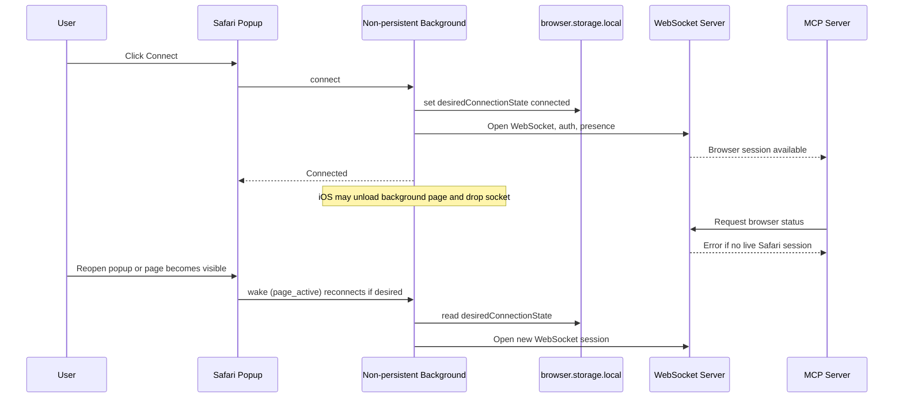
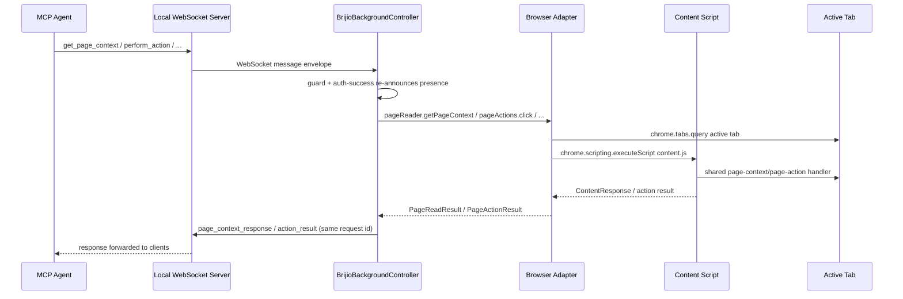

# Browser Extensions Domain

The Brijio browser extensions connect an AI agent to the browser session the
user already controls. Chrome is the first implementation; Safari is a parallel
implementation that reuses the shared extension package through thin adapters.
Firefox is a placeholder only (a reserved boundary, not implemented).

The extensions are **reactive**: they open a WebSocket only after an explicit user
action, authenticate with the local pairing token, announce browser presence, and
answer explicit MCP-originated requests. They never stream page content
continuously or publish ambient browser state.

> See [Shared Package](../architecture/shared-package.md) for the
> browser-agnostic controller, protocol, and DOM extraction logic that both
> extensions wrap. See [MCP Extension Flow](../architecture/mcp-extension-flow.md)
> for the end-to-end request path through the local WebSocket server.

## Adapter shape

Both extensions share one architecture: browser-specific source wires platform
APIs into adapter interfaces owned by `@brijio/shared`. The shared
`BrijioBackgroundController` depends on injected adapters (`StorageAdapter`,
`ActionAdapter`, `PageReaderAdapter`, `PageActionAdapter`, `PageBatchAdapter`,
`PageNavigationAdapter`, `PageOpenTabAdapter`, `DownloadAdapter`,
`ApprovalAdapter`, `TabListerAdapter`, `PageScreenshotAdapter`,
`SetupAdapter`, `TimersAdapter`) and contains no browser-API code. Each
extension contributes only the wiring plus a `BrijioSocket` implementation.

```text
@brijio/shared
  protocol.ts               WebSocket envelope types, request/response types, guards
  background-controller.ts  Adapter-driven controller (no browser API)
  page-context.ts           Pure DOM page-context extraction
  page-content.ts           Pure DOM page-content chunking
  content-handler.ts        Content-script request handler
  batch-handler.ts          Batch action execution
  timers.ts                 createGlobalTimers factory

clients/extensions/chrome/src/
  background.ts             chrome.* adapter wiring + BrijioBackgroundController
  content-script-entry.ts   runtime listener + delegation to shared handlers
  permissions.ts           minimal permission helpers
  popup.ts                 Chrome runtime message helpers

clients/extensions/safari/src/
  background.ts             browser.* adapter classes (SafariActionBadge, ...)
  background-entry.ts       Wires controller to browser.* APIs + reconnect-on-wake
  content-script-entry.ts   runtime listener + page-activity messages
  permissions.ts            Safari permission helpers (always-true)
  popup.ts / popup-entry.ts popup message construction and DOM wiring
```

The guiding change rule is: **keep adapters thin and shared behavior shared.**
When changing a browser capability, follow the full path shared -> adapter ->
integration tests, update both Chrome and Safari for shared behavior, and
document/test intentional platform differences.

## Chrome extension (MV3)

### Manifest

`clients/extensions/chrome/manifest.json` is Manifest V3 with a module
service-worker background:

- `"background": { "service_worker": "background.js", "type": "module" }`
- `"action.default_popup": "popup.html"`
- `minimum_chrome_version: "116"`
- Permissions: `activeTab`, `scripting`, `storage`, `tabs`, `downloads`
- Host permissions: `http://*/*`, `https://*/*` (granted at install time)

### Permissions and rationale

`permissions.ts` documents the minimal permission set and why each is needed:

| Permission                  | Why                                                                                          |
| --------------------------- | -------------------------------------------------------------------------------------------- |
| `activeTab`                 | Temporary access to the active page after the user starts the bridge from the toolbar.       |
| `scripting`                 | Inject the content script on demand for explicit page-context/page-content requests.         |
| `storage`                   | Remember the user-entered WebSocket URL, pairing token, and browser identity fields.         |
| `tabs`                      | Read the active tab URL/title and send messages to the active tab.                           |
| `downloads`                 | `download_status` / `download_file` capabilities (Chrome has a native downloads API).        |
| `http://*/*`, `https://*/*` | Read regular HTTP/HTTPS pages without a runtime permission prompt (granted at install time). |

Because broad host permission is granted at install time, Chrome's
`hasRegularPageAccess()` always returns `true`; `isRegularPageUrl()` only filters
to `http://`/`https://` and rejects internal/extension/file schemes.

### Background (`background.ts`)

`background.ts` instantiates a single `BrijioBackgroundController`, wiring
Chrome-specific adapters:

- **Action adapter** — `chrome.action.setBadgeText/setBadgeBackgroundColor/setBadgeTextColor/setTitle`.
- **WebSocket** — `DomWebSocketAdapter` wraps the DOM `WebSocket`, forwarding
  `onopen/onmessage/onclose/onerror` to the controller's `BrijioSocket`.
- **Storage** — `chrome.storage.local` for the six bridge-settings keys
  (`websocketUrl`, `pairingToken`, `browserInstanceId`, `browserName`,
  `profileName`, `label`), normalized via `normalizeBridgeSettings(values, 'Chrome')`.
- **Page reader / actions / batch / navigation / open-tab / screenshot** — each
  delegates to shared helpers (`sharedReadActiveTabPage`,
  `sharedPerformActiveTabAction`, `sharedPerformActiveTabBatch`,
  `navigateActiveTabToUrl`, `chrome.tabs.captureVisibleTab`).
- **Downloads** — a `DownloadAdapter` using `chrome.downloads.search/download`
  plus a `fetchResource` that uses `fetch` with credentials and returns base64 +
  SHA-256.
- **Approval adapter** — `createChromeApprovalAdapter` injects `content.js` into
  the active tab and sends `show_brijio_approval` / `hide_brijio_approval`.
- **Setup** — opens `popup.html` via `chrome.tabs.create` when settings are
  unusable.
- **Tab lister** — `chrome.tabs.query({})` filtered to regular-page URLs.

A `createMessageHandler(ctrl)` factory produces the `chrome.runtime.onMessage`
listener for popup messages (`get_settings`, `save_settings`, `get_status`,
`connect`, `disconnect`). It is registered only when `chrome.runtime.onMessage`
exists, so unit tests can import `background.ts` without a chrome runtime.

### Content script (`content-script-entry.ts`)

The Chrome content script registers one `chrome.runtime.onMessage` listener and
delegates to shared handlers (`handleContentRequest`, `executeBatch`,
`registerPageNavigationListener`). It is idempotent: a previous listener is
tracked on `globalThis.__brijioOnMessageListener` and removed before adding the
new one, so repeated `executeScript` re-injections do not stack listeners.

It also renders in-page UI banners delegated from the background via tab
messages:

- `show_brijio_approval` / `hide_brijio_approval` — an approval dialog
  (`approve` / `approve_session` / `deny`) used by approval-gated actions
  (`submit_form`, `fetch_resource`, `download_file`).
- `show_brijio_tab_indicator` / `hide_brijio_tab_indicator` — a "Brijio is
  active on this tab" banner plus a `● ` title prefix with a `MutationObserver`
  to re-apply the prefix, and a 60s inactivity timeout that auto-hides.

### Popup (`popup.ts`)

`popup.ts` is intentionally tiny: it re-exports shared message creators/parsers
(`createGetSettingsMessage`, `createSaveSettingsMessage`,
`createConnectMessage`, `createDisconnectMessage`, `createGetStatusMessage`,
`parseSettingsResponse`, `parseStatusResponse`, `parseErrorResponse`) and adds
only the Chrome `ChromeRuntime` interface and a Promise-based `sendMessage`
wrapper over `chrome.runtime.sendMessage`. `popup.html` provides the connection
UI and settings (WebSocket URL, pairing token, profile name, label).

## Safari extension (MV2)

### Manifest differences from Chrome

Safari uses Manifest V2 with platform-specific persistence:

| Aspect           | Chrome                            | Safari                                                                |
| ---------------- | --------------------------------- | --------------------------------------------------------------------- |
| Manifest version | 3                                 | 2                                                                     |
| Background       | `service_worker` (module)         | `scripts: ["background.js"]`, `"persistent": false` (iOS-safe source) |
| Action           | `action`                          | `browser_action`                                                      |
| Badge            | text + background/text color      | text only (no color API)                                              |
| Host permissions | `host_permissions` (install time) | `*://*/*` declared as a required permission                           |
| Content scripts  | injected on demand                | declared in `content_scripts` matching `http://*/*`/`https://*/*`     |
| Namespace        | `chrome.*`                        | `browser.*`                                                           |

Safari has no runtime permission prompts, so broad host access is granted when
the user installs/enables the extension. `permissions.ts` therefore makes
`hasRegularPageAccess()` and `requestRegularPageAccess()` always return `true`;
`isRegularPageUrl()` still restricts to `http(s)://`.

### Platform-specific builds (ADR 0051)

The checked-in source manifest is iOS-safe (`"persistent": false`). A build
script generates platform-specific manifests so desktop and iOS can diverge
intentionally:

- `clients/extensions/safari/dist-ios/` — `"persistent": false` (iOS/iPadOS,
  App Store compatible).
- `clients/extensions/safari/dist-macos/` — `"persistent": true` (stable
  desktop WebSocket bridge).

`make safari-ios` / `make safari-macos` / `make safari` build the matching
output and run `xcrun safari-web-extension-converter --ios-only` /
`--macos-only` to produce Xcode projects.

### Background (`background.ts` + `background-entry.ts`)

`background.ts` defines the Safari adapter classes:

- `SafariActionBadge` — `setBadgeText`/`setTitle` work; `setBadgeColor` /
  `setBadgeTextColor` are **no-ops** because Safari only supports text badges
  (`ON` / `OFF` / `ERR`).
- `SafariStorageAdapter` — `browser.storage.local` for bridge settings.
- `SafariSetupAdapter` — `openSetupPage()` is a no-op (Safari uses the popup).
- `SafariPageReaderAdapter` — delegates to `sharedReadActiveTabPage` with
  `onCatchPermissionCheck: hasRegularPageAccess`.
- `SafariDownloadAdapter` — downloads are **fire-and-forget** via
  `browser.tabs.create({ url })` because Safari has no downloads API;
  `downloadStatus` reports `capability: 'not_supported'`.
- `SafariPageNavigationAdapter` — `browser.tabs.update` wrapped in a 10s
  timeout so restricted pages do not hang the MCP client.
- `SafariWebSocketConnection` — a `BrijioSocket` that opens the `WebSocket` in
  `connect()` and applies listeners lazily; `disconnect()` clears the socket
  reference.
- `createSafariApprovalAdapter` — same content-script approval flow as Chrome
  but via `browser.*`.
- `tabLister` — `browser.tabs.query({})` filtered to regular URLs.

`background-entry.ts` instantiates the controller with these adapters and
registers the `browser.browserAction.onClicked` and `browser.runtime.onMessage`
listeners. The message handler mirrors Chrome's (`get_settings`, `save_settings`,
`connect`, `disconnect`, `get_status`) plus a Safari-only `brijio_page_active`
message handled by `reconnectIfDesired()`.

### Reconnect on wake (ADR 0050 / ADR 0052)

Because iOS Safari may unload the non-persistent background page and drop the
WebSocket, Safari persists **desired connection state**:

- `connect` stores `desiredConnectionState: "connected"` before calling
  `controller.requestConnect()`.
- `disconnect` stores `desiredConnectionState: "disconnected"` before calling
  `controller.requestDisconnect()`.

On background startup, `reconnectIfDesired()` reads the desired state and saved
settings; if the user previously chose Connect and settings are usable, it
reconnects silently. Disconnect remains explicit and durable (no reconnect when
the desired state is disconnected). This is best-effort: it only reconnects when
Safari gives the extension runtime another event, not while iOS has unloaded
extension JavaScript.

Safari content scripts additionally send a lightweight `brijio_page_active`
message on `pageshow`, `focus`, and `visibilitychange` (when the document
becomes visible), giving the background page another event-driven chance to
reconnect. These are wake hints, not a guarantee the background stays alive.



_Figure: Safari non-persistent background reconnect-on-wake lifecycle (ADR 0050 / ADR 0052)._

## Background request handling

Both extensions route the same flow through the shared controller. The
controller owns the WebSocket, connection-state machine, keepalive, presence,
and per-request dispatch. Adapter differences (Chrome `chrome.*` vs Safari
`browser.*`, color badges vs text badges, real downloads vs fire-and-forget) are
encapsulated behind the adapter interfaces.



_Figure: Extension background request handling shared by Chrome and Safari; auth and presence are handled in the controller, page work is delegated through adapters and the content script._

### Connection lifecycle and keepalive

On `socket.onopen`, the controller sends the auth envelope and starts a 20s
keepalive interval emitting `extension_keepalive` messages that carry **no
browser state**. Presence (sent after auth success and on
`browser_presence_request`) contains only `browserInstanceId`, `label`,
`browserName`, `profileName`, and capability names — never URL, title, content,
selected text, or DOM state.

On `onclose`/`onerror`, if the disconnect was not manual, the controller
schedules exponential backoff reconnect (1s initial, 2x multiplier, 30s cap,
with jitter). Manual disconnect cancels reconnect and stops keepalive. The
controller tracks `pendingRequestCount` so `getConnectionStatus()` reports
in-flight requests.

### Approval-gated actions

`submit_form`, `fetch_resource`, and `download_file` require user approval
before executing. The controller calls the `ApprovalAdapter`, which (in both
extensions) injects the content script into the active tab and shows the
approval banner. Decisions are `approve`, `approve_session` (session-scoped
grant cached in `approvalSessionGrants`), or `deny`. A denied or timed-out
action returns an `action_result` error without performing the action.

## Firefox

Firefox is **not implemented**. `clients/extensions/firefox/README.md` reserves
the client boundary only; packaging, permissions, and user-control behavior are
deferred to a separate ADR.

## Testing

- Chrome: `pnpm --filter @brijio/chrome-extension test` / `check` — adapter
  wiring, message handler, navigation timeout, downloads, content-script
  listener idempotency.
- Safari: `pnpm --filter @brijio/safari-extension test` — adapter classes,
  permission logic, popup messages, platform manifest generation, and
  reconnect-on-wake behavior. Shared controller, content handler, and
  extraction logic are tested in `@brijio/shared` (`background-controller.test.ts`).

Build outputs: Chrome loads `clients/extensions/chrome/dist` via "Load
unpacked"; Safari builds `dist-ios` / `dist-macos` and converts them to Xcode
projects with the Makefile targets.
