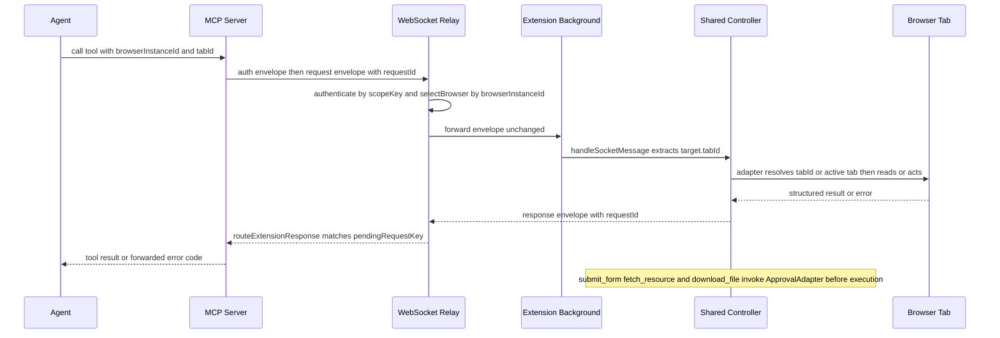

# MCP to WebSocket to Extension Flow

Brijio never lets an agent talk to the browser directly. Every request travels
a fixed hop sequence:

```
Agent -> MCP Server -> WebSocket Relay -> Extension Background -> Shared Controller -> Browser Tab
```

The response retraces the same path in reverse, carrying a structured result or
a forwarded error code. This page traces one request end to end, identifies the
canonical source file for each hop, and notes the invariants you must preserve
when editing this area.

## Canonical source files by hop

| Hop                           | Canonical file                                                                                                                                                                                                                                                 | Responsibility                                                                                                                                       |
| ----------------------------- | -------------------------------------------------------------------------------------------------------------------------------------------------------------------------------------------------------------------------------------------------------------- | ---------------------------------------------------------------------------------------------------------------------------------------------------- |
| MCP tool surface              | `servers/mcp/src/mcp-server.ts`                                                                                                                                                                                                                                | Registers every tool, validates input schemas, and calls the per-tool handlers.                                                                      |
| MCP tool wrappers             | `servers/mcp/src/click-element-tool.ts`, `fill-input-tool.ts`, `form-action-tools.ts`, `page-reading-tool.ts`, `navigate-to-url-tool.ts`, `open-tab-tool.ts`, `batch-tool.ts`, `download-file-tool.ts`, `fetch-resource-tool.ts`, `capture-screenshot-tool.ts` | Normalize tool input (including `browserInstanceId`/`tabId`) and call into `page-actions.ts`/`page-context.ts`.                                      |
| MCP request dispatch          | `servers/mcp/src/page-actions.ts`, `page-context.ts`                                                                                                                                                                                                           | Build the `BrijioPageActionsConfig`/`BrijioPageContextConfig`, resolve env-derived timeouts, and delegate to the websocket-client request functions. |
| MCP WebSocket client          | `servers/mcp/src/websocket-client.ts`                                                                                                                                                                                                                          | Authenticates, mints a `requestId`, stamps the `target` envelope, awaits the matching reply, and enforces the timeout.                               |
| MCP protocol envelopes        | `servers/mcp/src/protocol.ts`                                                                                                                                                                                                                                  | Builds and parses Brijio envelopes, forwards error codes (ADR 0061).                                                                                 |
| WebSocket relay               | `servers/websocket/src/server.ts`                                                                                                                                                                                                                              | Authenticates by pairing token, maintains presence, routes by `scopeKey` + `browserInstanceId`, and matches pending request IDs.                     |
| Relay protocol                | `servers/websocket/src/protocol.ts`                                                                                                                                                                                                                            | Re-exports shared envelope helpers and computes the `scopeKey`.                                                                                      |
| Extension background (Chrome) | `clients/extensions/chrome/src/background.ts`                                                                                                                                                                                                                  | Wires the shared controller to `chrome.*` adapters, `navigateActiveTabToUrl`, and the approval adapter.                                              |
| Extension background (Safari) | `clients/extensions/safari/src/background.ts`                                                                                                                                                                                                                  | Same role against the `browser.*` namespace (ADR 0019/0051).                                                                                         |
| Shared background controller  | `packages/shared/src/background-controller.ts`                                                                                                                                                                                                                 | `BrijioBackgroundController` dispatches each incoming envelope to the right adapter, threads `tabId`, and runs the approval gate.                    |
| Shared page reader            | `packages/shared/src/page-reader.ts`                                                                                                                                                                                                                           | Resolves a tab by `tabId` (or active-tab fallback) and runs content-script reads/actions.                                                            |
| Shared protocol               | `packages/shared/src/protocol.ts`                                                                                                                                                                                                                              | Canonical envelope/error/payload types shared by relay, MCP, and extension.                                                                          |

## End-to-end trace

1. **MCP tool builds a protocol envelope.** The agent calls a tool registered in
   `createBrijioMcpServer` (`servers/mcp/src/mcp-server.ts`). Every action tool
   accepts optional `browserInstanceId` and `tabId` inputs. The handler (for
   example `clickElement` in `click-element-tool.ts`) normalizes input, then
   calls `clickCurrentPageElement` in `page-actions.ts`, which calls
   `requestClickElement` in `websocket-client.ts`.
2. **MCP websocket-client sends it.** `requestBrijio` opens a short-lived
   WebSocket to the relay, sends an auth envelope, waits for `auth_success`, then
   sends the tool envelope stamped with a `target` carrying
   `browserInstanceId`/`tabId` (`targetEnvelope` in `websocket-client.ts`). Each
   request gets a unique `requestId` of the form `mcp-<timestamp>-<random>`.
3. **Relay authenticates and routes.** The relay (`servers/websocket/src/server.ts`)
   authenticates the pairing token and derives a `scopeKey`
   (`createScopeKey`, a SHA-256 of the token). Extension sockets announce
   browser presence, stored in a per-`scopeKey` presence map. On an MCP request
   the relay calls `selectBrowser` over presence records for the same
   `scopeKey`, using `message.target.browserInstanceId` to pick a specific
   browser or failing with `ambiguous_browser_target`/`browser_unavailable` when
   ambiguous or absent. The relay records the MCP socket under
   `pendingRequestKey(scopeKey, message.id)` and forwards the envelope
   unchanged to the chosen extension socket.
4. **Extension background hands to the shared controller.** The Chrome/Safari
   background script owns a single `BrijioBackgroundController`
   (`packages/shared/src/background-controller.ts`). `handleSocketMessage`
   parses the envelope, extracts `tabId` via `extractTabId` (reads
   `message.target.tabId`, parses to a number), and dispatches to the matching
   handler (`handlePageContextRequest`, `handlePerformActionRequest`,
   `handleNavigateToUrlRequest`, `handlePerformBatchRequest`, etc.). Each
   handler carries `tabId` down to its adapter.
5. **Adapter performs the tab work.** Page reads/actions route through
   `page-reader.ts` (`readActiveTabPage`/`performActiveTabAction`/
   `performActiveTabBatch`), which resolves the target tab: when `tabId` is
   provided it uses it directly, otherwise it queries the active tab as a
   backward-compatible fallback. Navigation goes through
   `navigateActiveTabToUrl` in `background.ts`, which uses `chrome.tabs.update`
   on the resolved tab id. The content script does the DOM work and returns a
   structured result.
6. **Structured result relays back.** The controller serializes the result
   (or error envelope) back over its socket. The relay's
   `routeExtensionResponse` matches the extension reply by
   `pendingRequestKey(scopeKey, message.id)`, deletes the pending entry, and
   forwards the message to the original MCP socket. The MCP websocket-client's
   `parseEnvelope` validates the reply against the `requestId` and resolves
   the tool call. If no reply arrives within the timeout, `requestBrijio`
   resolves with a `timeout` result.



_Caption: One request traveling Agent to MCP Server to WebSocket Relay to Extension Background to Shared Controller to Browser Tab and back, with the approval-gated branch called out._

## Tab targeting and active-tab fallback

`tabId` is threaded the full length of the stack (ADR 0062):

- **MCP input.** Tool schemas declare an optional `tabId`
  (`servers/mcp/src/mcp-server.ts`). Tool wrappers normalize it
  (`normalizeTabId`) and pass it through `page-actions.ts`/`page-context.ts` to
  the websocket-client request options.
- **Envelope target.** `targetEnvelope` (`servers/mcp/src/websocket-client.ts`)
  sets `target.tabId` (and `target.browserInstanceId`) on the outgoing
  envelope only when provided, leaving the envelope unchanged otherwise.
- **Relay.** The relay forwards `target` verbatim; it routes only on
  `browserInstanceId`, not `tabId`.
- **Controller.** `extractTabId` (`packages/shared/src/background-controller.ts`)
  reads `message.target.tabId` as a string, parses it to a number, and returns
  `undefined` when absent. `handleSocketMessage` passes that `tabId` to every
  read/action/batch/navigation handler and into the adapter interfaces
  (`PageReaderAdapter`, `PageActionAdapter`, `PageBatchAdapter`,
  `PageNavigationAdapter` all accept an optional `tabId`).
- **Page reader.** `readActiveTabPage`/`performActiveTabAction`/
  `performActiveTabBatch` (`packages/shared/src/page-reader.ts`) use the
  provided `tabId` directly and skip the active-tab query; when `tabId` is
  absent they fall back to `chrome.tabs.query({ active: true, currentWindow: true })`.
- **Navigation.** `navigateActiveTabToUrl` (`clients/extensions/chrome/src/background.ts`)
  uses the provided `tabId` for `chrome.tabs.update`, with the same active-tab
  fallback.

When `tabId` is omitted the system remains backward compatible and operates on
the active tab. See [Multi-tab workflow](../workflows/multi-tab.md) for the
agent-facing usage pattern.

## Request IDs and pending-request matching

Every request carries a `requestId` that ties the response back to the caller:

- **MCP side.** `createRequestId()` in `websocket-client.ts` mints
  `mcp-<timestamp>-<random>`. The same id is embedded in the envelope and used
  by `parseEnvelope` to reject mismatched replies.
- **Relay side.** On forwarding, the relay stores the MCP socket under
  `pendingRequestKey(scopeKey, message.id)` (`servers/websocket/src/server.ts`).
  `routeExtensionResponse` looks up that key for the extension's reply, deletes
  the entry, and forwards the message to the stored MCP socket. On socket close,
  `cleanupPendingRequestsForSocket` removes any pending entries owned by that
  socket so requests do not hang.
- **Controller side.** Handlers echo the incoming `message.id` into the
  response envelope so the relay can route it back.

## Timeouts

The MCP-side timeout is governed by `BRIJIO_REQUEST_TIMEOUT_MS` (with the
legacy `BROWSERBRIDGE_REQUEST_TIMEOUT_MS` honored as a renamed alias).
`getPageContextConfigFromEnv` (`servers/mcp/src/page-context.ts`) parses it via
`parseTimeoutMs`, defaulting to `5000` ms when unset or invalid. This `timeoutMs`
flows into every `BrijioPageContextConfig`/`BrijioPageActionsConfig` and into
each websocket-client request.

`requestBrijio` (`servers/mcp/src/websocket-client.ts`) starts a
`setTimeout(..., options.timeoutMs)` when the socket opens. If the matching
reply does not arrive in time it resolves with `timeoutResponse(...)` and
closes the socket. Approval-gated tools (`download_file`, `fetch_resource`, and
`submit_form`/`upload_file` inside `perform_batch`) use
`options.approvalTimeoutMs ?? options.timeoutMs`, so user-approval wait time is
not charged against the normal request budget.

Two additional timeouts live on the extension side: the content-script message
timeout (`DEFAULT_CONTENT_SCRIPT_MESSAGE_TIMEOUT_MS = 4000` in `page-reader.ts`)
and the navigation timeout (`NAVIGATION_TIMEOUT_MS = 10000` in
`navigateActiveTabToUrl`). The shared controller's approval timeout defaults to
`55000` ms (`approvalTimeoutMs`).

## Approval gating

`submit_form`, `fetch_resource`, and `download_file` are approval-gated
actions. The MCP websocket-client attaches approval metadata
(`createApprovalRequestOptions` — an `actionUUID` and `approvalRequest: true`)
to those requests before sending. On the extension side the controller's
`ensureApprovedAction` (`packages/shared/src/background-controller.ts`) checks
an `ApprovalAdapter` (provided by Chrome/Safari `createChromeApprovalAdapter`/
`createSafariApprovalAdapter`): it resolves the active-tab origin, consults a
per-session grant set (`approvalSessionGrants` keyed by
`origin\u0000actionType`), and otherwise calls `requestApproval`, which injects
a content-script approval banner and waits for `approve`/`approve_session`/
`deny`. Decisions resolve to `approval_denied`, `approval_timeout`, or
`approval_origin_changed` errors that flow back to the agent. In `perform_batch`
an approval timeout aborts the batch and skips remaining actions with
`approval_timeout`. See [Action approval](../workflows/action-approval.md).

## Error code forwarding (ADR 0061)

Errors flow back through the same chain and preserve their original code and
message rather than being flattened:

- **Router-level errors** come from the relay as `{ type: 'error', error: { code, message } }`.
  `parseRouterErrorEnvelope` (`servers/mcp/src/protocol.ts`) forwards any string
  `code` (for example `invalid_message`, `invalid_json`,
  `browser_unavailable`, `ambiguous_browser_target`) instead of replacing
  unknown codes with `invalid_response`. It only falls back to `invalid_response`
  when the envelope structure itself is malformed.
- **Action-level errors** come from the extension inside an `action_result`.
  `parseErrorPayload` preserves `stale_context` and `page_navigated` with their
  structured `detail`, and forwards every other string code (for example
  `not_supported`, `cors_blocked`, `http_error`, `size_exceeded`, `timeout`,
  `network_error`) instead of wrapping it as `browser_error`.
- **Connection-level errors** are produced locally by the websocket-client:
  `authRequiredResponse` for an empty pairing token,
  `connectionFailedResponse` for socket error/close, `timeoutResponse` for the
  timeout, and `invalidResponse` for malformed replies.

The relay emits its own error envelopes via `createErrorEnvelope`
(`packages/shared/src/protocol.ts`) using the shared `BrijioErrorCode` union;
the MCP server treats `code` as an open `string` so it never needs a parallel
union that must stay in sync.

## What to watch when editing this area

- **Tool input changes require protocol + background controller together.**
  Adding or renaming a tool input means updating the schema in `mcp-server.ts`,
  the wrapper's `normalizeInput`, the `page-actions.ts`/`page-context.ts`
  request options, the websocket-client `*RequestOptions`, and the
  background-controller adapter interfaces. The `tabId` thread is a worked
  example (ADR 0062).
- **Adapters must stay in sync with shared page-reader behavior.** Both
  Chrome and Safari background scripts must pass `tabId` through to
  `readActiveTabPage`/`performActiveTabAction`/`performActiveTabBatch` and
  `navigateActiveTabToUrl`; otherwise a provided `tabId` silently degrades to
  the active tab.
- **Relay routing keys are scopeKey + browserInstanceId + requestId.** Any
  change to presence, `selectBrowser`, or `pendingRequestKey` affects routing
  correctness and must keep the extension reply's `message.id` matched to the
  original MCP request.
- **Approval metadata must round-trip.** `actionUUID` and `approvalRequest`
  are minted on the MCP side and consumed by `ensureApprovedAction`; dropping
  them turns an approval-gated action into an unguarded one.
- **Error forwarding is intentional.** Do not re-introduce `browser_error`
  wrapping or `invalidResponse()` for unrecognized router codes — the agent
  relies on specific codes to decide whether an error is permanent or
  transient (ADR 0061).

## Related docs

- [Extension adapters](extension-adapters.md)
- [MCP tool surface](mcp-tool-surface.md)
- [Data and protocol](../data-and-protocol.md)
- [Action approval](../workflows/action-approval.md)
- [Multi-tab workflow](../workflows/multi-tab.md)
