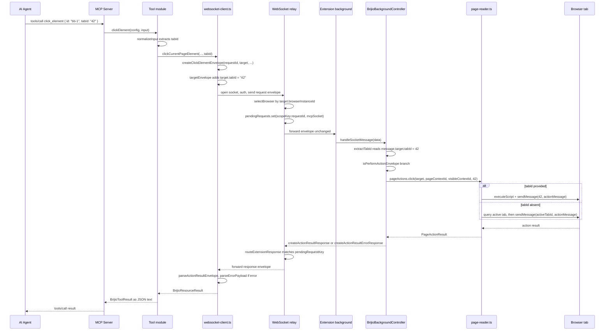

# MCP ↔ WebSocket ↔ Extension Flow

This page traces one agent request through the Brijio runtime chain — MCP tool
wrapper, WebSocket relay, extension background, shared background controller, and
browser adapter — and back to the agent. It covers the two cross-cutting behaviors
that shape the path: per-call `tabId` targeting ([ADR 0062](../../docs/architecture/decisions/0062-thread-tabid-through-action-stack.md))
and forwarded error codes ([ADR 0061](../../docs/architecture/decisions/0061-forward-error-codes-through-mcp.md)).

The overview of the whole chain, including presence setup and the four owned
components, lives in [Architecture Overview](../architecture.md). The protocol
envelope and presence shapes are defined in [Protocol and Data Model Guide](../data-and-protocol.md).
Per-tool behavior and the full tool catalog belong in
[Browser Actions](../workflows/browser-actions.md); the multi-tab workflow is in
[Multi-tab Workflow](../workflows/multi-tab.md).

## Components in the path

| Layer                        | File                                                             | Responsibility in this flow                                                              |
| ---------------------------- | ---------------------------------------------------------------- | ---------------------------------------------------------------------------------------- |
| MCP tool wrapper             | `servers/mcp/src/mcp-server.ts`                                  | Registers each tool, parses Zod input, calls a tool module                               |
| Tool module                  | `servers/mcp/src/*-tool.ts`                                      | Normalizes input (including `tabId`), calls `page-actions.ts` / `page-context.ts`        |
| Action/context helper        | `servers/mcp/src/page-actions.ts`, `page-context.ts`             | Builds WebSocket request options, calls the WS client                                    |
| WS client                    | `servers/mcp/src/websocket-client.ts`                            | Authenticates, builds the `target` envelope, sends, parses the response, forwards errors |
| Protocol                     | `servers/mcp/src/protocol.ts`, `packages/shared/src/protocol.ts` | Envelope shapes, builders, parsers, error forwarding                                     |
| WebSocket relay              | `servers/websocket/src/server.ts`                                | Authenticates connections, tracks presence, routes MCP→extension and extension→MCP       |
| Extension background         | `clients/extensions/{chrome,safari}/src/background.ts`           | Thin adapter that wires browser APIs into the shared controller                          |
| Shared controller            | `packages/shared/src/background-controller.ts`                   | Dispatches envelopes to handlers, threads `tabId`, sends responses                       |
| Page reader / action helpers | `packages/shared/src/page-reader.ts`                             | Resolves a tab (by `tabId` or active), injects content script, sends messages            |
| Browser adapter              | Chrome/Safari `tabs` / `scripting` APIs                          | Tab-level read, action, navigation                                                       |

## One request, end to end

The diagram traces a representative `click_element` call that carries a `tabId`,
through the WebSocket relay and the shared background controller, down to the
content script in the targeted tab, and back. The same path is used for reads,
batch actions, navigation, downloads, and screenshots; only the envelope payload
and dispatch branch differ.

_One request cycle: tool input normalization, target-envelope construction, relay routing by pending request id, tabId extraction, adapter dispatch, and structured return._

### MCP side: input to envelope

1. **Tool registration.** `createBrijioMcpServer` in `mcp-server.ts` registers each
   tool with a Zod input schema. A shared `tabIdInput` (`z.string().optional()`,
   described as "Optional Brijio tab ID to target") is added to every tool that can
   target a tab. The handler calls the corresponding tool module, e.g. `clickElement`,
   `readCurrentPage`, `navigateToUrl`, `performBatchTool` ([mcp-server.ts](../../servers/mcp/src/mcp-server.ts)).

2. **Input normalization.** Each tool module (`click-element-tool.ts`,
   `page-reading-tool.ts`, `form-action-tools.ts`, `batch-tool.ts`, …) calls
   `normalizeTabId(input.tabId)` to validate the optional `tabId` and passes it as
   the final argument to the `page-actions.ts` / `page-context.ts` helper. A few
   tools deliberately do not thread `tabId`: `navigate-to-url-tool.ts` validates
   `tabId` in input but currently forwards only `browserInstanceId` to
   `navigateToCurrentPageUrl`, and `open-tab-tool.ts` opens a brand-new tab so it
   carries no `tabId` ([click-element-tool.ts](../../servers/mcp/src/click-element-tool.ts),
   [navigate-to-url-tool.ts](../../servers/mcp/src/navigate-to-url-tool.ts),
   [open-tab-tool.ts](../../servers/mcp/src/open-tab-tool.ts)).

3. **Request options.** `page-actions.ts` and `page-context.ts` build the options
   object that the WS client consumes, resolving `tabId` from the call argument or
   `config.defaultTabId` ([page-actions.ts](../../servers/mcp/src/page-actions.ts)).

4. **Envelope and target.** `requestBrijio` in `websocket-client.ts` opens a fresh
   WebSocket, authenticates with the pairing token, and after `auth_success` sends
   the request via `targetEnvelope(options)`. `targetEnvelope` only attaches a
   `target` object when `browserInstanceId` or `tabId` is present; otherwise it
   returns the bare request envelope. Each `requestX` helper passes a typed
   `createXEnvelope(requestId, …)` builder and a matching `parseXEnvelope(value,
requestId)` parser to `requestBrijio`
   ([websocket-client.ts](../../servers/mcp/src/websocket-client.ts)).

### WebSocket relay: routing only

The WebSocket server (`servers/websocket/src/server.ts`) is a stateful in-memory
relay, not a protocol transformer. After authenticating a connection it stores a
`scopeKey` (SHA-256 of the pairing token) and, for extensions, a presence record.

- **MCP → extension.** `handleMcpMessage` resolves the target browser with
  `selectBrowser` (by `message.target?.browserInstanceId`, or the single online
  browser, else `browser_unavailable` / `ambiguous_browser_target`). It records the
  MCP socket under `pendingRequestKey(scopeKey, message.id)`, then forwards the
  **whole envelope unchanged** to the selected extension socket. The envelope's
  `target` (including `tabId`) is preserved verbatim. `list_browsers` is the one
  exception: the server answers it directly from its presence table instead of
  forwarding ([server.ts](../../servers/websocket/src/server.ts)).
- **Extension → MCP.** `handleExtensionMessage` routes presence announces and
  keepalives locally. Any other message with a matching `id` is handed to
  `routeExtensionResponse`, which looks up the pending MCP socket by
  `pendingRequestKey`, deletes the entry, and forwards the response envelope. If
  the extension sends an unrecognized message, the relay replies with an
  `invalid_message` error envelope.
- **Cleanup.** On socket close, `cleanupPendingRequestsForSocket` removes any
  pending entries owned by that socket so a disconnected MCP client does not leak
  pending slots.

### Extension side: dispatch and adapter

The extension background (`clients/extensions/chrome/src/background.ts` and
`clients/extensions/safari/src/background.ts`) constructs a
`BrijioBackgroundController` with browser-specific adapters and owns the single
long-lived WebSocket to the relay.

1. **Message dispatch.** `BrijioBackgroundController.handleSocketMessage` parses
   the envelope and immediately calls `extractTabId(message)`, which reads
   `message.target.tabId`, parses it to a number, and returns `undefined` when
   absent. It then branches on the payload type — `isGetPageContextEnvelope`,
   `isPerformActionEnvelope`, `isPerformBatchEnvelope`, `isNavigateToUrlEnvelope`,
   `isListTabsEnvelope`, `isDownloadStatusEnvelope`, `isDownloadFileEnvelope`,
   `isFetchResourceEnvelope`, `isCaptureScreenshotEnvelope`, … — and forwards the
   extracted `tabId` to the matching handler
   ([background-controller.ts](../../packages/shared/src/background-controller.ts)).
   Each handler increments `pendingRequestCount` for the duration of the work and
   sends the result envelope back over the same socket.

2. **Adapter call.** Handlers call the injected adapter interfaces, all of which
   accept an optional `tabId?: number`:
   `pageReader.getPageContext(tabId)` / `getPageContent(index, tabId)`,
   `pageActions.click/writeText/setChecked/selectOptions/submitForm/uploadFile(…,
tabId)`, `pageBatch.performBatch(message, tabId)`,
   `pageNavigation.navigateToUrl(url, tabId)`. The Chrome and Safari backgrounds
   implement these by delegating to the shared `page-reader.ts` helpers and to
   `navigateActiveTabToUrl`/`SafariPageNavigationAdapter`, forwarding `tabId`
   through ([chrome background.ts](../../clients/extensions/chrome/src/background.ts),
   [safari background.ts](../../clients/extensions/safari/src/background.ts)).

3. **Tab resolution and content-script work.** `readActiveTabPage`,
   `performActiveTabAction`, and `performActiveTabBatch` in `page-reader.ts`
   resolve the target tab: when `tabId` is provided they use it directly; when it
   is absent they query the active foreground tab (`tabs.query({ active: true,
currentWindow: true })`). They re-inject `content.js` via `executeScript` (per
   ADR 0043's listener-replacement mechanism), show the tab indicator, then
   `tabs.sendMessage(resolvedTabId, message)` and await a content-script response.
   Action results map the response into `PageActionResult`; batch results fall back
   to single-action execution when the content script returns an unexpected shape
   ([page-reader.ts](../../packages/shared/src/page-reader.ts)).

4. **Response.** Each controller handler serializes the adapter result with the
   matching `createXResponse` / `createXErrorResponse` builder and sends it back
   over the socket. The relay routes it to the pending MCP socket; the WS client
   parses it and resolves the tool call.

## Tab targeting

Per-call `tabId` threading (ADR 0062) makes multi-tab behavior explicit instead of
a silent no-op. The thread of custody is:

- **MCP input** → tool module normalizes `tabId` and passes it to the helper.
- **WS client** → `targetEnvelope` places `tabId` in `envelope.target.tabId` as a
  string; the relay forwards `target` unchanged.
- **Background controller** → `extractTabId` reads `target.tabId` and parses it
  to a number for the adapter calls; `undefined` means "use the active tab".
- **Shared helpers** → `readActiveTabPage`/`performActiveTabAction`/
  `performActiveTabBatch` use the numeric `tabId` directly when present, else
  query the active tab. Navigation adapters (`navigateActiveTabToUrl` in Chrome,
  `SafariPageNavigationAdapter.navigateToUrl` in Safari) do the same before
  calling `tabs.update`.

**Active-tab fallback is the backward-compatibility invariant.** When `tabId` is
omitted, every layer falls back to the foreground tab, so all existing callers
that omit `tabId` continue to work unchanged. `open_tab` is intentionally exempt:
it creates a new tab and returns its `tabId` for subsequent targeting. See
[Multi-tab Workflow](../workflows/multi-tab.md) for the agent-facing workflow.

A notable gap to watch when editing: the shared `page-reader.ts` functions accept
`tabId` and use it directly as the numeric target, but they do **not** call a
`tabs.get(tabId)` to validate the tab before messaging it — there is no `get` on
the `TabsApi` interface. A stale or non-existent `tabId` will surface as a
content-script / sendMessage failure rather than a dedicated "tab not found"
error.

## Error forwarding

ADR 0061 changed the MCP server from flattening errors to generic codes to
forwarding the original code and message from the relay and the extension. Two
functions implement the policy in `servers/mcp/src/protocol.ts`:

- **Router-level errors — `parseRouterErrorEnvelope`.** When the WS server sends a
  `{ type: 'error', error: { code, message } }` envelope, the parser checks the
  envelope _structure_ (must be an `error` type with a string `message`). If the
  structure is valid it forwards any string `code` as-is — including codes the
  MCP server's local `BrijioErrorCode` union does not know (e.g. `invalid_message`,
  `invalid_json`). It only falls back to `invalid_response` when the envelope
  itself is malformed (missing `error` object or missing `message`). This replaces
  the old behavior of returning `invalidResponse()` for any unrecognized code
  ([protocol.ts](../../servers/mcp/src/protocol.ts)).

- **Action-level errors — `parseErrorPayload`.** When the extension returns
  `{ ok: false, error: { code, message } }` inside an action result, the parser
  preserves `stale_context` and `page_navigated` with their structured `detail`
  (the agent relies on that detail). For every other code it forwards the original
  string `code` (e.g. `not_supported`, `cors_blocked`, `http_error`,
  `size_exceeded`) instead of wrapping as `browser_error`. Only a non-string code
  falls back to `browser_error`
  ([protocol.ts](../../servers/mcp/src/protocol.ts)).

- **Type relaxation.** `BrijioResourceResult<T>` and `BrijioToolResult<T>` use
  `code: string` (and `BrijioToolErrorCode = string`) rather than a closed union,
  so the result types can carry arbitrary forwarded codes. The MCP server no
  longer needs to keep a parallel `BrijioErrorCode` union in sync with the shared
  package.

The WS client applies this on every message: it runs `parseRouterErrorEnvelope`
first, and only if that returns `ignored` does it proceed to auth handling or the
tool-specific parser. This means a relay error short-circuits the response and the
agent sees the relay's real code and message.

Errors are returned to the agent inside the MCP `content` text field as JSON, not
as MCP-level `isError` flags — except `capture_screenshot`, which sets `isError:
true` on a failed capture so vision-capable clients can distinguish a missing
image from a successful one.

## Coordinated change surface

Because `tabId` (and tool inputs in general) cross every layer, a change to tool
inputs usually requires coordinated updates in three places:

1. **`servers/mcp/src/protocol.ts`** — envelope builders/parsers and the
   `WebSocketEnvelope.target` shape that carries `tabId`/`browserInstanceId`.
2. **The shared background controller** (`packages/shared/src/background-controller.ts`)
   — `extractTabId`, the dispatch branches, and the adapter interfaces
   (`PageReaderAdapter`, `PageActionAdapter`, `PageBatchAdapter`,
   `PageNavigationAdapter`) that accept `tabId`.
3. **Both extension adapters** (`clients/extensions/chrome/src/background.ts` and
   `clients/extensions/safari/src/background.ts`) — the adapter implementations and
   the Chrome/Safari `tabs`/`scripting` wrappers must forward the new parameter to
   the shared `page-reader.ts` helpers and to `navigateActiveTabToUrl` /
   `SafariPageNavigationAdapter`.

The shared `page-reader.ts` helpers are the convergence point: both adapters
delegate to them, so behavior stays consistent across browsers as long as the
adapter forwards `tabId` and the shared helper's tab-resolution logic is kept in
sync. If a tool should work on a background tab, it must accept `tabId` and must
not assume the active tab. The action-approval gate (see
[Client-Side Action Approval](action-approval.md)) is enforced inside the
background controller and is independent of `tabId` targeting — approval is
required for `submit_form`, `fetch_resource`, and `download_file` regardless of
which tab is targeted.

## Related docs

- [Architecture Overview](../architecture.md)
- [Client-Side Action Approval](action-approval.md)
- [Protocol and Data Model Guide](../data-and-protocol.md)
- [Multi-tab Workflow](../workflows/multi-tab.md)
- [Browser Actions](../workflows/browser-actions.md)
- [ADR 0061 — Forward error codes through MCP](../../docs/architecture/decisions/0061-forward-error-codes-through-mcp.md)
- [ADR 0062 — Thread tabId through the action stack](../../docs/architecture/decisions/0062-thread-tabid-through-action-stack.md)
