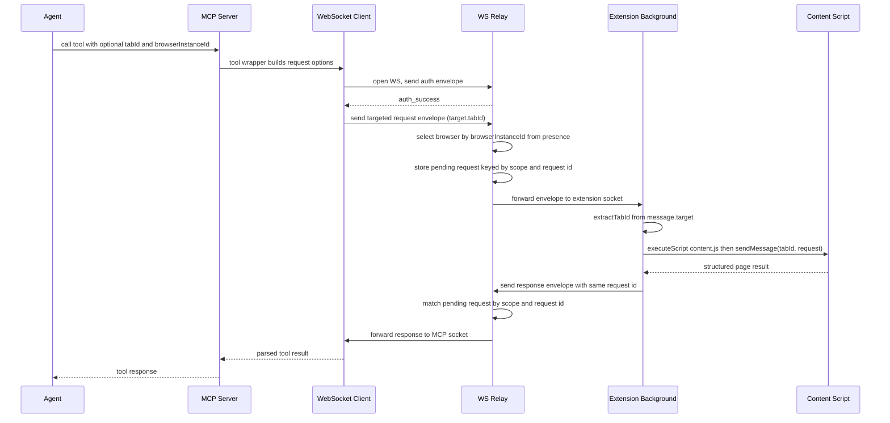

# MCP ↔ WebSocket ↔ Extension Flow

This page traces the runtime path Brijio uses to move an agent request from the
MCP server, through the WebSocket relay, into a browser tab, and back. The
path is request/response oriented: the MCP server opens a fresh WebSocket
connection per tool call, the relay forwards the request to one connected
extension session, the extension performs tab-level work via the shared
background controller and content script, and a structured result relays back.

## Canonical source files

MCP server (tool registration and per-tool wrappers):

- `servers/mcp/src/mcp-server.ts` — registers every MCP tool and resource, defines the shared `tabId`/`browserInstanceId` input schemas.
- `servers/mcp/src/page-context.ts` — page-context/page-content request config and env resolution.
- `servers/mcp/src/page-reading-tool.ts` — `read_current_page` wrapper.
- `servers/mcp/src/page-actions.ts` — shared config + thin action functions that call the WebSocket client.
- `servers/mcp/src/websocket-client.ts` — authenticates, builds the targeted envelope, waits for the response.
- `servers/mcp/src/click-element-tool.ts`
- `servers/mcp/src/fill-input-tool.ts`
- `servers/mcp/src/form-action-tools.ts` — `fill_editable`, `set_checked`, `select_options`, `submit_form`, `upload_file`.
- `servers/mcp/src/navigate-to-url-tool.ts`
- `servers/mcp/src/open-tab-tool.ts`
- `servers/mcp/src/list-tabs-tool.ts`
- `servers/mcp/src/batch-tool.ts`
- `servers/mcp/src/download-status-tool.ts`
- `servers/mcp/src/download-file-tool.ts`
- `servers/mcp/src/fetch-resource-tool.ts`
- `servers/mcp/src/capture-screenshot-tool.ts`
- `servers/mcp/src/protocol.ts` — envelope constructors/parsers for the MCP side.

WebSocket relay:

- `servers/websocket/src/server.ts` — auth, presence, browser selection, request forwarding, response routing.

Shared extension logic:

- `packages/shared/src/background-controller.ts` — `BrijioBackgroundController`: socket lifecycle, message dispatch, tabId extraction, approval gating.
- `packages/shared/src/page-reader.ts` — `readActiveTabPage` / `performActiveTabAction` / `performActiveTabBatch` with active-tab fallback.
- `packages/shared/src/protocol.ts` — envelope constructors/parsers shared with the extension.

Browser adapters:

- `clients/extensions/chrome/src/background.ts`
- `clients/extensions/safari/src/background.ts`

## Request flow

The diagram above shows a read or action request. Step by step:

1. **Agent calls an MCP tool.** `mcp-server.ts` registers each tool with a Zod
   `inputSchema`. Most browser tools share two optional inputs: `browserInstanceId`
   (which connected browser to target) and `tabId` (which tab within that browser).
2. **Tool wrapper builds request options.** The wrapper (e.g.
   `page-reading-tool.ts`, `form-action-tools.ts`) normalizes input and calls the
   shared function in `page-actions.ts` or `page-context.ts`, passing `tabId`
   through.
3. **WebSocket client authenticates and targets.** `websocket-client.ts`
   `requestBrijio` opens a new WebSocket to the relay, sends a `createAuthEnvelope`
   with the pairing token, waits for `auth_success`, then sends the actual request.
   `targetEnvelope` adds a `target` object carrying `browserInstanceId` and
   `tabId` to the envelope when either is present.
4. **Relay selects a browser and forwards.** `servers/websocket/src/server.ts`
   authenticates the MCP socket, then `handleMcpMessage` calls `selectBrowser`:
   if `browserInstanceId` is present it matches that session, otherwise it
   requires exactly one online browser (more than one yields
   `ambiguous_browser_target`). It records the pending request keyed by
   `scopeKey:requestId` and forwards the envelope verbatim to the extension
   socket.
5. **Extension background dispatches.** `BrijioBackgroundController.handleSocketMessage`
   parses the envelope, calls `extractTabId(message)` to read `message.target.tabId`
   as a string and parse it to a number, then dispatches to the matching handler
   (page context, page content, perform action, navigate, open tab, batch, list
   tabs, download, fetch, screenshot). Each handler calls the corresponding
   adapter method, passing `tabId`.
6. **Tab-level work.** The shared `page-reader.ts` `readActiveTabPage` /
   `performActiveTabAction` / `performActiveTabBatch` resolve the tab: use the
   provided `tabId` directly, otherwise fall back to the active tab. They
   `executeScript` `content.js` to ensure the content script is loaded, then
   `sendMessage` to the tab and await a structured response.
7. **Response relays back.** The background controller wraps the result in a
   response envelope (e.g. `createPageContextResponse`) with the same request id
   and sends it on its socket. The relay's `routeExtensionResponse` matches
   `scopeKey:requestId` against its pending-request map, deletes the entry, and
   forwards the envelope to the waiting MCP socket. `websocket-client.ts` parses
   the envelope and resolves the tool result back to the MCP server, which
   returns it to the agent.

### Relay state

The WebSocket relay is stateless across calls but holds two in-memory maps for
the duration of a connection: `presence` (online browsers keyed by
`scopeKey:browserInstanceId`) and `pendingRequests` (in-flight MCP requests keyed
by `scopeKey:requestId`). If the extension socket closes, the relay cleans up
that socket's presence record and pending requests so waiting MCP calls fail
rather than hang forever. `list_browsers` is answered directly from the presence
table; every other tool request is forwarded to a selected browser.

## Tab targeting

`tabId` is threaded end to end as a string and converted to a number only at the
extension boundary.

- **MCP input.** `mcp-server.ts` defines a shared `tabIdInput` Zod schema
  (`z.string().optional()`) included in most browser tools' `inputSchema`.
- **MCP tool wrappers.** Wrappers normalize `tabId` to a non-empty string
  (`page-reading-tool.ts` `normalizeTabId`) and pass it through `page-actions.ts`
  / `page-context.ts` to `websocket-client.ts`.
- **Envelope.** `websocket-client.ts` `targetEnvelope` places `tabId` in
  `message.target.tabId` (alongside `browserInstanceId`) when present.
- **Extension extraction.** `BrijioBackgroundController.extractTabId` reads
  `message.target.tabId`, parses it with `Number.parseInt`, and returns a
  number only when it is a safe integer; otherwise `undefined`.
- **Tab resolution.** `page-reader.ts` uses the numeric `tabId` directly when
  provided. When omitted, it queries the active tab
  (`{ active: true, currentWindow: true }`) and validates that the active tab
  has a URL and is a regular HTTP/HTTPS page before using it. This keeps the
  system backward compatible: callers that omit `tabId` get the active tab.

> A tool that should operate on a background tab must accept and propagate
> `tabId`; without it the active-tab fallback will silently target whatever the
> user is viewing. See [Multi-tab workflow](../workflows/multi-tab.md) for the
> recommended `list_tabs` → choose `tabId` → reuse pattern.

`browserInstanceId` is orthogonal: it selects _which connected browser_ the
relay forwards to. `tabId` selects _which tab within that browser_. The relay
selects the browser; the extension selects the tab.

## Approval-gated actions

`submit_form`, `fetch_resource`, and `download_file` are high-risk mutation
actions gated by human approval. In the MCP client, `websocket-client.ts`
generates an `actionUUID` and sets `approvalRequest: true` on these envelopes
(`createApprovalRequestOptions`), and extends the request timeout to
`approvalTimeoutMs` so the user has time to decide. At the extension, the
background controller's `ensureApprovedAction` checks for a per-origin session
grant; if none exists it shows an approval prompt on the active tab via the
`ApprovalAdapter` and races the user's decision against a timeout. A `deny`
returns `approval_denied`; a timeout returns `approval_timeout`;
`approve_session` caches a grant for the origin/actionType pair so subsequent
gated actions on the same origin skip the prompt until disconnect.

Batch requests (`perform_batch`) containing any approval-gated action take the
approval-aware path (`performApprovalAwareBatch`), prompting per gated action
and aborting the remainder on an approval timeout.

Approval semantics, the prompt UI, and session grants are covered in detail in
[Action approval workflow](../workflows/action-approval.md).

## Why this exists

Brijio is designed around explicit requests rather than continuous browser
mirroring. This flow keeps the browser local, keeps the extension reactive to
the active session, and makes it possible to target a specific tab or browser
without changing the core privacy model — the relay forwards opaque envelopes
and never inspects page content.

## What to watch for when editing this area

- **Tool inputs cross three layers.** Adding or changing a tool input usually
  requires coordinated edits in `mcp-server.ts` (Zod schema), the tool wrapper
  (`*-tool.ts`), `page-actions.ts`/`page-context.ts`, and `websocket-client.ts`.
  A schema that accepts an input but a wrapper that drops it will silently
  ignore the value (e.g. `navigate_to_url` currently registers `tabId` but its
  wrapper does not propagate it to the action call).
- **Envelopes must round-trip.** The relay forwards envelopes verbatim, so any
  field the extension reads (like `target.tabId`) must be set by the MCP client
  and parsed by the shared protocol layer. Keep `servers/mcp/src/protocol.ts`
  and `packages/shared/src/protocol.ts` envelope constructors/parsers in sync.
- **Extension adapters must match shared behavior.** Chrome and Safari
  background adapters delegate to the shared `page-reader.ts` helpers; both must
  provide `ActiveTabDeps` (`tabs`, `scripting`, `isRegularPageUrl`). Safari adds
  an `onCatchPermissionCheck` (`hasRegularPageAccess`) so permission failures
  surface as `regular_page_permission_required` rather than a generic
  content-script-unavailable error.
- **New tools need a pending-request id.** The relay correlates responses by
  `message.id`. A tool envelope without an `id` cannot get a routed response.
- **Screenshot and downloads are capability-optional.** Adapters return
  `not_supported`/`capability_not_supported` when a browser lacks the API
  (`pageScreenshot`/`download` may be `undefined`), and the controller surfaces
  that as a structured error rather than throwing.

## Related docs

- [Multi-tab workflow](../workflows/multi-tab.md)
- [Action approval workflow](../workflows/action-approval.md)
- [Architecture overview](../architecture.md)
- [Data and protocol](../data-and-protocol.md)
- [Capability matrix](../../docs/project/CAPABILITY_MATRIX.md)
- [ADR 0062 — Thread tabId through the action stack](../../docs/architecture/decisions/0062-thread-tabid-through-action-stack.md)
