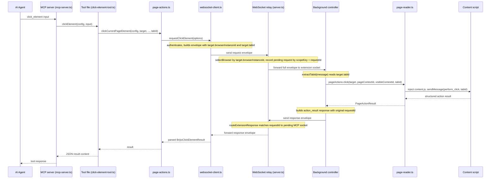

# MCP ↔ WebSocket ↔ Extension Flow

This page traces the runtime path Brijio uses to move an agent request from the
MCP server, through the local WebSocket relay, into a browser tab, and back as a
structured result. It names the canonical source file responsible at each hop,
documents how per-call `tabId` targeting threads through the stack, and gives
editing guidance for changes that cross layers.

The design is **request-driven, not mirrored**: the extension is reactive, opens
a WebSocket only after an explicit user action, and answers explicit
MCP-originated requests. It never streams page content continuously. See
[Browser Extensions Domain](browser-extensions.md) for the extension adapter
shape and [Multi-tab workflow](../workflows/multi-tab.md) for the agent-facing
multi-tab usage pattern.

## Canonical source files by hop

Each hop in the path is owned by a small, well-defined module:

- **MCP tool registration** — `servers/mcp/src/mcp-server.ts` registers every
  tool and its input schema, then delegates to a per-tool file.
- **MCP tool files** — `servers/mcp/src/page-reading-tool.ts`,
  `click-element-tool.ts`, `fill-input-tool.ts`, `form-action-tools.ts`,
  `navigate-to-url-tool.ts`, `open-tab-tool.ts`, `batch-tool.ts`,
  `list-tabs-tool.ts`, `capture-screenshot-tool.ts`, `download-*-tool.ts`,
  `fetch-resource-tool.ts` normalize tool input and call into `page-actions.ts`
  or `page-context.ts`.
- **MCP action/page-context façade** — `servers/mcp/src/page-actions.ts` and
  `servers/mcp/src/page-context.ts` translate normalized inputs into request
  options, applying `defaultBrowserInstanceId` / `defaultTabId` fallbacks.
- **WebSocket client** — `servers/mcp/src/websocket-client.ts` opens a
  one-shot WebSocket per request, authenticates with the pairing token, sends
  the request envelope (with `target`), and parses the matched response.
- **Protocol** — `servers/mcp/src/protocol.ts` defines the `WebSocketEnvelope`
  shape, the envelope constructors (`createGetPageContextEnvelope`,
  `createClickElementEnvelope`, ...), and the response parsers. The shared
  protocol lives in `packages/shared/src/protocol.js` (referenced by the
  extension side).
- **WebSocket relay** — `servers/websocket/src/server.ts` authenticates peers,
  tracks browser presence, routes MCP requests to the selected extension, and
  routes extension responses back to the waiting MCP socket.
- **Extension background controller** — `packages/shared/src/background-controller.ts`
  (`BrijioBackgroundController`) is the browser-agnostic dispatcher; it owns the
  WebSocket connection lifecycle, presence announcement, and per-message
  dispatch to injected adapters.
- **Shared page reader** — `packages/shared/src/page-reader.ts` resolves the
  target tab, injects the content script, and exchanges messages with it.
- **Extension adapters** — `clients/extensions/chrome/src/background.ts` and
  `clients/extensions/safari/src/background.ts` (+ `background-entry.ts`) wire
  `chrome.*` / `browser.*` APIs into the adapter interfaces the controller
  depends on.

## End-to-end request/response path

The diagram below traces a concrete `click_element` call hop by hop. The same
shape applies to `read_current_page`, `fill_input`, `perform_batch`,
`navigate_to_url`, and the other action tools; the only differences are the
payload type and the adapter method invoked at the bottom.

_Figure: A `click_element` request from agent to content script and back. The
relay is a stateless forwarder keyed by `requestId`; the controller is the only
hop that interprets the payload and touches browser APIs._

### Hop details

1. **Agent → MCP server.** The agent calls an MCP tool. `createBrijioMcpServer`
   in `servers/mcp/src/mcp-server.ts` has registered the tool with a Zod input
   schema; almost every action/reading tool schema includes optional
   `browserInstanceId` and `tabId` inputs. The wrapper logs the call and
   delegates to the per-tool function.

2. **Tool file → page-actions / page-context.** The tool file normalizes input
   (validating `tabId` as a non-empty string when present), then calls the
   matching `page-actions.ts` / `page-context.ts` function, forwarding
   `browserInstanceId` and `tabId`. `page-actions.ts` resolves
   `browserInstanceId ?? config.defaultBrowserInstanceId` and
   `tabId ?? config.defaultTabId`, then calls the corresponding
   `websocket-client.ts` request function.

3. **websocket-client → relay.** `requestBrijio` opens a fresh WebSocket to the
   relay, authenticates by sending `createAuthEnvelope(pairingToken)`, waits for
   `auth_success`, then sends `targetEnvelope(options)` — the request envelope
   with a merged `target: { browserInstanceId?, tabId? }` when either is set.
   Each request gets a unique id (`mcp-<timestamp>-<random>`); a timeout guards
   the whole exchange and the socket is closed once the response settles.

4. **Relay routing.** The relay authenticates peers by pairing token and
   derives a `scopeKey` (SHA-256 of the token) so MCP and extension peers that
   share a token form one routing scope. For an MCP message it calls
   `selectBrowser` using `message.target?.browserInstanceId` (ambiguous when
   multiple browsers are online and none is specified), records the MCP socket
   under `pendingRequestKey(scopeKey, requestId)`, and forwards the **entire
   envelope unchanged** to the chosen extension's socket. The relay never
   inspects `target.tabId`; it is opaque payload carried for the extension.

5. **Extension controller dispatch.** `BrijioBackgroundController.handleSocketMessage`
   JSON-parses the message and runs `extractTabId(message)`, which reads
   `message.target.tabId` (a string) and converts it to a number for the browser
   adapter. It then dispatches by payload type to handler methods, passing
   `tabId` through: `handlePageContextRequest(id, tabId)`,
   `handlePageContentRequest(id, index, tabId)`,
   `handlePerformActionRequest(id, action, pageContextId, visibleContextId, tabId)`,
   `handlePerformBatchRequest(id, payload, tabId)`,
   `handleNavigateToUrlRequest(id, url, tabId)`. Each handler calls the matching
   adapter method and sends the constructed response envelope back over the
   socket, preserving the original `requestId`.

6. **Adapter → content script.** The shared `page-reader.ts`
   (`readActiveTabPage` / `performActiveTabAction` / `performActiveTabBatch`)
   resolves the target tab: when `tabId` is provided it uses that numeric id
   directly; otherwise it queries the active tab in the current window. It
   re-injects `content.js` (idempotent per ADR 0043), shows the tab indicator,
   and `sendMessage`s the request to the content script, awaiting a structured
   response (with a message timeout). Chrome and Safari adapters simply forward
   `tabId` into these shared helpers.

7. **Response return.** The controller sends the response envelope with the
   original `requestId`. The relay's `routeExtensionResponse` matches
   `${scopeKey}:${requestId}` to the pending MCP socket, deletes the pending
   entry, and forwards the envelope. `websocket-client.ts` parses it (validating
   the `id` matches and the payload `type` is the expected response), and the
   result propagates back up the tool stack as a `BrijioResourceResult` and
   finally as JSON tool content to the agent.

## Tab targeting

Tab targeting is **per-call and stateless**: there is no hidden "selected tab"
session state, mirroring how `browserInstanceId` works. A `tabId` obtained from
`list_tabs` is passed explicitly on each subsequent tool call.

- **MCP tool wrappers** accept an optional per-call `tabId` in their input
  schema (`tabIdInput` in `mcp-server.ts`) and include it in protocol messages
  via `target.tabId` on the envelope.
- **The relay** is tab-agnostic: it routes by `browserInstanceId` and carries
  `target.tabId` through untouched.
- **The shared controller** extracts `target.tabId` once per message and
  threads it to every read/action/batch/navigation handler.
- **Shared page-reading and action helpers** (`readActiveTabPage`,
  `performActiveTabAction`, `performActiveTabBatch`) accept `tabId` and prefer
  it over the active-tab lookup when present; when omitted they fall back to
  `tabs.query({ active: true, currentWindow: true })`.
- **Chrome and Safari adapters** forward the provided `tabId` into the shared
  helpers for reads, actions, batch, and navigation.

When `tabId` is omitted the system remains backward compatible and operates on
the active tab. `open_tab` is the exception: it creates a new tab and therefore
does not accept a `tabId` (it returns the new tab's id).

## Stale-context validation

Short-lived positional IDs (e.g. `bb-1`) come from a `read_current_page` call
and are only valid until the page navigates or re-renders. Action tools defend
against stale targets in two ways:

- **Validation fields** (`expectedText`, `expectedHref`, `expectedRole`, and
  per-control `expectedLabel`) let the agent assert what it expects before the
  action runs; a mismatch returns a `stale_context` error rather than acting on
  the wrong element (ADR 0036 / 0041).
- **Context versioning** (`pageContextId` / `visibleContextId`) ties an action
  to the page snapshot it was planned against; a navigation that bumps the
  context id invalidates prior IDs and surfaces `page_navigated`.

Agents should re-read the page after any navigation before reusing IDs.

## Why this exists

Brijio is built around explicit requests rather than continuous browser
mirroring. This flow keeps the browser local, keeps the extension reactive,
and makes it possible to target a specific browser instance and a specific tab
on each call without changing the core privacy model. The relay is a thin,
stateless forwarder; all browser-specific logic lives behind the shared
controller and its adapters.

## What to watch for when editing this area

- **Tool inputs are a cross-layer contract.** A change to tool inputs usually
  requires updates in `servers/mcp/src/protocol.ts` (envelope constructors and
  response parsers) and the shared `background-controller.ts` dispatch together.
  The MCP tool file, `page-actions.ts` / `page-context.ts`, and `websocket-client.ts`
  request options must all be updated in the same change.
- **Keep adapters thin and shared behavior shared.** Extension adapters
  (`chrome`/`safari` `background.ts`) must stay in sync with the shared
  `page-reader.ts` behavior. When adding a browser capability, follow the full
  path shared → adapter → integration tests, and update both Chrome and Safari.
- **Forward `tabId` end to end.** If a tool should work on a background tab, it
  must accept `tabId` in its schema, extract and forward it through the tool
  file and `page-actions.ts`, and the controller must pass it to the adapter.
  Do not assume the active tab. Do not introduce hidden selected-tab session
  state — targeting is per-call only.
- **Preserve `requestId` correlation.** The relay matches responses to pending
  MCP sockets by `requestId` within a scope. Any new request type must carry and
  echo a request id, and the controller must respond with the same id.
- **Re-read context after mutations.** Any action that can navigate or re-render
  invalidates short-lived target IDs; tool wrappers and tests must treat
  post-mutation IDs as stale (ADR 0036 / 0041).

## Related docs

- [Multi-tab workflow](../workflows/multi-tab.md)
- [Browser Extensions Domain](browser-extensions.md)
- [ADR 0060 — Explicit tab listing and selection](../../docs/architecture/decisions/0060-explicit-tab-listing-and-selection.md)
- [ADR 0062 — Thread tabId through the action stack](../../docs/architecture/decisions/0062-thread-tabid-through-action-stack.md)
- [ADR 0041 — Reliable target identity and stale-target handling](../../docs/architecture/decisions/0041-reliable-target-identity-and-stale-target-handling.md)
- [ADR 0043 — Idempotent content-script injection](../../docs/architecture/decisions/0043-idempotent-content-script-injection.md)
- [Capability matrix](../../docs/project/CAPABILITY_MATRIX.md)
