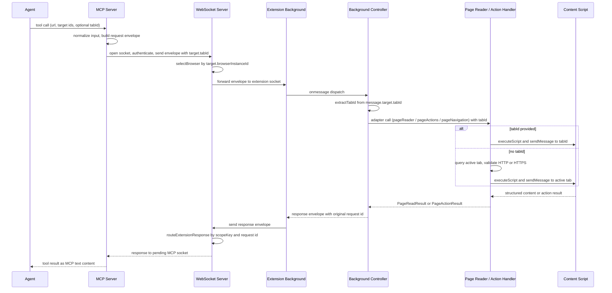

# MCP ↔ WebSocket ↔ Extension Flow

This page describes the runtime path Brijio uses to move an agent request from an MCP tool call to a browser tab and back. The model is explicit request/response: an agent receives no ambient browser state. Every piece of page context, action result, or tab metadata exists only because a tool was called and a structured response returned up the stack. There is no continuous browser mirroring and no hidden selected-tab session state held between calls.

## Canonical source files

- `servers/mcp/src/mcp-server.ts` — registers MCP tools and maps each tool input to a tool function.
- `servers/mcp/src/page-reading-tool.ts` — `read_current_page` tool: fetches page context and optional content chunks.
- `servers/mcp/src/navigate-to-url-tool.ts` — `navigate_to_url` tool.
- `servers/mcp/src/open-tab-tool.ts` — `open_tab` tool.
- `servers/mcp/src/batch-tool.ts` — `perform_batch` tool: validates and stages a batch of actions.
- `servers/mcp/src/form-action-tools.ts` — `submit_form`, `select_options`, `set_checked`, `upload_file` form-action tools.
- `servers/mcp/src/page-context.ts` — MCP-side page-context config and request fan-out to `websocket-client`.
- `servers/mcp/src/page-actions.ts` — MCP-side page-action config and request fan-out to `websocket-client`.
- `servers/mcp/src/websocket-client.ts` — `requestBrijio`: per-request WebSocket, auth, envelope targeting, timeout, response parsing.
- `servers/mcp/src/protocol.ts` — envelope constructors/parsers and the `target` shape shared across the MCP layer.
- `servers/websocket/src/server.ts` — relay: auth, presence table, MCP→extension forwarding, response routing.
- `servers/websocket/src/protocol.ts` — re-exports shared envelope helpers plus `createScopeKey`.
- `packages/shared/src/protocol.ts` — canonical `BrijioEnvelope`/`WebSocketEnvelope` type and all envelope builders used by both servers and extensions.
- `packages/shared/src/background-controller.ts` — `BrijioBackgroundController`: extension-side dispatch, adapter interfaces, `extractTabId`.
- `packages/shared/src/page-reader.ts` — shared `readActiveTabPage`/`performActiveTabAction`/`performActiveTabBatch` with tab targeting.
- `clients/extensions/chrome/src/background.ts` — Chrome: builds `BrijioBackgroundController` with concrete adapters.
- `clients/extensions/safari/src/background.ts` — Safari: builds `BrijioBackgroundController` with concrete adapter classes.

## Request flow

The diagram above traces a single agent tool call end-to-end, including the tab-targeting branch at the extension.

1. An agent calls an MCP tool. `mcp-server.ts` registers each tool with `McpServer.registerTool`; every page/action tool exposes optional `browserInstanceId` and `tabId` string inputs.
2. The tool function normalizes its input, then calls a `page-context.ts`/`page-actions.ts` helper, which calls a `request*` function in `websocket-client.ts`.
3. `requestBrijio` opens a fresh WebSocket per call, authenticates with the pairing token (the server derives a SHA-256 scope key from the token), and sends the request envelope. `targetEnvelope` adds a `target` object (`browserInstanceId`/`tabId`) only when either value is present. A `timeoutMs` guard resolves the promise on timeout or socket failure.
4. The WebSocket server authenticates each connection by role (`extension` or `mcp`). For an MCP message it answers `list_browsers` directly from its presence table; every other message is forwarded to the selected extension socket via `selectBrowser`.
5. The extension background hands each incoming envelope to `BrijioBackgroundController`, which dispatches by envelope type and extracts `tabId` from `message.target.tabId` (parsed from string to a safe integer).
6. The controller calls the matching adapter (`pageReader`, `pageActions`, `pageBatch`, `pageNavigation`, `pageOpenTab`, `download`, `tabLister`, `pageScreenshot`). Read/action adapters delegate to the shared `page-reader.ts` helpers, which perform the tab-level work: `executeScript` injects `content.js`, then `tabs.sendMessage` exchanges a `ContentRequest` with the content script and returns a structured result.
7. The response envelope (carrying the original request id) is sent back over the extension socket. The relay maps `scopeKey:requestId` to the pending MCP socket and forwards it. `requestBrijio` parses the response with the matching `parse*Envelope` and the MCP tool returns the result as MCP `text` content (JSON).

## Roles and the relay

The WebSocket server is a stateful relay, not a page reader. Two roles authenticate:

- `extension` connections announce browser presence (`browserInstanceId`, `label`, capabilities). The relay keeps a presence table keyed by `scopeKey:browserInstanceId`.
- `mcp` connections send tool requests. `selectBrowser` resolves the target extension: an explicit `target.browserInstanceId` must match an online browser; with no target and exactly one browser online it is used unambiguously; with zero it returns `browser_unavailable`; with more than one it returns `ambiguous_browser_target`.

Pending requests are tracked in `pendingRequests` keyed by `scopeKey:requestId`. Extension responses carrying that id are routed back to the originating MCP socket and the entry is deleted. Nothing is pushed to the MCP side except a response to an explicit request, preserving the request/response framing.

## Tab targeting

`tabId` is per-call and optional. When omitted, the system falls back to the active tab. There is no server-side selected-tab session state — each tool call carries its own targeting.

- MCP tool schemas expose an optional string `tabId`; tool wrappers normalize it and forward it into the `target` block of the request envelope via `targetEnvelope`.
- On the extension side, `BrijioBackgroundController.extractTabId` reads `message.target.tabId`, parses it to a number, and passes it to the adapter handlers. `open_tab` and `list_tabs` do not take a `tabId` (they create or enumerate tabs); `list_tabs`, downloads, and screenshots are browser-scoped rather than tab-scoped.
- Shared `readActiveTabPage`, `performActiveTabAction`, and `performActiveTabBatch` in `page-reader.ts` use the supplied `tabId` directly when present. When it is absent they query the active tab (`{ active: true, currentWindow: true }`), require an HTTP/HTTPS regular page URL, and fall back to that tab id. The same active-tab fallback applies in the Chrome and Safari navigation adapters (`navigateActiveTabToUrl` / `SafariPageNavigationAdapter`).

Caveat: the `navigate_to_url` MCP schema exposes `tabId`, and `navigateToCurrentPageUrl` plus the extension navigation adapter both accept it, but `navigate-to-url-tool.ts` does not currently pass `tabId` through to `navigateToCurrentPageUrl` — it forwards only the URL and `browserInstanceId`. In practice `navigate_to_url` therefore acts on the active tab even when a `tabId` is supplied. Treat this as a known gap when relying on `navigate_to_url` for background-tab navigation.

## Configuration

The MCP server reads connection settings from environment via `getPageContextConfigFromEnv` (`page-context.ts`): `BRIJIO_WS_URL` (default `ws://127.0.0.1:8787`), `BRIJIO_PAIRING_TOKEN`, `BRIJIO_REQUEST_TIMEOUT_MS`, and an optional `BRIJIO_BROWSER_INSTANCE_ID` default. `BrijioPageActionsConfig` also carries an optional `defaultTabId` used as a fallback when a tool omits `tabId`. The WebSocket server reads `BRIJIO_PAIRING_TOKEN` (plus `additionalPairingTokens`) for auth. Extension settings (WebSocket URL, pairing token, `browserInstanceId`, labels) are stored locally and passed into `BrijioBackgroundController` via storage adapters.

## Failures and invariants

- Each MCP request is one short-lived WebSocket connection. `requestBrijio` resolves exactly once on success, a router error, timeout, or socket close, then closes the socket.
- The relay never invents responses: if no browser matches the target it returns a `browser_unavailable` or `ambiguous_browser_target` error envelope directly to the MCP socket without forwarding.
- Extension-side content-script access is gated: reads/actions on non-HTTP(S) pages return `unsupported_page`; missing regular-page permissions surface as `regular_page_permission_required`.
- Navigation calls (`chrome.tabs.update`/Safari equivalent) are wrapped in a timeout so the agent always gets a response even on restricted pages.
- Approval-gated actions (`submit_form`, `download_file`, `fetch_resource`) use a longer `approvalTimeoutMs` and an `ApprovalAdapter`; the batch tool inflates its timeout when any action is approval-gated.

## What to watch for when editing this area

- A change to tool inputs usually requires coordinated updates in `servers/mcp/src/protocol.ts` and the background controller together. The `target` shape (`browserInstanceId`, `tabId`) is defined in `packages/shared/src/protocol.ts` and reused by both servers.
- Extension adapters must stay in sync with the shared `page-reader.ts` behavior — both Chrome and Safari route `getPageContext`/`getPageContent` and the action helpers through the same shared functions, so changes to the active-tab lookup or `tabId` resolution must be made once in `page-reader.ts` and kept consistent across both adapters.
- If a tool should work on a background tab, it must accept `tabId`, thread it through its `normalizeInput`/tool function into the `page-actions`/`page-context` helper, and not assume the active tab. Verify the full chain (tool → helper → `requestBrijio` → envelope `target` → `extractTabId` → adapter) end-to-end, since a missing link silently drops targeting (as with `navigate_to_url` today).
- Adding a new envelope type means adding a constructor/parser, a relay forward branch (most messages forward automatically once `selectBrowser` resolves), a background-controller dispatch branch, and a corresponding `request*`/`parse*` pair in `websocket-client.ts`.

## Related docs

- [Architecture overview](../architecture.md)
- [Data and protocol](../data-and-protocol.md)
- [Domains](../domains.md)
- [Multi-tab workflow](../workflows/multi-tab.md)
- [Capability matrix](../../docs/project/CAPABILITY_MATRIX.md)
- [ADR 0062 — thread tabId through the action stack](../../docs/architecture/decisions/0062-thread-tabid-through-action-stack.md)
