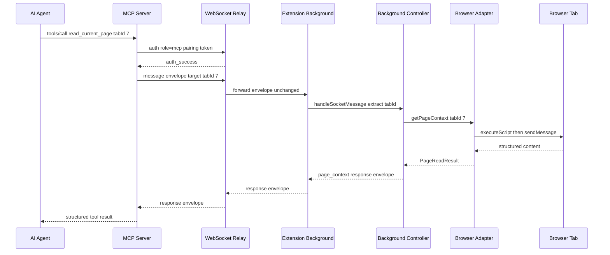

# MCP ↔ WebSocket ↔ Extension Flow

This page traces the runtime path Brijio uses to move one agent request from the
MCP server, through the WebSocket relay, to a browser tab, and back as a
structured result. It covers the protocol envelope, browser/tab targeting, the
shared background controller dispatch, error forwarding, and what must stay in
sync when editing the action stack.

## The round trip

An agent never talks to the browser directly. Each request is translated into a
Brijio protocol envelope by the MCP server, relayed over WebSocket to the
connected extension session, dispatched by the shared background controller, and
performed against a specific browser tab by a browser adapter. The response —
including any structured error — flows back the same way.

_One request from an MCP tool call through the relay, controller, and adapter to
a targeted tab, with the structured result returning the same way._

## Canonical source files

- `servers/mcp/src/mcp-server.ts` — tool registration and the shared `tabId` input schema.
- `servers/mcp/src/page-reading-tool.ts`, `page-actions.ts`, `page-context.ts` — build the request from tool input.
- `servers/mcp/src/websocket-client.ts` — opens a relay socket per request, authenticates, sends the envelope, parses the reply.
- `servers/mcp/src/protocol.ts` — envelope shapes, envelope constructors, and error parsers (ADR 0061).
- `servers/websocket/src/server.ts` — relay auth, presence, and routing.
- `packages/shared/src/background-controller.ts` — `BrijioBackgroundController` dispatch and adapter interfaces.
- `packages/shared/src/page-reader.ts` — shared `readActiveTabPage` / `performActiveTabAction` / `performActiveTabBatch`.
- `clients/extensions/chrome/src/background.ts`, `clients/extensions/safari/src/background.ts` (and `background-entry.ts`) — adapter implementations.

## Tracing one request

This section follows a single `read_current_page` call end to end.

### 1. MCP tool builds the envelope

`mcp-server.ts` registers every browser tool with a shared optional `tabId`
input (`z.string().optional()`). The tool handler forwards the parsed input to
the tool module. For reads this is `page-reading-tool.ts`, which normalizes the
input (including `normalizeTabId`) and calls `getCurrentPageContext` /
`getCurrentPageContent` in `page-context.ts`. Those functions call the websocket
client (`requestPageContext`, `requestPageContent`), passing `tabId` through
`PageContextRequestOptions.tabId`.

Action tools follow the same shape: the tool module extracts `tabId` from input
and passes it as a parameter to a `page-actions.ts` function such as
`clickCurrentPageElement`, which forwards `tabId: tabId ?? config.defaultTabId`
into the websocket-client options.

### 2. WebSocket client authenticates and sends

`servers/mcp/src/websocket-client.ts` is the relay client. Each `request*`
helper calls the shared `requestBrijio` function, which for each call:

1. Opens a fresh `WebSocket` to `options.websocketUrl`.
2. Sends `createAuthEnvelope(pairingToken)` on `open`.
3. On `auth_success` it sends the request envelope wrapped by `targetEnvelope`.
4. Waits for either a `parseRouterErrorEnvelope` result, the parsed envelope
   result, a timeout (`timeoutResponse`), a socket error
   (`connectionFailedResponse`), or an unexpected close.

`targetEnvelope` merges `browserInstanceId` and `tabId` into the envelope's
`target` field only when present. The envelope is then a `{ type: 'message',
id, target?, payload }` structure defined in `servers/mcp/src/protocol.ts`.

### 3. WebSocket relay forwards unchanged

`servers/websocket/src/server.ts` authenticates both `mcp` and `extension`
roles against the pairing token and derives a `scopeKey`. The extension later
announces browser presence, which the relay keeps in an in-memory `presence`
map keyed by `scopeKey:browserInstanceId`.

For an MCP message the relay calls `selectBrowser` to resolve the target
extension socket from presence, preferring `message.target.browserInstanceId`
and otherwise requiring exactly one online browser (it returns a
`browser_unavailable` / `ambiguous_browser_target` error envelope otherwise). It
then stores the MCP socket under `pendingRequestKey(scopeKey, message.id)` and
forwards the **entire envelope unchanged** to the extension socket — so
`target.tabId` travels through the relay untouched.

When the extension responds, `routeExtensionResponse` looks up the pending MCP
socket by `scopeKey:message.id`, deletes the pending entry, and forwards the
response envelope back to the MCP socket.

### 4. Extension background hands off to the controller

The extension background script owns a single `BrijioBackgroundController`
instance (constructed in `clients/extensions/chrome/src/background.ts` and
`clients/extensions/safari/src/background-entry.ts`). The controller opens and
maintains its own persistent WebSocket to the relay, so it is already
authenticated and has announced presence before any request arrives.

On every inbound relay message, `BrijioBackgroundController.handleSocketMessage`
parses the JSON and immediately calls `extractTabId(message)`. `extractTabId`
reads `message.target.tabId`, validates it is a non-empty string, and parses it
to a number (returning `undefined` when absent). It then dispatches by payload
type — `isGetPageContextEnvelope`, `isGetPageContentEnvelope`,
`isPerformActionEnvelope`, `isNavigateToUrlEnvelope`, `isPerformBatchEnvelope`,
etc. — passing the numeric `tabId` into the matching handler, and increments
`pendingRequestCount` for the duration of the handler.

### 5. Controller dispatches to page-reader / action / navigation handlers

The controller is adapter-driven. Its constructor options
(`BrijioBackgroundControllerOptions` in `background-controller.ts`) require
`pageReader`, `pageActions`, `pageBatch`, and `pageNavigation` adapters whose
interfaces each take an optional numeric `tabId`:

- `PageReaderAdapter.getPageContext(tabId?)` / `getPageContent(index, tabId?)`
- `PageActionAdapter.click(target, pageContextId, visibleContextId, tabId?)` and the other action methods
- `PageBatchAdapter.performBatch(message, tabId?)`
- `PageNavigationAdapter.navigateToUrl(url, tabId?)`

The handlers (`handlePageContextRequest`, `handlePerformActionRequest`,
`handleNavigateToUrlRequest`, `handlePerformBatchRequest`, …) call the
corresponding adapter method and then build the response envelope
(`createPageContextResponse`, `createActionResultResponse`, …) or an error
envelope (`createPageContextErrorResponse`, `createActionResultErrorResponse`, …)
to send back over the controller's socket.

### 6. Browser adapter performs tab-level work

The Chrome adapter (in `clients/extensions/chrome/src/background.ts`) wires the
controller to the shared helpers in `packages/shared/src/page-reader.ts`:

- `pageReader.getPageContext` / `getPageContent` call
  `sharedReadActiveTabPage(message, chromeDeps, tabId)`.
- `pageActions.click/writeText/…` call `sharedPerformActiveTabAction(message,
chromeDeps, tabId)`.
- `pageBatch.performBatch` calls `sharedPerformActiveTabBatch(message,
chromeDeps, tabId)`.
- `pageNavigation.navigateToUrl` calls the local `navigateActiveTabToUrl(url,
tabId)`.

The shared `readActiveTabPage` / `performActiveTabAction` /
`performActiveTabBatch` implement the targeting rule: when `tabId` is provided
they use it directly (`chrome.tabs.sendMessage(tabId, …)` /
`scripting.executeScript({ target: { tabId } })`); when it is absent they fall
back to `deps.tabs.query({ active: true, currentWindow: true })`. The Safari
adapters in `clients/extensions/safari/src/background.ts` mirror this, calling
the same shared helpers and accepting `tabId` in their adapter method
signatures.

### 7. Structured result flows back

The adapter returns a `PageReadResult` / `PageActionResult` /
`PageNavigationResult` discriminated union to the controller. The controller
wraps it into a response envelope and sends it over its socket; the relay's
`routeExtensionResponse` forwards it to the pending MCP socket; the MCP
`requestBrijio` parses it (via the tool-specific `parseEnvelope` such as
`parsePageContextEnvelope`) and resolves the promise; the tool handler returns
the JSON-serialized result as MCP `content`.

## Tab targeting (ADR 0062)

Per-call `tabId` is preferred over the active-tab fallback. The threading is
end-to-end:

- **MCP input**: every browser tool exposes an optional `tabId` string; tool
  modules normalize it with `normalizeTabId` and pass it to the websocket client.
- **MCP envelope**: `targetEnvelope` places `tabId` into `envelope.target.tabId`.
- **Relay**: forwards the whole envelope, so `target.tabId` is preserved.
- **Controller**: `extractTabId` reads `message.target.tabId` and parses it to a
  number, then threads it into each handler and adapter call.
- **Shared helpers + adapters**: use the numeric `tabId` directly when present,
  otherwise fall back to `tabs.query({ active: true, currentWindow: true })`.

When `tabId` is omitted the system remains backward compatible and operates on
the active foreground tab. This fallback is intentional: keep it unless an ADR
changes it. An agent that wants to act on a background tab must call `list_tabs`,
take that tab's `tabId`, and pass it to every subsequent call; without it the
call silently targets the foreground tab instead.

## Error forwarding (ADR 0061)

Errors flow back along the same chain (`Extension → WS Server → MCP Server →
Agent`). Brijio forwards the original error code and message rather than
replacing them with generic text, so the agent can act on specific failure
modes.

- **Router-level errors** (from the WS server, e.g. `invalid_message`,
  `invalid_json`, `browser_unavailable`): `parseRouterErrorEnvelope` in
  `servers/mcp/src/protocol.ts` forwards any string `code` and `message` as-is.
  It only returns `invalidResponse()` when the envelope structure itself is
  malformed (no `error` object or non-string `message`).
- **Action-level errors** (from the extension, e.g. `not_supported`,
  `cors_blocked`, `http_error`, `size_exceeded`): `parseErrorPayload` preserves
  `stale_context` and `page_navigated` with their structured `detail`, and
  forwards every other original string `code` instead of collapsing it to
  `browser_error` (it falls back to `browser_error` only when `code` is not a
  string). The `message` is always preserved.
- **Connection-level failures**: the websocket client maps socket errors and
  unexpected closes to `connection_failed` and timeouts to `timeout` via
  `connectionFailedResponse` / `timeoutResponse`; an empty pairing token
  resolves to `auth_required`.

The MCP `BrijioResourceResult` / tool-result error `code` is typed as `string`
rather than a closed union, because the relay and extension may emit codes the
MCP server does not know about. Agents should read the `message` field and
treat `code` as an arbitrary string.

## What to keep in sync when editing the action stack

- A change to a tool's input usually requires coordinated edits in
  `servers/mcp/src/protocol.ts` (envelope shapes / constructors / parsers) and
  `packages/shared/src/background-controller.ts` (adapter interfaces and
  dispatch) together.
- Extension adapters (`clients/extensions/chrome/src/background.ts` and the
  Safari background files) must stay in sync with the shared page-reader
  behavior in `packages/shared/src/page-reader.ts` — both the active-tab
  fallback and the explicit-`tabId` path.
- If a tool should work on a background tab, it must accept `tabId`, thread it
  through its `page-actions.ts` function, and not assume the active tab.
- Error parsers in `servers/mcp/src/protocol.ts` (`parseRouterErrorEnvelope`,
  `parseErrorPayload`) must forward new extension/relay codes rather than
  re-wrapping them; add new codes to the shared package's `BrijioErrorCode`
  union where they originate, not as MCP-only replacements.

## Related docs

- [WebSocket Relay](websocket-relay.md)
- [Browser Adapters](../concepts/browser-adapters.md)
- [Protocol and Data Model](../data-and-protocol.md)
- [Action Approval](../workflows/action-approval.md)
- [Multi-tab Workflow](../workflows/multi-tab.md)
- [Architecture Overview](../architecture.md)
- ADR 0061 — Forward Error Codes Through the MCP Server (`../../docs/architecture/decisions/0061-forward-error-codes-through-mcp.md`)
- ADR 0062 — Thread tabId Through the Action Stack (`../../docs/architecture/decisions/0062-thread-tabid-through-action-stack.md`)
