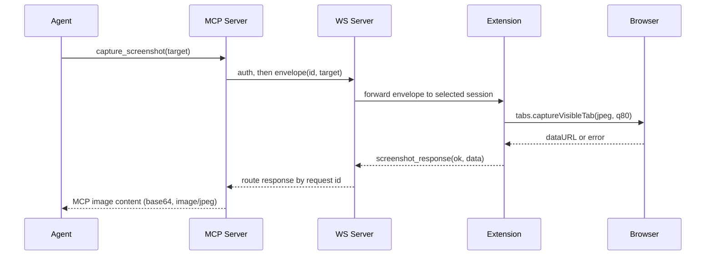

# MCP ↔ WebSocket ↔ Extension Flow

This page describes the runtime path Brijio uses to move an agent request
from the MCP server to a browser tab and back. Each tool call crosses three
process boundaries — MCP server, WebSocket relay, and browser extension —
before the browser adapter performs the tab-level work and the result returns
the same way.

## Canonical source files

- `servers/mcp/src/mcp-server.ts` — tool and resource registration
- `servers/mcp/src/capture-screenshot-tool.ts` — `capture_screenshot` wrapper
- `servers/mcp/src/page-actions.ts` — tool → WebSocket-client dispatch
- `servers/mcp/src/page-reading-tool.ts`
- `servers/mcp/src/navigate-to-url-tool.ts`
- `servers/mcp/src/open-tab-tool.ts`
- `servers/mcp/src/batch-tool.ts`
- `servers/mcp/src/form-action-tools.ts`
- `servers/mcp/src/protocol.ts` — protocol envelopes and error parsing
- `servers/mcp/src/websocket-client.ts` — WS connection and request/response
- `servers/websocket/src/server.ts` — relay routing and presence
- `packages/shared/src/background-controller.ts` — extension-side dispatch
- `packages/shared/src/protocol.ts` — shared `BrijioErrorCode` union
- `clients/extensions/chrome/src/background.ts`
- `clients/extensions/safari/src/background.ts`

## Request flow

1. An agent calls an MCP tool (for example `read_current_page`,
   `click_element`, `capture_screenshot`).
2. The MCP tool normalizes input and calls the corresponding `page-actions`
   function, which delegates to the WebSocket client.
3. The WebSocket client authenticates with the pairing token, then sends a
   protocol envelope carrying `browserInstanceId` and `tabId` in the
   `target` field.
4. The WebSocket server selects a connected extension session by
   `browserInstanceId` and forwards the envelope; it stores the pending
   request keyed by scope + request id.
5. The extension background layer (`BrijioBackgroundController`) receives the
   message, extracts `tabId` from the `target`, and dispatches to the shared
   page-reader, action, navigation, or screenshot handlers.
6. The browser adapter performs the tab-level work and returns a structured
   result or error.
7. The extension sends a response envelope back; the WS server routes it to
   the pending MCP socket by request id.
8. The MCP WebSocket client parses the envelope, converts a router-level error
   or action-level error into a `BrijioResourceResult`, and returns it to the
   tool, which serializes it as JSON `content` for the agent.

### Sequence diagram

The diagram below shows a representative tool call (`capture_screenshot`)
flowing through all three process boundaries and back. Other tools follow
the same shape; only the payload type and the extension-side handler differ.



_The capture_screenshot round trip across MCP, WebSocket, and extension._

## Tab targeting

Most tools accept an optional `tabId` (string) in their input schema. The
MCP server threads it into the envelope's `target.tabId`, and the shared
background controller extracts it via `extractTabId` before dispatching.

- `PageReaderAdapter.getPageContext` and `getPageContent` accept `tabId` and
  prefer it over an active-tab lookup when present.
- `PageActionAdapter` methods (`click`, `writeText`, `setChecked`,
  `selectOptions`, `submitForm`, `uploadFile`) thread `tabId` to the
  browser adapter.
- `PageNavigationAdapter.navigateToUrl` accepts `tabId`.
- Chrome and Safari background adapters use the provided tab ID for reads,
  navigation, and actions when present.

When `tabId` is omitted, the system remains backward compatible and falls
back to the active tab. This keeps the core privacy model — explicit,
agent-initiated requests rather than continuous browser mirroring — unchanged
while enabling multi-tab workflows.

## Screenshot capture (capture_screenshot)

`capture_screenshot` is a viewport-only JPEG capture of the active tab. It is
registered in `mcp-server.ts` and implemented by
`capture-screenshot-tool.ts`, which normalizes the optional
`browserInstanceId` and `tabId` inputs and delegates to
`page-actions.captureScreenshot`. The WebSocket client builds a
`capture_screenshot` envelope; the extension's `PageScreenshotAdapter`
calls `chrome.tabs.captureVisibleTab` (or the Safari WebExtensions
equivalent) with `format: 'jpeg', quality: 80`, strips the
`data:image/jpeg;base64,` prefix, and returns the base64 payload plus width,
height, tab ID, and capture timestamp.

### Active-tab only by design

`captureVisibleTab` can only capture the visible tab in a window. Capturing a
background tab would require switching focus, which is user-disruptive. The
tool therefore operates on the active tab even when `tabId` is provided — the
parameter exists for forward compatibility but the P3.3 implementation
validates that the requested tab is the active one. Agents that need a
screenshot of a specific page should use `open_tab` to create a dedicated tab,
then call `capture_screenshot` on it.

On success the MCP server returns MCP image content (`type: 'image'`,
`mimeType: 'image/jpeg'`) plus a JSON text block with the width, height,
`tabId`, and `capturedAt` metadata. On failure the tool returns an
`isError: true` text result so the agent receives the structured error code
and message.

### Capability fallback

If the extension does not provide a `PageScreenshotAdapter`, the
background controller responds with `capability_not_supported`.
`captureVisibleTab` permission errors at runtime also map to
`capability_not_supported`; other capture failures map to `capture_failed`.
Safari 14+ supports `browser.tabs.captureVisibleTab()` natively; permission
errors return `capability_not_supported` as a defensive fallback.

## Error-code forwarding (ADR 0061)

Errors flow back through the same chain:

```
Extension → WS Server → MCP Server → Agent
```

The MCP protocol layer in `servers/mcp/src/protocol.ts` forwards the original
error code and message rather than replacing them with generic values, so
agents receive specific, actionable codes.

### Router-level errors

When the WS server sends a `{ type: 'error', error: { code, message } }`
envelope, `parseRouterErrorEnvelope` forwards any string `code` as-is. It only
falls back to `invalid_response` when the envelope structure itself is
malformed (missing `error` object or `message` string). This lets the agent
see the real code the WS server emitted — `invalid_message`, `invalid_json`,
`auth_required`, etc. — instead of a generic replacement.

### Action-level errors

When the extension returns `{ ok: false, error: { code, message } }` inside an
`action_result` or response payload, `parseErrorPayload` preserves the
original `code` string (`not_supported`, `cors_blocked`, `http_error`,
`size_exceeded`, etc.) rather than flattening it to `browser_error`. The two
codes that carry structured `detail` — `stale_context` and `page_navigated` —
are preserved with their detail as before, since agents rely on that
information for stale-context recovery.

### Type alignment

The MCP server's `BrijioResourceResult` and `BrijioToolResult` error types use
`code: string` (not a constrained union), so they accept arbitrary codes the
WS server or extension may emit. The MCP server still keeps its local
`BrijioErrorCode` union for constructing well-known responses (`timeoutResponse`,
`connectionFailedResponse`, `authRequiredResponse`, etc.), but the result
types are not constrained to it. The shared package's `BrijioErrorCode` union
(`packages/shared/src/protocol.ts`) is the authoritative list used by the WS
server and extension; the MCP server must not assume its local union is a
strict subset, which is why it forwards unknown codes instead of rejecting
them.

## Why this exists

Brijio is designed around explicit requests rather than continuous browser
mirroring. This flow keeps the browser local, keeps the extension reactive,
and makes it possible to target a specific tab, capture a screenshot, and
surface precise errors back to the agent — all without changing the core
privacy model.

## What to watch for when editing this area

- A change to tool inputs usually requires updates in `protocol.ts` envelope
  constructors, the background controller dispatch, and the browser adapter
  together.
- Extension adapters must stay in sync with the shared page-reader and
  action behavior.
- If a tool should work on a background tab, it must accept `tabId` and not
  assume the active tab — except `capture_screenshot`, which is active-tab
  only by the `captureVisibleTab` constraint.
- When adding a new error code to the WS server or extension, the MCP server
  will forward it automatically; no change to `parseRouterErrorEnvelope` or
  `parseErrorPayload` is needed. Only update the shared `BrijioErrorCode`
  union.
- The MCP server's local `BrijioErrorCode` union must not be used to reject
  forwarded codes — it is intentionally narrower than the shared union.

## Related docs

- [Browser Content Pipeline](browser-content-pipeline.md)
- [Data and Protocol](../data-and-protocol.md)
- [Security](../security.md)
- [Action Approval](../workflows/action-approval.md)
- [Multi-tab workflow](../workflows/multi-tab.md)
- [ADR 0061: Forward Error Codes Through MCP](../../docs/architecture/decisions/0061-forward-error-codes-through-mcp.md)
- [ADR 0064: Visual Action Verification — Screenshot Tool](../../docs/architecture/decisions/0064-visual-action-verification.md)
