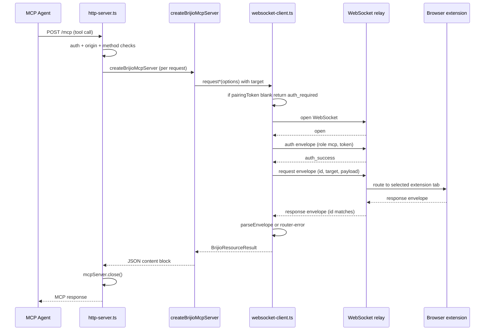

# MCP Server Domain

The `@brijio/mcp` package is the agent-facing surface of Brijio. An AI agent
talks to it over the Model Context Protocol (Streamable HTTP transport); the
server translates each tool call or resource read into a one-shot WebSocket
request against the local [WebSocket relay](mcp-extension-flow.md) and returns a
structured JSON result. The server itself is stateless and request-driven — it
never streams page content in the background and never starts browser access on
its own. The user's browser extension must already be connected.

This page is the deep dive for the MCP server internals. For the end-to-end
request path (MCP → relay → extension → back), see
[MCP ↔ WebSocket ↔ Extension Flow](mcp-extension-flow.md).

## Package layout and entry points

The server ships as the `brijio` npm binary (`bin/brijio.mjs`), with
`browserbridge` kept as a deprecated alias. The package's `exports` map points
the library entry at `http-server.ts`, while `index.ts` is the programmatic
start point that reads env options and calls `startBrijioMcpHttpServer`.

`servers/mcp/bin/brijio.mjs` is the real user-facing CLI. It owns the
one-command startup behavior (ADR 0029): it loads `~/.brijio/.env` and
project `.env` files, auto-generates `BRIJIO_PAIRING_TOKEN` and
`MCP_HTTP_AUTH_TOKEN` (both `randomBytes(32).toString('base64url')`) when
unset, mirrors the pairing token to the legacy `BROWSERBRIDGE_*` env vars,
binds sensible host/port defaults, and then dispatches to either a daemon
lifecycle command or run mode. Crucially, server modules are imported
**dynamically only in run mode** so that `--doctor` and `--print-config` never
trigger the full server stack (and never crash on a missing
`MCP_HTTP_AUTH_TOKEN`).

In run mode the bin imports the WebSocket server from `@brijio/websocket/server`
and starts it alongside the MCP HTTP server, then prints a startup banner (to
stderr) with the connection URLs and tokens. Demo mode (`brijio demo`) binds the
WS/MCP hosts to `127.0.0.1`, serves a static demo page on all interfaces, and
reuses an already-running daemon if one is healthy rather than double-binding
the port.

## HTTP transport — `http-server.ts`

`startBrijioMcpHttpServer` assembles the official TypeScript MCP SDK
`StreamableHTTPServerTransport` on top of a plain `node:http` server. It is the
sole boundary the agent ever sees.

### Configuration from env

`getMcpHttpServerOptionsFromEnv` reads:

| Env var                             | Default   | Purpose                                                                                  |
| ----------------------------------- | --------- | ---------------------------------------------------------------------------------------- |
| `MCP_HTTP_HOST`                     | `0.0.0.0` | Bind host                                                                                |
| `MCP_HTTP_PORT`                     | `8788`    | Bind port (validated 0–65535)                                                            |
| `MCP_HTTP_PATH`                     | `/mcp`    | MCP endpoint path (normalized with a leading `/`)                                        |
| `MCP_HTTP_AUTH_TOKEN`               | —         | **Required**; a blank token throws before listen                                         |
| `MCP_HTTP_ALLOWED_ORIGINS`          | `[]`      | Comma-separated allowed origins (supports `*.host` wildcards)                            |
| `BRIJIO_MCP_HTTP_TIMEOUT_MS`        | `60000`   | HTTP server/request timeout                                                              |
| `BRIJIO_APPROVAL_TIMEOUT_BUFFER_MS` | `5000`    | Buffer subtracted from `httpTimeoutMs` to derive `approvalTimeoutMs` (floored at 1000ms) |

The WebSocket relay URL and pairing token come from `page-context.ts`
(`getPageContextConfigFromEnv`), described under [Relay bridge](#relay-bridge--websocket-clientts).

### Request handling

Each inbound HTTP request is handled by `handleMcpHttpRequest`, which enforces
the boundary in a fixed order:

1. **Health** — `GET /health` returns `{ status, version, uptimeSeconds,
websocket: { url, status: 'unknown' } }` without auth. `version` is read from
   `package.json` at module load.
2. **Path** — non-`/mcp` paths get a `404 not_found`.
3. **CORS preflight** — `OPTIONS` short-circuits with `204`.
4. **Origin** — if an `Origin` header is present and not in the allow-list, a
   `403 forbidden_origin` is returned (wildcard `*.host` suffixes are matched
   against the origin's hostname).
5. **Auth** — a `Bearer` token must match `authToken`; otherwise `401
unauthorized`.
6. **Method** — only `GET`, `POST`, `DELETE` are MCP methods; anything else is
   `405 method_not_allowed`.

After the checks pass, the handler creates a **fresh `McpServer` per request**
(`createBrijioMcpServer`), wraps it in a stateless
`StreamableHTTPServerTransport` (`sessionIdGenerator: undefined`,
`enableJsonResponse: true`), connects it, lets the transport handle the request,
and then closes the server in `finally`. Per-request creation means there is no
shared session state between agent requests — the extension session is the only
durable state, held on the relay side.

## MCP server — `mcp-server.ts`

`createBrijioMcpServer` registers the full agent surface: tools, read-only
resources, skill resources, and a session-start prompt. Every tool handler logs
a `tool_call` event and returns the tool result as a single JSON `text` content
block. A shared optional `browserInstanceId` and optional `tabId` input is
declared on every browser tool, letting an agent pin a target browser instance
and/or a specific tab; when omitted, the relay routes to the single connected
browser and the active tab.

### Tools

The registered tools and the per-tool files that normalize their input:

| Tool                 | File                         | Responsibility                                                                         |
| -------------------- | ---------------------------- | -------------------------------------------------------------------------------------- |
| `list_browsers`      | `browser-list-tool.ts`       | Browser instances online for the pairing token                                         |
| `list_tabs`          | `list-tabs-tool.ts`          | Open HTTP/HTTPS tabs for a browser (tab ID, window, title, URL, active, supported)     |
| `read_current_page`  | `page-reading-tool.ts`       | Page context plus optional readable content chunks (sequential, stop-on-non-truncated) |
| `click_element`      | `click-element-tool.ts`      | Click a link/action target with optional stale-context guards                          |
| `fill_input`         | `fill-input-tool.ts`         | Write text into a visible form control                                                 |
| `fill_editable`      | `form-action-tools.ts`       | Write text into a visible contenteditable target                                       |
| `set_checked`        | `form-action-tools.ts`       | Set checkbox state / select a radio option                                             |
| `select_options`     | `form-action-tools.ts`       | Select option values in a single/multi select                                          |
| `submit_form`        | `form-action-tools.ts`       | Submit a form (approval-gated)                                                         |
| `upload_file`        | `form-action-tools.ts`       | Upload base64 file content into a file input                                           |
| `navigate_to_url`    | `navigate-to-url-tool.ts`    | Navigate to an HTTP(S) URL and wait for load                                           |
| `open_tab`           | `open-tab-tool.ts`           | Open a new tab, return its `tabId` for subsequent targeting                            |
| `perform_batch`      | `batch-tool.ts`              | Up to 20 sequential write actions in one request, optional trailing read               |
| `download_status`    | `download-status-tool.ts`    | Download status (capability `full`/`not_supported`)                                    |
| `download_file`      | `download-file-tool.ts`      | Initiate a download (approval-gated; Safari fire-and-forget)                           |
| `fetch_resource`     | `fetch-resource-tool.ts`     | Fetch a URL with browser session/cookies (high-risk, approval-gated)                   |
| `capture_screenshot` | `capture-screenshot-tool.ts` | JPEG (quality 80) viewport screenshot; returns an MCP `image` content block on success |

Each tool file normalizes its (loosely typed) MCP input into typed targets and
delegates to the `page-actions.ts` façade or `page-context.ts`. Input
validation failures return an `ok: false` result with code `invalid_tool_input`
rather than throwing — tools never raise into the MCP SDK. The batch tool is
the composition point: `perform_batch` accepts `click`, `write_text`,
`set_checked`, `select_options`, `upload_file`, `submit_form` action shapes,
stages upload payloads, and supports `continueOnError` and a trailing
`readAfterActions` read. Reads are intentionally not arbitrary batch steps.

Stale-context protection threads through the write tools: callers may pass
`pageContextId` (page version) and `visibleContextId` (visible form-state ID)
plus `expected*` assertions (`expectedText`, `expectedHref`, `expectedRole`,
`expectedLabel`). If the page navigated, the action fails with
`page_navigated`; if visible controls changed, it fails with `stale_context`
carrying a `StaleContextDetail`. The batch layer maps `page_navigated` to
`stale_context` at the envelope-parse step.

### Resources and prompt

Two read-only resources mirror the ADR 0007/0009 page-reading surface:

- `browser://page/current` (`current-page-context`) — sends `get_page_context`
  and returns a `PageContext` JSON result.
- `browser://page/current/content/{index}` (`current-page-content`) — parses the
  1-based `{index}`, sends `get_page_content`, returns a `PageContent` chunk. An
  invalid/non-positive index returns `invalid_resource_uri` without a WS call.

Each skill in `servers/mcp/skills/*/SKILL.md` is also registered as an MCP
resource at `skill://brijio/{name}` (markdown), so any MCP client can discover
and read workflow instructions. Finally, the `brijio-context` prompt injects an
orientation message listing connected browsers, multi-tab targeting guidance,
available skills, and key pitfalls (password fields, radios, short-lived IDs,
never auto-submit).

## Skills — `skills.ts`

`loadSkills` scans `servers/mcp/skills` (resolved relative to the compiled
output via `resolveSkillsDir`), reads each `SKILL.md`, parses optional YAML
frontmatter (`name`, `description`), extracts the title from the first `H1`,
and returns skills sorted alphabetically. Missing skill directories or files
are silently skipped (a directory with no `SKILL.md` yields `null` and is
filtered out). `skillResourceUri` builds the `skill://brijio/{name}` URI.
`buildContextMessage` assembles the `brijio-context` prompt body from skill
summaries plus a fixed pitfalls section. The current skills are:
`accessibility`, `comparison`, `data-extraction`, `ecommerce`, `form-filling`,
`monitoring`, `navigation`, `onboarding`, `using-brijio`, `web-qa`.

## Relay bridge — `websocket-client.ts`

The MCP server never talks to the browser directly. For each request it opens a
**one-shot WebSocket** to the relay, authenticates, sends the request envelope,
waits for the matching response, and closes the socket. `requestBrijio<T>` is
the shared engine; the typed `request*` helpers (e.g. `requestPageContext`,
`requestClickElement`, `requestPerformBatch`) supply the envelope constructor,
the response parser, and a timeout message.

### One-request lifecycle

The diagram above shows the tool-call → relay → response path within this
domain.

### Envelope targeting

Each `request*` helper builds a `WebSocketEnvelope` via a `create*Envelope`
constructor in `protocol.ts`. When a `browserInstanceId` and/or `tabId` is
present, `targetEnvelope` wraps the envelope's `target` field
(`{ browserInstanceId?, tabId? }`); otherwise the envelope is sent untargeted
and the relay auto-routes only when exactly one browser is online. The
`requestBrowserList` and `requestOpenTab` helpers are the exceptions: browser
list never targets, and open-tab targets only the browser instance (no tab).

### Auth and failure semantics

- A blank `pairingToken` returns `auth_required` **without** opening a socket.
- On `open`, the client sends `createAuthEnvelope` (`{ type: 'auth', role: 'mcp',
token }`) and waits for an `auth_success` payload before sending the request.
  A non-`auth_success` first message resolves to `invalid_response`.
- A `setTimeout` enforces `timeoutMs`; on expiry it resolves `timeout` and
  closes the socket.
- `socket.once('error')` resolves `connection_failed` (`Unable to connect to
Brijio WebSocket at <url>.`); an unexpected `close` before settlement also
  resolves `connection_failed`.
- Every message is first run through `parseRouterErrorEnvelope`: relay-level
  `type: 'error'` envelopes are forwarded (the real relay error code/message is
  preserved rather than replaced) and short-circuit the response.

### Approval-gated actions

`submit_form`, `download_file`, and `fetch_resource` are approval-gated:
`createApprovalRequestOptions` mints an `actionUUID`
(`action-<ts>-<rand>`) and sets `approvalRequest: true`. These use
`approvalTimeoutMs` (derived from the HTTP timeout minus a buffer) instead of
the normal `timeoutMs` so the user has time to approve in the extension. In
`perform_batch`, `addBatchActionApprovalMetadata` assigns an `actionUUID` to
every action and marks `submit_form` actions with `approvalRequest: true`; if
any action is approval-gated, the whole batch uses the approval timeout.

### Batch result mapping

`requestPerformBatch` maps the relay's partial-failure shape specially: a batch
result with `ok: false` **but** carrying a `data.results` array is converted to
`{ ok: true, data }` — the batch completed, and the individual per-action
successes/errors live inside `data.results`. Only a top-level batch error (no
`results`) stays `ok: false`. The result includes `aborted` so agents can
detect mid-batch navigation and re-read before retrying.

## Page-actions façade — `page-actions.ts`

`page-actions.ts` is the thin layer between tool files and `websocket-client.ts`.
Each `*CurrentPage*` helper (e.g. `clickCurrentPageElement`,
`fillCurrentPageInput`, `performBatch`, `captureScreenshot`) builds request
options from a `BrijioPageActionsConfig` (`websocketUrl`, `pairingToken`,
`timeoutMs`, `approvalTimeoutMs`, `defaultBrowserInstanceId`, `defaultTabId`)
and applies the per-call `browserInstanceId ?? defaultBrowserInstanceId` and
`tabId ?? defaultTabId` fallbacks.

The key extension point is **injectable transports**: `BrijioPageActionsConfig`
accepts optional `requestClickElement`, `requestFillInput`, … overrides. When
omitted, the production `defaultRequest*` from `websocket-client.ts` is used;
when supplied (as in the unit tests), the real WebSocket is never opened. This
is how the entire tool layer is tested without a relay. `page-context.ts`
follows the same pattern for `requestPageContext`/`requestPageContent`.

## Protocol mirror — `protocol.ts`

`protocol.ts` is the MCP-side mirror and extension of the shared protocol. It
defines the `WebSocketEnvelope` shape, all `create*Envelope` constructors, and
the `parse*Envelope` parsers. Each parser:

- validates `type === 'message'` and an `id` matching the request id (mismatch
  returns `{ ok: false, ignored: true }`, which the client treats as "not mine,
  keep waiting");
- validates the payload `type` (e.g. `page_context_response`, `action_result`,
  `batch_result`, `tab_list_response`);
- on success, narrows `payload.data` through runtime type guards
  (`isPageContext`, `isClickElementActionResultData`, …) and returns the typed
  data, or `invalid_response` if the shape is wrong;
- on `ok: false`, forwards the error, preserving `stale_context` detail and any
  `browsers` array (used by `ambiguous_browser_target`/`browser_unavailable`).

Canonical error helpers: `timeoutResponse`, `connectionFailedResponse`,
`authRequiredResponse`, `invalidResponse`, `invalidResourceUriResponse`. The
`BrijioErrorCode` union enumerates the codes the MCP server itself produces
(`auth_required`, `connection_failed`, `timeout`, `invalid_response`,
`browser_error`, `batch_failed`, `stale_context`, `page_navigated`,
`invalid_resource_uri`, `unsupported_scheme`, …); `parseRouterErrorEnvelope`
deliberately forwards any string code the relay emits even if not in this union.

All results share the `BrijioResourceResult<T>` shape: `{ ok: true, data: T }`
or `{ ok: false, error: { code, message, detail?, browsers? } }`. Tools layer an
additional `invalid_tool_input` code on top for input-validation failures.

## CLI tooling — daemon, print-config, doctor

### Daemon — `daemon.ts`

`daemon.ts` provides the full lifecycle surface parsed by
`parseDaemonCommand`: `install`, `uninstall`, `start`, `stop`, `restart`,
`status`, `logs` (with `--lines`/`--live`), `run`, `demo`, `print-config`,
`doctor`, and `help`. Platform handling is darwin (launchd) or linux (systemd);
any other platform throws.

`planDaemonInstall` (used by `install`) materializes the on-disk daemon layout
under `~/.brijio`: it creates `~/.brijio/.env` (mode `0o600`) with
auto-generated `BRIJIO_PAIRING_TOKEN` and `MCP_HTTP_AUTH_TOKEN` (preserving
existing values), optional `WEBSOCKET_PORT`/`MCP_HTTP_PORT`, writes a
`bin/brijio` shell wrapper that `exec`s the Node binary, and writes either a
launchd plist (`com.redvex.brijio.plist`, `RunAtLoad`/`KeepAlive`, logs to
`~/.brijio/brijio.log`) or a systemd user unit (`brijio.service`,
`Restart=on-failure`), then symlinks it into `~/Library/LaunchAgents` or
`~/.config/systemd/user`. `install` loads/enables the service; `uninstall`
disables and removes the link but preserves `~/.brijio`.

`getDaemonStatus` reports whether the service is loaded (launchctl list /
systemctl is-active) and probes `/health` on both the WS and MCP ports;
`getDaemonLogs` tails the darwin log file or runs `journalctl --user` on linux.
`loadBrijioEnv`/`applyBrijioEnv` load `.env` from `BRIJIO_ENV_FILE`, the CWD, or
`~/.brijio/.env` and apply only unset/blank env keys.

### print-config — `print-config.ts`

`--print-config [agent]` emits a ready-to-paste MCP client config block to
stdout (config) and a short "where to paste" hint to stderr. Supported agents:
`claude-desktop`, `cursor`, `cline`, `vscode`, `codex`, `hermes`,
`claude-code`, `gemini`, `windsurf`, `zed`, `continue`, `goose` (with aliases).
Most emit an `mcpServers.brijio` block with the MCP URL and a
`Bearer <token>` header; `vscode` uses a `servers` key with `type: http`,
`zed` uses `context_servers`, `windsurf` uses `${env:...}` interpolation,
`continue` emits YAML, and `goose` prints an instructional message (it only
supports stdio MCP servers). Ephemeral tokens (auto-generated) are flagged in
the output.

### doctor — `doctor.ts`

`--doctor` runs preflight checks and prints an emoji-coded report: config file
presence, MCP/WS port availability (`EADDRINUSE` detection via a temporary
`net` server), network path detection (Tailscale, mDNS, localhost), and Node.js
version (requires >= 18). It never starts the servers.

## Configuration summary

The MCP server reads configuration from env (with the bin setting defaults
before server import) and from `~/.brijio/.env`:

| Layer            | Variables                                                                                                               | Source                                                                                                 |
| ---------------- | ----------------------------------------------------------------------------------------------------------------------- | ------------------------------------------------------------------------------------------------------ |
| HTTP transport   | `MCP_HTTP_HOST/PORT/PATH/AUTH_TOKEN/ALLOWED_ORIGINS`, `BRIJIO_MCP_HTTP_TIMEOUT_MS`, `BRIJIO_APPROVAL_TIMEOUT_BUFFER_MS` | `http-server.ts`                                                                                       |
| Relay bridge     | `BRIJIO_WS_URL`, `BRIJIO_PAIRING_TOKEN`, `BRIJIO_BROWSER_INSTANCE_ID`, `BRIJIO_REQUEST_TIMEOUT_MS`                      | `page-context.ts` (with legacy `BROWSERBRIDGE_*` / `BRIJIO_*` aliases; new name preferred on conflict) |
| WebSocket server | `WEBSOCKET_HOST/PORT`                                                                                                   | bin / `@brijio/websocket`                                                                              |

`BRIJIO_BROWSER_INSTANCE_ID` sets a default target for all tool/resource
requests from this MCP server; per-call `browserInstanceId` overrides it.

## Tests

The package's tests (`*.test.ts`, run via `node --import tsx --test`) exercise
each layer in isolation thanks to the injectable transports:

- `websocket-client.test.ts` — the one-shot relay handshake, auth, timeouts,
  router errors, and per-action parse envelopes against fake WebSocket
  messages.
- Per-tool tests (`click-element-tool.test.ts`, `fill-input-tool.test.ts`,
  `form-action-tools.test.ts`, `batch-tool.test.ts`, `page-reading-tool.test.ts`,
  `navigate-to-url-tool.test.ts`, `list-tabs-tool.test.ts`,
  `browser-list-tool.test.ts`) — input validation and stale-context behavior
  with mocked `request*` transports.
- `protocol.test.ts` / `protocol-batch.test.ts` — envelope constructors and
  parsers, including malformed payloads and `ignored` id-mismatch handling.
- `daemon.test.ts`, `doctor.test.ts`, `print-config.test.ts`,
  `startup-banner.test.ts`, `network.test.ts` — CLI/lifecycle behavior with
  injectable `runner`/`exists`/`readFile` seams.
- `http-server.test.ts` — HTTP boundary (auth, origin, method, path) checks.
- `integration.test.ts` and `index.test.ts` — end-to-end behavior across the
  tool → façade → client → protocol path.
- `skills.test.ts` — frontmatter parsing, skill discovery, and the
  `brijio-context` prompt body.

When tool behavior changes, update the corresponding tool test, its MCP
registration in `mcp-server.ts`, the relevant skill markdown, the README
capability list, and the [Multi-tab workflow](../workflows/multi-tab.md) page.
