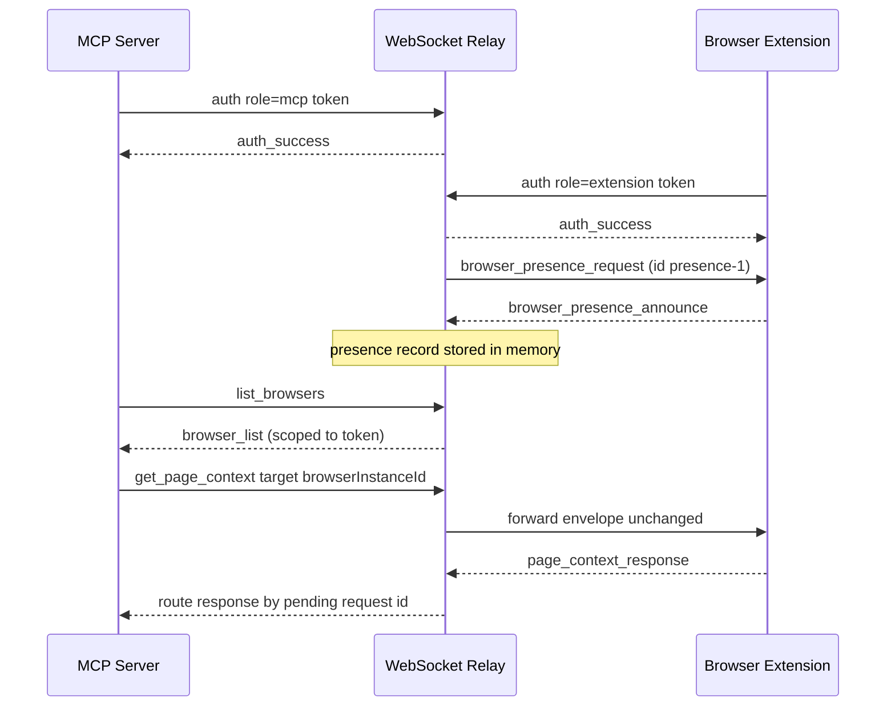

# WebSocket Relay: Auth, Presence, and Routing

The `servers/websocket` package is the local transport hub for Brijio. It is a
deliberately small WebSocket relay: it authenticates clients with a pairing
token, keeps a runtime-only table of which browser extensions are online, and
forwards envelopes between MCP servers and extensions. It is **state-light** —
it holds presence in memory for the life of a socket and discards it on close,
and it never inspects or interprets the payload of a forwarded message. All
application semantics live in the MCP server and the extension; the relay only
wires the right sockets together.

For the end-to-end journey of a single tool call through this relay, see
[MCP ↔ WebSocket ↔ Extension Flow](mcp-extension-flow.md). Protocol envelope
shapes and error codes are defined in the shared package and covered on the
[Data and Protocol](../data-and-protocol.md) page; the security model is
summarized on [Security](../security.md).

## Responsibilities and boundaries

The relay owns exactly four things:

1. **Authentication** — accepting connections only after they present a valid
   pairing token, and deriving a private routing scope from that token.
2. **Presence** — an in-memory registry of online browser instances, scoped by
   token, populated by extension announcements.
3. **Routing** — delivering an MCP-originated envelope to the one extension that
   should handle it, and matching the response back to the requesting MCP socket.
4. **Health** — an HTTP endpoint reporting server version, uptime, and the
   currently connected browsers.

It deliberately does **not** own: durable identity, persisted presence, page
content, URLs, DOM state, action semantics, or message interpretation. ADR 0021
calls this out explicitly — durable server-side presence storage, hosted
identity, and new browser capabilities are all out of scope. The relay forwards
envelopes unchanged and answers only a handful of control messages
(`auth`, `browser_presence_announce`, `browser_presence_request`,
`extension_keepalive`, `list_browsers`) itself.

## Entrypoint and configuration

`servers/websocket/src/index.ts` is the process entrypoint. It reads host/port
from the environment, constructs the server, and logs the bound URL:

- `WEBSOCKET_HOST` (default `0.0.0.0`)
- `WEBSOCKET_PORT` (default `8787`, must parse as a number)

The server itself is built by `createWebSocketServer` in
`servers/websocket/src/server.ts`, which accepts a `WebSocketServerOptions`
object. For tests this object carries `pairingToken`, `additionalPairingTokens`,
`host`, `port`, and an injectable `now()` clock. In production the tokens come
from the environment.

### Pairing tokens

`getPairingTokens` resolves the accepted token set with a fixed precedence:

1. `options.pairingToken` (explicit, used by tests)
2. `process.env.BRIJIO_PAIRING_TOKEN`
3. `process.env.BRIJIO_TOKEN` (legacy fallback)

If no token resolves, the server **throws at startup** (`BRIJIO_PAIRING_TOKEN
must be configured.`) — the relay will not start without a configured scope.
The resolved primary token is unioned with `options.additionalPairingTokens`
into a `Set<string>`, so any one of the accepted tokens authenticates a
connection and — critically — all accepted tokens derive **distinct** scope
keys. Additional tokens are a way to rotate credentials or admit a second
deployment without sharing the primary secret, but each token isolates its own
presence and routing scope (see [Scope keys](#scope-keys)).

## Connection lifecycle and roles

Every inbound WebSocket starts in an unauthenticated `ConnectionState`:

```ts
interface ConnectionState {
  role: BrijioRole | undefined; // 'extension' | 'mcp'
  scopeKey: string | undefined;
  browserInstanceId: string | undefined;
}
```

A connection is considered authenticated once `scopeKey` is set. Until then,
every incoming message is routed to `handleUnauthenticatedMessage`; after auth,
to `handleAuthenticatedMessage`, which branches on `role`:

- **`extension`** connections may announce browser presence, send keepalives,
  and return responses to pending MCP requests. They are the _presence
  providers_.
- **`mcp`** connections may list browsers and send requests to be forwarded to
  an extension. They are the _presence consumers_ and request initiators.

The `BrijioRole` type is exactly `'extension' | 'mcp'` — there is no third role,
and the relay treats any authenticated connection as one of these two.



_The full local pairing, presence, and routing handshake from ADR 0021._

## Authentication

The first message a client sends must be an `auth` payload
(`isAuthPayload` checks `type === 'auth'`, role is `extension` or `mcp`, and a
non-empty `token` string). The handler:

1. If the payload is not an auth message, replies `auth_required` —
   _"Authenticate before sending Brijio messages."_
2. If the token is not in the accepted set, logs `auth_failed` and replies
   `auth_failed` — _"Brijio pairing token was not accepted."_
3. On success, sets `state.role` and `state.scopeKey = createScopeKey(token)`,
   replies `createAuthSuccessEnvelope(message.id)`, and logs
   `client_authenticated`.

The raw token is never stored in connection state, presence records, logs, or
responses — only the derived `scopeKey` is. Immediately after a **successful
extension** auth, the relay sends a `browser_presence_request` (id `presence-1`)
to prompt the extension to announce itself. MCP connections receive no such
prompt.

## Scope keys

`createScopeKey` (in `servers/websocket/src/protocol.ts`) hashes the token with
SHA-256 and returns the hex digest — a 64-character string that is stable for a
given token but does not reveal the token. The scope key is the relay's private
routing boundary: presence records, pending-request keys, and `list_browsers`
results are all filtered by `scopeKey`. An MCP connection authenticated with
token A can never see or route to a browser announced under token B, even though
both live in the same process and the same `presence` map. This is the
"private routing scope" from ADR 0021 and is why additional pairing tokens do not
collapse into one shared namespace.

## Presence model

Presence is runtime-only and kept in a single in-memory map:

```ts
interface PresenceRecord extends Required<BrowserPresence> {
  scopeKey: string;
  socket: WebSocket;
}
```

Keyed by `presenceKey(scopeKey, browserInstanceId)` — a `${scopeKey}:${browserInstanceId}`
string — so the same `browserInstanceId` under different tokens is distinct.

- **Population.** An extension sends a `browser_presence_announce` payload
  (`isBrowserPresenceAnnouncePayload` validates `browserInstanceId`, `label`,
  `browserName`, `profileName`, and a `capabilities` array of known
  `BrowserCapability` values). `upsertPresence` stores the record, preserving
  the original `connectedAt` on re-announcement and refreshing `lastSeenAt` to
  `now().toISOString()` (the injectable clock makes this deterministic in tests).
- **Visibility.** `listRecordsForScope` filters by both `scopeKey` **and**
  `socket.readyState === OPEN`, so a half-closed socket is excluded from routing
  and listing even before the `close` handler runs.
- **Eviction.** On `socket.on('close')`, if the connection had a `scopeKey` and
  `browserInstanceId`, its presence record is deleted and `client_disconnected`
  is logged. There is no persistence, no graceful handoff, and no deferred
  expiry — closing the socket removes the browser immediately. This is the
  state-light guarantee: presence disappears when the socket closes.

`list_browsers` is the one MCP message the relay answers itself (rather than
forwarding). It returns a `browser_list` payload containing only the browsers in
the caller's scope, projected through `presenceForResponse` (which strips the
internal `socket` and `scopeKey`).

## Routing

Routing is the core forwarding behavior. For an authenticated **MCP** message
the relay runs `handleMcpMessage`:

1. If the payload is `list_browsers`, answer directly from the presence table
   (above).
2. Otherwise call `selectBrowser` over the in-scope, OPEN records, using
   `message.target?.browserInstanceId` as the optional explicit target.
3. If selection fails, reply a structured `error` envelope and do **not** store
   a pending request.
4. On success, if the message has an `id`, record
   `pendingRequests.set(pendingRequestKey(scopeKey, message.id), socket)` so the
   eventual response can be routed back, then `sendJson` the **entire envelope
   unchanged** to the selected extension's socket.

### Target selection and structured errors

`selectBrowser` encodes the routing rules from ADR 0021 and produces structured
errors for every failure case:

| Situation                                               | Error code                 | Message                                                                                                   |
| ------------------------------------------------------- | -------------------------- | --------------------------------------------------------------------------------------------------------- |
| Explicit `browserInstanceId` not found in scope         | `browser_unavailable`      | "No matching Brijio browser is online."                                                                   |
| No `browserInstanceId` and zero browsers online         | `browser_unavailable`      | "No Brijio browser is online."                                                                            |
| No `browserInstanceId` and more than one browser online | `ambiguous_browser_target` | "Multiple Brijio browsers are online. Specify browserInstanceId." — with a `browsers` array of candidates |
| Exactly one browser online and no explicit target       | (success)                  | routes to that one browser                                                                                |

The `ambiguous_browser_target` error is notable: it carries the full candidate
list (`records.map(presenceForResponse)`) so the MCP server can surface the
choice to the agent rather than guessing. Routing is deterministic only when
exactly one browser is online or the caller pins a `browserInstanceId`.

### Response routing back to MCP

When an **extension** sends a message after auth, `handleExtensionMessage`
classifies it in order:

1. `browser_presence_announce` → update presence (no reply).
2. `extension_keepalive` → silently accepted, logged at debug, **not
   forwarded** (see [Keepalive and reconnect](#keepalive-and-reconnect)).
3. A message whose `id` matches a pending request → `routeExtensionResponse`
   looks up `pendingRequests.get(pendingRequestKey(scopeKey, message.id))`,
   forwards the envelope to that MCP socket, and deletes the pending entry.
4. Anything else → `invalid_message` error: _"Extension messages must announce
   browser presence or respond to a pending request."_

The relay matches responses to requests purely by `scopeKey + message.id`. It
does not understand the payload type, so a `page_context_response`, a
`tab_list_response`, a screenshot result, or a batch result all follow the same
path: whatever the extension sends back with the original request `id` is
delivered verbatim to the waiting MCP socket.

### `list_tabs` is forwarded, not answered

Unlike `list_browsers` (which the relay serves from its own table), `list_tabs`
is a normal forwarded request. `isListTabsMessage` exists only to log the
forwarding; the message then goes through the standard `selectBrowser` +
`sendJson` path to the extension, and the extension's `tab_list_response` comes
back via `routeExtensionResponse`. This keeps tab state entirely in the
extension and the relay content-agnostic.

## Keepalive and reconnect

Chrome runs extension background work in a Manifest V3 service worker that
Chrome may stop when idle. ADR 0006 added an `extension_keepalive` message the
extension sends periodically while the bridge is ON so WebSocket activity keeps
the worker alive. The relay's contract for keepalive is narrow:

- It is recognized by `isKeepalivePayload` (`payload.type ===
'extension_keepalive'`).
- It is **silently accepted** — no success or error reply is sent to the
  extension.
- It is **never forwarded** to other clients (the ADR sequence diagram marks
  this explicitly: "Do not forward keepalive").
- It does **not** update presence. Presence refresh happens via
  `browser_presence_announce`, not keepalive.

The keepalive interval is set below Chrome's service-worker idle window (20
seconds per ADR 0006) and `minimum_chrome_version` is pinned to `116` because
Chrome 116 improved service-worker keepalive through WebSocket activity.

Reconnection is not orchestrated by the relay. Because presence is runtime-only,
a dropped extension socket simply disappears from the table on `close`; when the
extension reconnects and re-announces, it reappears with a fresh `connectedAt`
(unless an existing record for the same scope+instance is being upserted, in
which case `connectedAt` is preserved). MCP requests issued while no browser is
online fail fast with `browser_unavailable` rather than queuing — the relay
holds no durable state to retry against.

## Health endpoint

The relay attaches a small HTTP server (the same `node:http` instance the
`WebSocketServer` rides on) and exposes `GET /health`. Any other path returns a
`404`. `getStatus()` returns a `WebSocketHealthStatus`:

```ts
interface WebSocketHealthStatus {
  status: "ok";
  version: string; // from package.json
  uptimeSeconds: number; // floor((now - startTime) / 1000)
  extensions: {
    count: number;
    browsers: Array<{ browserInstanceId: string; label: string }>;
  };
}
```

The `extensions.browsers` list is built by filtering presence records to those
whose socket is still `OPEN` and projecting only `browserInstanceId` and
`label` — less than what `list_browsers` returns, intentionally, since the health
endpoint is for operational monitoring, not routing. Tests assert that
`getStatus().extensions.count` reflects connected extensions and drops to `0`
once they disconnect.

## Health vs. presence, and the state-light invariant

Two things that look similar are deliberately different:

- **`/health` and `getStatus()`** report a _snapshot_ for operations — version,
  uptime, and a count + minimal identity of connected browsers.
- **`list_browsers`** returns the _routing-grade_ presence view — full
  `BrowserPresence` (label, browserName, profileName, connectedAt, lastSeenAt,
  capabilities), scoped to the caller's token, consumed by the MCP server to
  pick a target.

Both derive from the same in-memory `presence` map, and both vanish when the
process restarts. The relay never writes presence to disk, a database, or a
remote store. This is the state-light contract: if the relay process exits,
presence is gone, and clients must re-authenticate and re-announce. The
conceptual model is designed so future cloud work can replace local token
issuance and in-memory presence without changing the auth → scope → presence →
routing shape described here.

## Error envelope shape

All relay-originated failures use `createErrorEnvelope` from the shared
package, producing a `{ type: 'error', error: { code, message, browsers? } }`
envelope. The relay itself emits only a handful of these codes: `auth_required`,
`auth_failed`, `invalid_message`, `invalid_json`, `browser_unavailable`, and
`ambiguous_browser_target`. The wider `BrijioErrorCode` union also contains
action-specific codes (`timeout`, `unsupported_action`, `invalid_browser_target`,
batch/upload errors) that the relay forwards in extension responses rather than
generates. `parseBrijioEnvelope`
itself returns `invalid_json` for unparseable input and `invalid_message` for a
valid JSON value that is not a `{ type: 'message', payload }` envelope, so
malformed frames are rejected before any auth or routing logic runs.

## Where this fits in the wider system

- The **MCP server** (`servers/mcp`) is the relay's other main client; it opens
  a socket per request, authenticates, sends an envelope, and waits for the
  matched-id response. That round trip is traced in
  [MCP ↔ WebSocket ↔ Extension Flow](mcp-extension-flow.md).
- The **extension** (`clients/extensions/chrome`, `clients/extensions/safari`)
  authenticates as `role: 'extension'`, announces presence, handles keepalive,
  and receives forwarded envelopes via the shared background controller.
- **Action-approval** flows for sensitive operations ride over this same relay
  and are described in [Action Approval](../workflows/action-approval.md).
- Envelope shapes, payload types, and the full error-code table live in
  `packages/shared/src/protocol.ts` and are summarized on
  [Data and Protocol](../data-and-protocol.md); the pairing-token security model
  is summarized on [Security](../security.md).
