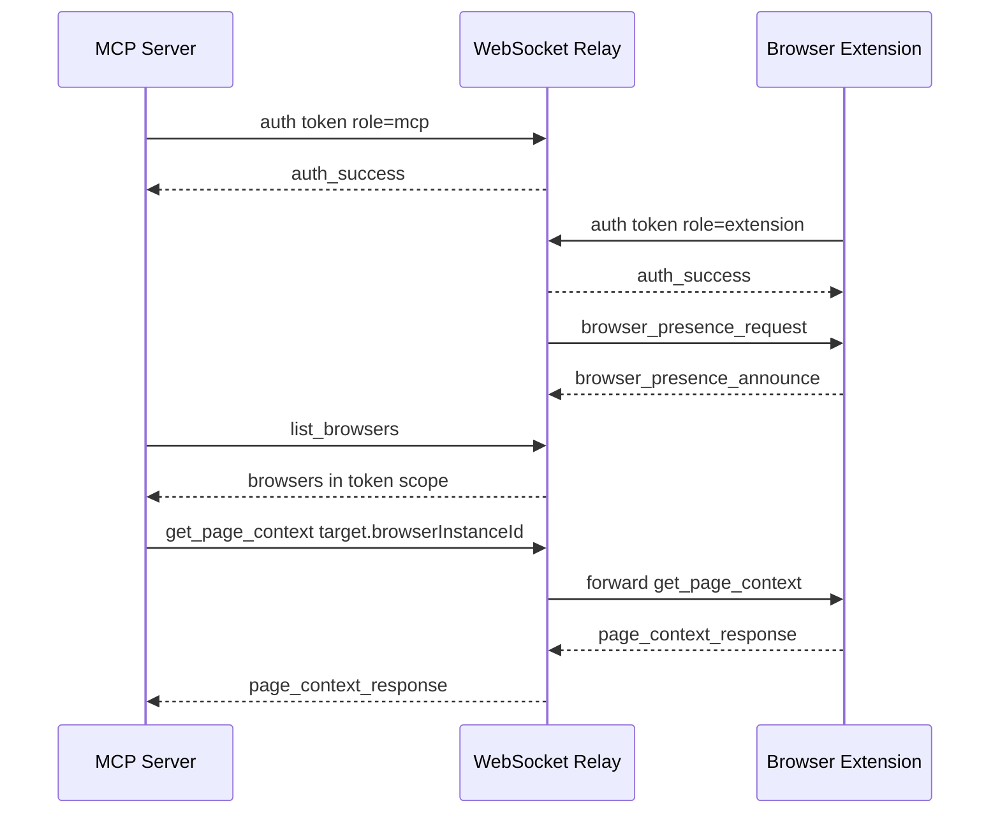
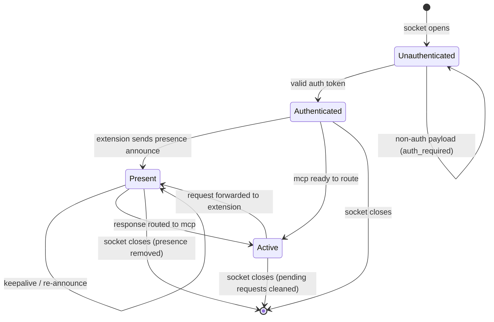

# WebSocket Relay Domain

The WebSocket relay (`servers/websocket`) is the local message transport that
sits between the [MCP server](mcp-server.md) and the browser extension. It is
intentionally **state-light**: it authenticates connections, tracks which
browser instances are currently online in memory, and routes per-call
requests and responses — but it persists nothing and stores no page content,
URL, title, or DOM state. When a socket closes, that connection's presence
disappears.

The relay is a small Node process built on the `ws` library. The HTTP server
that owns the WebSocket upgrade also serves a single `GET /health` endpoint.
Everything the relay does is scoped to a per-token `scopeKey`, so multiple
pairing tokens sharing one process never see one another's browsers or
traffic.

## Responsibilities

1. **Authenticate** every connection (MCP and extension) against the pairing
   token before any routing.
2. **Track browser presence** at runtime only, keyed by `scopeKey +
browserInstanceId`.
3. **Route MCP requests** to an online browser in the same token scope, with
   explicit per-call targeting.
4. **Route extension responses** back to the MCP connection that issued the
   request, via an in-flight `pendingRequests` map.
5. **Expose `/health`** with version, uptime, and the connected extension set.
6. **Emit structured JSON logs** to stderr for observability.

## Process entrypoint and configuration

`servers/websocket/src/index.ts` is the process entrypoint. It reads host and
port from the environment, constructs the server, and logs the listening URL:

```ts
const host = process.env.WEBSOCKET_HOST ?? "0.0.0.0";
const port = Number.parseInt(process.env.WEBSOCKET_PORT ?? "8787", 10);
const server = await createWebSocketServer({ host, port });
```

Environment variables:

| Variable                  | Default   | Notes                                                                                           |
| ------------------------- | --------- | ----------------------------------------------------------------------------------------------- |
| `WEBSOCKET_HOST`          | `0.0.0.0` | Bind address. Local installs use `127.0.0.1`.                                                   |
| `WEBSOCKET_PORT`          | `8787`    | Must be numeric.                                                                                |
| `BRIJIO_PAIRING_TOKEN`    | —         | Required. The relay fails to start if unset or empty. `BRIJIO_TOKEN` is accepted as a fallback. |
| `additionalPairingTokens` | —         | Passed programmatically via `createWebSocketServer` options, not an env var.                    |

`getPairingTokens` builds a `Set` of accepted tokens from
`options.pairingToken` (or `BRIJIO_PAIRING_TOKEN` / `BRIJIO_TOKEN`), plus
`options.additionalPairingTokens`. If the primary token is missing the server
throws `BRIJIO_PAIRING_TOKEN must be configured.` — the process never starts in
a tokenless state.

## Message envelope

All client traffic uses the JSON envelope defined in
`packages/shared/src/protocol.ts`:

```json
{
  "type": "message",
  "id": "optional-message-id",
  "target": { "browserInstanceId": "optional", "tabId": "optional" },
  "payload": { "type": "..." }
}
```

`parseBrijioEnvelope` validates the raw frame: it returns an `invalid_json`
error envelope if the frame is not parseable JSON, and an `invalid_message`
error envelope if the parsed value is not a `{ type: "message", payload }`
object. Errors are returned directly to the sending socket; the connection
stays open. Validation happens before auth is considered, so even
unauthenticated sockets receive structured errors for malformed input.

## Authentication and scope key

Every connection starts with a per-socket `ConnectionState` whose
`scopeKey` is `undefined`. Until `scopeKey` is set, the socket is
unauthenticated and the first message must be an `auth` payload.

The auth flow:

1. `isAuthPayload` checks that `payload.type === 'auth'`, `role` is
   `'extension'` or `'mcp'`, and `token` is a non-empty string. Any other
   payload before auth returns `auth_required`.
2. The token is checked against the accepted `Set`. A miss logs `auth_failed`
   and returns an `auth_failed` error; the connection remains open but still
   unauthenticated.
3. On success, `state.role` and `state.scopeKey` are set. `createScopeKey`
   hashes the token with SHA-256 to a 64-hex-char key — the raw token is never
   stored in presence state, logged (scope keys are truncated to 8 chars in
   logs), or echoed in responses.
4. The server sends `createAuthSuccessEnvelope(message.id)` back to the client.
5. If the role is `extension`, the server immediately sends a
   `browser_presence_request` (id `presence-1`) so the extension announces
   itself.

Because the scope key is a deterministic function of the token, two
connections using the same token share one scope; different tokens produce
independent scopes. This is the tenant-isolation boundary.



Auth -> presence -> request routing for one MCP and one extension in the same token scope.

## Role-based handling

After auth, `handleAuthenticatedMessage` branches on `state.role`:

- **Extension role** (`handleExtensionMessage`) handles presence, keepalive,
  and routed responses.
- **MCP role** (`handleMcpMessage`) handles browser discovery and forwards
  requests to a browser.

### Extension messages

- `browser_presence_announce` — validated by `isBrowserPresenceAnnouncePayload`
  (requires non-empty `browserInstanceId`, `label`, `browserName`,
  `profileName`, and an array of valid `capabilities`). On accept, the socket's
  `browserInstanceId` is recorded in `ConnectionState` and the presence map is
  upserted. Malformed announce payloads fall through to an `invalid_message`
  error that lists the missing fields in the log.
- `extension_keepalive` — silently accepted and not forwarded. This exists
  to keep the Chrome MV3 background service worker alive while the bridge is
  ON; it carries no page data (see ADR 0006).
- Anything else with a matching `id` is treated as a **response** and routed
  back to the pending MCP socket (see below). An extension message that is
  neither a valid announce, a keepalive, nor a routable response returns
  `invalid_message`.

### MCP messages

- `list_browsers` — answered directly from the in-memory presence table. The
  server returns a `browser_list` payload containing only browsers in the
  caller's `scopeKey` whose sockets are still `OPEN`.
- `list_tabs` — logged, then forwarded to the selected browser like any other
  request; the extension answers with `tab_list_response`, routed back via
  the pending-request path.
- All other payloads are **forwarded to a browser** after target selection.

## Browser presence

Presence lives in a single `Map<string, PresenceRecord>` created per server
instance. The key is `${scopeKey}:${browserInstanceId}`. A `PresenceRecord`
carries the `scopeKey`, the owning `socket`, the identity fields
(`browserInstanceId`, `label`, `browserName`, `profileName`,
`capabilities`), and timestamps (`connectedAt`, `lastSeenAt`).

`upsertPresence` preserves the original `connectedAt` on re-announce while
refreshing `lastSeenAt`, so repeated presence announcements and keepalive
cycles do not reset the connection start time.

Presence is **runtime-only**:

- On `socket.on('close')`, if the connection had a `scopeKey` and
  `browserInstanceId`, its presence entry is deleted and `client_disconnected`
  is logged.
- `listRecordsForScope` filters by both `scopeKey` equality and
  `socket.readyState === OPEN`, so a closing socket stops being selectable
  immediately even before the `close` handler runs.
- There is no durable store, no on-disk presence, and no page URL/title/content
  in the record. Presence is purely "is this browser online now."

This model means a relay restart clears all presence; extensions re-announce
on reconnect.

## Request routing and pending requests

MCP requests are routed per-call, not via hidden session state. Target
selection in `selectBrowser`:

1. If `message.target.browserInstanceId` is supplied, the server looks for a
   presence record with that id in the scope. A miss returns
   `browser_unavailable` ("No matching Brijio browser is online.").
2. If no target is supplied and zero browsers are online in scope, returns
   `browser_unavailable` ("No Brijio browser is online.").
3. If no target is supplied and more than one browser is online, returns
   `ambiguous_browser_target` with the full candidate browser list so the
   caller can choose.
4. Otherwise the single online browser (or the explicit match) is selected.

`tabId` in the `target` field is part of the shared envelope type and is
passed through verbatim with the rest of the message; the relay does not
interpret or strip it. Targeting is explicit and per-call: the server keeps no
"selected browser" between requests, so two consecutive requests must each
resolve their target independently.

Once a browser is selected and the request has an `id`, the relay records the
**originating MCP socket** in `pendingRequests` keyed by
`${scopeKey}:${message.id}`, then forwards the original envelope unchanged to
the extension's socket. The request id is the correlation key for the
response.

When the extension later sends a message whose `id` matches a pending key in
the same scope, `routeExtensionResponse` looks up the waiting MCP socket,
deletes the pending entry, and forwards the response envelope to the MCP
socket. If no `id` or no matching pending entry exists, the extension message
is not treated as a response.

### Failure and cleanup semantics

- The relay sends only when `socket.readyState === OPEN`; writes to closing
  sockets are dropped silently rather than throwing.
- On socket close, `cleanupPendingRequestsForSocket` removes every pending
  entry whose originating socket was the one closing, so an MCP disconnect
  does not leak pending entries whose responses would never be read. The
  extension response path simply finds no matching pending key and discards
  the response.
- Requests without an `id` are still forwarded but cannot receive a routed
  response (no pending entry is created).

## Health endpoint

The HTTP server handles `GET /health` via `handleHealthRequest`. Any other
method or path returns `404`.

The response (`WebSocketHealthStatus`) is:

```json
{
  "status": "ok",
  "version": "<package.json version>",
  "uptimeSeconds": 3621,
  "extensions": {
    "count": 2,
    "browsers": [
      { "browserInstanceId": "chrome-default", "label": "Chrome Default" }
    ]
  }
}
```

`version` is read from `package.json` at module load. `uptimeSeconds` is
`floor((now - startTime) / 1000)`. The `extensions` block is derived live from
the presence map, filtered to `OPEN` sockets; `count` is the number of online
browsers and `browsers` lists `browserInstanceId` + `label` only (not tokens
or scope keys). `getStatus` is also exposed on the returned server object for
programmatic use. See ADR 0033.

## Structured logging

The relay uses `createLogger('websocket')` from `packages/shared`, which emits
single-line JSON `LogEntry` objects (`timestamp`, `level`, `message`,
`service`, plus context) to **stderr**. Stderr is chosen so logs never
interfere with the MCP stdio transport or HTTP response pipes. Notable events:
`server_started`, `client_authenticated`, `auth_failed`, `presence_announce`,
`client_disconnected`, `list_browsers`, `list_tabs_forwarded`,
`mcp_request_routed`, `mcp_request_no_browser`, `extension_response_routed`,
`extension_keepalive`, and `invalid_message`. Scope keys in log context are
truncated to 8 characters.

## State and lifecycle summary



Connection state progression from open through auth to presence/routing and back to closed.

## Change guidance

Routing and authentication changes belong here. When modifying the relay:

- **Preserve per-call targeting.** `browserInstanceId` and `tabId` are
  explicit on each request; do not introduce hidden "selected browser"
  session state. Any new routing rule must keep target resolution independent
  per request.
- **Preserve scope isolation.** All presence lookups, `list_browsers`
  results, and `pendingRequests` keys are scoped by `scopeKey`. Do not add
  cross-scope access without a deliberate new boundary.
- **Keep presence runtime-only.** Do not persist presence or add page content
  to `PresenceRecord` — that is a deliberate invariant from ADR 0021.
- **Return structured errors and timeouts.** Continue using
  `createErrorEnvelope` with stable codes (`invalid_json`, `invalid_message`,
  `auth_required`, `auth_failed`, `browser_unavailable`,
  `ambiguous_browser_target`) so callers can branch on them.
- **Keep the health endpoint minimal.** No new HTTP routes beyond `/health`.
- **Log to stderr as JSON** so MCP stdio transport and HTTP pipes stay clean.

The protocol shapes and validation helpers live in
`packages/shared/src/protocol.ts`; the relay re-exports and adds only
`createScopeKey`. Shared envelope/type changes therefore affect both the relay
and the MCP server — coordinate across [MCP ↔ WebSocket ↔ Extension
Flow](mcp-extension-flow.md) and the [Data and Protocol](../data-and-protocol.md)
pages when touching them.
