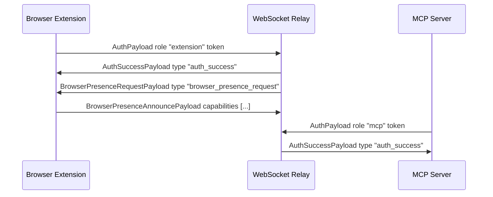
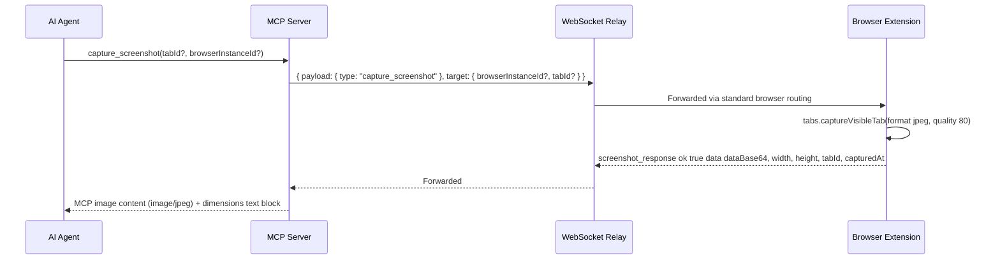

# Protocol and Data Model Guide

`packages/shared/src/protocol.ts` is the single source of truth for the wire
shapes exchanged across the Brijio runtime chain — the AI agent, the MCP
server, the WebSocket relay, and the Chrome/Safari extensions. Every envelope,
payload, capability flag, error code, and response builder used to bridge those
boundaries is defined here. Treat this file as the contract: the MCP server
(`servers/mcp/src/protocol.ts`) and extensions consume these shapes; the
WebSocket relay re-exports the envelope builders directly. Changing a shape
here without updating the relay, MCP server, and both extensions will break
interoperability.

For the end-to-end runtime path of one request see
<!-- openwiki: broken internal link [../architecture/mcp-extension-flow.md] file "../architecture/mcp-extension-flow.md" does not exist. Fix the href or restore the target, then delete this comment. -->

[MCP ↔ WebSocket ↔ Extension Flow](../architecture/mcp-extension-flow.md).
Per-tool behavior and the tool catalog live in
<!-- openwiki: broken internal link [../workflows/browser-actions.md] file "../workflows/browser-actions.md" does not exist. Fix the href or restore the target, then delete this comment. -->

[Browser Actions](../workflows/browser-actions.md); the multi-tab workflow is in
<!-- openwiki: broken internal link [../workflows/multi-tab.md] file "../workflows/multi-tab.md" does not exist. Fix the href or restore the target, then delete this comment. -->

[Multi-tab Workflow](../workflows/multi-tab.md); the client-side approval
<!-- openwiki: broken internal link [../architecture/action-approval.md] file "../architecture/action-approval.md" does not exist. Fix the href or restore the target, then delete this comment. -->

boundary is in [Client-Side Action Approval](../architecture/action-approval.md).

## The canonical envelope

All application messages flow inside a single, intentionally simple envelope:

```ts
interface WebSocketEnvelope {
  type: "message";
  id?: string;
  target?: { browserInstanceId?: string; tabId?: string };
  payload: unknown;
}
```

`BrijioEnvelope` is an alias for `WebSocketEnvelope`. The envelope is the unit
the relay parses and routes:

- `type` is always `'message'`; a sibling `type: 'error'` form is reserved for
  relay-level error envelopes (see [Error-code model](#error-code-model)).
- `id` is the correlation key. The MCP server stamps every outgoing request
  with an `mcp-...` id and matches the extension's response on the same id;
  auth and presence announce carry it too. When `id` is undefined the relay
  treats the message as uncorrelated (a broadcast such as presence announce).
- `target` carries explicit routing: `browserInstanceId` selects which connected
  extension receives the request, and `tabId` selects a specific tab within
  that extension. Both are optional; the relay resolves `browserInstanceId`
  via presence and passes `tabId` through untouched for the extension to
  resolve against the real Chrome/Safari tab id.
- `payload` is an untyped `unknown` at the envelope level; each payload
  discriminates itself with a `type` string (`'auth'`, `'list_tabs'`,
  `'capture_screenshot'`, …). The shared package provides per-payload
  interfaces and `is*` guards that validate the discriminated payload.

`parseBrijioEnvelope(rawMessage)` is the shared entry point for inbound JSON:
it JSON-parses and runs `isEnvelope`, returning either the validated envelope
or a `BrijioErrorEnvelope` with code `invalid_json` / `invalid_message`. The
relay calls it on every socket message before dispatch.

### Roles, auth, and presence



The handshake establishes identity before any tab work happens.

- `BrijioRole` — `'extension' | 'mcp'`. The relay gates message handling on the
  authenticated role: only extensions may announce presence; only MCP
  connections may originate routed requests.
- `AuthPayload` — `{ type: 'auth', role, token }`. `createAuthEnvelope` builds
  it from either a bare token (defaulting role to `'extension'`) or an
  `{ token, role, requestId }` object. The token is checked against the
  relay's pairing-token set; mismatches return `auth_failed`.
- `AuthSuccessPayload` — `{ type: 'auth_success' }`, returned with the original
  request id echoed back.
- `BrowserPresenceRequestPayload` — `{ type: 'browser_presence_request' }`,
  sent by the relay to a freshly authenticated extension to ask it to
  announce.
- `BrowserPresenceAnnouncePayload extends BrowserPresence` — adds
  `type: 'browser_presence_announce'`. The relay upserts the announced
  presence into its in-memory presence map keyed by `(scopeKey,
browserInstanceId)` and uses it to answer `list_browsers` requests and to
  route `browserInstanceId`-targeted requests.

## Browser presence and capabilities

`BrowserPresence` describes one connected extension instance:

```ts
interface BrowserPresence {
  browserInstanceId: string;
  label: string;
  browserName: string;
  profileName: string;
  connectedAt?: string;
  lastSeenAt?: string;
  capabilities: BrowserCapability[];
}
```

`browserInstanceId` is the routing key carried in `target.browserInstanceId`.
`capabilities` is the declared feature surface of that extension; the MCP
server and agent use it to decide which tools are safe to call against a given
browser. The `isBrowserPresenceAnnouncePayload` guard validates that every
required string field is non-empty and that every capability is a known
`BrowserCapability`.

`BrowserCapability` is the closed enum of named browser features. The full
set, matching `isBrowserCapability` in the shared protocol:

| Capability        | Meaning                                                                 |
| ----------------- | ----------------------------------------------------------------------- |
| `page_context`    | Can produce a structured page snapshot (`PageContext`)                  |
| `page_content`    | Can stream full page content chunks (`PageContent`)                     |
| `click`           | Can click links/actions                                                 |
| `fill_input`      | Can fill form controls (legacy alias; `fill_editable` covers editables) |
| `fill_editable`   | Can fill contenteditable / rich-text elements                           |
| `set_checked`     | Can toggle checkboxes/radios                                            |
| `select_options`  | Can change `<select>` option state                                      |
| `submit_form`     | Can submit forms (approval-gated)                                       |
| `navigate`        | Can navigate a tab to a URL                                             |
| `batch`           | Can execute `perform_batch` action sequences (≤ `BATCH_MAX_ACTIONS`)    |
| `upload_file`     | Can stage and upload files to file inputs                               |
| `download_status` | Can report download/fetch item state                                    |
| `download_file`   | Can initiate a browser download (approval-gated)                        |
| `fetch_resource`  | Can fetch a URL resource through the page (approval-gated)              |
| `screenshot`      | Can capture a viewport JPEG (ADR 0064)                                  |

Extensions include the capabilities they actually support in their announce
payload; the MCP server does not assume an entry is present. Newer entries
added by later ADRs — `download_status`, `download_file`, `fetch_resource`,
and `screenshot` — are first-class members of this enum.

## Tab listing and explicit tab targeting

Tab awareness was added by ADR 0060
([explicit tab listing and selection](../../docs/architecture/decisions/0060-explicit-tab-listing-and-selection.md)).
The protocol types are:

```ts
interface TabInfo {
  tabId: string; // opaque raw Chrome/Safari tab id as string
  windowId: string; // opaque raw Chrome/Safari window id as string
  title: string;
  url: string; // HTTP/HTTPS only
  active: boolean; // user's currently focused tab
  supported: boolean; // always true for listed tabs
}

interface ListTabsRequestPayload {
  type: "list_tabs";
}

interface TabListResponsePayload {
  type: "tab_list_response";
  ok: true;
  data: { tabs: TabInfo[] };
}
interface TabListErrorResponsePayload {
  type: "tab_list_response";
  ok: false;
  error: { code: string; message: string };
}
```

`isTabInfo` validates every `TabInfo` field, and `isTabListResponsePayload`
validates the whole `tabs` array. The shared builders are
`createListTabsEnvelope` (request) and `createTabListResponse` (success).

### Per-call tabId, not session state

The defining design choice is that tab targeting is **explicit and per-call**.
There is no `select_tab` session-level default and no hidden "selected tab"
state held by the relay or MCP server. `tabId` rides on the existing
`target` field of the envelope alongside `browserInstanceId`:

```ts
target: { browserInstanceId?: string, tabId?: string }
```

Each MCP tool accepts an optional `tabId` input, normalizes it through a
shared `normalizeTabId` guard (must be a non-empty string when provided), and
threads it into the request. When `tabId` is omitted the extension falls back
to the active tab (`tabs.query({ active: true, currentWindow: true })`);
when provided, the extension resolves that specific tab and targets it, still
validating it is a regular page. The `BrijioPageActionsConfig` carries a
`defaultTabId` fallback, but the canonical path is the explicit per-call
value.

`list_tabs` is forwarded through the relay like any other request: the relay's
`isListTabsMessage` check logs it, then the standard browser-selection routing
delivers it to the chosen extension, which returns a `tab_list_response`. Only
regular HTTP/HTTPS tabs are listed; `chrome://`, `chrome-extension://`,
`about:`, `file://`, and incognito tabs are filtered out by the extension.

For the full tab workflow — listing, choosing, opening new tabs, and
<!-- openwiki: broken internal link [../workflows/multi-tab.md] file "../workflows/multi-tab.md" does not exist. Fix the href or restore the target, then delete this comment. -->

re-reading after navigation — see [Multi-tab Workflow](../workflows/multi-tab.md).

## Staged file upload

File uploads to a `<input type="file">` control are staged through an explicit
multi-message flow so that the binary content can be chunked and checksummed
across the WebSocket boundary. Each payload and its dedicated envelope type:

| Payload `type`               | Direction | Carries                                                                                                                                                     |
| ---------------------------- | --------- | ----------------------------------------------------------------------------------------------------------------------------------------------------------- |
| `stage_file_upload_start`    | MCP → Ext | `uploadId`, `file { name, size, type?, sha256? }`, `chunkSize`, `totalChunks`                                                                               |
| `stage_file_upload_chunk`    | MCP → Ext | `uploadId`, `index`, `dataBase64`                                                                                                                           |
| `stage_file_upload_complete` | MCP → Ext | `uploadId`, optional `sha256`                                                                                                                               |
| `stage_file_upload_staged`   | Ext → MCP | `uploadId` (acknowledgment that staging succeeded)                                                                                                          |
| `stage_file_upload_ack`      | Ext → MCP | `uploadId` (flow acknowledgment)                                                                                                                            |
| `stage_file_upload_error`    | Ext → MCP | `uploadId`, `error.code` (one of `invalid_file_payload`, `checksum_mismatch`, `file_too_large`, `invalid_file_name`, `invalid_file_type`, `upload_expired`) |

The `start`/`chunk`/`complete` payloads each have a dedicated
`StageFileUpload*Envelope` type whose `target` is scoped to a
`browserInstanceId`. The `ack` and `error` envelopes allow an undefined
`target`, since the response may be sent without explicit browser targeting.

This staging surface is the protocol-layer foundation for `upload_file` action
handling; the action-level `PerformUploadFileAction` carries a `FileUploadPayload`
(`fileName`, `mimeType`, `contentBase64`, `sizeBytes`, optional `lastModified`)
targeting a `FormControlTarget` file input. The shared protocol does not
duplicate the staging shapes into other packages — `packages/shared/src/protocol.ts`
is the only source.

## Downloads and fetch resource status

ADR 0047 introduced download and fetch primitives. Two status item shapes
describe in-flight and completed transfers:

```ts
type DownloadState = "in_progress" | "complete" | "interrupted";

interface DownloadInfo {
  id: number;
  kind: "download";
  filename: string;
  url: string;
  mime: string | null;
  size: number | null;
  state: DownloadState;
  error?: string;
  danger?: string;
}

interface FetchResourceInfo {
  id: string;
  kind: "fetch";
  url: string;
  contentType: string | null;
  bytesReceived: number;
  totalBytes: number | null;
  state: DownloadState | "streaming";
  error?: string;
}
```

`DownloadStatusRequest` (`type: 'download_status'`, optional `ids` and
`browserInstanceId`) queries status; the response carries a `capability` of
`'full'` or `'not_supported'` plus an `items` array mixing `DownloadInfo` and
`FetchResourceInfo`:

```ts
interface DownloadStatusResponse {
  type: "download_status_response";
  ok: true;
  capability: "full" | "not_supported";
  items: Array<DownloadInfo | FetchResourceInfo>;
}
interface DownloadStatusErrorResponse {
  type: "download_status_response";
  ok: false;
  error: { code: string; message: string };
}
```

`createDownloadStatusEnvelope` builds the request; `createDownloadStatusResponse`
and `createDownloadStatusErrorResponse` build the answers. The relay-side
guards `isDownloadStatusEnvelope`, `isDownloadFileEnvelope`, and
`isFetchResourceEnvelope` validate inbound requests on the `url` field.

`download_file` initiates a browser download
(`DownloadFileRequest extends ApprovalMetadata` — it is approval-gated; see
<!-- openwiki: broken internal link [../architecture/action-approval.md] file "../architecture/action-approval.md" does not exist. Fix the href or restore the target, then delete this comment. -->

[Client-Side Action Approval](../architecture/action-approval.md)). Its
response reports `status: 'initiated' | 'initiated_fire_and_forget'` and a
nullable `downloadId`.

`fetch_resource` is also approval-gated and streams its result back as a
`FetchResourceStreamMessage` union of `fetch_resource_start`,
`fetch_resource_chunk`, `fetch_resource_complete`, and `fetch_resource_error`.
The complete message carries a `sha256` checksum and optional final
`dataBase64`; the error message carries an `error` string code, optional
`httpStatus`, and a `message`. The MCP server folds the fetch error path into a
composite `fetch_resource_error:<code>: <message>` message so the agent sees
the underlying HTTP/CORS/size failure reason.

## Screenshot capture (ADR 0064)

ADR 0064 ([visual action verification](../../docs/architecture/decisions/0064-visual-action-verification.md))
added an explicit, on-demand screenshot tool. Screenshots are JPEG
viewport captures of the active tab — no auto-capture, no full-page stitching,
no background-tab capture for the current scope.



The protocol types:

```ts
type ScreenshotErrorCode =
  "capability_not_supported" | "capture_failed" | "no_visible_tab" | "timeout";

interface CaptureScreenshotRequest {
  type: "capture_screenshot";
}

interface CaptureScreenshotResponse {
  type: "screenshot_response";
  ok: true;
  data: {
    dataBase64: string;
    width: number;
    height: number;
    tabId: string;
    capturedAt: string;
  };
}
interface CaptureScreenshotErrorResponse {
  type: "screenshot_response";
  ok: false;
  error: { code: ScreenshotErrorCode; message: string };
}
```

`CaptureScreenshotResult` and `CaptureScreenshotStreamMessage` are convenience
unions over the ok/err pair. `isCaptureScreenshotEnvelope` guards the request
via `hasPayloadType(value, 'capture_screenshot')`; `createScreenshotResponse`
and `createScreenshotErrorResponse` build the answers. `'screenshot'` is a
member of the `BrowserCapability` enum, and extensions that support capture
include it in their presence announce.

The MCP `capture_screenshot` tool returns MCP `image` content directly
(`mimeType: 'image/jpeg'`) alongside a text block with `width`, `height`,
`tabId`, and `capturedAt`; a text-only error result is returned with `isError`
when capture fails. `tabId` is accepted for forward compatibility but, for
this scope, only the active tab can be captured — a provided `tabId` must match
the active tab or the tool errors.

## Error-code model

Errors travel back along the same chain in two shapes, and ADR 0061
([forward error codes through MCP](../../docs/architecture/decisions/0061-forward-error-codes-through-mcp.md))
governs how the MCP server forwards them.

### Relay-level errors: `BrijioErrorEnvelope`

When the WebSocket relay rejects a message it emits a top-level error
envelope built with the shared `createErrorEnvelope`:

```ts
type BrijioErrorCode =
  | "invalid_json"
  | "invalid_message"
  | "auth_required"
  | "auth_failed"
  | "invalid_auth_message"
  | "browser_unavailable"
  | "ambiguous_browser_target"
  | "invalid_browser_target"
  | "timeout"
  | "unsupported_action"
  | "batch_failed"
  | "invalid_file_payload"
  | "checksum_mismatch"
  | "file_too_large"
  | "invalid_file_name"
  | "invalid_file_type"
  | "upload_staging_failed"
  | "upload_not_staged"
  | "target_not_file_input"
  | "upload_expired"
  | "download_not_found"
  | "fetch_resource_failed";

interface BrijioErrorEnvelope {
  type: "error";
  error: {
    code: BrijioErrorCode;
    message: string;
    browsers?: BrowserPresence[];
  };
}
```

`browsers?` is populated only for `ambiguous_browser_target`, listing the
online browsers so the agent can pick one. This `BrijioErrorCode` union is the
shared package's authoritative list of relay-emitted codes; the relay
(`servers/websocket/src/server.ts`) constructs every error through
`createErrorEnvelope`, re-exported from the shared package.

### Passthrough, not flattening (ADR 0061)

The MCP server's `parseRouterErrorEnvelope` and `parseErrorPayload` forward
the original error code and message **as-is** rather than flattening them to a
generic code:

- **Router-level errors.** `parseRouterErrorEnvelope` accepts any string
  `code` with a string `message` and forwards both unchanged, including codes
  the MCP server's own `BrijioErrorCode` union does not know (such as
  `invalid_message` and `invalid_json`). It only falls back to
  `invalid_response` when the envelope structure itself is malformed (no
  `error` object or no `message` string). `BrijioResourceResult.error.code`
  is typed as `string`, not `BrijioErrorCode`, precisely so unrecognized codes
  pass through.
- **Action-level errors.** `parseErrorPayload` preserves the original
  extension `code` string instead of wrapping non-known codes as
  `browser_error`. Two structured codes are special-cased because the agent
  relies on their `detail`:
  - `stale_context` — kept with its `StaleContextDetail` (expected/found
    text, href, role, label, type, context ids, reason).
  - `page_navigated` — kept with its `StaleContextDetail`.
  - All other codes (`not_supported`, `cors_blocked`, `http_error`,
    `size_exceeded`, …) are passed through as the original string code.

The practical consequence: agents receive specific, actionable codes
instead of generic `browser_error` / `invalid_response`, and the MCP server no
longer needs to keep a parallel `BrijioErrorCode` union in sync with the
shared package. Agents must therefore handle arbitrary string codes rather
than switching on a fixed set.

### Stale-context detail

`StaleContextDetail` is the structured payload attached to `stale_context` and
`page_navigated` errors so the agent can re-read context and recover:

```ts
interface StaleContextDetail {
  id: string;
  kind: string;
  expectedText?: string;
  foundText?: string;
  expectedHref?: string;
  foundHref?: string;
  expectedRole?: string;
  foundRole?: string;
  expectedLabel?: string;
  foundLabel?: string;
  expectedType?: string;
  foundType?: string;
  formId?: string;
  controlId?: string;
  previousContextId?: number;
  currentContextId?: number;
  previousVisibleContextId?: string;
  currentVisibleContextId?: string;
  reason?: "visible_controls_changed";
}
```

The MCP `StaleContextDetail` carries the same fields and is validated by
`isStaleContextDetail` before being attached. Action results also surface a
softer `contextStale` / `contextStaleReason` / `currentVisibleContextId`
triple on success payloads (write, set_checked, select_options, submit_form,
upload) to signal a changed-but-recoverable context without a hard error.

## Why this file is the contract

If you change anything that crosses a package boundary, start in
`packages/shared/src/protocol.ts`. It owns: the envelope shape; auth and
presence; tab identity and `tabId` targeting; browser capabilities; the
staged upload, download, fetch, and screenshot message sets; and the
error-code model. `packages/shared/src/index.ts` re-exports the whole module
alongside the background controller, page reader, and content handlers, so
`@brijio/shared` consumers import a single surface.

The MCP server intentionally keeps a local `protocol.ts` with parallel
constructors and parsers for its own result types (`BrijioResourceResult`,
`BrijioToolResult`), but those are MCP-side projections; the wire shapes
themselves are not duplicated — they originate in the shared package. Changing
a shared shape without updating the relay (`servers/websocket`), the MCP
server (`servers/mcp`), and both extensions (`clients/extensions/chrome`,
`clients/extensions/safari`) will break the runtime chain.

## Related source and decisions

- `packages/shared/src/protocol.ts` — canonical shapes, builders, and guards
- `packages/shared/src/index.ts` — re-export surface for `@brijio/shared`
- `servers/mcp/src/protocol.ts` — MCP-side parsers and forwarded error model
- `servers/websocket/src/server.ts` — relay routing, presence, error emission
- [ADR 0060 — Explicit Tab Listing and Selection](../../docs/architecture/decisions/0060-explicit-tab-listing-and-selection.md)
- [ADR 0061 — Forward Error Codes Through MCP](../../docs/architecture/decisions/0061-forward-error-codes-through-mcp.md)
- [ADR 0064 — Visual Action Verification (Screenshot)](../../docs/architecture/decisions/0064-visual-action-verification.md)
