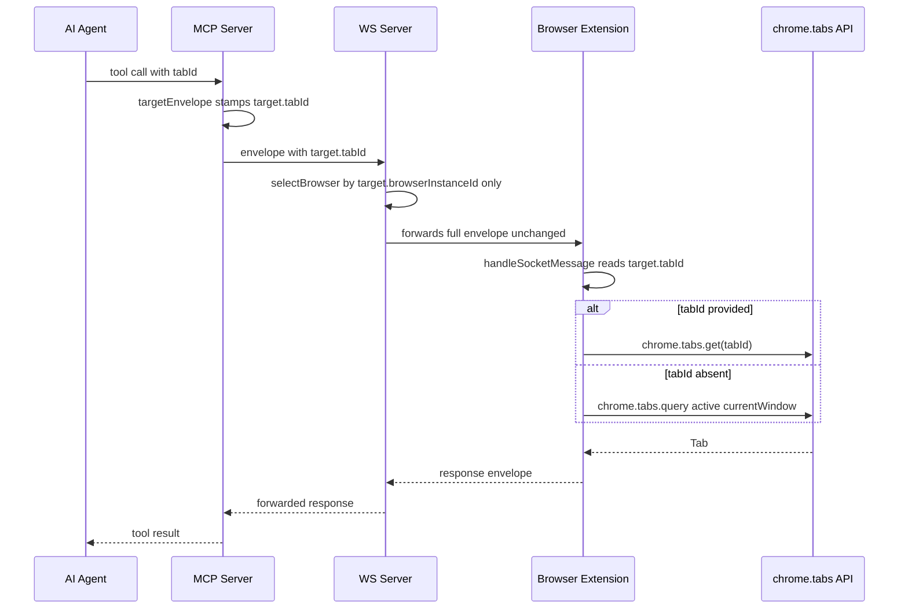
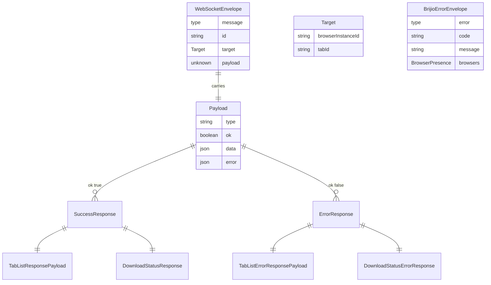

# Protocol and Data Model Guide

This page is the canonical OpenWiki home for the shared data structures and
protocol shapes that flow across the WebSocket relay, the MCP server, and the
browser extensions. When a change crosses package boundaries it must start from
the definitions documented here.

The authoritative definitions live in [`packages/shared/src/protocol.ts`]
(`repo://packages/shared/src/protocol.ts`). The MCP server keeps a parallel set
in [`servers/mcp/src/protocol.ts`](`repo://servers/mcp/src/protocol.ts`) that
mirrors the wire shapes for the MCP-facing result types and adds the envelope
parsers used to turn extension responses into typed tool results. Protocol
definitions belong in the shared package; the MCP file is a consumer-side mirror,
not a place to invent new wire shapes.

## The canonical envelope

Every message on the wire is wrapped in the same envelope, defined in
`packages/shared/src/protocol.ts`:

```ts
export interface WebSocketEnvelope {
  type: "message";
  id?: string;
  target?: {
    browserInstanceId?: string;
    tabId?: string;
  };
  payload: unknown;
}
export type BrijioEnvelope = WebSocketEnvelope;
```

The envelope is intentionally simple and explicit. Three things matter:

- **`type: 'message'`** — the discriminator for every normal request and
  response. A distinct `type: 'error'` is reserved for the router-level error
  envelope (see [Error envelopes](#error-envelopes)).
- **`id`** — an optional correlation id. Requests from the MCP server carry an
  id (e.g. `mcp-<timestamp>-<random>`); the extension echoes it back on the
  matching response so the relay and MCP client can demultiplex. Parsers like
  `parsePageContextEnvelope` reject a response whose `id` does not match the
  pending request by returning `{ ok: false, ignored: true }` rather than an
  error.
- **`target`** — routing that is **carried in the envelope, not in session
  state**. `target.browserInstanceId` selects which connected browser handles
  the call, and `target.tabId` selects which tab inside that browser. Both are
  optional and per-call (see [Tab listing and tab targeting](#tab-listing-and-tab-targeting)).
- **`payload`** — the typed request or response body. Its own `type` field
  (e.g. `'list_tabs'`, `'page_context_response'`) identifies the operation.

`parseBrijioEnvelope` validates a raw JSON string into this shape, returning a
`BrijioErrorEnvelope` with code `invalid_json` or `invalid_message` when the
message is malformed. `isEnvelope` requires `type === 'message'`, a string
`id` when present, a valid `target` when present, and a `payload` property.

### Roles, auth, and presence

Two roles participate on the wire:

```ts
export type BrijioRole = "extension" | "mcp";
```

A connection authenticates with an auth payload, then the relay replies with an
auth success:

```ts
export interface AuthPayload {
  type: "auth";
  role: BrijioRole;
  token: string;
}
export interface AuthSuccessPayload {
  type: "auth_success";
}
```

`createAuthEnvelope` builds the auth message. The string overload defaults the
role to `'extension'`; the MCP server uses its own `createAuthEnvelope`, which
sends `role: 'mcp'`. `isAuthPayload` requires a non-empty `token` and a role of
`'extension'` or `'mcp'`.

Once authenticated, the relay and extension exchange browser presence:

```ts
export interface BrowserPresenceRequestPayload {
  type: "browser_presence_request";
}

export interface BrowserPresenceAnnouncePayload extends BrowserPresence {
  type: "browser_presence_announce";
}
```

The announce payload carries the browser's identity and capabilities. The
shared `BrowserPresence` is documented below.

## Browser presence and capabilities

```ts
export interface BrowserPresence {
  browserInstanceId: string;
  label: string;
  browserName: string;
  profileName: string;
  connectedAt?: string;
  lastSeenAt?: string;
  capabilities: BrowserCapability[];
}
```

`browserInstanceId` is the stable identifier the relay uses to target a specific
browser instance. `connectedAt`/`lastSeenAt` are optional on the shared side;
the MCP mirror in `servers/mcp/src/protocol.ts` declares them as required
`string` fields and relaxes `capabilities` to `string[]` for its own parsing.

`BrowserCapability` is the closed set of named browser features an extension
can advertise:

```ts
export type BrowserCapability =
  | "page_context"
  | "page_content"
  | "click"
  | "fill_input"
  | "fill_editable"
  | "set_checked"
  | "select_options"
  | "submit_form"
  | "navigate"
  | "batch"
  | "upload_file"
  | "download_status"
  | "download_file"
  | "fetch_resource"
  | "screenshot";
```

These names match the protocol payload `type` values one-to-one (e.g. the
`page_context` capability backs `get_page_context`). `isBrowserCapability`
validates each entry against this union. The presence and capability shapes are
consumed by the relay's browser discovery/routing and by the MCP `list_browsers`
tool.

## Tab listing and tab targeting

Tab awareness was added by the explicit tab-selection work
<!-- openwiki: broken internal link [#related-decisions] heading anchor "related-decisions" does not exist in /openwiki/data-and-protocol.md. Fix the href or restore the target, then delete this comment. -->

([ADR 0060](#related-decisions)). A tab is described by:

```ts
export interface TabInfo {
  /** Opaque tab identifier (raw Chrome/Safari tab ID as string) */
  tabId: string;
  /** Opaque window identifier (raw Chrome/Safari window ID as string) */
  windowId: string;
  title: string;
  url: string; // HTTP/HTTPS only — chrome://, about:, file://, etc. are filtered out
  active: boolean; // user's currently focused tab
  supported: boolean; // always true for listed tabs
}
```

Listing tabs is an explicit, on-demand request — there is no ambient streaming
of tab updates:

```ts
export interface ListTabsRequestPayload {
  type: "list_tabs";
}

export interface TabListResponsePayload {
  type: "tab_list_response";
  ok: true;
  data: { tabs: TabInfo[] };
}
export interface TabListErrorResponsePayload {
  type: "tab_list_response";
  ok: false;
  error: { code: string; message: string };
}
```

Note that both the success and error responses share the same payload `type`
(`'tab_list_response'`) and are distinguished by `ok`. This `{ ok, data | error }`
pattern is reused across nearly every response shape.

### Targeting is explicit and per-call

The central design choice — emphasized by ADRs 0060 and 0062 — is that **tab
targeting is explicit and per-call, carried in the envelope `target.tabId`,
never in hidden session state.** This mirrors how `browserInstanceId` works:
stateless, explicit, no stale "selected tab" to drift out of sync.

Every tool that operates on a tab accepts an optional `tabId`:

- When `tabId` is **provided**, the extension resolves that specific tab
  (`chrome.tabs.get(Number(tabId))` / the Safari equivalent) and targets it,
  even if it is a background tab.
- When `tabId` is **omitted**, behaviour is unchanged — the active foreground
  tab is used (`chrome.tabs.query({ active: true, currentWindow: true })`).

The full threading path is:

1. The MCP tool extracts `tabId` from tool input (validated via `normalizeTabId`).
2. `requestBrijio` in `servers/mcp/src/websocket-client.ts` stamps it onto the
   envelope as `target.tabId` through the `targetEnvelope` helper.
3. The WS relay forwards the **entire envelope unchanged** to the selected
   browser — it only reads `target.browserInstanceId` for routing; `target.tabId`
   passes through untouched.
4. The extension's `BrijioBackgroundController.handleSocketMessage` extracts
   `message.target?.tabId` and forwards it down to `readActiveTabPage`,
   `performActiveTabAction`, `performActiveTabBatch`, and `navigateActiveTabToUrl`.

No `select_tab` session-level default exists. Per-call targeting is stateless
and explicit.



The diagram above shows how an explicit per-call `tabId` reaches the targeted tab while the relay stays pass-through for routing.

## File uploads

Two upload mechanisms exist. The simple, in-band path embeds a file in an action
(`upload_file`), and the staged chunked path uploads large files before they are
referenced by an action.

### Action-embedded file upload

`PerformUploadFileAction` (part of `PerformActionRequest`) carries a
`FileUploadPayload` inline:

```ts
export interface FileUploadPayload {
  fileName: string;
  mimeType: string;
  contentBase64: string;
  sizeBytes: number;
  lastModified?: number;
}
```

### Staged file upload flow

For larger files the protocol defines a multi-message staging handshake with its
own upload-scoped `uploadId`:

- **`stage_file_upload_start`** — `uploadId`, file metadata
  (`name`, `size`, `type?`, `sha256?`), `chunkSize`, `totalChunks`.
- **`stage_file_upload_chunk`** — `uploadId`, `index`, `dataBase64`.
- **`stage_file_upload_complete`** — `uploadId`, optional `sha256`.
- **`stage_file_upload_staged`** — extension acknowledges staging succeeded
  (`uploadId`).
- **`stage_file_upload_ack`** — caller acknowledges the staged upload.
- **`stage_file_upload_error`** — `uploadId` plus a typed `error.code` from a
  closed set: `invalid_file_payload`, `checksum_mismatch`, `file_too_large`,
  `invalid_file_name`, `invalid_file_type`, `upload_expired`.

The staged upload start/chunk/complete envelopes target a browser instance via
`target: { browserInstanceId?: string }`; the ack and error envelopes use an
optional `target` because they flow back from the extension.

## Download and fetch status

These shapes (ADR 0047) let the agent observe downloads and fetch resources in
progress, or initiate them.

```ts
export type DownloadState = "in_progress" | "complete" | "interrupted";

export interface DownloadInfo {
  id: number;
  kind: "download";
  filename: string;
  url: string;
  mime: string | null;
  size: number | null;
  state: DownloadState;
  error?: string;
  danger?: string;
}

export interface FetchResourceInfo {
  id: string;
  kind: "fetch";
  url: string;
  contentType: string | null;
  bytesReceived: number;
  totalBytes: number | null;
  state: DownloadState | "streaming";
  error?: string;
}
```

### Download status request/response

```ts
export interface DownloadStatusRequest {
  type: "download_status";
  ids?: Array<number | string>;
  browserInstanceId?: string;
}

export interface DownloadStatusResponse {
  type: "download_status_response";
  ok: true;
  capability: "full" | "not_supported";
  items: Array<DownloadInfo | FetchResourceInfo>;
}
export interface DownloadStatusErrorResponse {
  type: "download_status_response";
  ok: false;
  error: { code: string; message: string };
}
```

`capability` distinguishes browsers that fully support the downloads API
(`'full'`) from those that report `'not_supported'`, so the agent can degrade
gracefully.

### Download file and fetch resource

Downloads and fetches extend `ApprovalMetadata` (`actionUUID?`,
`approvalRequest?`), so they can ride the existing human-approval flow:

- **`download_file`** — request (`url`, `filename?`, `conflictAction?` of
  `'uniquify' | 'overwrite'`); response `downloadId: number | null` and
  `status: 'initiated' | 'initiated_fire_and_forget'`.
- **`fetch_resource`** — a streaming protocol. The response arrives as a
  sequence: `fetch_resource_start` (`fetchId`, `contentType`, `totalBytes`),
  zero or more `fetch_resource_chunk` (`index`, `dataBase64`), then
  `fetch_resource_complete` (`sha256`, `totalBytes`, optional `dataBase64`
  single-chunk fast path) or `fetch_resource_error` (`error` string code,
  `message`, optional `httpStatus`). `FetchResourceStreamMessage` unions these.

`createDownloadStatusEnvelope` / `createDownloadFileEnvelope` /
`createFetchResourceEnvelope` build the requests, placing `browserInstanceId`
in the envelope `target` when provided.

## Screenshots

ADR 0064 added a viewport-only screenshot capability. The `screenshot`
capability backs a `capture_screenshot` request that returns JPEG image data
from the visible tab:

```ts
export interface CaptureScreenshotRequest {
  type: "capture_screenshot";
}

export interface CaptureScreenshotResponse {
  type: "screenshot_response";
  ok: true;
  data: {
    dataBase64: string;
    width: number;
    height: number;
    tabId: string;
    capturedAt: string;
  };
}
export interface CaptureScreenshotErrorResponse {
  type: "screenshot_response";
  ok: false;
  error: { code: ScreenshotErrorCode; message: string };
}
```

`ScreenshotErrorCode` is `'capability_not_supported' | 'capture_failed' |
'no_visible_tab' | 'timeout'`. Screenshots are explicit and active-tab-only
because `chrome.tabs.captureVisibleTab()` captures the visible tab; capturing a
background tab would require stealing focus.

## Error envelopes

Errors travel on two distinct envelope shapes.

### Router-level errors: `BrijioErrorEnvelope`

The shared package defines a top-level error envelope that is _not_ a
`'message'`:

```ts
export interface BrijioErrorEnvelope {
  type: "error";
  error: {
    code: BrijioErrorCode;
    message: string;
    browsers?: BrowserPresence[];
  };
}
```

The shared `BrijioErrorCode` union is the closed set of codes the relay may emit
(for example `invalid_json`, `invalid_message`, `auth_required`, `auth_failed`,
`browser_unavailable`, `ambiguous_browser_target`, `invalid_browser_target`,
`timeout`, `unsupported_action`, `batch_failed`, and the upload/download/fetch
codes). `browsers?` is populated for `ambiguous_browser_target` so the agent can
see the available instances and disambiguate.

### Action-level errors: `{ ok: false, error }` inside a response payload

The second shape is an `ok: false` payload (e.g. `ActionResultErrorResponse`,
`TabListErrorResponsePayload`, `DownloadStatusErrorResponse`) carrying
`error: { code, message, detail? }`. The shared package defines fine-grained
code unions per response family, such as `ActionResultErrorCode` (including
`stale_context`, `page_navigated`, `target_not_found`, `approval_denied`,
`upload_not_staged`, …) and `PageContextErrorCode`.

### Forwarding through MCP (ADR 0061)

ADR 0061 fixed a bug where the MCP server discarded structured error codes and
replaced them with generic messages. The MCP parsers in
`servers/mcp/src/protocol.ts` now forward the original code and message:

- **`parseRouterErrorEnvelope`** — for a `{ type: 'error', error: { code, message } }`
  envelope it forwards any string `code` as-is (defaulting to `'invalid_response'`
  only when the code is not a string). It no longer rejects unrecognized codes
  like `invalid_message`/`invalid_json` with a generic message; it returns
  `invalidResponse()` only when the envelope structure itself is malformed.
- **`parseErrorPayload`** — for an `ok: false` action payload it preserves
  `stale_context` and `page_navigated` together with their structured
  `StaleContextDetail`, and forwards any other string code from the extension
  unchanged (instead of flattening it to `'browser_error'`).

As a result the MCP-facing result types (`BrijioResourceResult<T>`) carry
`code: string` rather than the constrained `BrijioErrorCode` union, so the agent
receives specific, actionable error codes. The exception is the
`fetch_resource_error` path, which forwards a composite code of the form
`fetch_resource_error:<errorCode>` for backward compatibility.

`StaleContextDetail` carries the before/after comparison fields
(`expectedText`/`foundText`, `expectedHref`/`foundHref`, `expectedRole`/
`foundRole`, `expectedLabel`/`foundLabel`, `expectedType`/`foundType`, plus
`formId`/`controlId` and previous/current context ids) so the agent can report
why a target was no longer valid.

## Type relationships

The diagram below summarizes how the envelope, the success/error result
discriminated unions, and the router error envelope relate:



The diagram above shows the envelope carrying a payload that is either a success response (with `data`) or an error response (with `error`), distinct from the top-level `BrijioErrorEnvelope`.

## Where the two protocol files diverge

`packages/shared/src/protocol.ts` is the source of truth for everything that
crosses the wire. `servers/mcp/src/protocol.ts` is the MCP-side mirror that:

- Re-declares the wire shapes it consumes (`WebSocketEnvelope`, `BrowserPresence`,
  `TabInfo`, `PageContext`/`PageContent` and their response types) for the MCP
  package's own typing, with small divergences (e.g. `BrowserPresence`
  with required `connectedAt`/`lastSeenAt` and `capabilities: string[]`).
- Defines the MCP-facing result type `BrijioResourceResult<T>` and the typed
  result aliases (`BrijioPageContextResult`, `BrijioTabListResult`,
  `BrijioDownloadStatusResult`, `BrijioScreenshotResult`, etc.) returned to tools.
- Provides the `parse*Envelope` functions that validate an incoming envelope,
  match its `id` to the pending request, and produce a typed result or
  `{ ok: false, ignored: true }` for unrelated messages.
- Provides factory helpers (`createGetPageContextEnvelope`,
  `createClickElementEnvelope`, `createListTabsEnvelope`, …) that build the
  request envelopes the MCP client sends.

The shared package also exports helper constructors and type guards
(`createAuthEnvelope`, `createBrowserPresenceAnnounceEnvelope`,
`createListTabsEnvelope`, `createTabListResponse`, `isListTabsEnvelope`,
`isTabInfo`, `parseBrijioEnvelope`, …) used by both the relay and the extensions.
A few constants live in the shared module, notably
`defaultPageContentMaxPayloadBytes = 131072` and `BATCH_MAX_ACTIONS = 20`.

## Why this file matters

If you are changing anything that crosses package boundaries, start by checking
`packages/shared/src/protocol.ts`. That file is the source of truth for:

- envelope shape and routing
- auth and presence
- tab identity and explicit per-call targeting
- browser capabilities
- staged file uploads and the in-band upload action
- download and fetch routing and status
- screenshot capture
- the error code vocabulary and forwarding rules

Changing these shapes without updating the relay, the MCP server, and the
extensions in lockstep will usually break interoperability. Protocol definitions
belong in `packages/shared`; do not duplicate or diverge them in the MCP mirror
except for the documented MCP-side result/parser types.

## Related pages

<!-- openwiki: broken internal link [../architecture/websocket-relay.md] file "../architecture/websocket-relay.md" does not exist. Fix the href or restore the target, then delete this comment. -->

- [WebSocket Relay](../architecture/websocket-relay.md)

<!-- openwiki: broken internal link [../architecture/mcp-server.md] file "../architecture/mcp-server.md" does not exist. Fix the href or restore the target, then delete this comment. -->

- [MCP Server](../architecture/mcp-server.md)

<!-- openwiki: broken internal link [../architecture/mcp-extension-flow.md] file "../architecture/mcp-extension-flow.md" does not exist. Fix the href or restore the target, then delete this comment. -->

- [MCP Extension Flow](../architecture/mcp-extension-flow.md)

<!-- openwiki: broken internal link [../architecture/shared-package.md] file "../architecture/shared-package.md" does not exist. Fix the href or restore the target, then delete this comment. -->

- [Shared Package](../architecture/shared-package.md)

<!-- openwiki: broken internal link [../architecture/browser-extensions.md] file "../architecture/browser-extensions.md" does not exist. Fix the href or restore the target, then delete this comment. -->

- [Browser Extensions](../architecture/browser-extensions.md)

<!-- openwiki: broken internal link [../workflows/multi-tab.md] file "../workflows/multi-tab.md" does not exist. Fix the href or restore the target, then delete this comment. -->

- [Multi-Tab Workflows](../workflows/multi-tab.md)

## Related source files

- `packages/shared/src/protocol.ts` — canonical wire protocol (source of truth)
- `packages/shared/src/index.ts` — re-exports the shared protocol and other modules
- `servers/mcp/src/protocol.ts` — MCP-side mirror, parsers, and result types
- `servers/mcp/src/websocket-client.ts` — builds/threads `target.tabId` into request envelopes
- `docs/architecture/decisions/0047-download-awareness.md`
- `docs/architecture/decisions/0060-explicit-tab-listing-and-selection.md`
- `docs/architecture/decisions/0061-forward-error-codes-through-mcp.md`
- `docs/architecture/decisions/0062-thread-tabid-through-action-stack.md`
- `docs/architecture/decisions/0064-visual-action-verification.md`

<a id="related-decisions"></a>
