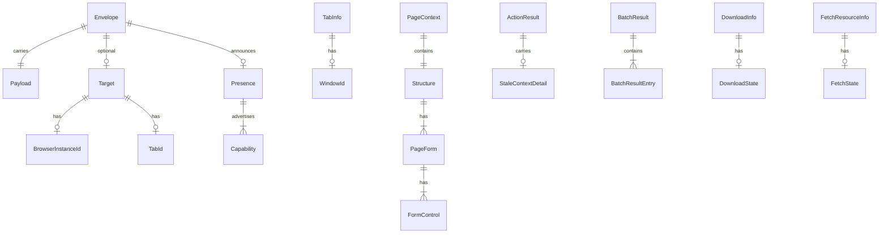

# Protocol and Data Model Guide

This page is the canonical OpenWiki reference for the shared data structures
and protocol message shapes that flow between the MCP server, the WebSocket
relay, and the browser extensions. It documents the wire envelope, the
auth/presence and capability model, tab primitives, the page context/content
models, action and batch messages, file-upload staging, download/fetch and
screenshot results, and the error codes those surfaces can return.

**Source of truth.** `packages/shared/src/protocol.ts` is the canonical
definition of every envelope, payload, and type guard on this page. The shared
package re-exports it (plus the related `page-context.ts` and `page-content.ts`
modules) from `packages/shared/src/index.ts`. `servers/mcp/src/protocol.ts`
mirrors and extends those types for the MCP side, adding MCP-specific result
wrappers (`BrijioResourceResult<T>`) and result/parse unions, but the wire
shapes are defined by the shared package.

**Change rule.** These shapes are the contract between three independently
deployed components — the relay, the MCP server, and the browser extensions.
Changing any envelope, payload, capability, or error code without updating all
three will break interoperability. Start any cross-package change in
`packages/shared/src/protocol.ts`.

## Core entities

The diagram below summarizes the principal protocol entities and how they
relate. Each is grounded in the types defined in `packages/shared/src/protocol.ts`.



The diagram shows the WebSocket envelope carrying a payload and an optional
target; browser presence advertising capabilities; page context nesting form
structures; and the result/error entities carrying stale-context detail.

## The WebSocket envelope

Every message exchanged between components is wrapped in `WebSocketEnvelope`
(also aliased as `BrijioEnvelope`):

```ts
export interface WebSocketEnvelope {
  type: "message";
  id?: string;
  target?: {
    browserInstanceId?: string;
    tabId?: string;
  };
  payload: unknown;
}
```

The envelope is intentionally minimal and explicit:

- `type` is always `'message'` (a separate `BrijioErrorEnvelope` uses
  `type: 'error'`).
- `id` is the optional request-correlation id used by the relay to route
  responses back to the MCP server.
- `target` carries explicit routing — `browserInstanceId` selects one of
  several connected browser instances, and `tabId` selects one tab within that
  browser (see [Tab listing and tab targeting](#tab-listing-and-tab-targeting)).
  Targeting lives in the envelope, not in hidden session state.
- `payload` is the typed message body. `parseBrijioEnvelope` validates only the
  envelope shape (`type === 'message'`, optional `id`/`target` of the correct
  shape, presence of `payload`); payload-specific validation is performed by the
  `is*Envelope`/`is*Payload` type guards.

`parseBrijioEnvelope(rawMessage)` returns either a parsed envelope or a
`BrijioErrorEnvelope` with code `invalid_json` (unparseable JSON) or
`invalid_message` (missing `payload` or wrong `type`).

## Roles, auth, and presence

`BrijioRole` distinguishes the two authenticated peer kinds: `'extension'` (a
browser extension connecting to the relay) and `'mcp'` (the MCP server
connecting to the relay).

- `AuthPayload` — `{ type: 'auth', role, token }`. `isAuthPayload` requires a
  non-empty `token` and a valid `role`.
- `AuthSuccessPayload` — `{ type: 'auth_success' }`, returned by the relay on
  successful authentication.
- `BrowserPresenceRequestPayload` — `{ type: 'browser_presence_request' }`,
  sent by the MCP side to ask the relay for connected browsers.
- `BrowserPresenceAnnouncePayload` — extends `BrowserPresence` with
  `type: 'browser_presence_announce'`, sent by the extension to announce itself
  (or relayed back to the MCP side in response to a presence request).

`createAuthEnvelope` has two overloads: `createAuthEnvelope(token)` builds an
extension auth message with no `id`; the object form accepts `requestId`,
`token`, and `role` and sets the envelope `id`.

### BrowserPresence and capabilities

`BrowserPresence` carries a browser instance's identity and advertised
capabilities:

```ts
export interface BrowserPresence {
  browserInstanceId: string;
  label: string;
  browserName: string;
  profileName: string;
  connectedAt?: string;
  lastSeenAt?: string;
  capabilities: BrowserCapability[];
}
```

`BrowserCapability` is the closed set of feature flags an extension can
advertise:

| Capability        | Meaning                                                                           |
| ----------------- | --------------------------------------------------------------------------------- |
| `page_context`    | Can extract structured page context (headings, landmarks, links, forms, actions). |
| `page_content`    | Can return chunked readable page content.                                         |
| `click`           | Can perform click actions.                                                        |
| `fill_input`      | Can fill form controls (write_text).                                              |
| `fill_editable`   | Can fill `contenteditable` elements.                                              |
| `set_checked`     | Can check/uncheck checkboxes.                                                     |
| `select_options`  | Can select `<select>` options.                                                    |
| `submit_form`     | Can submit forms.                                                                 |
| `navigate`        | Can navigate a tab to a URL.                                                      |
| `batch`           | Supports batched action execution.                                                |
| `upload_file`     | Can stage and upload files to file inputs.                                        |
| `download_status` | Can report download/fetch status.                                                 |
| `download_file`   | Can initiate downloads.                                                           |
| `fetch_resource`  | Can fetch a URL's bytes via the extension.                                        |
| `screenshot`      | Can capture a screenshot of a tab.                                                |

`isBrowserPresenceAnnouncePayload` validates that `browserInstanceId`, `label`,
`browserName`, and `profileName` are non-empty strings and `capabilities` is an
array of valid `BrowserCapability` values. These shapes drive browser discovery
in the MCP-facing flows (see [Extension Adapters](architecture/extension-adapters.md)
and [MCP Extension Flow](architecture/mcp-extension-flow.md)).

## Tab listing and tab targeting

Per ADR 0060 (Explicit Tab Listing and Selection) and ADR 0062 (Thread `tabId`
Through the Action Stack), tab targeting is **explicit and per-call**. There is
no hidden session-level "selected tab" state — the `tabId` is carried in the
envelope `target` on every call, exactly as `browserInstanceId` is, and when it
is omitted the extension falls back to the active foreground tab.

### TabInfo

```ts
export interface TabInfo {
  tabId: string; // opaque raw Chrome/Safari tab ID as string
  windowId: string; // opaque raw Chrome/Safari window ID as string
  title: string;
  url: string; // HTTP/HTTPS only
  active: boolean; // user's currently focused tab
  supported: boolean; // eligible for Brijio actions (true for listed tabs)
}
```

`isTabInfo` validates every field's type. Only regular HTTP/HTTPS tabs are
listed; `chrome://`, `chrome-extension://`, `about:`, `file://`, and
`safari://` URLs are filtered out, and incognito tabs are excluded.

### Tab list request/response

- `ListTabsRequestPayload` — `{ type: 'list_tabs' }`. Routed through the
  existing relay → extension browser routing, mirroring `list_browsers`.
- `TabListResponsePayload` — `{ type: 'tab_list_response', ok: true, data: { tabs: TabInfo[] } }`.
- `TabListErrorResponsePayload` — `{ type: 'tab_list_response', ok: false, error: { code, message } }`.

`isTabListResponsePayload` validates the response shape and that every entry in
`data.tabs` passes `isTabInfo`.

When a `tabId` is provided on any tab-operating tool, the extension resolves
that specific tab (`tabs.get(Number(tabId))`) and targets it; when omitted, it
uses `tabs.query({ active: true, currentWindow: true })`. A persistent
content-script banner and a `●` title prefix signal to the user which tab is
being controlled. See [Multi-Tab Workflows](workflows/multi-tab.md) for the
end-to-end flow.

## Page context and content models

The page-reading surface is split into two payloads: a structured **context**
summary and chunked **content**.

### PageContext

`PageContext` is the structured snapshot returned by `get_page_context`. It
carries stale-context validation ids, a preview, and a `structure` object:

```ts
export interface PageContext {
  _csVersion?: number; // content-script version for diagnostics
  pageContextId?: number; // numeric context id
  visibleContextId?: string; // hash of visible form/control structure
  url: string;
  title: string;
  timestamp: string;
  selectedText: string | null;
  preview: { content: string; truncated: boolean; maxBytes: number };
  structure: {
    headings: PageHeading[];
    landmarks: PageLandmark[];
    links: PageLink[];
    images: PageImage[];
    forms: PageForm[];
    editables: PageEditable[];
    actions: PageAction[];
  };
  content: {
    available: boolean;
    requestType: "get_page_content";
    firstIndex: 1;
    defaultMaxPayloadBytes: number;
  };
}
```

`structure` elements:

- **`PageHeading`** — `id`, `level` (1–6), `text`.
- **`PageLandmark`** — `id`, `role`, `name` (main/nav/aside/header/footer/section and ARIA landmark roles).
- **`PageLink`** — `id`, `text` (accessible name), `href`.
- **`PageImage`** — `id`, `alt`, `src`.
- **`PageForm`** — `id`, `label` (accessible name), `controls: PageFormControl[]`.
- **`PageEditable`** — `id`, `label`, `role`, `multiline`.
- **`PageAction`** — `id`, `role`, `name`, `enabled`, plus optional `tagName`, `description` (from `aria-describedby`/`title`), and `hidden` (aria-hidden/hidden attribute). Discovered via `ACTION_SELECTORS`, which includes native buttons/submits/summary and ARIA roles (`button`, `menuitem`, `tab`, `switch`, `option`, `link`, etc.).

### FormControl state

`PageFormControl` is the richest element type and carries the state the agent
needs to decide whether and how to act:

```ts
export interface PageFormControl {
  id: string;
  label: string;
  type: string;
  required: boolean;
  requiredSource?: "html" | "aria";
  disabled: boolean;
  readonly?: boolean;
  sensitive: boolean; // password-like types
  valueState?: "empty" | "filled" | "unknown";
  filledBy?: "brijio" | "user_or_page";
  checked?: boolean;
  multiple?: boolean;
  options?: PageFormControlOption[];
  validity?: PageFormControlValidity;
}
```

- **`valueState`** / **`filledBy`** — distinguish empty/filled controls and
  whether the current value was written by Brijio vs. the user or page.
- **`PageFormControlOption`** — `{ value, label, selected, disabled }`.
- **`PageFormControlValidity`** — `{ valid, reason? }`, where reason is one of
  `value_missing`, `type_mismatch`, `pattern_mismatch`, `too_short`,
  `too_long`, `range_underflow`, `range_overflow`, `step_mismatch`,
  `bad_input`, or `custom_error`.

### Stale-context validation

Two ids support stale-context detection:

- **`pageContextId`** — numeric context id.
- **`visibleContextId`** — a hash (`ctx_<hash>`) of the visible form/control
  structure, computed by `computeVisibleContextId` from form labels, control
  types, required/disabled/readonly/sensitive flags, value/filled state,
  checked state, option selection, and validity reasons. It changes when the
  visible controls change, even if the page id does not.

`perform_action` and `perform_batch` accept optional `pageContextId` and
`visibleContextId`; if the context has drifted by the time the action runs, the
result carries `contextStale: true`, a `contextStaleReason` of
`'visible_controls_changed'`, and the `currentVisibleContextId`, or an error
with `code: 'stale_context'`. A navigation during an action yields
`code: 'page_navigated'`. See [Action error codes](#action-error-codes).

### PageContent chunking

`get_page_content` returns `PageContent` chunks:

```ts
export interface PageContent {
  url: string;
  title: string;
  timestamp: string;
  index: number;
  content: string;
  truncated: boolean;
  maxPayloadBytes: number;
}
```

Readable content is rendered to Markdown (headings, links, images, tables) by
`page-content.ts` and split into byte-bounded chunks by `chunkReadableContent`.
`defaultPageContentMaxPayloadBytes` is 131072 bytes. Chunking preserves
paragraph boundaries where possible and falls back to character splitting for
oversized blocks; `index` is 1-based and `truncated` indicates more chunks
remain. `isGetPageContentEnvelope` validates that an optional `index` is a
positive integer.

## Actions

`perform_action` carries a single action plus optional stale-context ids:

```ts
export interface PerformActionRequest {
  type: "perform_action";
  pageContextId?: number;
  visibleContextId?: string;
  action:
    | PerformClickAction
    | PerformWriteTextAction
    | PerformSetCheckedAction
    | PerformSelectOptionsAction
    | PerformSubmitFormAction
    | PerformUploadFileAction;
}
```

All action payloads extend `ApprovalMetadata` (`actionUUID?`,
`approvalRequest?`), so each action can be individually approved. The
`hasValidApprovalMetadata` guard ensures `actionUUID`, if present, is a
non-empty string and `approvalRequest`, if present, is boolean. See
[Action Approval](workflows/action-approval.md).

### Action targets

- **`ClickActionTarget`** — `kind: 'link' | 'action'`, `id`, plus optional
  `expectedText`/`expectedHref`/`expectedRole` for pre-click validation.
- **`FormControlTarget`** — `formId`, `controlId`, optional `expectedLabel`.
  Used by `write_text`, `set_checked`, `select_options`, `upload_file`.
- **`EditableActionTarget`** — `kind: 'editable'`, `id`, optional
  `expectedText`. Used for `contenteditable` elements.
- **`FormSubmitTarget`** — `formId`, optional `expectedLabel`.

> `WriteTextActionTarget` and `WriteTextEditableTarget` are deprecated aliases
> for `FormControlTarget` and `EditableActionTarget` respectively.

### Action variants

| Action type      | Target                                      | Extra fields                                        |
| ---------------- | ------------------------------------------- | --------------------------------------------------- |
| `click`          | `ClickActionTarget`                         | —                                                   |
| `write_text`     | `FormControlTarget \| EditableActionTarget` | `text`                                              |
| `set_checked`    | `FormControlTarget`                         | `checked: boolean`                                  |
| `select_options` | `FormControlTarget`                         | `values: string[]`                                  |
| `submit_form`    | `FormSubmitTarget`                          | —                                                   |
| `upload_file`    | `FormControlTarget`                         | `file: FileUploadPayload`, optional `expectedLabel` |

### Action results

Each action has its own result-data shape, all returned via
`ActionResultResponse` (`type: 'action_result'`, `ok: true`):

- **`ActionResultData`** (click) — includes `observed?: ClickObserved` with
  `navigationStarted?` and `detailsOpen?` (for disclosure toggles).
- **`WriteTextActionResultData`** — `textLength`, plus stale-context fields.
- **`SetCheckedActionResultData`** — `checked`, `changed`, plus stale-context fields.
- **`SelectOptionsActionResultData`** — `values`, plus stale-context fields.
- **`SubmitFormActionResultData`** — `submitted?`,
  `validationErrors?: FormValidationError[]` (per-control validity reasons),
  plus stale-context fields.
- **`UploadFileActionResultData`** — `fileName`, `mimeType`, `sizeBytes`,
  `fileCount`, plus stale-context fields.

The shared stale-context fields on result data are `contextStale?`,
`contextStaleReason?: 'visible_controls_changed'`, and
`currentVisibleContextId?`.

### Action error codes

`ActionResultErrorCode` enumerates the failure codes an action result error can
carry (returned in `ActionResultErrorResponse.error.code`):

```
no_active_tab | unsupported_page | regular_page_permission_required |
content_script_unavailable | unsupported_action | invalid_action_target |
target_not_found | target_disabled | target_readonly | unsupported_control |
invalid_control_value | option_not_found | target_option_disabled |
action_failed | stale_context | page_navigated | upload_not_staged |
approval_denied | approval_timeout | approval_unavailable | approval_origin_changed
```

The approval codes (`approval_denied`, `approval_timeout`, `approval_unavailable`,
`approval_origin_changed`) come from the ADR 0048 approval flow — an action can
be denied by the user, time out while waiting for approval, run on a browser
without approval support, or have its page origin change while approval is
pending. `stale_context` and `page_navigated` (ADR 0041) cover context-drift
and navigation-during-action failures; the error may include a
`StaleContextDetail` carrying the expected vs. found text/href/role/label/type,
previous/current context ids, and a `reason`.

## Batch

`perform_batch` executes up to `BATCH_MAX_ACTIONS` (20) actions in sequence:

```ts
export const BATCH_MAX_ACTIONS = 20;

export interface PerformBatchRequest {
  type: "perform_batch";
  pageContextId?: number;
  visibleContextId?: string;
  actions: BatchAction[]; // 1–20 items
  continueOnError?: boolean;
  readAfterActions?: boolean;
}
```

- `continueOnError` controls whether the batch stops on the first action
  failure (default stops).
- `readAfterActions`, when true, appends a final `BatchReadOutcome` containing
  a fresh `PageContext` so the caller can observe the post-batch page state
  without a separate read.

`isPerformBatchEnvelope` enforces 1–20 actions, validates each action via
`isBatchAction`, and validates `continueOnError`/`readAfterActions` types and
the optional context ids. `BatchActionError` adds `'page_navigated'`,
`'upload_staging_failed'`, and `'upload_not_staged'` to the per-action error
codes, plus an `aborted` flag and optional `StaleContextDetail`.

`BatchResultResponse` returns `results: BatchResultEntry[]` (each entry is
either a `BatchActionOutcome` or a `BatchReadOutcome`) and an `aborted` flag.
`ok` is true only if every entry succeeded. A malformed batch produces
`BatchResultErrorResponse` with a `BrijioErrorCode` (typically `batch_failed`).

## File uploads

File upload has two layers: an out-of-band **staging** protocol and an inline
**action** payload.

### Staged upload protocol

Large files are staged in chunks before being attached to a file input, using
dedicated envelope types:

- `StageFileUploadStartPayload` — `{ type: 'stage_file_upload_start', uploadId, file: { name, size, type?, sha256? }, chunkSize, totalChunks }`.
- `StageFileUploadChunkPayload` — `{ type: 'stage_file_upload_chunk', uploadId, index, dataBase64 }`.
- `StageFileUploadCompletePayload` — `{ type: 'stage_file_upload_complete', uploadId, sha256? }`.

The extension acknowledges staging with `StageFileUploadStagedPayload`
(`{ type: 'stage_file_upload_staged', uploadId }`) and `StageFileUploadAckPayload`.
Failures produce `StageFileUploadErrorPayload` with an `error.code` of
`invalid_file_payload`, `checksum_mismatch`, `file_too_large`,
`invalid_file_name`, `invalid_file_type`, or `upload_expired`.

### Inline upload action

`PerformUploadFileAction` carries an inline `FileUploadPayload` for smaller
uploads or after staging:

```ts
export interface FileUploadPayload {
  fileName: string;
  mimeType: string;
  contentBase64: string;
  sizeBytes: number;
  lastModified?: number;
}
```

`isUploadFileAction` validates the `FormControlTarget`, a non-empty `fileName`,
a `contentBase64` string, a non-negative integer `sizeBytes`, and an optional
numeric `lastModified`. The result (`UploadFileActionResultData`) reports
`fileName`, `mimeType`, `sizeBytes`, and `fileCount`.

## Downloads and fetch

The download/fetch surface (ADR 0047) reports on downloads initiated by the
browser and on resources fetched via the extension.

### DownloadInfo and FetchResourceInfo

```ts
export type DownloadState = "in_progress" | "complete" | "interrupted";

export interface DownloadInfo {
  id: number;
  kind: "download";
  filename: string;
  url: string;
  mime: string | null;
  size: number | null;
  state: DownloadState;
  error?: string;
  danger?: string;
}

export interface FetchResourceInfo {
  id: string;
  kind: "fetch";
  url: string;
  contentType: string | null;
  bytesReceived: number;
  totalBytes: number | null;
  state: DownloadState | "streaming";
  error?: string;
}
```

### Status and file requests

- `DownloadStatusRequest` — `{ type: 'download_status', ids?, browserInstanceId? }`.
- `DownloadStatusResponse` — `{ type: 'download_status_response', ok: true, capability: 'full' | 'not_supported', items: Array<DownloadInfo | FetchResourceInfo> }`.
  The `capability` field signals whether the browser supports full download
  status or not at all.
- `DownloadStatusErrorResponse` — `{ type: 'download_status_response', ok: false, error: { code, message } }`.
- `DownloadFileRequest` (extends `ApprovalMetadata`) — `{ type: 'download_file', url, filename?, conflictAction?: 'uniquify' | 'overwrite', browserInstanceId? }`.
- `DownloadFileResponse` — `{ type: 'download_file_response', ok: true, downloadId: number | null, status: 'initiated' | 'initiated_fire_and_forget' }`.

### Fetch resource streaming

`FetchResourceRequest` (extends `ApprovalMetadata`) — `{ type: 'fetch_resource', url, maxSizeBytes?, timeout?, browserInstanceId? }`.
The response is a stream of `FetchResourceStreamMessage`:

- `FetchResourceStartResponse` — `{ type: 'fetch_resource_start', fetchId, url, contentType, totalBytes }`.
- `FetchResourceChunkResponse` — `{ type: 'fetch_resource_chunk', fetchId, index, dataBase64 }`.
- `FetchResourceCompleteResponse` — `{ type: 'fetch_resource_complete', fetchId, contentType?, sha256, totalBytes, dataBase64? }`.
- `FetchResourceErrorResponse` — `{ type: 'fetch_resource_error', fetchId?, error, httpStatus?, message }`.

## Screenshots

The screenshot surface (ADR 0064) captures a tab's viewport as base64 PNG data.

- `CaptureScreenshotRequest` — `{ type: 'capture_screenshot' }`.
- `CaptureScreenshotResponse` — `{ type: 'screenshot_response', ok: true, data: { dataBase64, width, height, tabId, capturedAt } }`.
- `CaptureScreenshotErrorResponse` — `{ type: 'screenshot_response', ok: false, error: { code: ScreenshotErrorCode, message } }`.

`ScreenshotErrorCode` is `capability_not_supported`, `capture_failed`,
`no_visible_tab`, or `timeout`. The capability is advertised as `screenshot` in
`BrowserCapability`.

## Navigation and tab opening

Two simpler tab-level operations round out the surface:

- **Navigate** — `NavigateToUrlRequest` (`{ type: 'navigate_to_url', url }`)
  returns `NavigateToUrlResult` (`url`, `title`, `timestamp`, `redirected`,
  `navigationMs`). Errors use `NavigateToUrlErrorCode`:
  `no_active_tab`, `unsupported_scheme`, `unsupported_page`,
  `navigation_failed`, `timeout`, `content_script_unavailable`.
- **Open tab** (ADR 0063) — `OpenTabRequest` (`{ type: 'open_tab', url }`)
  returns `OpenTabResult` (`tabId`, `url`, `title`). Errors use
  `OpenTabErrorCode`: `unsupported_scheme`, `open_tab_failed`, `timeout`.

## Envelope-level errors

`BrijioErrorEnvelope` (`type: 'error'`) is the relay-level error shape, distinct
from the action/batch result errors. Its `error.code` is a `BrijioErrorCode`:

```
invalid_json | invalid_message | auth_required | auth_failed |
invalid_auth_message | browser_unavailable | ambiguous_browser_target |
invalid_browser_target | timeout | unsupported_action | batch_failed |
invalid_file_payload | checksum_mismatch | file_too_large |
invalid_file_name | invalid_file_type | upload_staging_failed |
upload_not_staged | target_not_file_input | upload_expired |
download_not_found | fetch_resource_failed
```

`browser_unavailable`, `ambiguous_browser_target`, and
`invalid_browser_target` cover browser routing failures; the error may include
a `browsers: BrowserPresence[]` list so the caller can pick a valid target.

## MCP-side result types

`servers/mcp/src/protocol.ts` re-declares the wire shapes above (it imports
`OpenTabResult` from `@brijio/shared`) and layers MCP-facing result/parse
unions on top. The generic `BrijioResourceResult<T>` is either
`{ ok: true, data: T }` or `{ ok: false, error: { code, message, detail?, browsers? } }`.
Concrete result aliases include `BrijioPageContextResult`,
`BrijioClickElementResult`, `BrijioFillInputResult`, `BrijioSetCheckedResult`,
`BrijioSelectOptionsResult`, `BrijioSubmitFormResult`, `BrijioUploadFileResult`,
`BrijioBrowserListResult`, `BrijioDownloadStatusResult`,
`BrijioDownloadFileResult`, `BrijioFetchResourceResult`, and
`BrijioTabListResult`. Parse-result unions add an `{ ok: false, ignored: true }`
branch for messages the MCP client treats as non-matching noise. These wrappers
are MCP-internal; the on-the-wire shapes are defined by the shared package.

> Note: the MCP-side `BrijioErrorCode` is a smaller, MCP-focused subset
> (`auth_required`, `auth_failed`, `browser_unavailable`, `timeout`,
> `batch_failed`, `stale_context`, `page_navigated`, …). It is **not** the same
> union as the shared `BrijioErrorCode`; treat `packages/shared/src/protocol.ts`
> as authoritative for wire errors.

## Related source and docs

- `packages/shared/src/protocol.ts` — canonical protocol definitions and guards.
- `packages/shared/src/page-context.ts` — `PageContext` extraction and
  `computeVisibleContextId`.
- `packages/shared/src/page-content.ts` — readable-content rendering and
  `chunkReadableContent`.
- `packages/shared/src/index.ts` — shared package barrel.
- `servers/mcp/src/protocol.ts` — MCP-side re-exports and result wrappers.
- `docs/architecture/decisions/0060-explicit-tab-listing-and-selection.md`
- `docs/architecture/decisions/0062-thread-tabid-through-action-stack.md`

Related wiki pages: [Extension Adapters](architecture/extension-adapters.md),
[MCP Extension Flow](architecture/mcp-extension-flow.md),
[MCP Tool Surface](architecture/mcp-tool-surface.md),
[Action Approval](workflows/action-approval.md),
[Multi-Tab Workflows](workflows/multi-tab.md).
