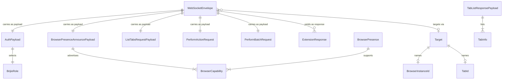

# Protocol and Data Model Guide

This page is the canonical home for the shared data structures and protocol shapes that cross package boundaries in the Brijio system. The single source of truth is `packages/shared/src/protocol.ts`, re-exported verbatim from `packages/shared/src/index.ts`. Everything described here — the envelope, auth, presence, tab identity, capabilities, page reads, actions, batch, navigation, file uploads, and download/fetch routing — is defined there, and the relay, MCP server, and browser extensions all import these types.

Changing these shapes without updating the relay, MCP server, and extensions will break interoperability.

## The canonical envelope

Every frame on the WebSocket is a `WebSocketEnvelope` (aliased as `BrijioEnvelope`):

```ts
interface WebSocketEnvelope {
  type: "message";
  id?: string;
  target?: { browserInstanceId?: string; tabId?: string };
  payload: unknown;
}
```

- `type` is always the literal `'message'`. This is the discriminator the relay uses to tell data frames apart from `BrijioErrorEnvelope` frames (`type: 'error'`).
- `id` is an optional correlation id. Request/response helpers thread it through unchanged; when absent the helpers omit it rather than emit `undefined`.
- `target` carries the two targeting axes, both optional and both per-call: `browserInstanceId` selects which connected extension handles the message, and `tabId` selects which tab inside that browser. Targeting is carried in the envelope rather than hidden in session state (see [Tab listing and tab targeting](#tab-listing-and-tab-targeting)).
- `payload` is untyped at the envelope level; each payload type is discriminated by its own `payload.type` string, and the `is*Envelope` guards narrow the payload back to a concrete shape.

`parseBrijioEnvelope(rawMessage)` is the entry point for any raw frame. It JSON-parses the message and runs the structural `isEnvelope` check — `type === 'message'`, optional string `id`, optional `target` whose `browserInstanceId` (if present) must be a string, and a required `payload`. A parse failure or a malformed frame returns a `BrijioErrorEnvelope` with code `invalid_json` or `invalid_message` rather than throwing.

## Relationships between protocol entities



The envelope wraps a discriminated payload and carries an optional target; auth, presence, and tab-listing payloads are the discovery primitives, while action and batch payloads drive the page-manipulation surface.

## Roles and authentication

A connection authenticates with an `AuthPayload` and receives an `AuthSuccessPayload`:

```ts
type BrijioRole = "extension" | "mcp";

interface AuthPayload {
  type: "auth";
  role: BrijioRole;
  token: string;
}

interface AuthSuccessPayload {
  type: "auth_success";
}
```

`BrijioRole` distinguishes the two peer kinds on the relay: browser extensions (`extension`) and the MCP server (`mcp`). `isAuthPayload` validates that `role` is one of the two literals and that `token` is a non-empty string. `createAuthEnvelope` is overloaded — it accepts a bare token (defaulting the role to `'extension'`) or an explicit `{ requestId?, token, role }` object, and places the value into the envelope payload with the optional `id` from `requestId`. `createAuthSuccessEnvelope` builds the success reply, echoing `requestId` back as `id`.

## Browser presence and capabilities

Once authenticated, a browser extension announces itself through the presence flow:

```ts
interface BrowserPresence {
  browserInstanceId: string;
  label: string;
  browserName: string;
  profileName: string;
  connectedAt?: string;
  lastSeenAt?: string;
  capabilities: BrowserCapability[];
}
```

`BrowserPresenceRequestPayload` (`type: 'browser_presence_request'`) asks connected extensions to announce; `BrowserPresenceAnnouncePayload` extends `BrowserPresence` with `type: 'browser_presence_announce'`. `isBrowserPresenceAnnouncePayload` is the strict guard the relay relies on: it requires non-empty `browserInstanceId`, `label`, `browserName`, and `profileName`, plus a `capabilities` array whose every element is a valid `BrowserCapability`. These shapes drive MCP-facing browser discovery (see [Architecture](architecture.md) and [MCP Extension Flow](architecture/mcp-extension-flow.md)).

`BrowserCapability` is a fixed union naming the browser feature flags an extension can advertise:

```ts
type BrowserCapability =
  | "page_context"
  | "page_content"
  | "click"
  | "fill_input"
  | "fill_editable"
  | "set_checked"
  | "select_options"
  | "submit_form"
  | "navigate"
  | "batch"
  | "upload_file"
  | "download_status"
  | "download_file"
  | "fetch_resource"
  | "screenshot";
```

The capability string also matches the corresponding `payload.type` of the request it gates (e.g. `'screenshot'` ↔ `CaptureScreenshotRequest`), so presence doubles as a feature-negotiation table. `isBrowserCapability` is the exhaustive literal guard.

## Tab listing and tab targeting

Tab awareness is explicit and per-call. There is no hidden session-level "selected tab" state; targeting rides on the envelope `target.tabId` exactly the way `browserInstanceId` does, as established by ADR 0060 (explicit tab listing and selection) and threaded end-to-end by ADR 0062 (thread `tabId` through the action stack). See also [Multi-Tab Workflow](workflows/multi-tab.md).

The tab-listing primitives are:

```ts
interface TabInfo {
  tabId: string; // opaque raw browser tab id as string
  windowId: string; // opaque raw browser window id as string
  title: string;
  url: string; // HTTP/HTTPS only
  active: boolean; // user's currently focused tab
  supported: boolean; // eligible for Brijio actions (true for listed tabs)
}

interface ListTabsRequestPayload {
  type: "list_tabs";
}

interface TabListResponsePayload {
  type: "tab_list_response";
  ok: true;
  data: { tabs: TabInfo[] };
}

interface TabListErrorResponsePayload {
  type: "tab_list_response";
  ok: false;
  error: { code: string; message: string };
}
```

Two design points matter operationally:

- **Success and error share the `tab_list_response` type.** They are discriminated by the `ok` boolean, not by distinct type strings. The same `ok`/`error` pattern is used across the page-context, action, navigation, batch, screenshot, and download responses.
- **`tabId`/`windowId` are opaque strings.** They are raw Chrome/Safari tab and window IDs rendered as strings; the extension resolves them back to numeric ids when calling `chrome.tabs.get` / `chrome.tabs.update`. When `tabId` is omitted from a tool call, the extension falls back to `tabs.query({ active: true, currentWindow: true })`, so all existing callers that omit `tabId` continue to work unchanged.

`isTabInfo` validates all six fields, and `isTabListResponsePayload` guards the full response. Helper creators `createListTabsEnvelope` and `createTabListResponse` build the request and the successful reply.

## Page reading surface

Reading a tab produces either a `PageContext` (structural summary) or paged `PageContent` (full text). `PageContext` carries a `structure` block of headings, landmarks, links, images, forms, editables, and actions, plus a `content` block describing how to fetch the full text. `PageContent` returns one page of text at a time with an `index` (1-based) and a `truncated` flag; the default page-content payload ceiling is `defaultPageContentMaxPayloadBytes` (131072 bytes). `PageContextResponse`/`PageContextErrorResponse` and `PageContentResponse`/`PageContentErrorResponse` follow the shared `ok`/`error` convention.

## Action and batch surface

A single action is a `PerformActionRequest` with a discriminated `action` union:

```ts
interface PerformActionRequest {
  type: "perform_action";
  pageContextId?: number;
  visibleContextId?: string;
  action:
    | PerformClickAction
    | PerformWriteTextAction
    | PerformSetCheckedAction
    | PerformSelectOptionsAction
    | PerformSubmitFormAction
    | PerformUploadFileAction;
}
```

Every action extends `ApprovalMetadata` (`actionUUID?`, `approvalRequest?`), which the protocol validates via `hasValidApprovalMetadata`. `ActionResultResponse`/`ActionResultErrorResponse` carry per-action outcomes; error responses include an `ActionResultErrorCode` (e.g. `target_not_found`, `target_disabled`, `stale_context`, `approval_denied`) and an optional `StaleContextDetail` explaining what changed on the page.

Batch groups up to `BATCH_MAX_ACTIONS` (20) actions in a single `PerformBatchRequest`:

```ts
interface PerformBatchRequest {
  type: "perform_batch";
  pageContextId?: number;
  visibleContextId?: string;
  actions: BatchAction[];
  continueOnError?: boolean;
  readAfterActions?: boolean;
}
```

`isPerformBatchEnvelope` enforces the 1–20 action bound and validates each action with the same per-action guards. `BatchResultResponse` returns one `BatchResultEntry` per action (plus an optional trailing read), an `aborted` flag, and a top-level `ok` derived from whether every entry succeeded (overridable). `BatchActionError` adds batch-specific codes (`page_navigated`, `upload_staging_failed`, `upload_not_staged`).

## Navigation and tab lifecycle

`NavigateToUrlRequest` (`type: 'navigate_to_url'`) navigates an existing tab; `NavigateToUrlResponse` reports the resolved URL, title, whether a redirect occurred, and `navigationMs`. `NavigateToUrlErrorCode` covers `no_active_tab`, `unsupported_scheme`, `unsupported_page`, `navigation_failed`, `timeout`, and `content_script_unavailable`.

`OpenTabRequest` (`type: 'open_tab'`, introduced by ADR 0063) opens a new tab and returns an `OpenTabResult` containing the new `tabId`, the opened `url`, and the (possibly empty) `title` — useful for spawning a fresh tab and then targeting it by the returned `tabId` on subsequent calls.

## Screenshots

`CaptureScreenshotRequest` (`type: 'capture_screenshot'`, ADR 0064) returns base64-encoded image data plus `width`, `height`, `tabId`, and `capturedAt`. `ScreenshotErrorCode` is the narrow set `capability_not_supported`, `capture_failed`, `no_visible_tab`, `timeout`.

## File upload staging

File uploads use a staged, chunked flow keyed by an `uploadId`, separate from the inline `upload_file` action. The payloads are:

- `StageFileUploadStartPayload` — `uploadId`, file metadata (`name`, `size`, optional `type`/`sha256`), `chunkSize`, `totalChunks`.
- `StageFileUploadChunkPayload` — `uploadId`, `index`, base64 `dataBase64`.
- `StageFileUploadCompletePayload` — `uploadId`, optional `sha256`.
- `StageFileUploadStagedPayload` / `StageFileUploadAckPayload` — `uploadId` only.
- `StageFileUploadErrorPayload` — `uploadId` and a typed `error.code` drawn from `invalid_file_payload`, `checksum_mismatch`, `file_too_large`, `invalid_file_name`, `invalid_file_type`, `upload_expired`.

Each stage has a matching typed envelope whose `target` carries `browserInstanceId`. The ack and error envelopes make `target` optional so they can be routed back without a target.

## Download and fetch status

Downloads and fetches are modelled uniformly as tracked transfers. `DownloadState` is `'in_progress' | 'complete' | 'interrupted'`; `FetchResourceInfo` additionally allows `'streaming'`.

```ts
interface DownloadInfo {
  id: number;
  kind: "download";
  filename: string;
  url: string;
  mime: string | null;
  size: number | null;
  state: DownloadState;
  error?: string;
  danger?: string;
}

interface FetchResourceInfo {
  id: string;
  kind: "fetch";
  url: string;
  contentType: string | null;
  bytesReceived: number;
  totalBytes: number | null;
  state: DownloadState | "streaming";
  error?: string;
}
```

The status query is `DownloadStatusRequest` (`type: 'download_status'`, optional `ids` filter, optional `browserInstanceId`). `DownloadStatusResponse` reports a `capability` of `'full'` or `'not_supported'` and a mixed `items` array of `DownloadInfo | FetchResourceInfo`, so a browser that cannot introspect downloads can still respond successfully with `capability: 'not_supported'`.

`DownloadFileRequest` (`type: 'download_file'`) initiates a browser download, returning `downloadId` and a `status` of `'initiated'` or `'initiated_fire_and_forget'`. `FetchResourceRequest` (`type: 'fetch_resource'`) streams the resource back as a sequence: `FetchResourceStartResponse` → one or more `FetchResourceChunkResponse` → `FetchResourceCompleteResponse` (with `sha256` and `totalBytes`), or `FetchResourceErrorResponse` (with optional `httpStatus`). `FetchResourceStreamMessage` is the union of those four. All three request types extend `ApprovalMetadata` and accept a per-call `browserInstanceId`.

## Errors

`BrijioErrorEnvelope` (`type: 'error'`) is the out-of-band error frame, distinct from the per-action `ok: false` responses. Its `error.code` is a `BrijioErrorCode` — the union of all protocol-level and action-level failure codes, including `auth_required`, `auth_failed`, `browser_unavailable`, `ambiguous_browser_target`, `invalid_browser_target`, `timeout`, `unsupported_action`, `batch_failed`, the upload codes, `download_not_found`, and `fetch_resource_failed`. The optional `error.browsers` field can carry a `BrowserPresence[]` so the relay can list available browsers when a target is missing or ambiguous. `ParseBrijioEnvelopeResult` is either a parsed envelope or one of these error envelopes.

## Why this file matters

If you are changing anything that crosses package boundaries, start by checking `packages/shared/src/protocol.ts`. That file is the source of truth for:

- envelope shape and parsing
- roles, auth, and presence
- browser capabilities
- tab identity and listing
- page reading, actions, and batch
- navigation and tab lifecycle
- screenshots
- download and file-upload routing
- the shared error vocabulary

The typed `ExtensionResponse` union is the single enumerated type every extension response must conform to; adding a new response means extending that union and the corresponding creator/guard, or the relay and MCP server will not recognize it.

## Related source files

- `packages/shared/src/protocol.ts` — all shapes, creators, and guards described here.
- `packages/shared/src/index.ts` — re-exports the protocol module for cross-package consumption.
- `docs/architecture/decisions/0060-explicit-tab-listing-and-selection.md` — tab listing and per-call `tabId` design.
- `docs/architecture/decisions/0062-thread-tabid-through-action-stack.md` — threading `tabId` end-to-end through the action stack.
