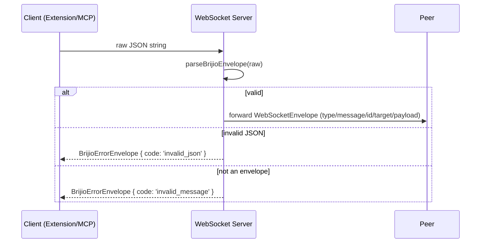
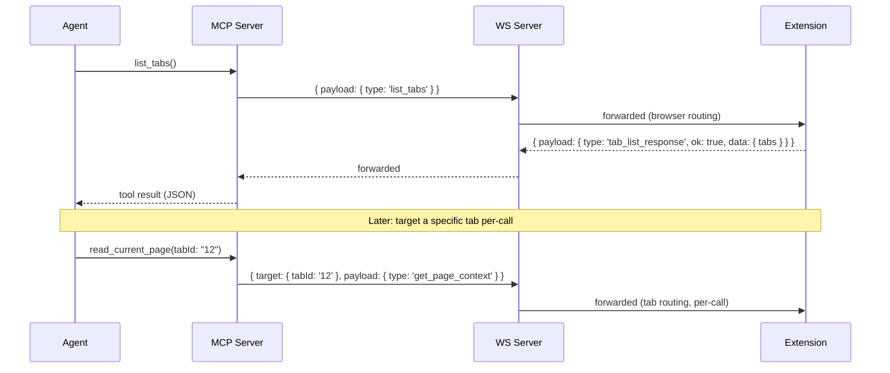
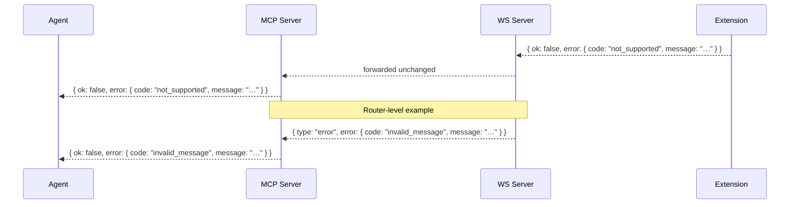

# Protocol and Data Model Guide

This page is the canonical OpenWiki home for the shared data structures and protocol shapes defined in `packages/shared/src/protocol.ts`, together with the page-context and page-content helpers in `packages/shared/src/page-context.ts` and `packages/shared/src/page-content.ts`. Everything described here is re-exported from `packages/shared/src/index.ts`, which is the single import surface consumed by the WebSocket relay, the MCP server, and the browser extensions.

## Cross-boundary rule: one source of truth

Protocol definitions live **only** in `packages/shared`. They must not be duplicated in `servers/mcp`, `servers/websocket`, or the extensions. `packages/shared/src/index.ts` re-exports the protocol, page-content, and page-context modules:

```ts
export * from "./protocol.js";
export * from "./page-content.js";
export * from "./page-context.js";
// … timers, background-controller, content-handler, etc.
```

The MCP server, WebSocket server, and extension all import these types and helpers from `@brijio/shared`. Changing a shape here without updating every consumer breaks interoperability — when you change anything that crosses a package boundary, start by editing `packages/shared/src/protocol.ts`. The MCP server is _not_ allowed to maintain a parallel `BrijioErrorCode` union (see [Error model and forwarded codes](#error-model-and-forwarded-codes) below); ADR 0061 explicitly relaxed the MCP result types to `code: string` precisely so the shared package remains the only authority.

## The canonical envelope

Every message on the WebSocket relay is wrapped in `WebSocketEnvelope`:

```ts
export interface WebSocketEnvelope {
  type: "message";
  id?: string;
  target?: {
    browserInstanceId?: string;
    tabId?: string;
  };
  payload: unknown;
}

export type BrijioEnvelope = WebSocketEnvelope;
```

The envelope is intentionally simple and explicit:

- `type` is always `'message'` for normal messages; router-level errors use a separate `BrijioErrorEnvelope` with `type: 'error'` (see [Error model and forwarded codes](#error-model-and-forwarded-codes)).
- `id` is the optional correlation/request id echoed back on responses. Helpers like `createPageContextResponse(id, context)` omit `id` when it is `undefined` rather than emitting `undefined`.
- `target` carries routing: `browserInstanceId` selects which connected browser instance handles the call, and `tabId` selects which tab within that instance. **Targeting is carried in the envelope, never hidden in session state.**
- `payload` is the typed request or response body; guards like `isGetPageContextEnvelope`, `isPerformActionEnvelope`, and `isPerformBatchEnvelope` validate both the envelope shape and the payload before a handler acts on it.

The `parseBrijioEnvelope` helper parses a raw JSON string and returns either `{ ok: true, message }` or a `{ ok: false, error }` `BrijioErrorEnvelope`. It rejects non-JSON input with `invalid_json` and anything that is not an object with `type: 'message'` and a `payload` property with `invalid_message`.



### Roles, auth, and presence

`BrijioRole` distinguishes the two peers on the relay:

```ts
export type BrijioRole = "extension" | "mcp";
```

Connection setup uses these payload types:

- `AuthPayload` — `{ type: 'auth', role, token }`; `isAuthPayload` requires a non-empty token.
- `AuthSuccessPayload` — `{ type: 'auth_success' }`.
- `BrowserPresenceRequestPayload` — `{ type: 'browser_presence_request' }`.
- `BrowserPresenceAnnouncePayload` — extends `BrowserPresence` with `type: 'browser_presence_announce'`; `isBrowserPresenceAnnouncePayload` validates identity fields and that every capability is a known `BrowserCapability`.

Factory helpers `createAuthEnvelope`, `createAuthSuccessEnvelope`, `createBrowserPresenceRequestEnvelope`, and `createBrowserPresenceAnnounceEnvelope` build the corresponding `WebSocketEnvelope`s. Presence is announced by the extension after auth and re-requested on demand by the MCP server for browser discovery (see [Browser presence and capabilities](#browser-presence-and-capabilities)).

## Browser presence and capabilities

`BrowserPresence` is the identity and capability record a connected browser instance advertises:

```ts
export interface BrowserPresence {
  browserInstanceId: string;
  label: string;
  browserName: string;
  profileName: string;
  connectedAt?: string;
  lastSeenAt?: string;
  capabilities: BrowserCapability[];
}
```

`BrowserCapability` is the union of named browser feature flags. The complete set in the shared package is:

```ts
export type BrowserCapability =
  | "page_context"
  | "page_content"
  | "click"
  | "fill_input"
  | "fill_editable"
  | "set_checked"
  | "select_options"
  | "submit_form"
  | "navigate"
  | "batch"
  | "upload_file"
  | "download_status"
  | "download_file"
  | "fetch_resource"
  | "screenshot";
```

Each flag corresponds to a concrete protocol surface: `page_context`/`page_content` gate page reading, `click`/`fill_input`/`fill_editable`/`set_checked`/`select_options`/`submit_form` gate the action variants, `batch` gates `perform_batch`, `upload_file` gates file-upload actions, `download_status`/`download_file`/`fetch_resource` gate the download and fetch surfaces, and `screenshot` gates `capture_screenshot`. `isBrowserCapability` is the exhaustive string guard that `isBrowserPresenceAnnouncePayload` uses to validate the `capabilities` array.

## Tab listing and explicit per-call targeting

ADR 0060 introduced tab-awareness primitives and ADR 0062 threads `tabId` through the entire action stack. The shared protocol is the contract both rely on.

### Tab primitives

```ts
export interface TabInfo {
  tabId: string; // opaque, raw Chrome/Safari tab ID as string
  windowId: string; // opaque, raw Chrome/Safari window ID as string
  title: string;
  url: string; // HTTP/HTTPS only
  active: boolean; // user's currently focused tab
  supported: boolean; // eligible for Brijio actions (always true for listed tabs)
}

export interface ListTabsRequestPayload {
  type: "list_tabs";
}

export interface TabListResponsePayload {
  type: "tab_list_response";
  ok: true;
  data: { tabs: TabInfo[] };
}

export interface TabListErrorResponsePayload {
  type: "tab_list_response";
  ok: false;
  error: { code: string; message: string };
}
```

`isTabInfo` validates all six `TabInfo` fields, and `isTabListResponsePayload` validates the whole response including the `tabs` array. There is no streaming of tab updates — `list_tabs` is an explicit on-demand fetch, mirroring `list_browsers`.

### Per-call targeting, not session state

The design rule (ADR 0060 constraint 1) is that tab targeting is **explicit and per-call**, with no hidden session-level "selected tab". The envelope `target.tabId` carries the chosen tab on each tool call; when `tabId` is absent the extension falls back to the active foreground tab. `WebSocketEnvelope.target` is therefore the single routing surface — `browserInstanceId` for multi-browser targeting and `tabId` for multi-tab targeting within a browser.



ADR 0062 documents that before its changes the extension silently dropped `target.tabId`; the shared protocol already carried the field, so the contract did not need to change — only the extension wiring. See the explicit tab targeting design in ADR 0060 and the threading in ADR 0062.

## Page context and content

Reading a page is a two-step protocol: fetch a compact `PageContext` (structure + preview), then optionally stream full `PageContent` in byte-bounded chunks.

`PageContext` (returned by `get_page_context`) carries `url`, `title`, `timestamp`, `selectedText`, a `preview` block (`content`/`truncated`/`maxBytes`), a `structure` object of `headings`/`landmarks`/`links`/`images`/`forms`/`editables`/`actions`, and a `content` descriptor telling the caller how to request full content:

```ts
content: {
  available: boolean;
  requestType: "get_page_content";
  firstIndex: 1;
  defaultMaxPayloadBytes: number;
}
```

`defaultPageContentMaxPayloadBytes = 131072` (128 KiB) is the default chunk size. `PageContent` (returned by `get_page_content` with an `index`) is `{ url, title, timestamp, index, content, truncated, maxPayloadBytes }`; `index` is 1-based and validated by `isGetPageContentEnvelope`.

`extractPageContext` (in `packages/shared/src/page-context.ts`) builds a `PageContext` from a live `Document`: it extracts readable content, headings, landmarks, links, images, forms (with controls, validity, options), editables, and actions, computes a `visibleContextId`, and seeds the preview via `chunkReadableContent`. `chunkReadableContent` (in `page-content.ts`) splits content on paragraph boundaries into `ContentChunk`s that respect `maxContentBytes`, only hard-splitting a single block when it exceeds the limit. Page-context and page-content error responses use the `PageContextErrorCode` / `PageContentErrorCode` unions (`not_connected`, `no_active_tab`, `unsupported_page`, `regular_page_permission_required`, `content_script_unavailable`, `extraction_failed`, `invalid_index`, `unsupported_request`).

## Actions and action result shapes

<!-- openwiki: broken internal link [../workflows/action-approval.md] file "../workflows/action-approval.md" does not exist. Fix the href or restore the target, then delete this comment. -->

`perform_action` carries a single discriminated `action` union. All action variants extend `ApprovalMetadata` (`actionUUID?`, `approvalRequest?`), which threads through to the approval flow (see [Action Approval](../workflows/action-approval.md)):

| Action type      | Target shape                                                                                                | Key fields                |
| ---------------- | ----------------------------------------------------------------------------------------------------------- | ------------------------- |
| `click`          | `ClickActionTarget` (`kind: 'link'\|'action'`, `id`, optional `expectedText`/`expectedHref`/`expectedRole`) | —                         |
| `write_text`     | `WriteTextActionTarget` (= `FormControlTarget`) or `WriteTextEditableTarget` (= `EditableActionTarget`)     | `text`                    |
| `set_checked`    | `FormControlTarget`                                                                                         | `checked`                 |
| `select_options` | `FormControlTarget`                                                                                         | `values: string[]`        |
| `submit_form`    | `FormSubmitTarget` (`formId`, optional `expectedLabel`)                                                     | —                         |
| `upload_file`    | `FormControlTarget`                                                                                         | `file: FileUploadPayload` |

`PerformActionRequest` also carries optional `pageContextId` and `visibleContextId` for stale-context detection. `FormControlTarget` is `{ formId, controlId, expectedLabel? }`.

`ActionResultResponse` is `{ type: 'action_result', ok: true, data }` where `data` is one of the typed result bodies (`ActionResultData` for click, plus `WriteTextActionResultData`, `SetCheckedActionResultData`, `SelectOptionsActionResultData`, `SubmitFormActionResultData`, `UploadFileActionResultData`). These bodies carry optional `contextStale` / `contextStaleReason: 'visible_controls_changed'` / `currentVisibleContextId` so the agent can detect that the page changed under it. `ActionResultErrorResponse` carries `code: ActionResultErrorCode`, `message`, optional `actionUUID`, and an optional `detail: StaleContextDetail` (expected vs. found text/href/role/label/type, previous/current context ids). The `ActionResultErrorCode` union covers `no_active_tab`, `unsupported_page`, `regular_page_permission_required`, `content_script_unavailable`, `unsupported_action`, `invalid_action_target`, `target_not_found`, `target_disabled`, `target_readonly`, `unsupported_control`, `invalid_control_value`, `option_not_found`, `target_option_disabled`, `action_failed`, `stale_context`, `page_navigated`, `upload_not_staged`, and the approval codes (`approval_denied`, `approval_timeout`, `approval_unavailable`, `approval_origin_changed`).

## Batch

`perform_batch` runs up to `BATCH_MAX_ACTIONS = 20` actions in one envelope. `PerformBatchRequest` is:

```ts
export interface PerformBatchRequest {
  type: "perform_batch";
  pageContextId?: number;
  visibleContextId?: string;
  actions: BatchAction[]; // 1–20 items, each a validated BatchAction
  continueOnError?: boolean;
  readAfterActions?: boolean;
}
```

<!-- openwiki: broken internal link [../concepts/mcp-tool-surface.md] file "../concepts/mcp-tool-surface.md" does not exist. Fix the href or restore the target, then delete this comment. -->

`isPerformBatchEnvelope` enforces the 1–20 action bound, validates each action via `isBatchAction`, and type-checks every optional flag. `BatchResultResponse` is `{ type: 'batch_result', ok, results, aborted }`; `ok` defaults to "all entries ok" but can be overridden. Each `BatchResultEntry` is either a `BatchActionOutcome` (the typed action result data, or a `BatchActionError` with `code`, `message`, optional `detail: StaleContextDetail`, `aborted`, `actionUUID`) or a `BatchReadOutcome` (a fresh `PageContext` when `readAfterActions` is set, or an error). A whole-batch failure uses `BatchResultErrorResponse` with a `BrijioErrorCode`. See [Batch handler](../concepts/mcp-tool-surface.md) for the tool surface.

## File uploads

There are two file-upload paths.

### Inline upload action

`PerformUploadFileAction` carries a `FileUploadPayload` inline (`fileName`, `mimeType`, `contentBase64`, `sizeBytes`, optional `lastModified`) targeted at a file `FormControlTarget`. The result is `UploadFileActionResultData` with the echoed file metadata and `fileCount`.

### Staged upload flow

For larger uploads, the protocol defines a staged start/chunk/complete/ack/error flow, each with its own `WebSocketEnvelope` wrapper (`StageFileUploadStartEnvelope`, `…ChunkEnvelope`, `…CompleteEnvelope`, `…AckEnvelope`, `…ErrorEnvelope`):

1. `stage_file_upload_start` — `uploadId`, `file` metadata (`name`, `size`, `type`, `sha256`), `chunkSize`, `totalChunks`.
2. `stage_file_upload_chunk` — `uploadId`, `index`, `dataBase64` (per chunk).
3. `stage_file_upload_complete` — `uploadId`, optional `sha256` to verify.
4. `stage_file_upload_staged` — server confirms staging by `uploadId`.
5. `stage_file_upload_ack` — final acknowledgment.
6. `stage_file_upload_error` — `uploadId` plus a typed `error.code` drawn from `invalid_file_payload`, `checksum_mismatch`, `file_too_large`, `invalid_file_name`, `invalid_file_type`, `upload_expired`.

## Downloads and fetch

The download/fetch surface (ADR 0047) models both browser-managed downloads and agent-initiated resource fetches with a shared status shape:

```ts
export type DownloadState = "in_progress" | "complete" | "interrupted";

export interface DownloadInfo {
  id: number;
  kind: "download";
  filename: string;
  url: string;
  mime: string | null;
  size: number | null;
  state: DownloadState;
  error?: string;
  danger?: string;
}

export interface FetchResourceInfo {
  id: string;
  kind: "fetch";
  url: string;
  contentType: string | null;
  bytesReceived: number;
  totalBytes: number | null;
  state: DownloadState | "streaming";
  error?: string;
}
```

- **`download_status`** — `DownloadStatusRequest` (`ids?`, `browserInstanceId?`) → `DownloadStatusResponse` (`ok: true`, `capability: 'full' | 'not_supported'`, `items: Array<DownloadInfo | FetchResourceInfo>`) or `DownloadStatusErrorResponse`. Built by `createDownloadStatusEnvelope` / `createDownloadStatusResponse`.
- **`download_file`** — `DownloadFileRequest` (`url`, optional `filename`, `conflictAction: 'uniquify' | 'overwrite'`, `browserInstanceId`, plus `ApprovalMetadata`) → `DownloadFileResponse` (`downloadId`, `status: 'initiated' | 'initiated_fire_and_forget'`) or `DownloadFileErrorResponse`.
- **`fetch_resource`** — `FetchResourceRequest` (`url`, optional `maxSizeBytes`, `timeout`, `browserInstanceId`, plus `ApprovalMetadata`) starts a **streaming** response: `fetch_resource_start` (`fetchId`, `url`, `contentType`, `totalBytes`), then zero or more `fetch_resource_chunk` (`fetchId`, `index`, `dataBase64`), then `fetch_resource_complete` (`fetchId`, `sha256`, `totalBytes`, optional `dataBase64`/`contentType`) or `fetch_resource_error` (`fetchId?`, `error`, `message`, optional `httpStatus`). `FetchResourceStreamMessage` is the union of these four.

## Screenshots

`capture_screenshot` (ADR 0064) → `CaptureScreenshotResponse` (`data: { dataBase64, width, height, tabId, capturedAt }`) or `CaptureScreenshotErrorResponse` with a `ScreenshotErrorCode` of `capability_not_supported`, `capture_failed`, `no_visible_tab`, or `timeout`. `CaptureScreenshotResult` and `CaptureScreenshotStreamMessage` are the typed unions used by callers.

## Navigation and open-tab

- `navigate_to_url` → `NavigateToUrlResponse` (`data: NavigateToUrlResult` with `url`, `title`, `timestamp`, `redirected`, `navigationMs`) or `NavigateToUrlErrorResponse` (`NavigateToUrlErrorCode`: `no_active_tab`, `unsupported_scheme`, `unsupported_page`, `navigation_failed`, `timeout`, `content_script_unavailable`).
- `open_tab` (ADR 0063) → `OpenTabResponse` (`data: { tabId, url, title }`) or `OpenTabErrorResponse` (`OpenTabErrorCode`: `unsupported_scheme`, `open_tab_failed`, `timeout`).

`ExtensionResponse` is the discriminated union of all extension-originated responses (page context/content, action, navigate, open-tab, batch, download status/file, fetch stream, screenshot), which is what `createEnvelope(id, payload)` accepts.

## Error model and forwarded codes

The relay uses two distinct error channels.

### Router-level errors — `BrijioErrorEnvelope`

```ts
export interface BrijioErrorEnvelope {
  type: "error";
  error: {
    code: BrijioErrorCode;
    message: string;
    browsers?: BrowserPresence[];
  };
}
```

These are produced by `createErrorEnvelope` and returned by `parseBrijioEnvelope`. `browsers` is optional and used by `browser_unavailable` / `ambiguous_browser_target` to list candidate instances. `BrijioErrorCode` is the shared union of router-level codes:

```ts
export type BrijioErrorCode =
  | "invalid_json"
  | "invalid_message"
  | "auth_required"
  | "auth_failed"
  | "invalid_auth_message"
  | "browser_unavailable"
  | "ambiguous_browser_target"
  | "invalid_browser_target"
  | "timeout"
  | "unsupported_action"
  | "batch_failed"
  | "invalid_file_payload"
  | "checksum_mismatch"
  | "file_too_large"
  | "invalid_file_name"
  | "invalid_file_type"
  | "upload_staging_failed"
  | "upload_not_staged"
  | "target_not_file_input"
  | "upload_expired"
  | "download_not_found"
  | "fetch_resource_failed";
```

### Action/response-level errors

Per-call responses (`page_context_response`, `page_content_response`, `action_result`, `batch_result`, `navigate_to_url_response`, `open_tab_response`, `download_status_response`, `download_file_response`, `screenshot_response`) each carry their own `ok: false` variant with a domain-specific `code` union (`ActionResultErrorCode`, `PageContextErrorCode`, `ScreenshotErrorCode`, etc.) and a free-text `message`. The screenshot and fetch surfaces also have their own narrow error unions.

### ADR 0061: forward, don't flatten

ADR 0061 addressed a bug where the MCP server's `parseRouterErrorEnvelope` and `parseErrorPayload` discarded original error codes and replaced them with generic `invalid_response` / `browser_error`. The decision:

- **Router-level**: forward any envelope with a string `code` and string `message` as-is; only return `invalidResponse()` when the envelope structure itself is malformed. This stops unrecognized shared-package codes (e.g. `invalid_message`, `invalid_json`) from being hidden behind `"Received an invalid Brijio response."`.
- **Action-level**: preserve `stale_context` and `page_navigated` with their structured `detail`; for all other codes, pass through the original extension `code` string instead of wrapping as `browser_error`.
- **Types**: the MCP `BrijioToolResult` / `BrijioResourceResult` error `code` is relaxed to `string`, so the MCP server no longer maintains a parallel union that must stay in sync with `@brijio/shared`. The shared `BrijioErrorCode` union remains the authoritative list for code that constructs router errors.



## Envelope constructors and validators

The protocol module exports a large set of factory helpers (`createAuthEnvelope`, `createListTabsEnvelope`, `createTabListResponse`, `createPageContextResponse`, `createActionResultResponse`, `createPerformBatchEnvelope`, `createBatchResultResponse`, `createDownloadStatusEnvelope`, `createFetchResourceStartResponse`, `createScreenshotResponse`, `createOpenTabResponse`, `createErrorEnvelope`, …) and type guards (`isAuthPayload`, `isBrowserPresenceAnnouncePayload`, `isListTabsEnvelope`, `isTabListResponsePayload`, `isGetPageContextEnvelope`, `isPerformActionEnvelope`, `isPerformBatchEnvelope`, `isDownloadStatusEnvelope`, `isCaptureScreenshotEnvelope`, `isOpenTabEnvelope`, …). All factories build `WebSocketEnvelope`s with `type: 'message'` and omit `id`/optional fields when undefined; all guards validate both envelope structure and the payload's typed fields before narrowing. Prefer these over hand-rolled objects so validation and shape stay in sync.

## Why this file matters

<!-- openwiki: broken internal link [../concepts/mcp-tool-surface.md] file "../concepts/mcp-tool-surface.md" does not exist. Fix the href or restore the target, then delete this comment. -->
<!-- openwiki: broken internal link [../architecture/websocket-relay.md] file "../architecture/websocket-relay.md" does not exist. Fix the href or restore the target, then delete this comment. -->
<!-- openwiki: broken internal link [../concepts/browser-adapters.md] file "../concepts/browser-adapters.md" does not exist. Fix the href or restore the target, then delete this comment. -->

`packages/shared/src/protocol.ts` is the source of truth for the envelope shape, roles and auth, browser presence and capabilities, tab identity and explicit per-call targeting, page context/content, actions and batch results, the staged file-upload flow, downloads and fetch, screenshots, and the `BrijioErrorCode` union forwarded end-to-end per ADR 0061. Any cross-boundary change starts here; the MCP server, WebSocket server, and extensions import from `@brijio/shared` and must not duplicate these definitions. See the [MCP tool surface](../concepts/mcp-tool-surface.md) and [WebSocket relay](../architecture/websocket-relay.md) pages for how these shapes are consumed, and the [browser adapters](../concepts/browser-adapters.md) page for how the extension implements them.

## Related source files and decisions

- `packages/shared/src/protocol.ts`
- `packages/shared/src/page-context.ts`
- `packages/shared/src/page-content.ts`
- `packages/shared/src/index.ts`
- [ADR 0060 — Explicit Tab Listing and Selection](../docs/architecture/decisions/0060-explicit-tab-listing-and-selection.md)
- [ADR 0061 — Forward Error Codes Through MCP](../docs/architecture/decisions/0061-forward-error-codes-through-mcp.md)
- [ADR 0062 — Thread tabId Through the Action Stack](../docs/architecture/decisions/0062-thread-tabid-through-action-stack.md)
