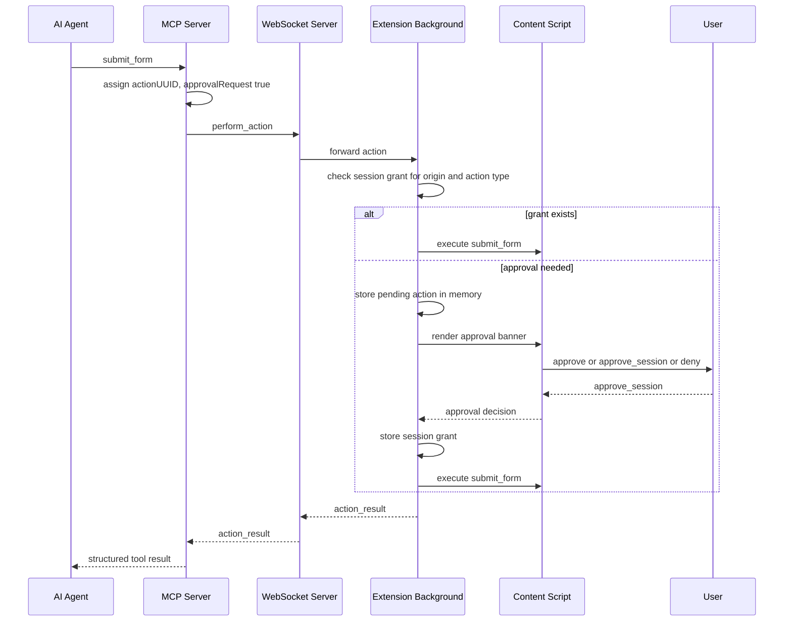
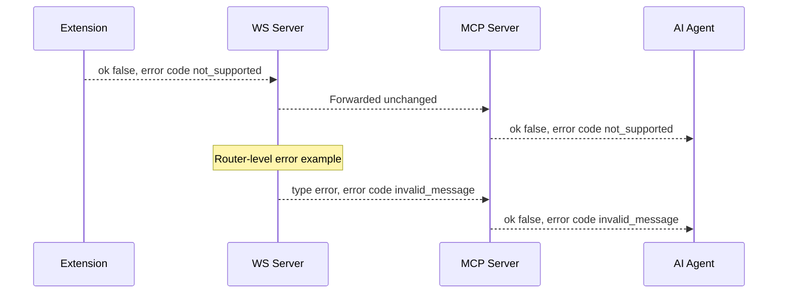

# Protocol and Data Model Guide

This page is the canonical OpenWiki home for the main shared data structures and
protocol shapes that flow across the WebSocket relay, the browser extension, and
the MCP server.

## Where protocol definitions live

Protocol definitions live **only** in `packages/shared/src/protocol.ts`. That
file is the source of truth for every envelope, payload, capability, error
code, and helper referenced on this page. It is re-exported wholesale through
`packages/shared/src/index.ts`, so anything in the `@brijio/shared` package can
import these types and helpers directly.

`servers/mcp/src/protocol.ts` is the **MCP-side parser**, not a duplicate
definition source. It defines MCP-local result types (`BrijioResourceResult`,
`BrijioScreenshotResult`, etc.), envelope constructors that stamp MCP request
IDs and approval metadata onto shared payload shapes, and the parsers that turn
raw WebSocket envelopes back into typed results. When the shared package changes
a payload shape, the MCP server's parsers must follow; the MCP server must not
redefine the shared shapes independently.

If you are changing anything that crosses package boundaries, start by checking
`packages/shared/src/protocol.ts`, then confirm the MCP parser in
`servers/mcp/src/protocol.ts` still agrees.

## The canonical envelope

`packages/shared/src/protocol.ts` defines the main message envelope used across
the relay and clients:

```ts
export interface WebSocketEnvelope {
  type: "message";
  id?: string;
  target?: {
    browserInstanceId?: string;
    tabId?: string;
  };
  payload: unknown;
}
```

- `WebSocketEnvelope` — `type: 'message'`, optional `id` (request/response
  correlation), optional `target` (browser instance and/or tab), and a
  `payload`.
- `BrijioRole` — `'extension' | 'mcp'`.
- `AuthPayload` / `AuthSuccessPayload` — `type: 'auth'` (role + token) and
  `type: 'auth_success'`.
- `BrowserPresenceRequestPayload` / `BrowserPresenceAnnouncePayload`.

The envelope is intentionally simple and explicit. Targeting information
(`browserInstanceId`, `tabId`) is carried in the envelope `target` rather than
hidden in session state. The envelope `id` is the request/response identifier
shared by a request and its reply; the per-action `actionUUID` (see
[Action approval](#action-approval)) is a separate, finer-grained identifier.

Shared helpers build envelopes consistently:

- `createAuthEnvelope` / `createAuthSuccessEnvelope`
- `createEnvelope(id, payload)` is the low-level builder used by the
  type-specific `create*Envelope` helpers.

## Browser presence and capabilities

The shared protocol defines:

- `BrowserPresence` — `browserInstanceId`, label, `browserName`, `profileName`,
  connection timestamps (`connectedAt`, `lastSeenAt`), and `capabilities`.
- `BrowserCapability` — named browser feature flags. The full union is:

```ts
export type BrowserCapability =
  | "page_context"
  | "page_content"
  | "click"
  | "fill_input"
  | "fill_editable"
  | "set_checked"
  | "select_options"
  | "submit_form"
  | "navigate"
  | "batch"
  | "upload_file"
  | "download_status"
  | "download_file"
  | "fetch_resource"
  | "screenshot";
```

The `screenshot` capability was added by ADR 0064 (visual action verification).
A browser announces the capabilities it supports in its
`BrowserPresenceAnnouncePayload`; callers gate behavior on the advertised set.

These shapes are used by the WebSocket relay and the MCP-facing browser
discovery flows.

## Tab listing and tab targeting

Tab-awareness primitives (ADR 0060, ADR 0062) are explicit and per-call:

- `TabInfo` — opaque `tabId`, `windowId`, title, URL, `active`, and
  `supported` flag (always true for listed tabs).
- `ListTabsRequestPayload` — `type: 'list_tabs'`.
- `TabListResponsePayload` / `TabListErrorResponsePayload` —
  `type: 'tab_list_response'` with `ok: true` + `data.tabs`, or `ok: false` +
  `error`.

The important design choice is that tab targeting is explicit and per-call via
the envelope `target.tabId`. The repo does **not** use hidden session-level
"selected tab" state.

## File uploads and download/fetch status

### Staged file uploads

The staged upload flow (ADR 0046) is a start/chunk/complete/ack/error sequence:

- `StageFileUploadStartPayload` — `uploadId`, file metadata (`name`, `size`,
  `mimeType`, optional `sha256`), `chunkSize`, `totalChunks`.
- `StageFileUploadChunkPayload` — `uploadId`, `index`, `dataBase64`.
- `StageFileUploadCompletePayload` — `uploadId`, optional `sha256`.
- `StageFileUploadStagedPayload` / `StageFileUploadAckPayload`.
- `StageFileUploadErrorPayload` — `uploadId` + `error` with a code from
  `invalid_file_payload | checksum_mismatch | file_too_large |
invalid_file_name | invalid_file_type | upload_expired`.

### Downloads and fetch

- `DownloadState` — `'in_progress' | 'complete' | 'interrupted'`.
- `DownloadInfo` — `id`, `filename`, `url`, `mime`, `size`, `state`, optional
  `error` / `danger`.
- `FetchResourceInfo` — `id`, `url`, `contentType`, `bytesReceived`,
  `totalBytes`, `state` (extends `DownloadState` with `'streaming'`), optional
  `error`.
- `DownloadStatusRequest` — `type: 'download_status'`, optional `ids`.
- `DownloadStatusResponse` / `DownloadStatusErrorResponse` — includes a
  `capability: 'full' | 'not_supported'` field so callers know whether the
  browser reports real download state.
- `DownloadFileRequest extends ApprovalMetadata` — `type: 'download_file'`,
  `url`, optional `filename` / `conflictAction`. Approval-gated (see
  [Action approval](#action-approval)).
- `FetchResourceRequest extends ApprovalMetadata` — `type: 'fetch_resource'`,
  `url`, optional `maxSizeBytes` / `timeout`. Approval-gated.
- `FetchResourceStreamMessage` — the streamed fetch response union:
  `FetchResourceStartResponse`, `FetchResourceChunkResponse`,
  `FetchResourceCompleteResponse`, `FetchResourceErrorResponse`.

## Screenshots

ADR 0064 (visual action verification) adds an explicit, viewport-only
screenshot surface. Screenshots are JPEG captures of the active tab, opt-in per
tool call (no auto-capture), and routed through the standard envelope.

Shared types in `packages/shared/src/protocol.ts`:

```ts
export interface CaptureScreenshotRequest {
  type: "capture_screenshot";
}

export interface CaptureScreenshotResponse {
  type: "screenshot_response";
  ok: true;
  data: {
    dataBase64: string;
    width: number;
    height: number;
    tabId: string;
    capturedAt: string;
  };
}

export interface CaptureScreenshotErrorResponse {
  type: "screenshot_response";
  ok: false;
  error: { code: ScreenshotErrorCode; message: string };
}

export type ScreenshotErrorCode =
  "capability_not_supported" | "capture_failed" | "no_visible_tab" | "timeout";
```

Shared helpers:

- `isCaptureScreenshotEnvelope` — type guard for incoming `capture_screenshot`
  envelopes.
- `createScreenshotResponse(id, data)` — builds a success envelope.
- `createScreenshotErrorResponse(id, code, message)` — builds an error
  envelope.

`'screenshot'` is a member of the `BrowserCapability` union, so a browser must
advertise it before screenshot requests are routed to it.

On the MCP side, `servers/mcp/src/protocol.ts` defines
`ScreenshotResultData`, `BrijioScreenshotResult`
(=`BrijioResourceResult<ScreenshotResultData>`), `createCaptureScreenshotEnvelope`,
and `parseScreenshotEnvelope`, which parses a `screenshot_response` payload and
forwards errors via `parseErrorPayload`. The MCP tool layer
(`capture-screenshot-tool.ts`) wraps the result with `mimeType: 'image/jpeg'`
before returning image content to the agent.

## Action approval

ADR 0048 introduces a client-side approval gate for selected browser-mutating
operations. Approval is **not** required for every action; only
`submit_form`, `fetch_resource`, and `download_file` are approval-gated in the
first (hardcoded) implementation.

### Protocol fields

Approval metadata is threaded through the shared action interfaces via
`ApprovalMetadata`:

```ts
export interface ApprovalMetadata {
  actionUUID?: string;
  approvalRequest?: boolean;
}
```

Every action interface that can be approval-gated extends `ApprovalMetadata`:
`PerformClickAction`, `PerformWriteTextAction`, `PerformSetCheckedAction`,
`PerformSelectOptionsAction`, `PerformSubmitFormAction`,
`PerformUploadFileAction`, `DownloadFileRequest`, and `FetchResourceRequest`.

- `actionUUID` — a unique identifier for one specific action within a single
  request or a batch. For `perform_batch`, **every** batch action carries an
  `actionUUID` (whether or not it needs approval) so approved, denied, or
  timed-out actions are individually identifiable.
- `approvalRequest` — set to `true` only on actions that require approval.

The MCP server assigns `actionUUID` values and sets `approvalRequest: true` for
gated actions. In `servers/mcp/src/websocket-client.ts`,
`createApprovalRequestOptions()` mints a fresh `action-${...}` UUID plus
`approvalRequest: true`, and `addBatchActionApprovalMetadata` ensures every
batch item gets a UUID (and `submit_form` items additionally get
`approvalRequest: true`). `requestSubmitForm`, `requestDownloadFile`, and
`requestFetchResource` all call `createApprovalRequestOptions()` and pass the
approval options into the corresponding `create*Envelope` helper.

### Approval decisions

The user-facing approval decision is one of:

- `approve` — approve only the current action.
- `approve_session` — approve this action **and** future matching actions
  during the same bridge connection, scoped to `{ origin, actionType }`.
- `deny` — reject the current action.

`approve_session` grants are held in extension background memory only (never
`localStorage`, extension storage, or IndexedDB) and are cleared when the
bridge disconnects, the extension reloads, or the browser session ends. Before
executing an approved action, the extension verifies the active tab still has
the same origin and action type; an origin change fails the action.

### Approval error codes

Approval failures are returned as structured action errors. The
`ActionResultErrorCode` union in `packages/shared/src/protocol.ts` includes:

- `approval_denied` — the user denied the action.
- `approval_timeout` — the user did not respond before the computed approval
  timeout.
- `approval_unavailable` — the extension could not render the approval UI.
- `approval_origin_changed` — the active tab origin changed before execution.

Approval errors include `actionUUID` when available. `ActionResultErrorResponse`
and `BatchActionError` both carry an optional `actionUUID`; batch errors also
carry `aborted`.

### Timeout derivation

The approval timer must fire **before** the local MCP HTTP request timeout so
Brijio returns a structured `approval_timeout` instead of a generic HTTP
timeout:

```text
approvalTimeoutMs = httpRequestTimeoutMs - approvalTimeoutBufferMs
```

The MCP server passes `options.approvalTimeoutMs ?? options.timeoutMs` as the
request budget for approval-gated tools and batches. For remote/enterprise
deployments behind infrastructure Brijio does not control, timeout values must
be explicitly configured below the shortest expected client/proxy/gateway
timeout.

### Batch semantics

Inside `perform_batch`, approval-gated actions execute one at a time: a
matching session grant skips the prompt; otherwise the banner is shown for that
action only, and the runner waits for approve / approve_session / deny / timeout
before continuing. A denied action returns `approval_denied` for its
`actionUUID` and the batch continues to the next action (denial is a focused
per-action outcome, not a batch abort). An approval timeout records
`approval_timeout` for the current action and returns a **partial**
`batch_result` with focused failed entries for the timed-out and remaining
unexecuted actions. The `continueOnError` flag continues to apply to execution
failures after approval; page navigation still aborts remaining actions.

The end-to-end approval flow is shown below:



_Approval-gated actions carry an `actionUUID` and `approvalRequest`; the
extension holds pending state and session grants in memory only._

## Error codes and forwarding

### The shared `BrijioErrorCode` union

`packages/shared/src/protocol.ts` owns the canonical `BrijioErrorCode` union
used by the WebSocket relay:

```ts
export type BrijioErrorCode =
  | "invalid_json"
  | "invalid_message"
  | "auth_required"
  | "auth_failed"
  | "invalid_auth_message"
  | "browser_unavailable"
  | "ambiguous_browser_target"
  | "invalid_browser_target"
  | "timeout"
  | "unsupported_action"
  | "batch_failed"
  | "invalid_file_payload"
  | "checksum_mismatch"
  | "file_too_large"
  | "invalid_file_name"
  | "invalid_file_type"
  | "upload_staging_failed"
  | "upload_not_staged"
  | "target_not_file_input"
  | "upload_expired"
  | "download_not_found"
  | "fetch_resource_failed";
```

This union is the **source of truth**. Router-level error envelopes
(`BrijioErrorEnvelope`) carry `code: BrijioErrorCode`. Action-level errors use
the broader `ActionResultErrorCode` union (which includes the approval codes
above, plus `target_not_found`, `action_failed`, `stale_context`,
`page_navigated`, etc.).

### Forwarding through the MCP server (ADR 0061)

ADR 0061 requires that the original error code and message from the WS server
and extension be **forwarded** to the agent rather than flattened into generic
codes. The MCP server previously maintained a local `BrijioErrorCode` union
that drifted out of sync with the shared package, causing codes like
`invalid_message` and `invalid_json` to be replaced with `invalid_response`
("Received an invalid Brijio response.") and extension-specific codes like
`not_supported` / `cors_blocked` to be collapsed to `browser_error`.

The current implementation in `servers/mcp/src/protocol.ts` forwards codes
instead:

- `parseRouterErrorEnvelope` — for router-level `{ type: 'error', error: { code,
message } }` envelopes, forwards any string `code` and `message` as-is. It
  only returns `invalidResponse()` when the envelope structure itself is
  malformed (missing `error` object or `message` string). Unrecognized codes
  such as `invalid_message` and `invalid_json` are passed through rather than
  replaced.
- `parseErrorPayload` — for action-level `{ ok: false, error: { code, message }
}` payloads, preserves `stale_context` and `page_navigated` with their
  structured `detail` (the agent relies on that detail), and forwards the
  original `code` string for all other codes instead of wrapping as
  `browser_error`.

Because the extension and WS server may emit codes not known to the MCP server,
the MCP result type `BrijioResourceResult<T>` declares `error.code` as `string`
(not constrained to a local union). The MCP server's local `BrijioErrorCode`
union is retained only for internal constructors (`timeoutResponse`,
`connectionFailedResponse`, `invalidResponse`, etc.) and must not constrain the
forwarded result type. This is why the MCP server's local union must not drift
out of sync with the shared union: forwarding sidesteps the drift problem by
accepting arbitrary string codes, but the shared union remains the canonical
list of known router-level codes.



_ADR 0061 forwards the original error code and message end-to-end instead of
flattening to generic `browser_error` or `invalid_response`._

## Related source files and decisions

- `packages/shared/src/protocol.ts` — canonical protocol definitions.
- `packages/shared/src/index.ts` — re-exports the shared protocol surface.
- `servers/mcp/src/protocol.ts` — MCP-side parser and envelope constructors.
- `servers/mcp/src/websocket-client.ts` — MCP request helpers, approval
  metadata assignment, and screenshot routing.
- `docs/architecture/decisions/0048-client-side-action-approval.md`
- `docs/architecture/decisions/0061-forward-error-codes-through-mcp.md`
- `docs/architecture/decisions/0064-visual-action-verification.md`

For the operational approval workflow, see
<!-- openwiki: broken internal link [../workflows/action-approval.md] file "../workflows/action-approval.md" does not exist. Fix the href or restore the target, then delete this comment. -->

[Action Approval](../workflows/action-approval.md). For multi-tab routing that
threads `tabId` through this envelope, see
<!-- openwiki: broken internal link [../workflows/multi-tab.md] file "../workflows/multi-tab.md" does not exist. Fix the href or restore the target, then delete this comment. -->

[Multi-Tab](../workflows/multi-tab.md). For how MCP tool calls reach the
<!-- openwiki: broken internal link [../architecture/mcp-extension-flow.md] file "../architecture/mcp-extension-flow.md" does not exist. Fix the href or restore the target, then delete this comment. -->

browser, see [MCP Extension Flow](../architecture/mcp-extension-flow.md) and
<!-- openwiki: broken internal link [../architecture/browser-content-pipeline.md] file "../architecture/browser-content-pipeline.md" does not exist. Fix the href or restore the target, then delete this comment. -->

the [Browser Content Pipeline](../architecture/browser-content-pipeline.md).
