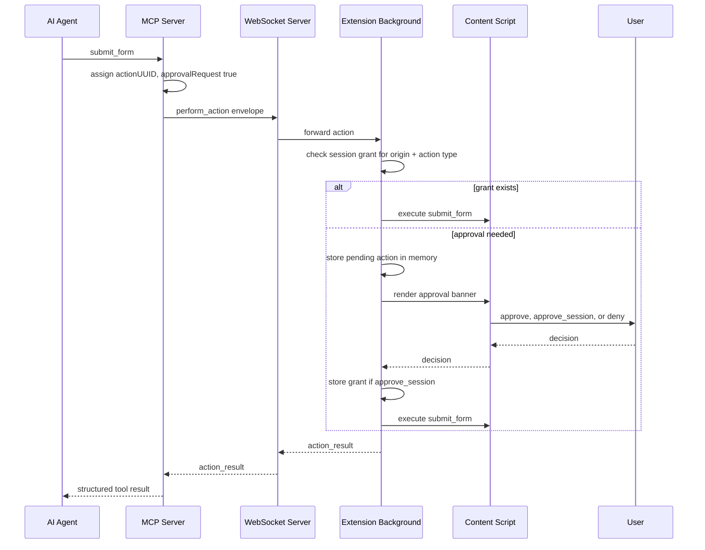

# Protocol and Data Model Guide

This page is the canonical OpenWiki home for the shared data structures and
protocol shapes that flow across the relay, the browser extensions, and the MCP
server. Treat `packages/shared/src/protocol.ts` as the single source of truth for
these shapes; `servers/mcp/src/protocol.ts` is the MCP-side companion that
mirrors the relevant types and supplies the envelope builders and parsers used by
MCP tool calls. Changing the shared shapes without updating both sides will
usually break interoperability.

## The canonical envelope

Every WebSocket message is wrapped in a `WebSocketEnvelope` (aliased as
`BrijioEnvelope`):

```ts
interface WebSocketEnvelope {
  type: "message";
  id?: string;
  target?: {
    browserInstanceId?: string;
    tabId?: string;
  };
  payload: unknown;
}
```

The envelope is intentionally minimal. `id` is the request/response correlation
identifier (for example `mcp-<ts>-<rand>`). `target` carries routing, not
session state: `browserInstanceId` selects one connected extension among many,
and `tabId` selects one tab within that browser. `payload` is the typed
operation, discriminated by its own `type` field.

`parseBrijioEnvelope` accepts a raw JSON string and returns either a parsed
envelope or a `BrijioErrorEnvelope` (`invalid_json` / `invalid_message`). The
envelope is the only shape the relay forwards; it does not interpret the
payload beyond routing.

## Auth and presence

Connection identity is established with two roles:

```ts
type BrijioRole = "extension" | "mcp";
```

`AuthPayload` (`{ type: 'auth', role, token }`) authenticates a connection;
`AuthSuccessPayload` (`{ type: 'auth_success' }`) acknowledges it. Envelope
builders `createAuthEnvelope`, `createAuthSuccessEnvelope`, and the type guards
`isAuthPayload` / `isAuthSuccessEnvelope` implement the handshake.

Browser presence is discovered and announced through:

- `BrowserPresenceRequestPayload` (`{ type: 'browser_presence_request' }`) — the
  MCP side asks the relay which browsers are connected.
- `BrowserPresenceAnnouncePayload` — extends `BrowserPresence` with
  `type: 'browser_presence_announce'`.

`BrowserPresence` describes one connected browser instance:

```ts
interface BrowserPresence {
  browserInstanceId: string;
  label: string;
  browserName: string;
  profileName: string;
  connectedAt?: string;
  lastSeenAt?: string;
  capabilities: BrowserCapability[];
}
```

`browserInstanceId` is the routing key used in `envelope.target.browserInstanceId`
for all subsequent per-browser calls. Presence is fetched on demand; the
extension does not stream presence updates.

## Browser capability set

`BrowserCapability` is the closed set of feature flags a connected browser
advertises. It doubles as the discriminator for which operations a browser
supports:

```ts
type BrowserCapability =
  | "page_context"
  | "page_content"
  | "click"
  | "fill_input"
  | "fill_editable"
  | "set_checked"
  | "select_options"
  | "submit_form"
  | "navigate"
  | "batch"
  | "upload_file"
  | "download_status"
  | "download_file"
  | "fetch_resource"
  | "screenshot";
```

`isBrowserCapability` validates a single flag; `isBrowserPresenceAnnouncePayload`
requires every element of `capabilities` to pass it. The MCP server uses these
capabilities to decide whether a tool is dispatchable to a given browser.

## Explicit, per-call targeting

Targeting is explicit and per-call. There is no hidden session-level "selected
tab" or "selected browser" state. Each operation carries its own routing in
`envelope.target`:

- `target.browserInstanceId` selects the connected extension (mirrors the
  `list_browsers` flow).
- `target.tabId` selects a tab within that browser (introduced by the explicit
  tab-selection work, ADRs 0060 and 0062).

When `tabId` is omitted, the extension falls back to the active foreground tab.
When provided, the extension resolves the raw Chrome/Safari tab ID and targets
that specific tab, injecting the tab indicator (title prefix and in-page banner)
so the user can see which tab Brijio is acting on. The invariant is: the same
envelope always targets the same browser and tab, regardless of any prior call.

## Tab listing and open-tab shapes

Tab awareness was added in two stages.

### List tabs (ADR 0060)

`list_tabs` mirrors `list_browsers`. The MCP `list_tabs` tool sends a
`ListTabsRequestPayload` (`{ type: 'list_tabs' }`); the extension replies with a
`tab_list_response`. `TabInfo` is the per-tab shape:

```ts
interface TabInfo {
  tabId: string; // raw Chrome/Safari tab ID as string
  windowId: string; // raw window ID as string
  title: string;
  url: string; // HTTP/HTTPS only
  active: boolean; // currently focused tab
  supported: boolean; // eligible for Brijio actions (true for listed tabs)
}
```

Only regular HTTP/HTTPS tabs are listed; `chrome://`, `chrome-extension://`,
`about:`, `file://`, and `safari://` tabs are filtered out, and incognito tabs
are excluded. Response shapes:

- `TabListResponsePayload` — `{ type: 'tab_list_response', ok: true, data: { tabs: TabInfo[] } }`
- `TabListErrorResponsePayload` — `{ type: 'tab_list_response', ok: false, error: { code, message } }`

`isTabInfo` validates a single tab; `isTabListResponsePayload` validates the
whole response including the tabs array.

### Open tab (ADR 0063)

`open_tab` creates a new tab and returns its `tabId` so the agent can target it
immediately. `OpenTabRequest` is `{ type: 'open_tab', url }`; the URL is
validated to an HTTP/HTTPS scheme. The success result is:

```ts
interface OpenTabResult {
  tabId: string;
  url: string;
  title: string; // may be empty until the page loads
}
```

`OpenTabResponse` / `OpenTabErrorResponse` use the standard `ok: true` /
`ok: false` envelope pattern. `OpenTabErrorCode` is
`'unsupported_scheme' | 'open_tab_failed' | 'timeout'`. Both `OpenTabResponse`
and `OpenTabErrorResponse` are members of the `ExtensionResponse` union.

## Approval-gated action metadata (ADR 0048)

Not every action requires user approval, but a hardcoded set does:
`submit_form`, `fetch_resource`, and `download_file`. The approval policy is
intentionally small and local; future stages can make it configurable or
enterprise-managed without changing the action execution pipeline.

Approval-gated actions carry an `ApprovalMetadata` block:

```ts
interface ApprovalMetadata {
  actionUUID?: string;
  approvalRequest?: boolean;
}
```

- `actionUUID` uniquely identifies one action, both in single-action requests and
  in every item of a `perform_batch`. The MCP server assigns it with
  `createActionUUID()` (`action-<ts>-<rand>`).
- `approvalRequest: true` marks an action as needing a user approval decision
  (`approve`, `approve_session`, or `deny`).

`PerformClickAction`, `PerformWriteTextAction`, `PerformSetCheckedAction`,
`PerformSelectOptionsAction`, `PerformSubmitFormAction`, and
`PerformUploadFileAction` all extend `ApprovalMetadata`, so the fields ride on
each action payload. `DownloadFileRequest` and `FetchResourceRequest` also
extend `ApprovalMetadata`, so the same metadata travels on the standalone
download/fetch envelopes.

On the MCP side, `createApprovalRequestOptions()` builds the
`{ actionUUID, approvalRequest: true }` pair for each approval-gated call, and
`addBatchActionApprovalMetadata` attaches a unique `actionUUID` to every batch
action while setting `approvalRequest: true` only on `submit_form` items. The
relay and extension see the metadata in the payload; the extension holds the
pending action and any `approve_session` grant in memory, scoped to
`{ origin, actionType }`, and clears them when the bridge disconnects.

### Approval-aware request flow

The envelope `id` stays the request/response correlation identifier; `actionUUID`
identifies the specific action within the request or batch. Approval errors
return `actionUUID` in the error payload so the agent can map the failure back to
the originating action.



_Approval-gated actions carry an `actionUUID` and `approvalRequest: true`; the
extension resolves the user decision in memory and returns a structured result
or an approval error._

### Approval error codes

Approval-specific `ActionResultErrorCode` values are:
`approval_denied`, `approval_timeout`, `approval_unavailable`, and
`approval_origin_changed`. `ActionResultErrorResponse.error` and
`BatchActionError` both surface `actionUUID` when available so the agent can
correlate the failed action. The approval timeout is derived from the local MCP
HTTP timeout minus a buffer (`approvalTimeoutMs = httpRequestTimeoutMs -
approvalTimeoutBufferMs`), so Brijio returns a structured `approval_timeout`
before the HTTP server produces a generic timeout.

### Batch approval semantics

Inside a `perform_batch`, the extension treats every action independently:

1. Actions that do not require approval execute normally.
2. Approval-gated actions with a matching session grant execute normally.
3. Approval-gated actions without a grant show one approval banner at a time.
4. The batch continues only after the current action succeeds, is denied, or
   times out.

A denied action returns `approval_denied` for its `actionUUID` but does not
abort the whole batch; remaining actions still run. The `continueOnError` flag
applies to execution failures (stale targets, unsupported controls) after an
action is approved. Page navigation remains special: an action that navigates
the page aborts the remaining actions because previously read page IDs may no
longer be valid.

## Staged file uploads

Large file uploads are staged in chunks rather than sent inline with the action.
The staged-upload protocol has an explicit start, chunked transfer, completion
ack, and error path. Every staged envelope targets a browser by
`browserInstanceId` and is keyed by an `uploadId`.

- `StageFileUploadStartPayload` — `{ type: 'stage_file_upload_start', uploadId,
file: { name, size, type?, sha256? }, chunkSize, totalChunks }`.
- `StageFileUploadChunkPayload` — `{ type: 'stage_file_upload_chunk', uploadId,
index, dataBase64 }`, one per chunk.
- `StageFileUploadCompletePayload` — `{ type: 'stage_file_upload_complete',
uploadId, sha256? }` signals the client finished sending chunks.
- `StageFileUploadStagedPayload` — `{ type: 'stage_file_upload_staged',
uploadId }` is the extension-side confirmation that the staged file is ready.
- `StageFileUploadAckPayload` — `{ type: 'stage_file_upload_ack', uploadId }`
  acknowledges a staged file.
- `StageFileUploadErrorPayload` — `{ type: 'stage_file_upload_error', uploadId,
error: { code, message } }` reports a staged-upload failure.

`StageFileUploadErrorPayload.error.code` is one of `invalid_file_payload`,
`checksum_mismatch`, `file_too_large`, `invalid_file_name`, `invalid_file_type`,
or `upload_expired`. The same codes appear in `BrijioErrorCode` so the relay and
MCP layers can surface a consistent failure vocabulary.

## Download and fetch status

Downloads and fetches share a `DownloadState` of `'in_progress' | 'complete' |
'interrupted'`. The two item shapes are distinguished by a `kind` field:

```ts
interface DownloadInfo {
  id: number;
  kind: "download";
  filename: string;
  url: string;
  mime: string | null;
  size: number | null;
  state: DownloadState;
  error?: string;
  danger?: string;
}

interface FetchResourceInfo {
  id: string;
  kind: "fetch";
  url: string;
  contentType: string | null;
  bytesReceived: number;
  totalBytes: number | null;
  state: DownloadState | "streaming";
  error?: string;
}
```

`DownloadStatusRequest` (`{ type: 'download_status', ids?, browserInstanceId? }`)
polls one or both kinds. `DownloadStatusResponse` returns
`{ ok: true, capability: 'full' | 'not_supported', items: Array<DownloadInfo |
FetchResourceInfo> }`; `DownloadStatusErrorResponse` returns the standard
`{ ok: false, error: { code, message } }`. The `capability` field tells the
caller whether the browser supports full download status tracking or not.

### Download file

`DownloadFileRequest` extends `ApprovalMetadata` and is therefore
approval-gated:

```ts
interface DownloadFileRequest {
  type: "download_file";
  url: string;
  filename?: string;
  conflictAction?: "uniquify" | "overwrite";
  browserInstanceId?: string;
  actionUUID?: string;
  approvalRequest?: boolean;
}
```

`DownloadFileResponse` returns `{ ok: true, downloadId: number | null, status:
'initiated' | 'initiated_fire_and_forget' }`; Safari's fire-and-forget path
returns a null `downloadId` and the `initiated_fire_and_forget` status.

### Fetch resource

`FetchResourceRequest` also extends `ApprovalMetadata` and is approval-gated:

```ts
interface FetchResourceRequest {
  type: "fetch_resource";
  url: string;
  maxSizeBytes?: number;
  timeout?: number;
  browserInstanceId?: string;
  actionUUID?: string;
  approvalRequest?: boolean;
}
```

Fetch streams back through `FetchResourceStreamMessage`:

1. `FetchResourceStartResponse` — `{ type: 'fetch_resource_start', fetchId, url,
contentType, totalBytes }`.
2. `FetchResourceChunkResponse` — `{ type: 'fetch_resource_chunk', fetchId,
index, dataBase64 }`, repeated.
3. `FetchResourceCompleteResponse` — `{ type: 'fetch_resource_complete', fetchId,
sha256, totalBytes, dataBase64?, contentType? }`.
4. `FetchResourceErrorResponse` — `{ type: 'fetch_resource_error', fetchId?,
error, httpStatus?, message }`.

`FetchResourceInfo` summarizes an in-flight or completed fetch for
`download_status` polling.

## Error envelope

Non-envelope or routing failures use `BrijioErrorEnvelope`:

```ts
interface BrijioErrorEnvelope {
  type: "error";
  error: {
    code: BrijioErrorCode;
    message: string;
    browsers?: BrowserPresence[];
  };
}
```

`BrijioErrorCode` is the cross-layer error vocabulary: `invalid_json`,
`invalid_message`, `auth_required`, `auth_failed`, `invalid_auth_message`,
`browser_unavailable`, `ambiguous_browser_target`, `invalid_browser_target`,
`timeout`, `unsupported_action`, `batch_failed`, the staged-upload codes
(`invalid_file_payload`, `checksum_mismatch`, `file_too_large`,
`invalid_file_name`, `invalid_file_type`, `upload_staging_failed`,
`upload_not_staged`, `target_not_file_input`, `upload_expired`), and the
download/fetch codes (`download_not_found`, `fetch_resource_failed`). The
optional `browsers` field lets the relay return the available browser list with
a targeting error so the caller can retry against the right `browserInstanceId`.

## Where this lives

<!-- openwiki: mermaid parse failed and this diagram was converted to a text fence so it does not break rendering. Fix the diagram source and restore the mermaid fence. Parser error: Heuristic: an unescaped angle bracket inside a label breaks rendering; rephrase the label. -->

```text
flowchart TD
  Shared["packages/shared/src/protocol.ts<br/>source of truth"] --> Relay["WebSocket relay"]
  Shared --> Ext["Browser extension background"]
  MCPProto["servers/mcp/src/protocol.ts<br/>MCP-side companion"] --> MCP["MCP server envelope builders"]
  MCP --> Relay
  Relay --> Ext
```

_`packages/shared/src/protocol.ts` defines the canonical types and guards; the
MCP server re-exports a companion set in `servers/mcp/src/protocol.ts` and uses
its own envelope builders and parsers to construct the same wire shapes._

## Why this file matters

If you change anything that crosses a package boundary — envelope shape, auth
and presence, tab identity, browser capabilities, approval metadata, staged
uploads, or download/fetch routing — start in `packages/shared/src/protocol.ts`.
That file is the source of truth for the wire shapes, and `servers/mcp/src/protocol.ts`
is the MCP-side companion that must stay in lockstep. Updating one without the
other will usually break the relay, the extensions, or the MCP tools.

## Related pages

- [MCP Extension Flow](architecture/mcp-extension-flow.md)
- [Domains](domains.md)
- [Action Approval](workflows/action-approval.md)
- [Multi-Tab](workflows/multi-tab.md)
