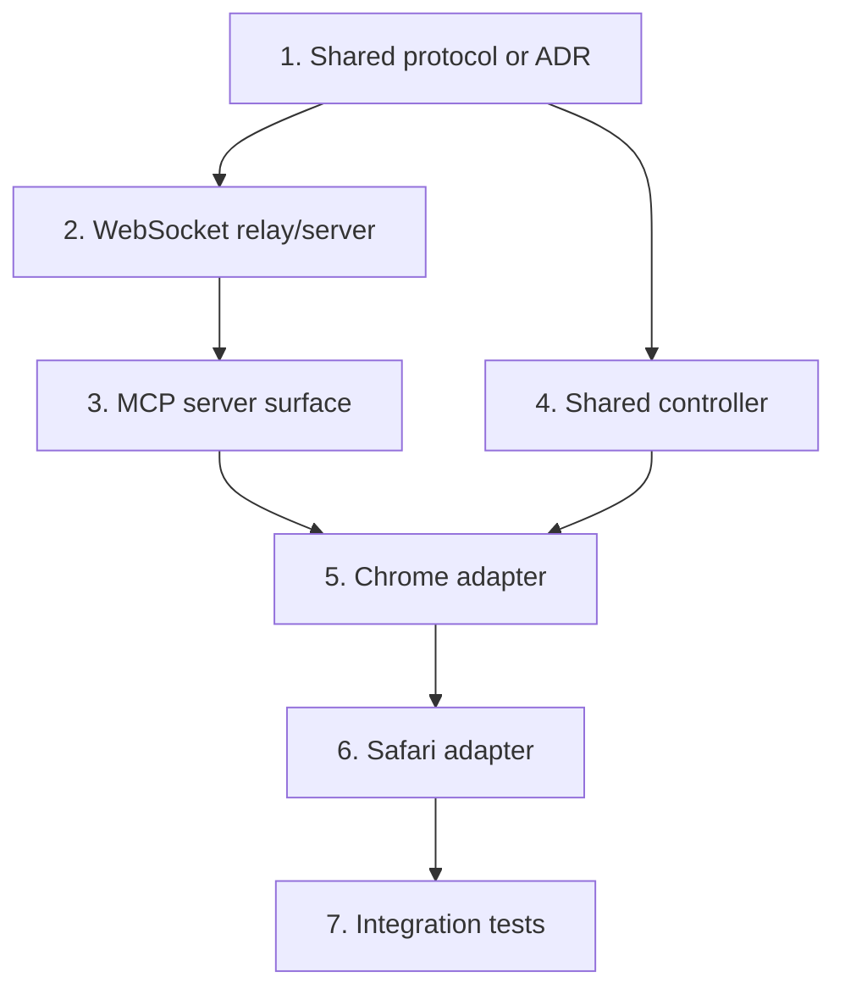

# Major Domains

Brijio is a monorepo organized into a few clear domains. Each domain owns a distinct responsibility and a set of source roots. Keeping these domains separate makes changes easier to review and reduces hidden coupling. This page is a domain map and navigation aid; the runtime chain, request flow, and tab targeting are covered in [Architecture](architecture.md).

The domains, in dependency order from shared contract outward to the browser:

| Domain             | Primary source roots                                     | Owns                                                     |
| ------------------ | -------------------------------------------------------- | -------------------------------------------------------- |
| Shared protocol    | `packages/shared`                                        | Protocol envelope, payload types, browser-agnostic logic |
| WebSocket relay    | `servers/websocket`                                      | Transport, auth, presence, request routing               |
| MCP server         | `servers/mcp`                                            | Agent-facing tools, resources, skills, HTTP transport    |
| Browser extensions | `clients/extensions/chrome`, `clients/extensions/safari` | Browser-side adapters and entry-point wiring             |
| Product framing    | `README.md`, `docs/project/*`                            | What Brijio is, its capabilities, and its boundaries     |
| Security           | `docs/security/*`                                        | Threat model, trust boundaries, guarantees               |
| Docs and history   | `docs/architecture/decisions/*`, `docs/artifacts/*`      | ADRs, design history, completed-feature notes            |

## 1. Shared protocol and browser-agnostic logic

**Primary source root:** `packages/shared`

This domain owns the data model and reusable logic that both the relay/servers and the browser extensions depend on. It is the single source of truth for the wire protocol and for logic shared across Chrome and Safari.

`packages/shared/src/index.ts` re-exports the modules that make up this domain: `protocol`, `page-context`, `page-content`, `page-reader`, `batch-handler`, `popup-*`, `bridge-settings`, `timers`, `logger`, and the adapter-driven `background-controller`.

The protocol lives in `packages/shared/src/protocol.ts`. It defines the canonical `WebSocketEnvelope` (`type: 'message'`, optional `id`, optional `target` with `browserInstanceId`/`tabId`, and a `payload`), the `BrijioRole` (`'extension' | 'mcp'`), `BrowserPresence`, `TabInfo`, the typed request/response payloads, and their constructors and parsers. The package contains no browser API calls; all browser-specific behavior is injected through adapter interfaces, so the Chrome and Safari packages import the same logic and supply only `chrome.*` or `browser.*` adapters plus entry-point wiring.

See [Data and Protocol](data-and-protocol.md) for the envelope and payload contract.

## 2. WebSocket relay

**Primary source root:** `servers/websocket`

The relay is the local transport and routing layer. It authenticates MCP and extension clients against the local pairing token set, derives a sha256 scope key from the accepted token, and tracks browser presence per scope in an in-memory map. Presence is runtime-only and is removed when the extension socket closes; it never includes page URL, title, content, or DOM state.

The relay answers `list_browsers` directly from its presence table. For every other MCP request it selects a browser by `target.browserInstanceId` (requiring an explicit ID when more than one browser is online in the scope) and forwards the full envelope to that extension's socket, recording the pending request so the extension's response can be routed back to the requesting MCP socket by request id. It also exposes a `/health` endpoint reporting connected browser instances.

## 3. MCP server

**Primary source root:** `servers/mcp`

This is the agent-facing surface. It exposes Brijio capabilities to AI agents through the Model Context Protocol over an HTTP transport with bearer-token auth and origin allowlisting. The package entrypoint reads options from environment and starts the HTTP runtime; `servers/mcp/src/mcp-server.ts` registers the tools (`list_browsers`, `list_tabs`, `read_current_page`, `click_element`, `fill_input`, `fill_editable`, `set_checked`, `select_options`, `submit_form`, `upload_file`, `navigate_to_url`, `open_tab`, `perform_batch`, `download_status`, `download_file`, `fetch_resource`, `capture_screenshot`), the `current-page-context` and `current-page-content` resources, skill resources, and the `brijio-context` prompt. Outgoing relay traffic is built in `servers/mcp/src/websocket-client.ts`, where `requestBrijio()` authenticates as role `mcp` and sends the request envelope with an optional `target`.

The server also ships a browser-friendly demo site under `servers/mcp/demo` and skill markdown under `servers/mcp/skills` (one directory per skill, each exposed as an MCP resource). See [Architecture](architecture.md) for the runtime chain and the focused MCP extension flow.

## 4. Browser extensions

**Primary source roots:** `clients/extensions/chrome`, `clients/extensions/safari`

These packages implement the browser-side bridge as thin adapters around the shared `BrijioBackgroundController`. They differ in API surface and packaging, but share the same product rules:

- user-controlled activation: the bridge connects only after explicit user action;
- explicit request/response behavior: the extension answers specific requests and returns structured results, and never streams page state;
- page context before page content (progressive disclosure);
- action targeting through short-lived IDs scoped by `target.kind`;
- no continuous streaming, browser mirroring, cookie export, session cloning, or credential extraction — these are explicit non-goals.

Chrome is the first implementation and is Manifest V3: a service-worker background, `activeTab`/`scripting`/`storage`/`tabs`/`downloads` permissions, broad `host_permissions`, and runtime `optional_host_permissions` prompts for regular-page access. Safari is a parallel implementation (ADR 0019) that reuses the shared logic with Safari-specific adapters and MV2 background behavior: the `browser.*` namespace instead of `chrome.*`, an MV2 background script (with `"persistent": false` on iOS/iPadOS and `true` on macOS), a text-only badge (`ON`/`OFF`/`ERR`) because Safari's `browser_action` does not support badge color, broad host access granted at install time rather than via runtime prompts, and a popup overlay instead of a Chrome-style setup page. Firefox is reserved as a future boundary but is not implemented; its packaging and behavior should be designed in a separate ADR before implementation.

The key platform difference to preserve is this intentional split: shared logic in `@brijio/shared`, browser-specific adapters at the edges. When changing shared browser behavior, consider and test both Chrome and Safari and document intentional platform differences.

## 5. Product framing

**Primary source roots:** `README.md`, `docs/project/POSITIONING.md`, `docs/project/CAPABILITY_MATRIX.md`, `docs/project/ROADMAP.md`

These docs explain what Brijio is for and what it is not. Brijio is positioned around existing authenticated browser sessions, remote agents, a local browser, and no shared credentials — not generic browser automation. The root `README.md` states the key principles (authenticated browser first, remote-agent friendly, privacy by design, progressive disclosure, human in control) and the high-level capability summary. `docs/project/CAPABILITY_MATRIX.md` is the canonical product contract: it is the single source of truth for capability names, support status, and intentional boundaries, and extension READMEs, the MCP surface, and the roadmap should all use the same capability names it defines.

## 6. Security and trust

**Primary source roots:** `docs/security/THREAT_MODEL.md`, `docs/security/TRUST_BOUNDARIES.md`, `docs/security/SECURITY_GUARANTEES.md`

Security docs define the trust boundaries in the architecture and the threat actors behind them (malicious agent, compromised relay, network attacker, malicious website). They encode the mitigations that shape the product: explicit request/response, no continuous streaming, user-controlled connections, progressive disclosure, least-privilege permissions, and structured content that is read rather than evaluated. The docs also explain why the project avoids credential export, session cloning, browser mirroring, ambient surveillance, and MFA interception — these are deliberate boundaries, not missing features. See [Security](security.md) for the consolidated security posture.

## 7. Docs and design history

**Primary source roots:** `docs/architecture/decisions/*`, `docs/artifacts/*`

The `docs/architecture/decisions/` directory holds the ADRs that record accepted and proposed design decisions; the most relevant ones for cross-domain work include the WebSocket relay design (`0002`), the pairing/presence routing model (`0021`), the HTTP MCP transport (`0023`), the shared extension package and Safari adapter split (`0019`/`0031`), the tab-listing and threading decisions (`0060`/`0062`), and the forward-error-codes decision (`0061`). `docs/architecture/ARCHITECTURE.md` is the short architecture overview. `docs/artifacts/` holds completed-feature and operational notes. ADRs are especially valuable when changing browser actions, protocol shapes, or connection behavior; per `AGENTS.md`, changes that introduce or alter a product capability, a cross-package protocol, a trust boundary, or routing/lifecycle semantics require an approved ADR before implementation.

## Cross-domain change ordering

Brijio favors an explicit-contract style: the shared protocol and ADRs are the contract the other domains implement. If a change touches more than one domain, update in dependency order so the contract moves first and the adapters follow:

The change path the repo enforces, from shared contract outward to the browser adapters and integration tests.

In practice this means: edit the shared protocol shape or write the ADR first, then update the relay/server, then the MCP surface and the shared controller, then the Chrome and Safari browser adapters, then the integration tests. Because the extensions are parallel implementations of the same shared controller, changes to shared browser behavior should be made in `packages/shared` and then reflected in both adapter packages rather than duplicated in one. This keeps the repo's explicit-contract style intact and reduces hidden coupling.

The full ownership list from `AGENTS.md`: shared protocol shapes and browser-agnostic behavior belong in `packages/shared`; relay authentication, presence, and routing belong in `servers/websocket`; agent-facing tools, resources, prompts, and skills belong in `servers/mcp`; browser-specific integration belongs in `clients/extensions/chrome` and `clients/extensions/safari`, with adapters kept thin and shared behavior kept shared. Related pages: [Architecture](architecture.md), [Data and Protocol](data-and-protocol.md), [Security](security.md), [Workflows](workflows.md).
