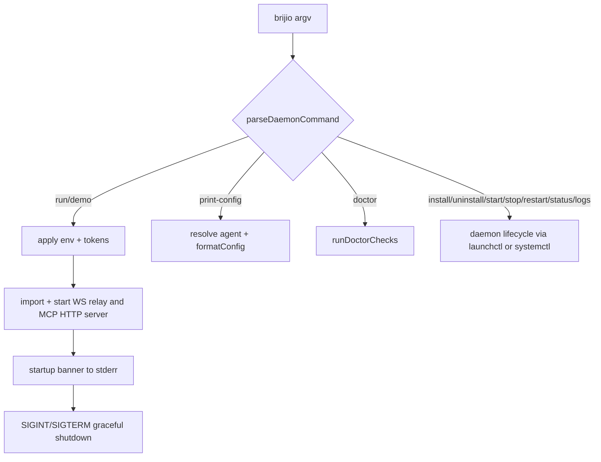
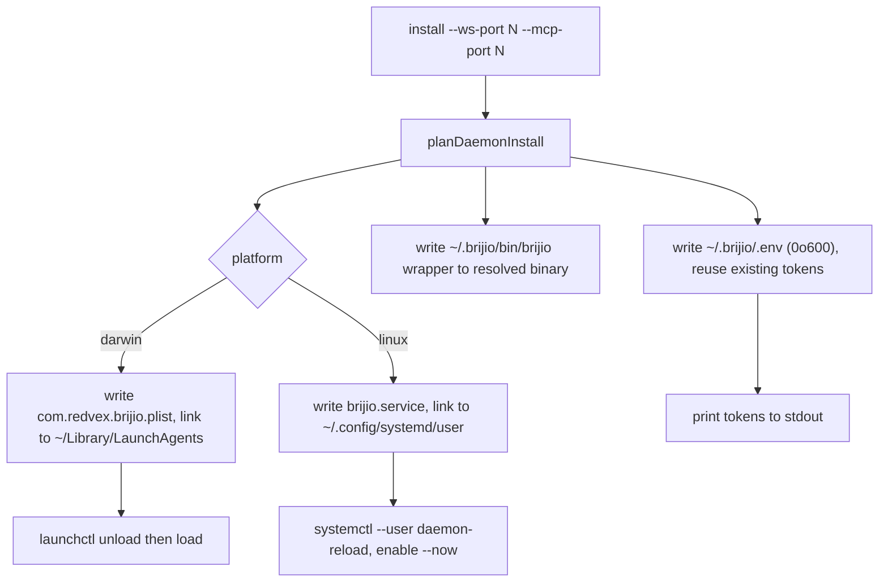

# Operations: Daemon, Config, and Health

Brijio ships two cooperating long-running processes — a **WebSocket relay** (`8787`) that authenticates browser extensions and routes MCP requests to them, and an **MCP HTTP server** (`8788`) that AI agents call over Streamable HTTP. They are started together by a single `brijio` entry point, which also owns the env/config loading, token auto-generation, diagnostic subcommands, and the optional OS-level daemon lifecycle. This page covers running and inspecting that surface; for the request flow and tools see [Workflows](workflows.md), and for the component model see [Architecture](architecture.md).

## Run modes and the `brijio` entry point

The combined entry point is `dist/bin/brijio.js`, exposed by the `@brijio/mcp` package as both `brijio` and the deprecated `browserbridge` alias. It parses `process.argv` into a `DaemonCommand` and dispatches:

- `run` (default) — starts both servers interactively in the foreground; dies when the terminal closes. Extra args are forwarded to the server stack, and `--dev` forces `WEBSOCKET_HOST`/`MCP_HTTP_HOST` to `127.0.0.1`.
- `demo` — like `run` but also serves the static demo page; binds WS/MCP to `127.0.0.1` while the demo page binds `0.0.0.0`. If a daemon is already answering `/health` on the WS port, `demo` attaches only the demo page rather than re-binding the ports.
- `--print-config [agent]` — prints a ready-to-paste MCP client config block.
- `--doctor` — runs preflight diagnostic checks.
- `install`, `uninstall`, `start`, `stop`, `restart`, `status`, `logs` — manage the OS-level daemon.

Server modules read `process.env` at import-evaluation time, so the entry point applies the env file and token defaults **before** dynamically importing the server stack. For `--print-config` and `--doctor`, the server modules are never imported, which keeps those commands fast and avoids port binding. `--help`/`-h` and `--version`/`-v` are handled before any env work.



The entry point dispatches run-mode commands, prints the startup banner to stderr, and wires graceful shutdown for the WS, MCP, and demo servers.

## Env and configuration

### The `.env` file

The template at `/.env.example` documents every supported key. `pnpm dev` (see below) copies it into `.env` and fills the placeholders with generated tokens; the entry point reads `.env` through `loadBrijioEnv` with this candidate chain:

1. `BRIJIO_ENV_FILE` if set (explicit override),
2. `./.env` in the current working directory,
3. `~/.brijio/.env` (the daemon's persistent config).

The first existing candidate wins; values are only applied where the environment variable is unset or empty (`applyBrijioEnv`), so explicit shell exports always take precedence over the file. The env parser is a minimal `KEY=VALUE` reader that skips comments and unquotes single/double-quoted values.

| Key                                 | Default               | Purpose                                                                             |
| ----------------------------------- | --------------------- | ----------------------------------------------------------------------------------- |
| `WEBSOCKET_HOST`                    | `0.0.0.0`             | WS relay bind address                                                               |
| `WEBSOCKET_PORT`                    | `8787`                | WS relay port                                                                       |
| `BRIJIO_WS_URL`                     | `ws://127.0.0.1:8787` | URL the MCP server connects to the relay at                                         |
| `BRIJIO_PAIRING_TOKEN`              | generated             | Token browser extensions authenticate with                                          |
| `BRIJIO_BROWSER_INSTANCE_ID`        | _(empty)_             | Default browser instance for MCP tools                                              |
| `BRIJIO_REQUEST_TIMEOUT_MS`         | `5000`                | WS client request timeout                                                           |
| `MCP_HTTP_HOST`                     | `0.0.0.0`             | MCP HTTP server bind address                                                        |
| `MCP_HTTP_PORT`                     | `8788`                | MCP HTTP server port                                                                |
| `MCP_HTTP_PATH`                     | `/mcp`                | MCP HTTP endpoint path                                                              |
| `MCP_HTTP_AUTH_TOKEN`               | generated             | Bearer token for MCP HTTP requests                                                  |
| `MCP_HTTP_ALLOWED_ORIGINS`          | _(empty)_             | Comma-separated CORS origins; supports `*.host` wildcards                           |
| `BRIJIO_MCP_HTTP_TIMEOUT_MS`        | `60000`               | MCP HTTP server/request timeout                                                     |
| `BRIJIO_APPROVAL_TIMEOUT_BUFFER_MS` | `5000`                | Buffer subtracted from the HTTP timeout to derive the approval timeout (min `1000`) |
| `TEST_PAGE_PORT`                    | `8080`                | Docker test-page port (not started by `pnpm dev`)                                   |

### BrowserBridge backwards-compatible aliases

During the rename from "BrowserBridge" to "Brijio", the entry point and `getPageContextConfigFromEnv` accept the legacy names and mirror the resolved value back onto both old and new variables:

- `BROWSERBRIDGE_PAIRING_TOKEN` / `BRIJIO_TOKEN` → `BRIJIO_PAIRING_TOKEN`
- `BROWSERBRIDGE_WEBSOCKET_URL` / `BRIJIO_WEBSOCKET_URL` / `WEBSOCKET_URL` → `BRIJIO_WS_URL`
- `BROWSERBRIDGE_REQUEST_TIMEOUT_MS` → `BRIJIO_REQUEST_TIMEOUT_MS`
- `BROWSERBRIDGE_BROWSER_INSTANCE_ID` → `BRIJIO_BROWSER_INSTANCE_ID`

`resolveRenamedEnv` warns when both the new and an old name are set with differing values, then prefers the new name. The WS relay itself also accepts `BRIJIO_TOKEN` as a fallback for `BRIJIO_PAIRING_TOKEN`.

### Token auto-generation

If `BRIJIO_PAIRING_TOKEN` is unset (or placeholder), the entry point generates one with `randomBytes(32).toString('base64url')` and writes it to both `BRIJIO_PAIRING_TOKEN` and `BROWSERBRIDGE_PAIRING_TOKEN`; if `MCP_HTTP_AUTH_TOKEN` is unset it generates one too. Auto-generated tokens are **ephemeral** — they change on every restart. The startup banner marks them `[ephemeral]` and warns the operator to set the env vars for persistence. The daemon `install` command instead persists generated tokens in `~/.brijio/.env` (mode `0o600`) so they survive reboots.

`pnpm token` (a shortcut for `node scripts/brijio-token.mjs`) prints a freshly generated pairing token to stdout with usage hints on stderr. `pnpm dev` runs `scripts/dev.mjs`, which creates `.env` from the template, replaces placeholder tokens with generated ones, and — when `.env` already has valid tokens — interactively asks whether to regenerate them (skipped in `--yes`/`CI` mode).

## Health endpoints

Both servers expose `GET /health` returning JSON, as specified in [ADR-0033](../docs/architecture/decisions/0033-health-endpoints-and-structured-logging.md). They never require auth.

**WebSocket relay** (`servers/websocket/src/server.ts`) — returns `status`, `version` (read from `package.json`), `uptimeSeconds`, and the live extension roster:

```json
{
  "status": "ok",
  "version": "0.3.0",
  "uptimeSeconds": 3621,
  "extensions": {
    "count": 2,
    "browsers": [
      { "browserInstanceId": "chrome-default", "label": "Chrome Default" }
    ]
  }
}
```

Only sockets in the `OPEN` state are counted, so the health endpoint reflects currently-connected extensions rather than stale presence. The `getStatus()` function on the server runtime is the single source of this state.

**MCP HTTP server** (`servers/mcp/src/http-server.ts`) — returns `status`, `version`, `uptimeSeconds`, and a `websocket` object with the configured WS URL and a `status` of `"reachable"` or `"unknown"`:

```json
{
  "status": "ok",
  "version": "0.3.0",
  "uptimeSeconds": 3621,
  "websocket": { "url": "ws://127.0.0.1:8787", "status": "unknown" }
}
```

The MCP server has no persistent WS connection — it opens a throwaway WS client per tool call — so the WS reachability is reported as `"unknown"` rather than probed inline (a failed probe would otherwise block the health response). `/health` is matched before the MCP path and auth checks, so it remains queryable without credentials. Any other path that does not match `MCP_HTTP_PATH` returns a JSON `404`; the MCP path requires a `Bearer` token, allowed-origin/CORS, and `GET`/`POST`/`DELETE`.

Both servers emit single-line JSON logs to **stderr** via `@brijio/shared`'s `createLogger` (service `websocket` or `mcp`), which keeps stdout clean for MCP stdio transport and HTTP pipes and is compatible with `docker logs` and `journalctl`.

## `brijio --doctor`

The doctor runs preflight checks and prints a human-readable report to stdout (`servers/mcp/src/doctor.ts`). It needs the resolved token values, so the entry point applies the env file before dispatching. The checks are:

1. **Config** — warns if no config path was detected (env vars/auto-generation in use); passes if the path is readable.
2. **Ports** — attempts to bind the MCP and WS ports with a throwaway `net.Server`; fails with `EADDRINUSE` guidance if a port is taken.
3. **Network** — runs `detectNetworkPaths` (Tailscale, mDNS, localhost) and reports reachable paths.
4. **Node.js** — fails if the runtime is older than Node 18 (the `@brijio/mcp` package targets Node 22).

Each result is `pass`, `warn`, or `fail`; the report ends with a summary that tells the operator to fix issues before running Brijio when any `fail` is present.

## `brijio --print-config [agent]`

Prints a ready-to-copy MCP client configuration block to stdout, with a stderr hint about where to paste it (`servers/mcp/src/print-config.ts`). Without an agent argument it presents an interactive picker; with an unknown agent it errors and points to the picker. The MCP host is `detectNetworkPaths().bestHost` (Tailscale > mDNS > localhost) in normal mode and `127.0.0.1` in `--dev`. Supported canonical agents include `claude-desktop`, `cursor`, `vscode`, `cline`, `codex`, `hermes`, `claude-code`, `gemini`, `windsurf`, `zed`, `continue`, and `goose` (which is not directly configurable and prints a stdio-bridge workaround). Each formatter emits the agent's native shape (`mcpServers`, `servers`, `context_servers`, YAML, or a shell `mcp add` command) with the resolved URL and bearer token; ephemeral tokens are annotated so the operator knows they change on restart.

## Daemon lifecycle

`install` creates a persistent, autostart-on-login daemon so the servers survive terminal close without Docker. It is specified in [ADR-0037](../docs/architecture/decisions/0037-daemon-install-via-npx.md) and implemented in `servers/mcp/src/daemon.ts`. Only `darwin` (launchd) and `linux` (systemd user units) are supported; other platforms throw from `normalizePlatform`.



`planDaemonInstall` is idempotent: it reuses existing `BRIJIO_PAIRING_TOKEN` and `MCP_HTTP_AUTH_TOKEN` from `~/.brijio/.env` rather than regenerating, writes a `.env.example` on first install, and applies `--ws-port`/`--mcp-port` overrides to the file. The LaunchAgent plist sets `RunAtLoad` and `KeepAlive` (start on login, auto-restart on crash) with `WorkingDirectory` at `~/.brijio` and logs to `~/.brijio/brijio.log`; the systemd unit uses `Restart=on-failure` (not `always`, to avoid loops on config errors), `WorkingDirectory=%h/.brijio`, and `EnvironmentFile=%h/.brijio/.env`. The daemon binary is a shell wrapper (`writeDaemonWrapper`) that `exec`s the resolved Node binary, so updates to `process.execPath` don't break the plist.

| Command                     | macOS                                              | Linux                                                                    |
| --------------------------- | -------------------------------------------------- | ------------------------------------------------------------------------ |
| `start`                     | `launchctl load` the link                          | `systemctl --user start brijio.service`                                  |
| `stop`                      | `launchctl unload` the link                        | `systemctl --user stop brijio.service`                                   |
| `restart`                   | `unload` then `load`                               | `systemctl --user restart brijio.service`                                |
| `uninstall`                 | `unload`, remove the link; preserves `~/.brijio`   | `disable --now`, `daemon-reload`, remove the link; preserves `~/.brijio` |
| `status`                    | `launchctl list com.redvex.brijio` + health probes | `systemctl --user is-active --quiet` + health probes                     |
| `logs [--lines N] [--live]` | `tail` of `~/.brijio/brijio.log`                   | `journalctl --user -u brijio.service`                                    |

`status` probes both `/health` endpoints (using the WS/MCP ports from `~/.brijio/.env`, defaulting to `8787`/`8788`) with a `1500ms` `fetch` timeout, and `formatStatus` prints a table of loaded state, config/binary paths, and health results. `uninstall` never deletes `~/.brijio` — it prints a note that the operator can `rm -rf` it to fully remove. `install`/`start`/`stop`/`restart` swallow the "not loaded" error from `launchctl unload` so re-running them is safe.

## Docker

The `Dockerfile` builds a single combined image that runs both servers under s6-overlay. The builder stage uses `pnpm --filter @brijio/mcp build` (tsup) to produce `dist/`; the runtime stage copies only `dist/`, strips `workspace:` deps from `package.json`, and runs `npm install --omit=dev` for the remaining external npm packages (`ws`, `zod`, `@modelcontextprotocol/sdk`). The s6 service at `docker/s6-rc.d/brijio/run` is a `longrun` that `cd /app && exec node dist/bin/brijio.js`; the `user` bundle contains it so s6 starts it. Default env in the image is `WEBSOCKET_HOST=0.0.0.0`, `WEBSOCKET_PORT=8787`, `MCP_HTTP_HOST=0.0.0.0`, `MCP_HTTP_PORT=8788`, `MCP_HTTP_PATH=/mcp`, `BRIJIO_WEBSOCKET_URL=ws://127.0.0.1:8787`, `BRIJIO_REQUEST_TIMEOUT_MS=5000`; empty tokens auto-generate and are printed to stdout on first startup. Ports `8787` and `8788` are exposed.

`docker-compose.yml` defines three services, each guarded by a **profile** so they only start when explicitly selected. Derive the exact profiles and commands from that file rather than assuming a profile exists:

- **`brijio`** (`runtime`) — builds the image and maps `${WEBSOCKET_PORT:-8787}` and `${MCP_HTTP_PORT:-8788}`.
- **`browserbridge`** (`legacy-runtime`) — `extends` the `brijio` service for the deprecated name.
- **`test-page`** (`test`) — a `nginx:1.27-alpine` serving `clients/test-page` on `${TEST_PAGE_PORT:-8080}`, not started by `pnpm dev`.

Start a profile with, e.g., `docker compose --profile runtime up`; the `legacy-runtime` and `test` profiles are independent and must be selected explicitly when needed.
