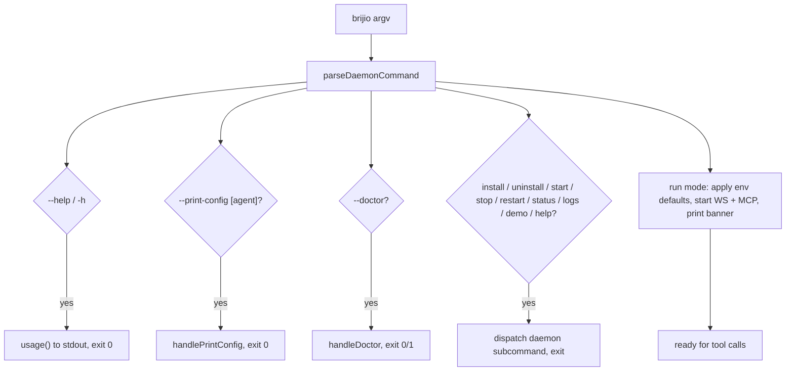

# Daemon and CLI Operations

Brijio's user-facing entry point is a single `brijio` binary (`servers/mcp/bin/brijio.mjs`) that combines the WebSocket companion server and the MCP HTTP server in one process. ADR 0029 established the one-command startup model and ADR 0035 made that binary the published `@brijio/mcp` npm package; ADR 0037 added the daemon lifecycle subcommands that persist that runtime across logins, and ADR 0038 polished the surface with `--print-config`, `--doctor`, `--dev`, and a network-aware startup banner. This page documents the operational layer that wraps the runtime: how commands are parsed and dispatched, how configuration is loaded and persisted, how the daemon is installed and managed per platform, and how diagnostic, config-printing, and banner features behave. It deliberately does not re-document the MCP tool surface (see [Architecture Overview](../architecture.md)) or the protocol (see [Data and Protocol](../data-and-protocol.md)).

## Command surface and dispatch

The CLI parses `process.argv` into a discriminated `DaemonCommand` union via `parseDaemonCommand` in `servers/mcp/src/daemon.ts`. The parser distinguishes top-level flags from subcommands:

- Top-level flags (`--help`/`-h`, `--print-config [agent]`, `--doctor`, `--dev`, `--version`/`-v`) are handled before subcommand parsing.
- Subcommands are positional: `install`, `uninstall`, `start`, `stop`, `restart`, `status`, `logs`, `demo`, `help`.
- Anything that is not a recognized flag or subcommand falls through to **run mode** — the default behavior of starting both servers interactively — with the unrecognized args forwarded as server args. `--dev` is stripped from the forwarded args but preserved as a `dev` flag on the parsed command.



_Command dispatch in `bin/brijio.mjs`: meta-operations exit before any server starts; only `run` and `demo` start the server stack._

The full command set, as printed by `usage()`:

```
brijio                         Run WebSocket and MCP servers interactively
brijio demo                    Run servers with the demo page for quick verification
brijio --dev                   Run in dev mode (bind to 127.0.0.1 only)
brijio --print-config [agent]  Print MCP client config for an agent
brijio --doctor                Run diagnostic checks
brijio install [--ws-port N] [--mcp-port N]
brijio uninstall
brijio start
brijio stop
brijio restart
brijio status
brijio logs [--lines N] [--live]
```

`install` accepts `--ws-port` and `--mcp-port` (validated as integers in `1..65535`); `logs` accepts `--lines`/`-n` (positive integer, default 100) and `--live`. Meta-operations that take no arguments (`demo`, `uninstall`, `start`, `stop`, `restart`, `status`) raise if extra args are supplied. A `--version`/`-v` flag short-circuits very early and prints the package version from `package.json` before any imports.

The binary entry point imports the server stack **dynamically and only in run/demo mode**. `--doctor` and `--print-config` exit before the server modules are imported, so they never trigger the full module cascade and cannot fail on missing server-side dependencies.

### Run and demo modes

In run mode the binary applies environment defaults (see below), starts the WebSocket server and the MCP HTTP server, prints the startup banner to **stderr**, and registers `SIGINT`/`SIGTERM` handlers that close both servers and exit cleanly. `EADDRINUSE` during startup is caught and reformatted into an actionable message pointing at `--doctor`, alternate port env vars, or stopping the conflicting process, rather than a raw stack trace.

`--dev` is a run-mode flag: it sets `WEBSOCKET_HOST` and `MCP_HTTP_HOST` to `127.0.0.1`, overriding any broader bind. Demo mode (`brijio demo`) similarly binds the WS and MCP hosts to `127.0.0.1` for security, but starts an additional static demo page server bound to `0.0.0.0` so the page is reachable over Tailscale/LAN. Before starting WS/MCP in demo mode, the binary probes `http://127.0.0.1:<wsPort>/health`; if a daemon is already running there it attaches the demo page to it and skips WS/MCP startup, avoiding an `SO_REUSEPORT` pairing-token mismatch.

## Environment loading and the config directory

All configuration flows through environment variables, populated from an optional `.env` file. `loadBrijioEnv` (`servers/mcp/src/daemon.ts`) resolves the env file from a three-tier candidate chain, in priority order:

1. `BRIJIO_ENV_FILE` (explicit override, if set and non-empty)
2. `<cwd>/.env`
3. `~/.brijio/.env`

The first candidate that exists is read and parsed (`parseEnvFile`) into a `Record<string,string>`; `#`-comment and blank lines are skipped, values are unquoted. `applyBrijioEnv` then copies those values into `process.env`, but **only for keys that are currently unset or blank** — explicit environment variables always win over the file. The binary calls `loadBrijioEnv()`/`applyBrijioEnv()` early, before parsing the command, so that `--print-config` and `--doctor` see token values without starting servers.

The key environment variables consumed by this surface:

| Variable               | Default                                      | Meaning                                                           |
| ---------------------- | -------------------------------------------- | ----------------------------------------------------------------- |
| `BRIJIO_PAIRING_TOKEN` | auto-generated (`randomBytes(32).base64url`) | Token the browser extension uses to authenticate to the WS server |
| `MCP_HTTP_AUTH_TOKEN`  | auto-generated                               | Bearer token required for every MCP HTTP request                  |
| `WEBSOCKET_PORT`       | `8787`                                       | WebSocket companion port                                          |
| `MCP_HTTP_PORT`        | `8788`                                       | MCP HTTP port                                                     |
| `MCP_HTTP_HOST`        | `0.0.0.0` (`127.0.0.1` in `--dev`/demo)      | MCP HTTP bind host                                                |
| `WEBSOCKET_HOST`       | `0.0.0.0` (`127.0.0.1` in `--dev`/demo)      | WS bind host                                                      |
| `MCP_HTTP_PATH`        | `/mcp`                                       | MCP endpoint path                                                 |
| `BRIJIO_ENV_FILE`      | —                                            | Explicit env-file path override                                   |

The binary mirrors the pairing token onto the legacy `BROWSERBRIDGE_PAIRING_TOKEN` name and the WS URL onto several legacy names for backwards compatibility, preferring the new name and warning if both are set with differing values. When neither token is provided it generates ephemeral ones; when a token is explicitly provided the startup banner and `--print-config` mark the auto-generated ones `[ephemeral]` and warn that they change on restart.

The daemon's persistent config directory is `~/.brijio/`, holding `.env`, `.env.example` (written on first install if missing), `bin/brijio` (a wrapper shell script that `exec`s the real Node binary), the service definition, and `brijio.log` on macOS.

## Daemon install and lifecycle

`brijio install` (`planDaemonInstall` + `installDaemon`) turns the foreground binary into a login-persistent background service. It is the answer to ADR 0037's motivation: `launchd`/`systemd` run in minimal environments that do not read shell profiles, so tokens must live in a file the service loads rather than in `~/.zshrc`. Secrets are deliberately kept out of the service definition and in the mode-`0600` `.env` file.

### Platform split

`normalizePlatform` accepts only `darwin` and `linux`; any other platform throws (`Brijio daemon install does not support <platform> yet.`). Windows is not supported. The two paths differ in service definition, link location, and lifecycle verbs:

| Concern       | macOS (`darwin`)                                 | Linux                                                                      |
| ------------- | ------------------------------------------------ | -------------------------------------------------------------------------- |
| Service type  | LaunchAgent plist                                | systemd user unit                                                          |
| Service file  | `~/.brijio/com.redvex.brijio.plist`              | `~/.brijio/brijio.service`                                                 |
| Link location | `~/Library/LaunchAgents/com.redvex.brijio.plist` | `~/.config/systemd/user/brijio.service`                                    |
| Start         | `launchctl load <link>`                          | `systemctl --user enable --now brijio.service` (install) / `start` (start) |
| Stop          | `launchctl unload <link>`                        | `systemctl --user stop brijio.service`                                     |
| Restart       | `launchctl unload` then `load`                   | `systemctl --user restart brijio.service`                                  |
| Logs          | `tail` of `~/.brijio/brijio.log`                 | `journalctl --user -u brijio.service`                                      |

The macOS plist (`buildLaunchAgentPlist`) sets `RunAtLoad` and `KeepAlive` to `true`, `WorkingDirectory` to `~/.brijio`, and routes both `StandardOutPath` and `StandardErrorPath` to `~/.brijio/brijio.log`. The systemd unit (`buildSystemdUserUnit`) is `Type=simple`, `Restart=on-failure` with `RestartSec=5`, `WorkingDirectory=%h/.brijio`, `EnvironmentFile=%h/.brijio/.env`, and `WantedBy=default.target`. Both reference the `~/.brijio/bin/brijio` wrapper rather than embedding any token. The install flow is idempotent: re-running `install` reuses existing `BRIJIO_PAIRING_TOKEN`/`MCP_HTTP_AUTH_TOKEN` from `.env` rather than regenerating them, and only overrides port values actually supplied via `--ws-port`/`--mcp-port`.

`uninstall` stops and disables the service, removes the link, but **preserves** `~/.brijio/` (config and logs) and tells the user the `rm -rf` command to fully remove the data.

### Lifecycle, status, and logs

`start`, `stop`, and `restart` issue the platform verbs above against the installed link. `status` (`getDaemonStatus` + `formatStatus`) reports whether the service is loaded (via `launchctl list <label>` on macOS or `systemctl --user is-active --quiet` on Linux) and probes the `/health` endpoints of both the WS port and the MCP port with a 1.5 s timeout, printing a two-column table. `logs` reads the last N lines (default 100); on macOS it tails `~/.brijio/brijio.log` directly (or a "no log file" message if absent), and on Linux it shells out to `journalctl`. `logs --live` spawns `tail -f` (macOS) or `journalctl --follow` (Linux) with inherited stdio and exits with the child's code.

## Doctor preflight checks

`brijio --doctor` runs `runDoctorChecks` (`servers/mcp/src/doctor.ts`), prints `formatDoctorReport`, and exits non-zero if any check `fail`s. It starts no servers. The checks are:

1. **Config** — if a config path was passed (the binary passes the loaded env-file path), verify it is accessible; warn (not fail) if absent or no path was detected, since env vars or auto-generation can still work.
2. **Ports** — for both the MCP and WS ports, briefly `net.createServer().listen(port)`; `EADDRINUSE` is a `fail` with a hint to use `--mcp-port`/`--ws-port`, other listen errors are `fail`, and a successful listen-and-close is `pass`.
3. **Network** — run `detectNetworkPaths` and report the detected reachable signals (Tailscale IP, mDNS hostname, localhost) as a `pass` with the signals in the detail; failure to detect is a `warn`.
4. **Node.js** — `fail` if the major version is below 18, else `pass`.

The report uses emoji icons (`✅`/`❌`/`⚠️`) and ends with a summary line: `fail` count > 0 → "Fix the above before running Brijio"; otherwise `warn` count > 0 → "No critical issues…"; otherwise "All checks passed." The binary maps any `fail` to exit code 1.

## Network detection

`detectNetworkPaths` (`servers/mcp/src/network.ts`) supplies the reachable addresses shown by the startup banner, `--print-config`, and the doctor network check. It probes three signals and ranks them Tailscale > mDNS > localhost:

- **Tailscale CLI** — `detectTailscale` runs `tailscale status --json` with a 2 s timeout; on success it parses `TailscaleIPs` and picks the first address in the Tailscale CGNAT range (`100.64.0.0/10`, checked by `isTailscaleIP`). This confirms Tailscale is both installed and authenticated.
- **Tailscale interface fallback** — `detectTailscaleInterface` scans `os.networkInterfaces()` for an IPv4 address in `100.64.0.0/10`, catching the case where the CLI is not on `PATH` but the interface exists.
- **mDNS** — `detectMdns` resolves `<hostname>.local` via `dns.resolve()`; success yields `<hostname>.local`. This works natively on macOS and on Linux only with `avahi-daemon` or `systemd-resolved` mDNS support, and degrades gracefully to `null`.

`detectNetworkPaths` always includes `Local`/`127.0.0.1`, appends Tailscale (CLI result preferred, else interface IP) and mDNS when available, and sets `bestHost` by the same priority. This is the operational counterpart of ADRs 0025 and 0026, which made the MCP HTTP `Host`/`Origin` validation friendly to Tailscale (`.ts.net`) and local-domain (`.local`) names via `MCP_HTTP_ALLOW_TAILSCALE_HOSTS` / `MCP_HTTP_ALLOW_LOCAL_HOSTS` and `*.suffix` wildcard allow-list entries. Network detection does not change the auth boundary: the bearer token is still required for every MCP request regardless of which host the client used.

## print-config

`brijio --print-config [agent]` (handled by `handlePrintConfig` in the binary, backed by `servers/mcp/src/print-config.ts` and `print-config-commands.ts`) emits a ready-to-copy MCP client config block to **stdout** and a short "where to paste" hint to **stderr**, then exits. It starts no servers. The URL uses `detectNetworkPaths().bestHost` unless `--dev` forces `127.0.0.1`; the token is the real resolved `MCP_HTTP_AUTH_TOKEN`, annotated as ephemeral when it was auto-generated.

`AGENTS` lists twelve canonical agents with aliases (`claude` → `claude-desktop`, `cur` → `cursor`, `vs` → `vscode`, `code` → `claude-code`); `resolveAgentName` maps input to a canonical name. With no agent argument and a TTY stdin, the binary prints a numbered picker (`formatInteractivePrompt`) and reads the choice; with no agent and a non-TTY stdin it falls back to `formatDefaultJson` (the widest-compatible `mcpServers` envelope) so `brijio --print-config > config.json` is safe in CI. An unknown agent errors with a pointer to the picker.

The formatters vary by agent target:

- **`claude-desktop`, `cursor`, `cline`** — `mcpServers` JSON envelope with `url` + `Authorization: Bearer <token>` header; per-agent paste hint.
- **`vscode`** — `servers` key with `"type": "http"`.
- **`codex`, `claude-code`, `gemini`** — shell commands (`codex mcp add … --bearer-token-env-var`, `claude mcp add --transport http …`, `gemini mcp add --transport http …`) rather than config files; Codex references the env var name by convention.
- **`hermes`** — YAML for `~/.hermes/config.yaml`.
- **`windsurf`** — `mcpServers` with `serverUrl` and `${env:MCP_HTTP_AUTH_TOKEN}` interpolation so no literal token is written.
- **`zed`** — `context_servers` key.
- **`continue`** — full YAML file with `name`/`version`/`schema` metadata; adds a dev/ephemeral `description` when `--dev`.
- **`goose`** — instructional "not supported" message: Goose is stdio-only and Brijio is HTTP-only (ADR 0023), with an `mcp-proxy` workaround pointer.

## Startup banner

`formatStartupBanner` (`servers/mcp/src/startup-banner.ts`) renders the post-startup banner, written to **stderr** so stdout stays clean for piping. Unless `--dev` (which skips detection and uses `127.0.0.1`), it calls `detectNetworkPaths` best-effort (failures are swallowed so they never block startup) and, when paths are available, lists every reachable address with its WS and MCP URLs. It then prints the pairing and MCP auth tokens, marking auto-generated ones `[ephemeral]` and, when either token was not user-provided, warning that ephemeral tokens change on restart and recommending `BRIJIO_PAIRING_TOKEN`/`MCP_HTTP_AUTH_TOKEN` env vars for persistence. `--dev` adds a "Dev mode — binding to 127.0.0.1 only" line; demo mode adds the demo page URL; and a special "demo attached to existing daemon" path shows only the demo URL and notes the daemon it attached to. The banner closes with the user-facing next steps (paste the pairing token into the extension; configure the MCP client via `--print-config`; make a tool call). This banner is the zero-readme onboarding entry point called out by ADRs 0029 and 0038.

## Alternative deployment: Docker image

The npm package (`@brijio/mcp`) is the primary local path, but ADR 0035 also ships a single combined Docker image (`redvex/browserbridge`) that runs both the WebSocket and MCP services under s6-overlay supervision, exposing ports 8787 and 8788. This is the containerized alternative to the daemon install flow and avoids the `npx`-cache-pruning risk noted in ADR 0037; users who want persistence without a system service can `docker run` the image with `BRIJIO_PAIRING_TOKEN` and `MCP_HTTP_AUTH_TOKEN` supplied as environment. The daemon lifecycle subcommands (`install`/`start`/`stop`/…) are for the native-process path and are not used with the container image.
