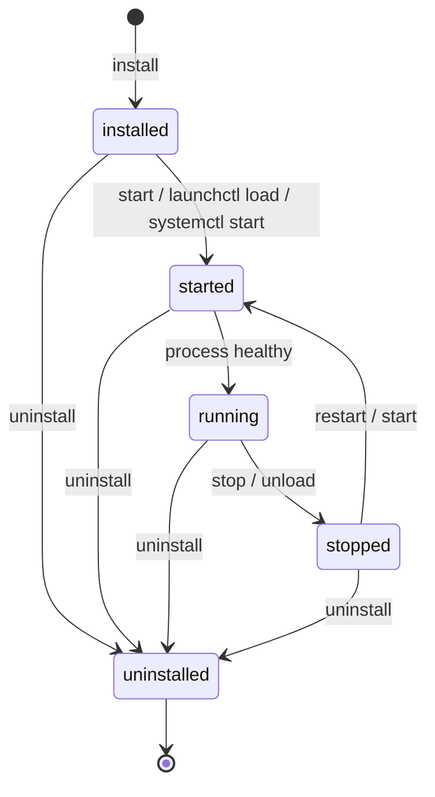

# Daemon and Runtime Operations

Brijio runs two cooperating processes: a **WebSocket companion** (the browser-extension bridge, default port `8787`) and an **MCP HTTP server** (the AI-agent-facing surface, default port `8788`). This page documents how those processes are started, supervised, installed as a daemon, diagnosed, and containerised.

For the MCP request flow that runs on top of this runtime, see [MCP Extension Flow](../architecture/mcp-extension-flow.md) and [MCP Tool Surface](../architecture/mcp-tool-surface.md). For first-time setup, see [Quickstart](../quickstart.md).

## One-command startup (`pnpm dev`)

The root `pnpm dev` script runs `node scripts/dev.mjs`, a Node.js orchestrator (ADR 0029) that manages the full local-development lifecycle so a fresh clone needs zero manual configuration.

The orchestrator:

1. **Configures `.env`** — copies `.env.example` to `.env` on a fresh clone, then auto-generates `BRIJIO_PAIRING_TOKEN` and `MCP_HTTP_AUTH_TOKEN` via `crypto.randomBytes(32).toString('base64url')`. With an existing `.env`, it prompts to re-generate tokens (or preserves them).
2. **Spawns both servers** as child processes with `tsx watch` (`servers/mcp` → `tsx watch src/index.ts`; `servers/websocket` similarly).
3. **Health-checks** before declaring readiness — polls `GET /health` on both servers every 500 ms with a 15 s timeout.
4. **Supervises** — restarts crashed child processes with a 2 s backoff, up to 5 attempts.
5. **Graceful shutdown** — on `SIGINT`/`SIGTERM` propagates the signal to all children within a 5 s grace window.

Non-interactive mode (`pnpm dev --yes` or `CI=true`) skips all prompts and uses defaults (localhost-only, auto-generated tokens); this is what CI and Docker Compose rely on. The test page is intentionally Docker-only and is not started by `pnpm dev`.

The startup banner (see [Startup banner](#startup-banner)) is the human-readable result of this process.

## Environment configuration (`.env`)

`.env.example` is the canonical template; `pnpm dev` derives a real `.env` from it. The `.env` keys and their roles:

| Key                          | Default               | Purpose                                                          |
| ---------------------------- | --------------------- | ---------------------------------------------------------------- |
| `WEBSOCKET_HOST`             | `0.0.0.0`             | Bind host for the WS companion                                   |
| `WEBSOCKET_PORT`             | `8787`                | WS companion port                                                |
| `BRIJIO_WS_URL`              | `ws://127.0.0.1:8787` | URL the MCP server uses to reach the WS companion                |
| `BRIJIO_REQUEST_TIMEOUT_MS`  | `5000`                | Per-request timeout for WS round-trips                           |
| `BRIJIO_PAIRING_TOKEN`       | auto-generated        | Token a browser extension presents to pair with the WS companion |
| `BRIJIO_BROWSER_INSTANCE_ID` | empty                 | Optional browser-instance identifier                             |
| `MCP_HTTP_HOST`              | `0.0.0.0`             | Bind host for the MCP HTTP server                                |
| `MCP_HTTP_PORT`              | `8788`                | MCP HTTP server port                                             |
| `MCP_HTTP_PATH`              | `/mcp`                | MCP HTTP endpoint path                                           |
| `MCP_HTTP_AUTH_TOKEN`        | auto-generated        | Bearer token MCP clients send to authorize requests              |
| `MCP_HTTP_ALLOWED_ORIGINS`   | empty                 | Comma-separated CORS origins                                     |
| `TEST_PAGE_PORT`             | `8080`                | Docker test-page port (Docker only)                              |

**BrowserBridge backwards-compatible aliases.** During the rename from BrowserBridge to Brijio the older `BROWSERBRIDGE_*` env names are still accepted as aliases: `BROWSERBRIDGE_PAIRING_TOKEN`, `BROWSERBRIDGE_WEBSOCKET_URL`, and `BROWSERBRIDGE_REQUEST_TIMEOUT_MS` map to their `BRIJIO_*` counterparts. The published package exposes both binary names (`brijio` and `browserbridge`) from the same `dist/bin/brijio.js` entry.

**Env loading order.** `loadBrijioEnv` searches, in order: the path in `BRIJIO_ENV_FILE` (explicit override), `./.env` in the current working directory, then `~/.brijio/.env` (the daemon config directory). The first file that exists wins; values are applied to `process.env` only for keys that are not already set. Tokens are never auto-generated by the loader — generation happens in the orchestrator (`dev.mjs`) and the `install` command.

## Daemon lifecycle

The daemon subcommands live in `servers/mcp/src/daemon.ts` and are parsed by `parseDaemonCommand`. `--dev` is a top-level flag extracted before subcommand parsing; everything else is a positional subcommand. Unknown first arguments fall through to `run` mode, so `brijio` with no recognised subcommand simply runs the servers interactively.

| Command                                       | Effect                                                     |
| --------------------------------------------- | ---------------------------------------------------------- |
| `brijio` (or any unknown args)                | Run WS + MCP servers interactively in the foreground       |
| `brijio --dev`                                | Run in dev mode — bind to `127.0.0.1` only                 |
| `brijio demo`                                 | Run servers with the demo page for quick verification      |
| `brijio --print-config [agent]`               | Emit a ready-to-paste MCP client config block for an agent |
| `brijio --doctor`                             | Run preflight diagnostic checks                            |
| `brijio install [--ws-port N] [--mcp-port N]` | Install as a managed daemon (launchd/systemd)              |
| `brijio uninstall`                            | Remove the daemon (preserves `~/.brijio/`)                 |
| `brijio start` / `stop` / `restart`           | Control the installed daemon                               |
| `brijio status`                               | Report loaded state and ping health endpoints              |
| `brijio logs [--lines N] [--live]`            | Show recent daemon logs; `--live` follows                  |
| `brijio help` (`--help` / `-h`)               | Print usage                                                |

_Daemon lifecycle: `install` creates the service definition and env file; `start` loads it; `status` probes the running process; `stop`/`uninstall` tear it down. Config in `~/.brijio/` survives uninstall._

### Install plan

`planDaemonInstall` (`servers/mcp/src/daemon.ts`) implements the install step (ADR 0037). It supports only `darwin` and `linux` — any other platform throws. The plan:

1. **Creates `~/.brijio/`** (and `~/.brijio/bin/`).
2. **Generates and persists tokens** — reads any existing `~/.brijio/.env`; only generates `BRIJIO_PAIRING_TOKEN` and `MCP_HTTP_AUTH_TOKEN` if absent (idempotent reinstall). The `.env` is written with mode `0600` so tokens are not world-readable, unlike plist `EnvironmentVariables`.
3. **Writes optional port overrides** — `--ws-port` / `--mcp-port` write `WEBSOCKET_PORT` / `MCP_HTTP_PORT` into `.env`; absent flags leave defaults.
4. **Writes a `.env.example`** into the config dir if missing.
5. **Resolves and wraps the binary** — `resolveCurrentBinaryPath()` finds the running binary; a small shell wrapper is written to `~/.brijio/bin/brijio` that `exec`s `node` against that path, so future daemon starts avoid `npx` resolution lag and survive npx cache pruning.
6. **Builds the service definition** under the label `com.redvex.brijio`:
   - **macOS** — a LaunchAgent plist (`buildLaunchAgentPlist`) with `RunAtLoad=true`, `KeepAlive=true`, `WorkingDirectory=~/.brijio`, stdout/stderr to `~/.brijio/brijio.log`, and no `EnvironmentVariables` (`.env` is the single source of truth).
   - **Linux** — a systemd user unit (`buildSystemdUserUnit`) with `Restart=on-failure`, `RestartSec=5`, `EnvironmentFile=%h/.brijio/.env`, `WantedBy=default.target`.
7. **Symlinks** the service file into `~/Library/LaunchAgents/` (macOS) or `~/.config/systemd/user/` (Linux).
8. **Loads** it — `installDaemon` runs `launchctl load` (reloading first on macOS) or `systemctl --user daemon-reload && systemctl --user enable --now` (Linux).

`uninstall` stops/unloads the service, removes the symlink, but deliberately leaves `~/.brijio/` intact (preserving `.env` and logs); it prints a note that the user can `rm -rf ~/.brijio` to fully remove.

### Logs and status

`logs` is platform-aware: on macOS it tails `~/.brijio/brijio.log` (or `tail -f` with `--live`); on Linux it uses `journalctl --user -u brijio.service` (with `--follow` for `--live`). The line count (`--lines` / `-n`, default 100) is validated as a positive integer.

`status` returns a `DaemonStatus` containing the platform, whether the daemon is loaded (via `launchctl list com.redvex.brijio` or `systemctl --user is-active --quiet`), and health-probe results for both endpoints. `formatStatus` renders a fixed-row table: daemon loaded, config path, resolved binary path, WebSocket health, and MCP health.

## Doctor checks (`--doctor`)

`servers/mcp/src/doctor.ts` (ADR 0038) runs opt-in preflight checks and prints a diagnostic report. `runDoctorChecks` returns a list of `DoctorCheckResult` entries, each `pass` / `fail` / `warn`:

1. **Config** — warns if no config path is detected; passes if the file is accessible, warns otherwise.
2. **Ports** — opens a throwaway TCP listener on the MCP and WS ports; fails with `EADDRINUSE` detail if a port is already bound.
3. **Network** — `detectNetworkPaths()` reports reachable paths (Tailscale IP, mDNS, localhost).
4. **Node.js** — fails if the major version is below 18.

`formatDoctorReport` renders the results with a pass/warn/fail summary and a final readiness verdict.

## Print-config (agent config emission)

`brijio --print-config [agent]` (`servers/mcp/src/print-config.ts`) emits a ready-to-paste MCP client configuration block for a specific agent, printing the config to stdout and a "where to paste" hint to stderr. `resolveAgentName` maps canonical names and aliases (e.g. `claude` → `claude-desktop`, `cur` → `cursor`) to a formatter in the `FORMATTERS` map. Supported agents include `claude-desktop`, `cursor`, `vscode`, `cline`, `codex`, `hermes`, `claude-code`, `gemini`, `windsurf`, `zed`, `continue`, and `goose` (Goose is stdio-only and emits an instructional message explaining no direct HTTP config is possible).

Each formatter produces a different envelope: `claude-desktop`/`cursor`/`cline` use an `mcpServers` JSON block with a Bearer `Authorization` header; `vscode` uses a `servers` object with `type: "http"`; `hermes` and `continue` emit YAML; `windsurf` interpolates `${env:...}` for the token; `zed` uses `context_servers`. All reference the MCP URL and a resolved auth token; ephemeral (auto-generated) tokens are annotated so the user knows they change on restart.

## Health endpoints and structured logging

Both servers expose `GET /health` (ADR 0033). The MCP server's `handleMcpHttpRequest` short-circuits `/health` before auth/path checks and returns `{ status, version, uptimeSeconds, websocket: { url, status } }`, where `websocket.status` defaults to `"unknown"` (a lightweight probe that never blocks the response). The WS server (`servers/websocket/src/server.ts`) returns an enriched health document including connected extension count and browser instance IDs. These endpoints are what `pnpm dev`'s orchestrator polls for readiness and what `brijio status` probes via `probeHealth` (a `fetch` with a 1.5 s timeout).

Structured logging (ADR 0033) is provided by `@brijio/shared`'s `createLogger`, which emits single-line JSON to **stderr** with `timestamp`, `level`, `message`, `service`, and arbitrary fields. Stderr is chosen so logs never interfere with MCP stdio transport or HTTP response pipes. The MCP server creates its logger as `createLogger('mcp')` and logs `server_started`, `health_check`, `mcp_request`, `auth_unauthorized`, and `mcp_request_error` events. This makes logs OCI-compatible with `docker logs` and `journalctl`.

## Startup banner

`servers/mcp/src/startup-banner.ts` formats the human-readable "🚀 Brijio ready!" banner, written to stderr to keep stdout clean for piping. When not in dev mode it calls `detectNetworkPaths()` (best-effort, never blocks startup) to list every reachable address — Tailscale, mDNS, localhost — alongside the WS and MCP URLs. In dev mode it forces `127.0.0.1`. The banner prints the pairing token and MCP auth token, marking auto-generated ones `[ephemeral]` with a warning that they change on restart, and shows a dev-mode note when `--dev` is active.

## Docker

`docker-compose.yml` defines three services, each gated behind a Compose profile (profiles are derived from the compose file; no service starts without an explicit `--profile`):

| Service         | Profile          | Image                   | Ports                          | Notes                                                      |
| --------------- | ---------------- | ----------------------- | ------------------------------ | ---------------------------------------------------------- |
| `brijio`        | `runtime`        | Built from `Dockerfile` | `8787`, `8788`                 | Combined image: WS companion + MCP server under s6-overlay |
| `browserbridge` | `legacy-runtime` | `extends: brijio`       | `8787`, `8788`                 | Backwards-compatible alias profile                         |
| `test-page`     | `test`           | `nginx:1.27-alpine`     | `8080` (host `TEST_PAGE_PORT`) | Serves `clients/test-page` as static HTML                  |

The combined `Dockerfile` is a two-stage build: stage 1 builds the bundled `dist/` output with `tsup` (the same output as the published npm package); stage 2 installs s6-overlay and runs both processes under it (`ENTRYPOINT ["/init"]`). Tokens auto-generate when empty and are printed to stdout on first startup. Default env baked into the image sets `WEBSOCKET_HOST=0.0.0.0`, `WEBSOCKET_PORT=8787`, `MCP_HTTP_HOST=0.0.0.0`, `MCP_HTTP_PORT=8788`, `MCP_HTTP_PATH=/mcp`, `BRIJIO_WEBSOCKET_URL=ws://127.0.0.1:8787`, and `BRIJIO_REQUEST_TIMEOUT_MS=5000`; `EXPOSE 8787 8788`. The compose `brijio` service passes `BRIJIO_PAIRING_TOKEN` / `MCP_HTTP_AUTH_TOKEN` from the host env (empty → auto-generated) and maps host `${WEBSOCKET_PORT:-8787}` / `${MCP_HTTP_PORT:-8788}` to the container ports.

Typical usage: `docker compose --profile runtime up brijio` for the runtime, `docker compose --profile test up test-page` for the static test page. The test page is intentionally not part of `pnpm dev` (see [One-command startup](#one-command-startup-pnpm-dev)).

## Testing

Daemon behaviour is covered by focused tests under `servers/mcp/src` (e.g. `daemon.test.ts` exercises command parsing, the install plan, and lifecycle helpers) and `servers/websocket/src/server.test.ts` covers the WS `/health` endpoint. See [Testing](../testing.md) for the overall test layout and [Workflows](../workflows.md) for how these commands fit into development and release workflows.
