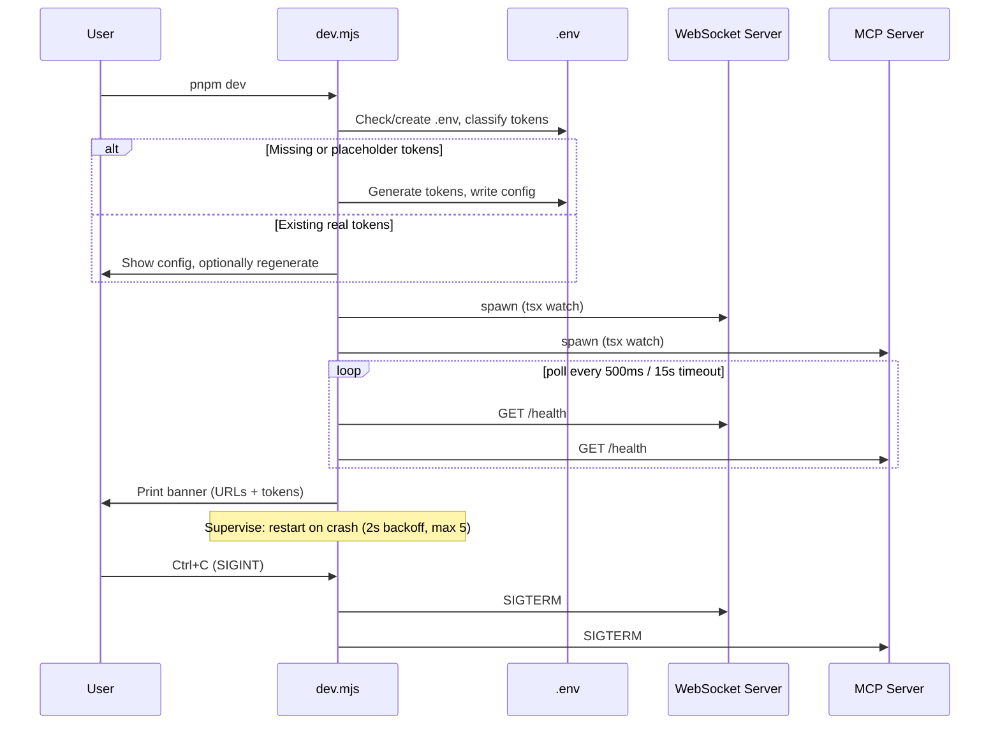
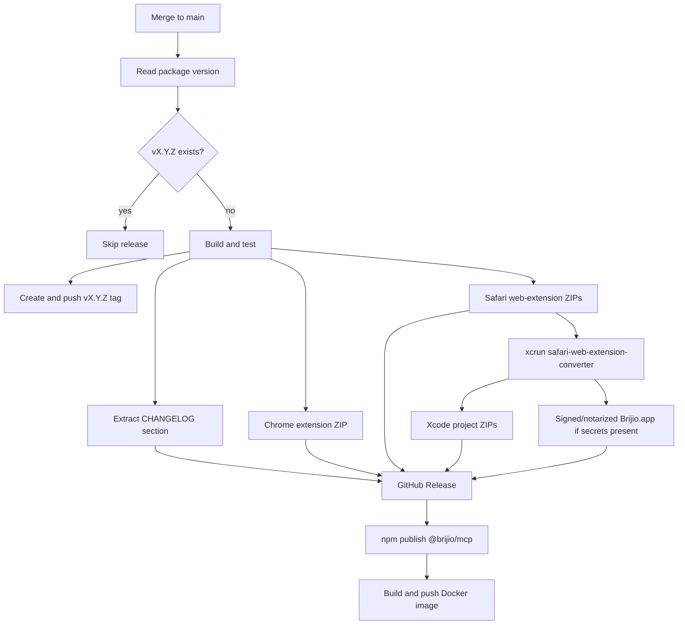

Brijio ships two cooperating servers — a [WebSocket relay](../architecture/websocket-relay.md) and an [MCP HTTP server](../concepts/mcp-tool-surface.md) — that are always deployed together. The runtime layer exists to make that pairing simple in every context: a `pnpm dev` orchestrator for local work, a single `npx`/`docker` entry point for end users, an OS daemon for always-on use, and a unified release pipeline that publishes all of it from one version tag. This page documents how those modes are configured, started, supervised, and released.

## Environment variables and tokens

Configuration is entirely environment-driven, read from a `.env` file or the process environment. The `.env.example` template documents the canonical variables:

| Variable                                            | Default                     | Purpose                                              |
| --------------------------------------------------- | --------------------------- | ---------------------------------------------------- |
| `WEBSOCKET_HOST` / `WEBSOCKET_PORT`                 | `0.0.0.0` / `8787`          | WebSocket relay bind address and port                |
| `BRIJIO_WS_URL`                                     | `ws://127.0.0.1:8787`       | WebSocket URL the MCP server connects to             |
| `BRIJIO_REQUEST_TIMEOUT_MS`                         | `5000`                      | Per-request timeout for WS relay calls               |
| `BRIJIO_PAIRING_TOKEN`                              | auto-generated              | Token authorizing extensions to connect to the relay |
| `BRIJIO_BROWSER_INSTANCE_ID`                        | (empty)                     | Optional stable ID for a browser instance            |
| `MCP_HTTP_HOST` / `MCP_HTTP_PORT` / `MCP_HTTP_PATH` | `0.0.0.0` / `8788` / `/mcp` | MCP HTTP transport bind and path                     |
| `MCP_HTTP_AUTH_TOKEN`                               | auto-generated              | Bearer token required on every MCP HTTP request      |
| `MCP_HTTP_ALLOWED_ORIGINS`                          | (empty)                     | Comma-separated CORS origin allow-list               |
| `TEST_PAGE_PORT`                                    | `8080`                      | Port for the Docker-only test page (nginx)           |

Both tokens are generated with `crypto.randomBytes(32).toString('base64url')` whenever they are unset or still hold a placeholder value. The two products that can run unconfigured — `pnpm dev`, the `npx`/`brijio` binary, the Docker image, and the OS daemon install — each auto-generate and print them so a fresh start is usable immediately.

### BrowserBridge backwards-compatible aliases

During the rename from "BrowserBridge" to "Brijio", the old `BROWSERBRIDGE_*` names remain accepted as aliases. The dev orchestrator and the `brijio` binary both implement a `withCompatibilityAliases` / `resolveRenamedEnv` fallback chain that reads `BROWSERBRIDGE_PAIRING_TOKEN`, `BROWSERBRIDGE_WEBSOCKET_URL`, `BROWSERBRIDGE_REQUEST_TIMEOUT_MS`, and `BROWSERBRIDGE_BROWSER_INSTANCE_ID` when the `BRIJIO_*` equivalent is absent, and mirrors the resolved value back into both namespaces so either name keeps working.

### Token generation (`pnpm token`)

`pnpm token` (and the alias `pnpm brijio`) run `scripts/brijio-token.mjs`, which prints a freshly generated pairing token to stdout. The script re-exports `generatePairingToken` from the shared `scripts/token-utils.mjs` module (the same function the orchestrator and daemon use), and notes on stderr that `BROWSERBRIDGE_PAIRING_TOKEN` remains accepted as a legacy alias. It is the manual escape hatch when you need a token outside of a full server start.

## One-command local startup (`pnpm dev`)

`pnpm dev` runs `scripts/dev.mjs`, an orchestrator that removes the manual `.env` setup that used to require copying a template, generating tokens, and pasting them into place. It manages the full lifecycle of a local session.

### `.env` setup and token configuration

On startup the orchestrator classifies the existing `.env` via `classifyEnv`:

- **No `.env`** — copies `.env.example` into place.
- **`placeholders`** — the file exists but tokens are still `replace-with-generated-token` / `replace-with-generated-mcp-token`; tokens are regenerated.
- **`incomplete`** — some values present but tokens missing; tokens are regenerated.
- **`configured`** — both tokens already set. In interactive mode it shows the current config with tokens masked and asks whether to regenerate; in non-interactive mode (`--yes`/`-y` or `CI=true`) it keeps the existing tokens.

When generating, it calls `generateConfig()` and writes a complete set of defaults (`0.0.0.0` hosts, ports 8787/8788, `/mcp` path, a fresh `BRIJIO_PAIRING_TOKEN` and `MCP_HTTP_AUTH_TOKEN`). `writeEnv` preserves existing lines, comments, and ordering, updating keys in place and appending any new ones.

### Server spawn, health checks, and supervision

The orchestrator spawns both servers as child processes under `tsx watch`:

- WS: `npx tsx watch servers/websocket/src/index.ts`
- MCP: `npx tsx watch servers/mcp/src/index.ts`

It passes the full resolved `.env` to each child so host, port, and token settings are honored. It then polls `GET /health` on each server (every 500 ms, up to a 15 s timeout) before declaring readiness; `0.0.0.0` bind addresses are probed via `127.0.0.1`. If either health check fails the orchestrator shuts down and exits non-zero.

Both servers expose a `GET /health` endpoint returning enriched status JSON (`{ status: "ok", version, uptimeSeconds, ... }`) rather than the minimal body the original ADR proposed. On a child crash the supervisor restarts it after a 2 s backoff, up to `MAX_RESTART_ATTEMPTS` (5); exceeding that limit terminates the orchestrator with an error. `SIGINT`/`SIGTERM` trigger a graceful shutdown: children get `SIGTERM`, then `SIGKILL` after a 5 s grace period.

### Startup banner

Once healthy, the orchestrator prints a banner listing the WebSocket URL, MCP URL, and both tokens, with a note to copy the pairing token into the browser extension and the MCP auth token into the MCP client. `0.0.0.0` hosts display as `localhost` for readability.



`pnpm dev:ws` and `pnpm dev:mcp` remain available to start a single server directly, bypassing the orchestrator for targeted development.

## Network host options and the `*.ts.net` / `*.local` allow-lists

Because the MCP HTTP endpoint can drive a connected browser, it is protected by a mandatory bearer token (`MCP_HTTP_AUTH_TOKEN`) and an optional `Origin` allow-list. Two ADRs (0025, 0026) make the origin check friendly to Tailscale MagicDNS and mDNS/`.local` names so users do not have to enumerate every reachable hostname.

`MCP_HTTP_ALLOWED_ORIGINS` accepts comma-separated entries. Entries beginning with `*.` are treated as suffix wildcards: `*.ts.net` matches `device.tailnet.ts.net` and `*.local` matches `browserbridge.local`. The match checks the origin hostname suffix while still honoring scheme and port. This wildcard matching is implemented in `isAllowedOrigin`/`matchesWildcardHost` in the MCP HTTP server.

These checks are request-routing guardrails, **not** authentication. A forged `Host`/`Origin` header can pass them, so the bearer token remains required before any MCP tool handling regardless of which host matched. Deployment guidance is to bind or firewall the server to the intended network.

> **Note:** ADR 0035 proposed removing host allow-listing entirely (relying only on the bearer token), and the current MCP HTTP server implements only `Origin` validation via `MCP_HTTP_ALLOWED_ORIGINS` — there is no `Host`-header allow-list in `http-server.ts`. The `MCP_HTTP_ALLOWED_HOSTS`, `MCP_HTTP_ALLOW_TAILSCALE_HOSTS`, and `MCP_HTTP_ALLOW_LOCAL_HOSTS` variables described in ADRs 0025/0026 are not read by the current server; only `MCP_HTTP_ALLOWED_ORIGINS` (with the same `*.` suffix semantics) is honored.

## Combined Docker image (s6-overlay)

ADR 0035 consolidated the two separate server packages into a single Docker image so users run one container, not two. The root `Dockerfile` builds the MCP package with `tsup` and runs both servers under [s6-overlay](https://github.com/just-containers/s6-overlay) v3 for process supervision.

### Build

A multi-stage build installs workspace dependencies with pnpm and builds `@brijio/mcp` (tsup bundles workspace deps; `ws`, `zod`, and `@modelcontextprotocol/sdk` remain external npm packages). The runtime stage installs s6-overlay, copies the bundled `dist/` output, strips `workspace:*` specifiers from `package.json`, and runs `npm install --omit=dev`.

### s6 service

A single s6 `longrun` service (`docker/s6-rc.d/brijio`) runs the combined Node.js entry point:

```sh
#!/command/with-contenv sh
cd /app
exec node dist/bin/brijio.js
```

That `brijio.js` entry point (the bundled `servers/mcp/bin/brijio.mjs`) starts both the WebSocket server and the MCP HTTP server in one process, auto-generates tokens if empty, prints the startup banner, and wires graceful shutdown on `SIGINT`/`SIGTERM`. The service is registered in the s6 `user` bundle (`docker/s6-rc.d/user/contents.d/brijio`) so it starts when `/init` initializes. `ENTRYPOINT` is `/init` (s6-overlay).

### Defaults and tokens

The image sets `ENV` defaults for `WEBSOCKET_HOST` (`0.0.0.0`), `WEBSOCKET_PORT` (`8787`), `MCP_HTTP_HOST` (`0.0.0.0`), `MCP_HTTP_PORT` (`8788`), `MCP_HTTP_PATH` (`/mcp`), `BRIJIO_WEBSOCKET_URL` (`ws://127.0.0.1:8787`), and `BRIJIO_REQUEST_TIMEOUT_MS` (`5000`). `BRIJIO_PAIRING_TOKEN` and `MCP_HTTP_AUTH_TOKEN` auto-generate when empty and are printed to stdout on first start; persist them by setting the env vars explicitly. `EXPOSE 8787 8788` documents the two ports.

Because both servers share one container network namespace, the MCP server connects to the WebSocket server on loopback (`ws://127.0.0.1:8787`) with no Docker Compose hostname resolution. Note that `127.0.0.1` binding inside a container is unreachable from the host even with `-p` port mapping, so the image defaults to `0.0.0.0` and relies on the auth tokens for security; strictly local-only access requires `npx` or `docker run --network=host`.

### docker-compose profiles

`docker-compose.yml` derives three profiles from the single image:

| Profile          | Service         | Notes                                                                        |
| ---------------- | --------------- | ---------------------------------------------------------------------------- |
| `runtime`        | `brijio`        | The standard combined image, ports 8787/8788                                 |
| `legacy-runtime` | `browserbridge` | `extends: brijio` for the old name                                           |
| `test`           | `test-page`     | `nginx:1.27-alpine` serving `clients/test-page` on `${TEST_PAGE_PORT:-8080}` |

The compose file passes tokens through from `.env` (`${BRIJIO_PAIRING_TOKEN:-}`, `${MCP_HTTP_AUTH_TOKEN:-}`) and forwards `BRIJIO_REQUEST_TIMEOUT_MS`. The test page is Docker-only — it is not started by `pnpm dev`.

## The `brijio` binary and daemon install (`npx`)

The published `@brijio/mcp` package (private: false) exposes a `bin` entry (`brijio`, with a deprecated `browserbridge` alias) pointing at `dist/bin/brijio.js`. `npx @brijio/mcp` therefore starts both servers in one foreground process with the same auto-generated-token, defaults, and graceful-shutdown behavior as the Docker entry point. It also dispatches daemon lifecycle subcommands.

### Daemon lifecycle

ADR 0037 added OS-level daemon install so Brijio can run at login and survive terminal close, without Docker. Subcommands are parsed in `servers/mcp/src/daemon.ts` and dispatched by the bin entry point:

| Command                                | macOS                                                                             | Linux                                                                                            |
| -------------------------------------- | --------------------------------------------------------------------------------- | ------------------------------------------------------------------------------------------------ |
| `install [--ws-port N] [--mcp-port N]` | Writes LaunchAgent plist, symlinks to `~/Library/LaunchAgents/`, `launchctl load` | Writes systemd user unit, symlinks to `~/.config/systemd/user/`, `systemctl --user enable --now` |
| `uninstall`                            | `launchctl unload`, remove link                                                   | `systemctl --user disable --now`, `daemon-reload`, remove link                                   |
| `start` / `stop` / `restart`           | `launchctl load` / `unload`                                                       | `systemctl --user start` / `stop` / `restart`                                                    |
| `status`                               | `launchctl list` + health probes                                                  | `systemctl --user is-active` + health probes                                                     |
| `logs [--lines N] [--live]`            | `tail` / `tail -f` `~/.brijio/brijio.log`                                         | `journalctl --user -u brijio.service` / `--follow`                                               |

Daemon support is darwin and linux only; other platforms throw `Brijio daemon install does not support <platform> yet.`

### Configuration directory (`~/.brijio/`)

`install` creates `~/.brijio/` holding:

- `.env` — persistent tokens and optional port overrides, written mode `0600`. Tokens are generated on first install and preserved on reinstall (idempotent); `--ws-port`/`--mcp-port` override existing port values.
- `.env.example` — written on first install if missing.
- `bin/brijio` — a shell wrapper that `exec`s the resolved binary path, so the plist/unit records a stable path rather than relying on `npx` resolution at every start.
- The service definition (`com.redvex.brijio.plist` on macOS, `brijio.service` on Linux), symlinked into the OS's expected location.

The macOS plist sets `RunAtLoad` and `KeepAlive` (start at login, restart on crash) with `WorkingDirectory` pointed at `~/.brijio` so the process always finds its `.env`. The systemd unit uses `Restart=on-failure`, `RestartSec=5`, `EnvironmentFile=%h/.brijio/.env`, and `WantedBy=default.target` (a user unit, no `sudo`). Tokens deliberately live in the `.env` file rather than in plist/systemd `Environment=` directives to avoid leaking credentials in user-readable service definitions.

`uninstall` stops and removes the service link but preserves `~/.brijio/` (`.env` and logs); it prints the `rm -rf` command for full removal.

### `.env` fallback chain

The bin entry point loads `.env` via `loadBrijioEnv`, checking in order: an explicit `BRIJIO_ENV_FILE`, `CWD/.env`, then `~/.brijio/.env`. `applyBrijioEnv` only sets values the process environment doesn't already define, so explicit env vars take precedence. Because the daemon's `WorkingDirectory` is `~/.brijio/`, the daemon always finds its config regardless of where it was launched.

### Non-daemon run modes

Beyond the lifecycle subcommands, the binary supports:

- `brijio` (or `npx @brijio/mcp`) — interactive foreground run of both servers.
- `brijio demo` — runs both servers on `127.0.0.1` plus a static demo page on `0.0.0.0` (reachable via Tailscale/LAN); if a daemon is already healthy on the WS port, it starts only the demo page to avoid port/pairing-token conflicts.
- `brijio --dev` — binds both servers to `127.0.0.1` only.
- `brijio --print-config [agent]` / `--doctor` — print MCP client config or run diagnostic checks without starting servers (server modules are imported dynamically only in run mode).
- `brijio --version` / `-v` — print the package version.

`EADDRINUSE` on startup is caught and reported with a pointer to `brijio --doctor` and the port-override env vars.

## Unified release workflow

ADR 0049 replaced the older separate extension release tags (`ext-chrome-v*`, `ext-safari-v*`) with a single `vX.Y.Z` tag that owns all release outputs. The `tag-and-release.yml` workflow runs on pushes to `main` (and `workflow_dispatch`).

### Tag and release job

The `release` job reads the root `package.json` version and checks whether `vX.Y.Z` already exists via `git ls-remote`; it skips entirely if the tag is present. Otherwise it builds, tests, extracts the matching `CHANGELOG.md` section (failing if absent), creates and pushes the annotated tag, and creates the GitHub Release with the changelog body and prerelease flag derived from the version string.

### Extension assets

Separate jobs, gated on `should_release`, build and attach assets to the same release:

- **Chrome** (`ubuntu-latest`) — builds `@brijio/chrome-extension`, validates `dist/manifest.json` version equals the release version, verifies expected build outputs, and uploads `brijio-chrome-extension-<version>.zip`.
- **Safari** (`macos-latest`) — builds `@brijio/safari-extension`, validates the iOS and macOS manifest versions, and uploads `brijio-safari-ios-web-extension-<version>.zip` and `brijio-safari-macos-web-extension-<version>.zip`. It then runs `xcrun safari-web-extension-converter` (continue-on-error) to produce Xcode project ZIPs for iOS and macOS.

#### Signed and notarized macOS app

When Apple Developer ID secrets are configured, the Safari job additionally builds a signed, notarized, stapled `Brijio.app`: it imports a `.p12` into a temporary keychain, runs `xcodebuild` with manual code signing and a secure timestamp, submits via `xcrun notarytool submit --wait`, verifies the notarization status is `Accepted`, and staples the ticket (retried up to five times to handle CloudKit propagation delay). The resulting `brijio-safari-macos-<version>.zip` is uploaded as a release asset. Without the signing secrets, only the unsigned Xcode project ZIPs are uploaded.

### npm and Docker publish

- **npm** (`publish-npm`, `ubuntu-latest`, Node 24) — verifies `servers/mcp/package.json` is `@brijio/mcp` at the release version, checks `npm view @brijio/mcp@<version>` to skip if already published, builds, and runs `npm publish --access public --provenance --no-git-checks` using OIDC trusted publishing (requires `permissions: id-token: write`).
- **Docker** (`publish-docker`, gated on both `release` and `publish-npm`) — builds and pushes the root `Dockerfile` to Docker Hub as `<user>/mcp:<version>` (plus `:latest` for non-prerelease versions).



## Key invariants and relationships

- **Two servers, one product.** The WebSocket relay exists only to bridge the MCP server and browser extensions; it is never deployed without the MCP server. Every distribution mode (dev, npx, Docker, daemon) starts both together.
- **Tokens are the security boundary.** `MCP_HTTP_AUTH_TOKEN` guards every MCP HTTP request; `BRIJIO_PAIRING_TOKEN` guards extension WebSocket connections. Host/origin checks are advisory routing guardrails, not authentication. When tokens are unset they auto-generate and print once; persistence requires setting the env vars explicitly.
- **`0.0.0.0` is the default bind.** Local dev, Docker, and npx all default to `0.0.0.0` for reachability on LAN/Tailscale, relying on the auth tokens. Strict loopback-only is opt-in via `MCP_HTTP_HOST=127.0.0.1` / `WEBSOCKET_HOST=127.0.0.1` (or `brijio --dev`), but `127.0.0.1` binding is unreachable from the host under Docker port mapping.
- **Health checks gate readiness.** Both servers expose `GET /health`; the dev orchestrator and the daemon `status` command poll it before declaring the system ready.
- **One version tag drives everything.** A single `vX.Y.Z` tag produces the npm package, Docker image, Chrome ZIP, and Safari assets (including the signed macOS app when Apple secrets are present). Extension-only hotfixes require a normal patch release.
