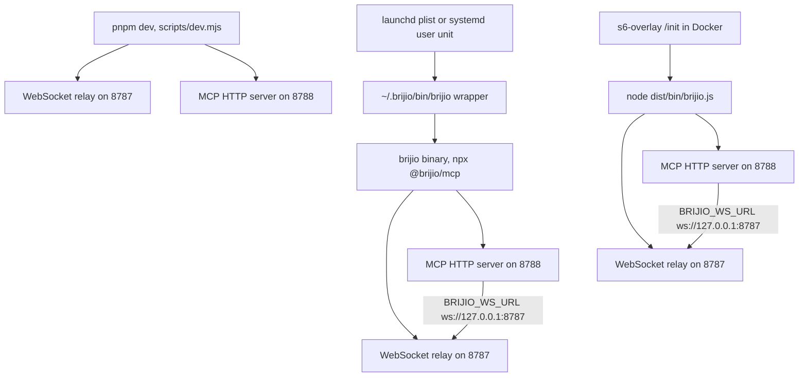
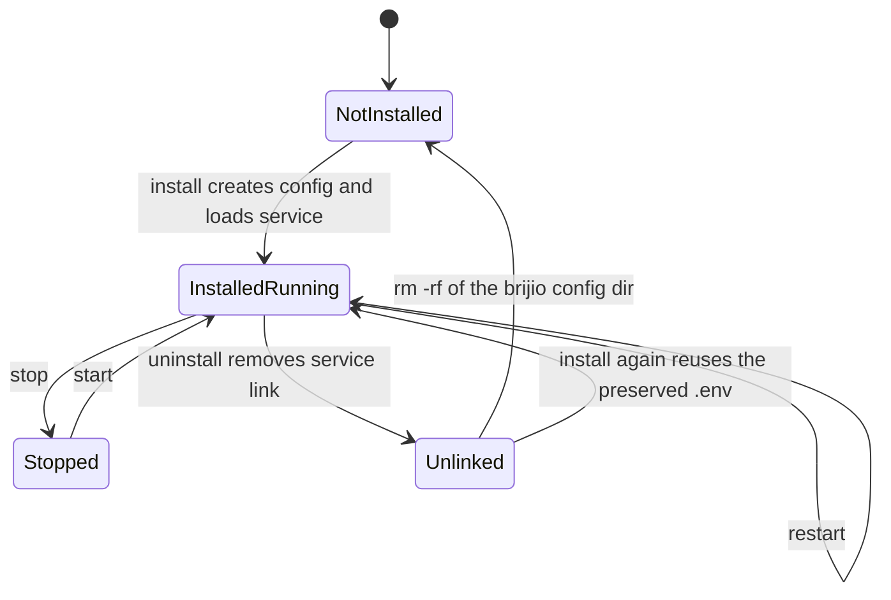

# Runtime and Deployment

Brijio runs as two cooperating processes on one machine: the WebSocket relay
(port 8787) and the MCP HTTP server (port 8788). Everything in this page is
about getting those two processes up, keeping them up, and verifying they are
healthy. The product ships three ways to do that, all converging on the same
server code:

- **`pnpm dev`** — the interactive development orchestrator
  ([scripts/dev.mjs](../../scripts/dev.mjs), ADR 0029).
- **`brijio` / `npx @brijio/mcp`** — the combined npm entry point
  ([servers/mcp/bin/brijio.mjs](../../servers/mcp/bin/brijio.mjs), ADR 0035),
  optionally installed as a persistent daemon via launchd or systemd (ADR 0037).
- **Docker** — the combined image supervised by s6-overlay
  ([Dockerfile](../../Dockerfile)).

This page covers runtime configuration and deployment. The day-to-day
development commands (`pnpm build`, `pnpm test`, per-package verification) live
in [Workflows](../workflows.md); the server internals are covered in
[MCP Server](../architecture/mcp-server.md) and
[WebSocket Relay](../architecture/websocket-relay.md).



_All three deployment modes start the same two servers; the MCP server always
reaches the relay over loopback via `BRIJIO_WS_URL` (default
`ws://127.0.0.1:8787`)._

## One-command startup: `pnpm dev`

`pnpm dev` runs `node scripts/dev.mjs`. The orchestrator owns the full local
lifecycle so a fresh clone works with zero manual configuration (ADR 0029):

1. **`.env` lifecycle.** If `.env` is missing at the repo root, it is copied
   from `.env.example`. The file is then classified:
   - **placeholders** (`replace-with-generated-token` /
     `replace-with-generated-mcp-token`) or **incomplete** — tokens are
     generated and written, preserving existing lines, order, and comments.
   - **configured** (both tokens present and real) — the current configuration
     is shown with masked tokens; the user is asked whether to regenerate.
   - **non-interactive** (`pnpm dev --yes`, `-y`, or `CI=true`) — prompts are
     skipped and existing tokens are kept.
2. **Token generation.** `BRIJIO_PAIRING_TOKEN` and `MCP_HTTP_AUTH_TOKEN` are
   generated with `crypto.randomBytes(32).toString('base64url')` from the
   shared [scripts/token-utils.mjs](../../scripts/token-utils.mjs). The
   orchestrator also mirrors values into the legacy `BROWSERBRIDGE_*` aliases
   (`withCompatibilityAliases`) so older configuration keeps working during the
   rename transition.
3. **Server spawning.** Both servers start as child processes:
   `npx tsx watch servers/websocket/src/index.ts` and
   `npx tsx watch servers/mcp/src/index.ts`, with all `.env` values passed in
   the child environment. Output is prefixed `[ws]` / `[mcp]`.
4. **Health gating.** The orchestrator polls
   `http://127.0.0.1:8787/health` and `http://127.0.0.1:8788/health` every
   500 ms for up to 15 seconds. If either server never becomes healthy, the
   other is shut down and the process exits 1 — the readiness banner is only
   printed when both servers answer.
5. **Supervision.** If a child crashes, it is restarted with a 2-second
   backoff, up to 5 attempts; after that the orchestrator exits 1.
6. **Graceful shutdown.** `SIGINT`/`SIGTERM` sends `SIGTERM` to both children;
   if they do not exit within 5 seconds they are killed with `SIGKILL`.

The readiness banner prints the WebSocket URL, MCP URL, pairing token, and MCP
auth token, plus the "Press Ctrl+C to stop all servers." hint. `0.0.0.0` hosts
are displayed as `localhost` for readability.

`pnpm dev:ws` and `pnpm dev:mcp` bypass the orchestrator and run a single
server under `tsx watch` — those require `.env` to already carry valid tokens,
because the bare MCP entry point throws when `MCP_HTTP_AUTH_TOKEN` is empty
(see [Health endpoints and server requirements](#health-endpoints)).

### Manual token generation: `pnpm token`

`pnpm token` (and the alias `pnpm brijio`) run
[scripts/brijio-token.mjs](../../scripts/brijio-token.mjs), which prints a
pairing token to stdout and reminds on stderr that
`BROWSERBRIDGE_PAIRING_TOKEN` remains accepted as a legacy alias. There is no
separate generator for the MCP auth token — the same base64url generator exists
in `token-utils.mjs` (`generateAuthToken`), used by the orchestrator and the
combined binary.

## Runtime configuration

`.env.example` documents the full variable set and is the template the
orchestrator copies:

| Variable                                            | Default                     | Meaning                                                                                                                                                                           |
| --------------------------------------------------- | --------------------------- | --------------------------------------------------------------------------------------------------------------------------------------------------------------------------------- |
| `WEBSOCKET_HOST` / `WEBSOCKET_PORT`                 | `0.0.0.0` / `8787`          | Relay bind address and port                                                                                                                                                       |
| `BRIJIO_WS_URL`                                     | `ws://127.0.0.1:8787`       | URL the MCP server uses to reach the relay                                                                                                                                        |
| `BRIJIO_REQUEST_TIMEOUT_MS`                         | `5000`                      | Timeout for forwarded browser requests                                                                                                                                            |
| `BRIJIO_PAIRING_TOKEN`                              | auto-generated              | Token for extension ↔ relay authentication                                                                                                                                        |
| `BRIJIO_BROWSER_INSTANCE_ID`                        | _(empty)_                   | Restrict tool calls to one browser instance                                                                                                                                       |
| `MCP_HTTP_HOST` / `MCP_HTTP_PORT` / `MCP_HTTP_PATH` | `0.0.0.0` / `8788` / `/mcp` | MCP HTTP server binding                                                                                                                                                           |
| `MCP_HTTP_AUTH_TOKEN`                               | auto-generated              | Bearer token required on the MCP endpoint                                                                                                                                         |
| `MCP_HTTP_ALLOWED_ORIGINS`                          | _(empty)_                   | Comma-separated allowed `Origin` values (exact match or `*.`-prefixed host wildcard)                                                                                              |
| `TEST_PAGE_PORT`                                    | `8080`                      | Port for the Docker-only nginx test page                                                                                                                                          |
| `BROWSERBRIDGE_*` aliases                           | —                           | Legacy names (`PAIRING_TOKEN`, `WEBSOCKET_URL`, `REQUEST_TIMEOUT_MS`, `BROWSER_INSTANCE_ID`) still accepted during the transition; the new `BRIJIO_*` names win when both are set |

Two more variables affect only the MCP HTTP server
([servers/mcp/src/http-server.ts](../../servers/mcp/src/http-server.ts)):

- `BRIJIO_MCP_HTTP_TIMEOUT_MS` — HTTP request timeout, default 60000 ms.
- `BRIJIO_APPROVAL_TIMEOUT_BUFFER_MS` — default 5000; the user-approval
  timeout is derived as `max(1000, httpTimeout − buffer)` so approval prompts
  always fit inside the HTTP window.

The combined binary resolves renamed variables through a single helper:
`BRIJIO_WS_URL` beats `BROWSERBRIDGE_WEBSOCKET_URL`, `BRIJIO_WEBSOCKET_URL`,
and `WEBSOCKET_URL`, warning when both old and new names are set to different
values. The same resolution exists server-side in
[page-context.ts](../../servers/mcp/src/page-context.ts).

**Env-file resolution chain.** The `brijio` entry point loads configuration
from the first existing file in this order:

1. `BRIJIO_ENV_FILE` (explicit override), then
2. `./.env` in the current working directory, then
3. `~/.brijio/.env` (the daemon's config file).

Loaded values only fill environment variables that are unset or empty — a real
environment variable always wins over the file.

**Never commit real tokens, secrets, or user data.** `.env` is generated
locally; placeholder values in `.env.example` are the only token-like strings
that belong in version control. Auto-generated tokens are ephemeral: they change
on every restart, so anything persistent (daemon, Docker, production) must set
`BRIJIO_PAIRING_TOKEN` and `MCP_HTTP_AUTH_TOKEN` explicitly.

## The combined `brijio` binary

`servers/mcp/bin/brijio.mjs` is the published entry point. The npm package
`@brijio/mcp` exposes it under two bin names — `brijio` (preferred) and
`browserbridge` (deprecated; invoking it prints a removal warning). It is
bundled by tsup into `dist/bin/brijio.js` with all workspace dependencies
inlined; only `@modelcontextprotocol/sdk`, `ws`, `zod`, and `tsx` remain
external npm packages.

Startup behavior in run mode:

- **Zero-config tokens.** If `BRIJIO_PAIRING_TOKEN` (or its legacy aliases) is
  unset/empty, a base64url token is generated; likewise for
  `MCP_HTTP_AUTH_TOKEN`. The pairing token is mirrored to
  `BROWSERBRIDGE_PAIRING_TOKEN` for compatibility.
- **Sensible defaults.** Hosts default to `0.0.0.0`, ports to 8787/8788, the
  MCP path to `/mcp`, and `BRIJIO_WS_URL` to `ws://127.0.0.1:8787` — the two
  servers share one process and one loopback.
- **Startup banner on stderr** (ADR 0038), so stdout stays pipeable. It lists
  every reachable address detected by the network module (Tailscale IP first,
  then mDNS `.local`, then localhost), the tokens (marked `[ephemeral]` when
  auto-generated, with a warning that they change on restart), and connection
  hints.
- **`--dev` flag** forces `WEBSOCKET_HOST`/`MCP_HTTP_HOST` to `127.0.0.1`.
- **Port-conflict handling.** On `EADDRINUSE` the binary prints a friendly
  error suggesting `brijio --doctor`, changing `WEBSOCKET_PORT` /
  `MCP_HTTP_PORT`, or stopping the conflicting process, and exits 1.
- **`demo` subcommand** starts a static demo-page server (default port 8789,
  `BRIJIO_DEMO_PORT`), binding `0.0.0.0` while the WS/MCP hosts are pinned to
  `127.0.0.1`. If a daemon is already answering on the WebSocket port, the demo
  server attaches to it instead of starting a second relay — two processes on
  the same port would use different pairing tokens and break request routing.
- **`--print-config [agent]`** emits a ready-to-copy MCP client configuration
  for a known agent (`claude-desktop`, `cursor`, `vscode`, `cline`, `codex`,
  `hermes`, `claude-code`, `gemini`, `windsurf`, `zed`, `continue`, `goose`),
  prompting interactively when run on a TTY and falling back to JSON otherwise.
- **`--version` / `-v`** prints the package version and exits.
- **Graceful shutdown.** `SIGINT`/`SIGTERM` closes the relay, the MCP server,
  and (in demo mode) the demo server, then exits 0.

## Daemon install lifecycle

For persistent, starts-at-login operation, ADR 0037 added daemon subcommands
implemented in [servers/mcp/src/daemon.ts](../../servers/mcp/src/daemon.ts).
macOS uses a launchd LaunchAgent; Linux uses a systemd **user** unit (no
`sudo`). Other platforms throw: daemon install supports `darwin` and `linux`
only.

| Command                                       | Effect                                                                         |
| --------------------------------------------- | ------------------------------------------------------------------------------ |
| `brijio install [--ws-port N] [--mcp-port N]` | Create config, generate tokens, write service definition, load and start it    |
| `brijio uninstall`                            | Stop and remove the service link; **preserves** `~/.brijio/` (config and logs) |
| `brijio start` / `stop` / `restart`           | `launchctl load`/`unload` or `systemctl --user start`/`stop`/`restart`         |
| `brijio status`                               | Loaded state + health probes for both servers                                  |
| `brijio logs [--lines N] [--live]`            | Recent or streaming daemon logs                                                |
| `brijio --doctor`                             | Preflight diagnostics (see below)                                              |

### What `install` writes

`install` creates `~/.brijio/` containing:

- **`.env`** — persistent tokens and optional port overrides, written with
  mode `0600` so credentials are not world-readable. Install is idempotent:
  existing tokens are preserved on reinstall, and `--ws-port` / `--mcp-port`
  (validated to be integers 1–65535) are written into `.env` only when given.
- **`.env.example`** — a template, written on first install if missing.
- **`bin/brijio`** — a small `sh` wrapper (`exec node <resolved-entry-point>`)
  so the service definition points at a stable path even when the package was
  resolved through the npx cache.
- **Service definition + symlink**:
  - macOS: `~/.brijio/com.redvex.brijio.plist`, symlinked into
    `~/Library/LaunchAgents/`. The plist sets `RunAtLoad` and `KeepAlive`
    (start on login, restart on crash), `WorkingDirectory` to `~/.brijio` (so
    the `.env` fallback finds its config), and routes stdout/stderr to
    `~/.brijio/brijio.log`.
  - Linux: `~/.brijio/brijio.service`, symlinked into
    `~/.config/systemd/user/`. The unit is `Type=simple` with
    `WorkingDirectory=%h/.brijio`, `ExecStart=%h/.brijio/bin/brijio`,
    `Restart=on-failure` with `RestartSec=5` (deliberately _not_ `always`, to
    avoid restart loops on config errors), `EnvironmentFile=%h/.brijio/.env`,
    and `WantedBy=default.target`.

Tokens live in `.env` rather than `EnvironmentVariables` in the plist/unit —
service definitions are user-readable plaintext, and a single `.env` works for
both daemon and interactive runs (rotate by editing the file and running
`brijio restart`).



_Daemon lifecycle. `uninstall` never deletes `~/.brijio/`; reinstalling after
an uninstall reuses the persisted tokens and configuration._

### Observing the daemon

- `status` reports whether the service is loaded (`launchctl list` on macOS,
  `systemctl --user is-active` on Linux), the config and binary paths, and the
  result of probing `http://127.0.0.1:<ws-port>/health` and
  `http://127.0.0.1:<mcp-port>/health` (1.5-second timeout each), using the
  ports from `~/.brijio/.env`.
- `logs` tails `~/.brijio/brijio.log` on macOS and reads
  `journalctl --user -u brijio.service` on Linux; `--live` follows the stream
  instead. `--lines`/`-n` must be a positive integer (default 100).

From a source checkout, the daemon commands require a build first:
`pnpm build` then `node servers/mcp/dist/bin/brijio.js install` (or `start`,
`status`, …). End users run the same commands through `npx @brijio/mcp`.

## Docker: the combined image

The root [Dockerfile](../../Dockerfile) builds one image containing both
servers (ADR 0035):

- **Build stage** (`node:22-alpine`): `pnpm install --filter @brijio/mcp...
--frozen-lockfile`, then `pnpm --filter @brijio/mcp build` — the tsup bundle
  at `servers/mcp/dist`.
- **Runtime stage**: installs **s6-overlay v3** (noarch plus the
  architecture-specific tarball mapped from `TARGETARCH`), copies the bundled
  `dist/`, strips `workspace:*` entries from `package.json`, and runs
  `npm install --omit=dev --ignore-scripts` for the external runtime deps only.
  `EXPOSE 8787 8788`, `ENTRYPOINT ["/init"]`.

Process supervision inside the container is a **single s6 longrun service**
(`docker/s6-rc.d/brijio`) that runs `node dist/bin/brijio.js` — the same
combined entry point as `npx @brijio/mcp`, not two separate node processes. The
Node entry point handles token auto-generation and the startup banner; s6
provides crash restart and signal handling. The Dockerfile documents its
defaults in its header comment and bakes them in as `ENV`:

| Variable                                            | Docker default                                                       |
| --------------------------------------------------- | -------------------------------------------------------------------- |
| `WEBSOCKET_HOST` / `WEBSOCKET_PORT`                 | `0.0.0.0` / `8787`                                                   |
| `BRIJIO_PAIRING_TOKEN`                              | auto-generated if empty                                              |
| `MCP_HTTP_HOST` / `MCP_HTTP_PORT` / `MCP_HTTP_PATH` | `0.0.0.0` / `8788` / `/mcp`                                          |
| `MCP_HTTP_AUTH_TOKEN`                               | auto-generated if empty                                              |
| `BRIJIO_WEBSOCKET_URL`                              | `ws://127.0.0.1:8787` (both processes share the container namespace) |
| `BRIJIO_REQUEST_TIMEOUT_MS`                         | `5000`                                                               |

Tokens generated inside the container are ephemeral — new ones on each
container start, printed at startup (the banner goes to stderr, so `docker logs`
shows it). Persist them by passing `-e BRIJIO_PAIRING_TOKEN=…` and
`-e MCP_HTTP_AUTH_TOKEN=…` or by setting them in the `.env` used by Compose.

**Docker binding caveat:** inside a container, `127.0.0.1` binds to the
container's loopback and is unreachable from the host even with `-p` port
mapping. Docker deployments must keep the `0.0.0.0` defaults and treat the auth
tokens as the security boundary (or use `--network=host` with explicit
loopback binding). This is also why no host allowlists exist anymore — ADR 0035
removed `MCP_HTTP_ALLOWED_HOSTS` and friends; a request's network interface is
irrelevant, only its tokens and (for browser-originated requests) its CORS
origin matter.

### Compose profiles

[docker-compose.yml](../../docker-compose.yml) defines exactly three profiles:

- **`runtime`** — service `brijio`: builds the root Dockerfile, exposes
  `${WEBSOCKET_PORT:-8787}:8787` and `${MCP_HTTP_PORT:-8788}:8788`, and passes
  `BRIJIO_PAIRING_TOKEN`, `MCP_HTTP_AUTH_TOKEN`, and
  `BRIJIO_REQUEST_TIMEOUT_MS` through from the host `.env` (empty means
  auto-generate). Run it with `docker compose --profile runtime up --build`.
  Note that plain `docker compose up` starts nothing, because every service in
  the file belongs to a profile.
- **`legacy-runtime`** — service `browserbridge`: `extends: brijio`, an alias
  for the transition window from the old product name.
- **`test`** — service `test-page`: an `nginx:1.27-alpine` container serving
  `clients/test-page/` read-only on `${TEST_PAGE_PORT:-8080}:80`. Run it with
  `docker compose --profile test up test-page`. The test page is Docker-only;
  `pnpm dev` does not start a third process (ADR 0029), and `brijio demo` is
  the native alternative.

## Health endpoints

Both servers expose `GET /health`, which is what the dev orchestrator, the
daemon `status` command, and container health checks poll.

**WebSocket relay** (`servers/websocket/src/server.ts`) — the HTTP server that
owns the WebSocket upgrade answers `/health` with:

```json
{
  "status": "ok",
  "version": "…",
  "uptimeSeconds": 123,
  "extensions": {
    "count": 1,
    "browsers": [
      { "browserInstanceId": "chrome-default", "label": "Chrome Default" }
    ]
  }
}
```

Only sockets in the `OPEN` state are counted, so `count` reflects browsers that
are actually connected right now.

**MCP HTTP server** (`servers/mcp/src/http-server.ts`) — `/health` is answered
before the auth check, so it needs no bearer token:

```json
{
  "status": "ok",
  "version": "…",
  "uptimeSeconds": 123,
  "websocket": { "url": "ws://127.0.0.1:8787", "status": "unknown" }
}
```

`websocket.url` is the configured `BRIJIO_WS_URL`; `websocket.status` is
currently always `unknown` — the MCP server does not probe the relay from the
health handler, it only reports reachability indirectly through request
failures. Anything else on the MCP path requires the `Authorization: Bearer
<MCP_HTTP_AUTH_TOKEN>` header, a GET/POST/DELETE method, and — for requests
carrying an `Origin` header — an origin that appears in
`MCP_HTTP_ALLOWED_ORIGINS` (exact match, or a `*.`-prefixed host wildcard such
as `*.local`). Requests without an `Origin` header (typical for CLI and agent
clients) bypass the origin check entirely; a request with a disallowed origin
gets a `403 forbidden_origin` before any MCP handling, and a missing/invalid
bearer token gets `401 unauthorized`.

One operational invariant follows from the option loader: when the MCP server
is started _without_ the combined entry point (`pnpm dev:mcp`, or importing
`getMcpHttpServerOptionsFromEnv` directly), an empty `MCP_HTTP_AUTH_TOKEN`
throws immediately — "MCP_HTTP_AUTH_TOKEN is required for MCP HTTP transport."
Only `pnpm dev` and the `brijio` binary auto-fill it before the server loads.

## Operational verification

These are the deployment-facing checks, distinct from the development test
suites in [Workflows](../workflows.md):

- **`brijio --doctor`** runs preflight diagnostics
  ([servers/mcp/src/doctor.ts](../../servers/mcp/src/doctor.ts)) and exits 1 if
  any check fails:
  - config file found/readable (warns, not fails, when no `.env` was located),
  - **port availability** for both 8787 and 8788 — binds each port to detect
    `EADDRINUSE` before starting,
  - network detection (Tailscale CLI, mDNS, loopback),
  - Node.js version (fails below Node 18).
- **`brijio status`** for an installed daemon: loaded state, config/binary
  paths, and live `/health` probes on both ports.
- **Direct health probes** for any deployment mode:

  ```sh
  curl http://127.0.0.1:8787/health   # relay: version, uptime, connected extensions
  curl http://127.0.0.1:8788/health   # MCP: version, uptime, configured WS URL
  ```

- **`docker compose config`** with the relevant `--profile` flag to confirm
  which services a deployment will actually start.

The behavior of these operational surfaces is pinned by tests:
`scripts/dev.test.mjs` covers `.env` creation, classification, alias
mirroring, health-check polling, and the banner;
`servers/mcp/src/daemon.test.ts` covers command parsing, the install plan,
plist/systemd unit contents, and the per-platform logs commands;
`servers/mcp/src/doctor.test.ts` and `startup-banner.test.ts` cover the
diagnostic report and banner formatting; and
`servers/websocket/src/server.test.ts` plus `servers/mcp/src/http-server.test.ts`
pin the `/health` response shapes.
