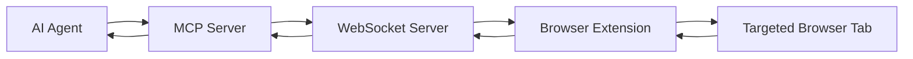

# OpenWiki Quickstart

Brijio connects remote AI agents to the browser session a user already controls — no cloned browser, no exported cookies, no continuous screenshots. The system is intentionally reactive: the user explicitly starts and stops the browser bridge, the extension answers explicit requests only, and agents must ask for browser state or perform actions through the MCP server. There is no continuous page, DOM, screenshot, history, or browser-state streaming.

Start here if you want to understand the repo quickly:

- [Architecture Overview](architecture.md)
- [MCP ↔ WebSocket ↔ Extension flow](architecture/mcp-extension-flow.md)
- [Workflows](workflows.md)
- [Multi-tab workflow](workflows/multi-tab.md)
- [Major Domains](domains.md)
- [Security and Trust Model](security.md)
- [Capability matrix](../docs/project/CAPABILITY_MATRIX.md)
- [Roadmap](../docs/project/ROADMAP.md)
- [Root README](../README.md)
- [Agent instructions](../AGENTS.md)

## What this repository is

This is a pnpm TypeScript monorepo for a browser-bridge product (`AGPLv3`). The major source domains, in dependency order from shared contract outward to the browser:

- `packages/shared` — the canonical protocol envelope, payload types, and browser-agnostic logic (`BrijioBackgroundController`, page readers) used by both servers and extensions.
- `servers/websocket` — the local relay: pairing-token auth, sha256 scope keys, in-memory browser presence, and request routing between MCP and extension sockets.
- `servers/mcp` — the agent-facing MCP surface over HTTP (`/mcp`): tools, resources, skills, and the `brijio-context` prompt, plus the per-request WebSocket client that talks to the relay.
- `clients/extensions/chrome` and `clients/extensions/safari` — thin browser-specific adapters around the shared controller. Safari reuses the shared logic with Safari-specific adapters (ADR 0019). Firefox is reserved but not implemented.

The current product contract and support status live in [capability matrix](../docs/project/CAPABILITY_MATRIX.md); design history lives in the ADRs under `docs/architecture/decisions/`.

## How the pieces fit together

The runtime is a single explicit request/response chain:

1. The user manually starts the browser bridge in the extension UI (no background auto-connect).
2. The extension authenticates to the relay as role `extension` with the pairing token and announces browser presence.
3. An agent calls an MCP tool; the MCP server opens a short-lived WebSocket, authenticates as role `mcp` with the same pairing token, and sends a structured request envelope (with optional `target.browserInstanceId` and `target.tabId`).
4. The relay selects the target browser and forwards the envelope to that extension socket.
5. The extension reads or acts on the targeted tab and returns a structured result, which flows back through the relay to the agent.

Tab targeting is **per-call and stateless**: every page/action tool accepts an optional `tabId`; when omitted, the system falls back to the active foreground tab. There is no session-level "selected tab" state. This model is the canonical source for multi-tab behavior — see [ADR 0060](../docs/architecture/decisions/0060-explicit-tab-listing-and-selection.md) (explicit tab listing and selection) and [ADR 0062](../docs/architecture/decisions/0062-thread-tabid-through-action-stack.md) (threading `tabId` through the action stack), with the concrete loop in the [multi-tab workflow](workflows/multi-tab.md).

## Task-routing map

When you change something, decide which layer owns the behavior first, then go to the relevant wiki page:

| Change area                                                             | Owns it                             | Go to                                                                                   |
| ----------------------------------------------------------------------- | ----------------------------------- | --------------------------------------------------------------------------------------- |
| Protocol / shared data shapes, browser-agnostic reader/controller logic | `packages/shared`                   | [MCP ↔ Extension flow](architecture/mcp-extension-flow.md), [Major Domains](domains.md) |
| Relay routing, auth, presence, browser/tab selection                    | `servers/websocket`                 | [Architecture Overview](architecture.md)                                                |
| MCP tools, resources, skills, HTTP transport, MCP↔relay client          | `servers/mcp`                       | [MCP ↔ Extension flow](architecture/mcp-extension-flow.md), [Workflows](workflows.md)   |
| Browser adapters, extension UI, manifest, platform differences          | `clients/extensions/*`              | [Architecture Overview](architecture.md), [Major Domains](domains.md)                   |
| Multi-tab / `tabId` targeting, `list_tabs`/`open_tab`                   | cross-layer (ADR 0060/0062/0063)    | [Multi-tab workflow](workflows/multi-tab.md)                                            |
| Security, trust boundaries, auth/routing, browser-state exposure        | `docs/security/*`                   | [Security and Trust Model](security.md)                                                 |
| Testing, build/lint commands, ADR & TDD workflow                        | repo-wide                           | [Workflows](workflows.md)                                                               |
| Capability names, support status, intentional boundaries                | `docs/project/CAPABILITY_MATRIX.md` | [Capability matrix](../docs/project/CAPABILITY_MATRIX.md)                               |

For cross-domain protocol or browser-capability changes, update in dependency order so the shared contract moves first and the adapters follow: shared protocol → WebSocket relay → MCP surface → shared controller → Chrome adapter → Safari adapter → integration tests (see [Major Domains](domains.md)).

## Where to go next

- Read [architecture/mcp-extension-flow.md](architecture/mcp-extension-flow.md) for the end-to-end request path and the canonical source files at each layer.
- Read [workflows/multi-tab.md](workflows/multi-tab.md) before changing tab-aware tools or skills.
- Read [workflows.md](workflows.md) for the `pnpm` build/test/lint commands, the ADR and TDD workflow, and the per-domain verification table.
- Use the [capability matrix](../docs/project/CAPABILITY_MATRIX.md) and [roadmap](../docs/project/ROADMAP.md) to understand what is implemented, planned, or intentionally unsupported.

## Notes for future changes

- The source of truth for recent multi-tab behavior is ADR 0060 and ADR 0062 in `docs/architecture/decisions/` (ADR 0063 covers `open_tab`).
- If you change tool inputs or the extension request path, update the architecture page and the multi-tab workflow page together.
- Keep this page short; it is the entrypoint, not the canonical home for every detail.
