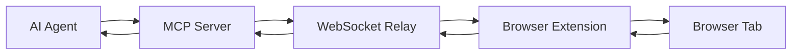

# OpenWiki Quickstart

Brijio is a user-controlled bridge between remote AI agents and the browser
session the user already controls. It is intentionally **reactive**: the browser
extension connects only after an explicit user action, and agents must ask for
browser state or perform actions through the MCP server. Brijio is not a remote
desktop, a browser-cloning system, or a continuous-streaming surveillance layer;
every read or action is initiated by an explicit request and answered with a
structured result.

Start here to understand the repository quickly, then follow the task-routing
map below to the page that covers your job.

## What this repository is

Brijio is a private pnpm TypeScript monorepo (`packageManager: pnpm@10.32.1`,
Node `>=22.0.0`) that lets an AI agent collaborate with the authenticated
browser a user is already using — no cookie export, no session replication, no
separate browser for the agent. It is open source under AGPLv3. The workspace
groups four runtime systems (see [pnpm-workspace.yaml](../pnpm-workspace.yaml)):

| System                                   | Package                                                  | Responsibility                                                                                                                                                                                                                                        |
| ---------------------------------------- | -------------------------------------------------------- | ----------------------------------------------------------------------------------------------------------------------------------------------------------------------------------------------------------------------------------------------------- |
| Shared protocol & browser-agnostic logic | `packages/shared` (`@brijio/shared`)                     | The WebSocket envelope, auth/presence messages, capability names, tab shapes, and reusable page-context/background-controller logic both servers and extensions depend on. Protocol shapes live here and are not duplicated.                          |
| WebSocket relay                          | `servers/websocket` (`@brijio/websocket`)                | Local transport and routing: authenticates clients with the local pairing token, tracks runtime-only browser presence, and routes messages between the MCP server and connected extensions. State-light — presence disappears when the socket closes. |
| MCP server                               | `servers/mcp` (`@brijio/mcp`)                            | The agent-facing surface: MCP tools, resources, prompts, and skills, assembled around the Streamable HTTP transport. It forwards agent calls to the relay and returns structured results.                                                             |
| Browser extensions                       | `clients/extensions/chrome`, `clients/extensions/safari` | Thin browser adapters that implement the user-controlled, request/response bridge. Chrome and Safari share logic from `packages/shared` and differ in manifests (MV2/MV3) and platform packaging.                                                     |

> **Firefox note:** `clients/extensions/firefox` is a placeholder — it contains
> only a `README.md` reserving the client boundary. Firefox packaging,
> permissions, and user-control behavior must be designed in a separate ADR
> before implementation starts.

`AGENTS.md` is the authority for runtime/package-manager versions, available
commands, and the layer ownership rules; `docs/project/CAPABILITY_MATRIX.md` is
the canonical product contract and support-status source. Do not copy mutable
tool inventories or the full source tree here — follow those sources of truth
instead.

## How the pieces fit together

The runtime is one explicit request/response chain. The request flows
left-to-right and the structured result returns along the same path; no
component pushes ambient browser state back to the agent.

```text
Agent -> MCP Server -> WebSocket Relay -> Browser Extension -> Browser Session
```



The basic cycle is:

1. The user manually starts the bridge (the extension connects and announces
   browser presence).
2. The MCP server receives a tool/resource call from an agent.
3. The MCP server forwards the request to the WebSocket relay as a protocol
   envelope.
4. The relay delivers the request to the connected extension.
5. The extension reads or acts on the target browser tab and returns a
   structured result.

Tab targeting is explicit per call: when a `tabId` is provided it is threaded
through the MCP tool wrappers, relay protocol, background controller, and
browser adapters; when omitted, the system falls back to the active tab. There
is no hidden selected-browser or selected-tab session state, and page context
should be re-read after navigation or a mutation that can invalidate
short-lived target IDs.

## Task-routing map

Find your task, then follow the link.

| If you are…                                                                                   | Go to                                                                                                                                                                                                                                                                      |
| --------------------------------------------------------------------------------------------- | -------------------------------------------------------------------------------------------------------------------------------------------------------------------------------------------------------------------------------------------------------------------------- |
| Tracing the end-to-end request path (tool call → relay → extension → result)                  | [MCP ↔ WebSocket ↔ Extension Flow](architecture/mcp-extension-flow.md)                                                                                                                                                                                                     |
| Changing a specific system (shared, relay, MCP server, or an extension)                       | The relevant page under [Architecture Overview](architecture.md): [Shared Package](architecture/shared-package.md), [WebSocket Relay](architecture/websocket-relay.md), [MCP Server](architecture/mcp-server.md), [Browser Extensions](architecture/browser-extensions.md) |
| Working with protocol shapes, envelopes, roles, presence, or result/error data                | [Protocol and Data Model Guide](data-and-protocol.md)                                                                                                                                                                                                                      |
| Running, configuring, or deploying Brijio (`pnpm dev`, tokens, daemon, Docker, health checks) | [Runtime and Deployment](operations/runtime-and-deployment.md)                                                                                                                                                                                                             |
| Using dev commands or per-domain verification patterns                                        | [Workflows](workflows.md)                                                                                                                                                                                                                                                  |
| Writing or running tests (unit, integration, harness, TDD conventions)                        | [Testing](testing.md)                                                                                                                                                                                                                                                      |
| Understanding trust assumptions, threat classes, or action-approval boundaries                | [Security and Trust Model](security.md)                                                                                                                                                                                                                                    |
| Targeting tabs (`list_tabs`, `open_tab`, per-call `tabId`, stale-context re-reads)            | [Multi-tab Workflow](workflows/multi-tab.md)                                                                                                                                                                                                                               |
| Keeping a change scoped to the right ownership boundary                                       | [Major Domains](domains.md)                                                                                                                                                                                                                                                |

For the cross-layer path to check when a protocol or browser capability changes
(from [AGENTS.md](../AGENTS.md)):

```text
shared protocol -> WebSocket relay -> MCP surface -> shared controller
                -> Chrome adapter -> Safari adapter -> integration tests
```

## Where to go next

- Read [architecture/mcp-extension-flow.md](architecture/mcp-extension-flow.md)
  for the canonical end-to-end request path and the source files at each hop.
- Read [workflows/multi-tab.md](workflows/multi-tab.md) before changing tab-aware
  tools or skills.
- Use the [capability matrix](../docs/project/CAPABILITY_MATRIX.md) and
  [roadmap](../docs/project/ROADMAP.md) for what is implemented, planned, or
  intentionally unsupported, and [AGENTS.md](../AGENTS.md) for change workflow,
  ADR rules, and verification commands.

## Notes for future changes

- Keep this page short: it is the routing entry point, not the canonical home for
  every detail. Deep content belongs on the linked pages.
- If you change tool inputs or the extension request path, update the relevant
  architecture page and the multi-tab workflow page together.
- When tool behavior changes, update its tests, MCP registration, relevant
  skills under `servers/mcp/skills`, the capability matrix, and the relevant
  OpenWiki workflow pages (per [AGENTS.md](../AGENTS.md)).
