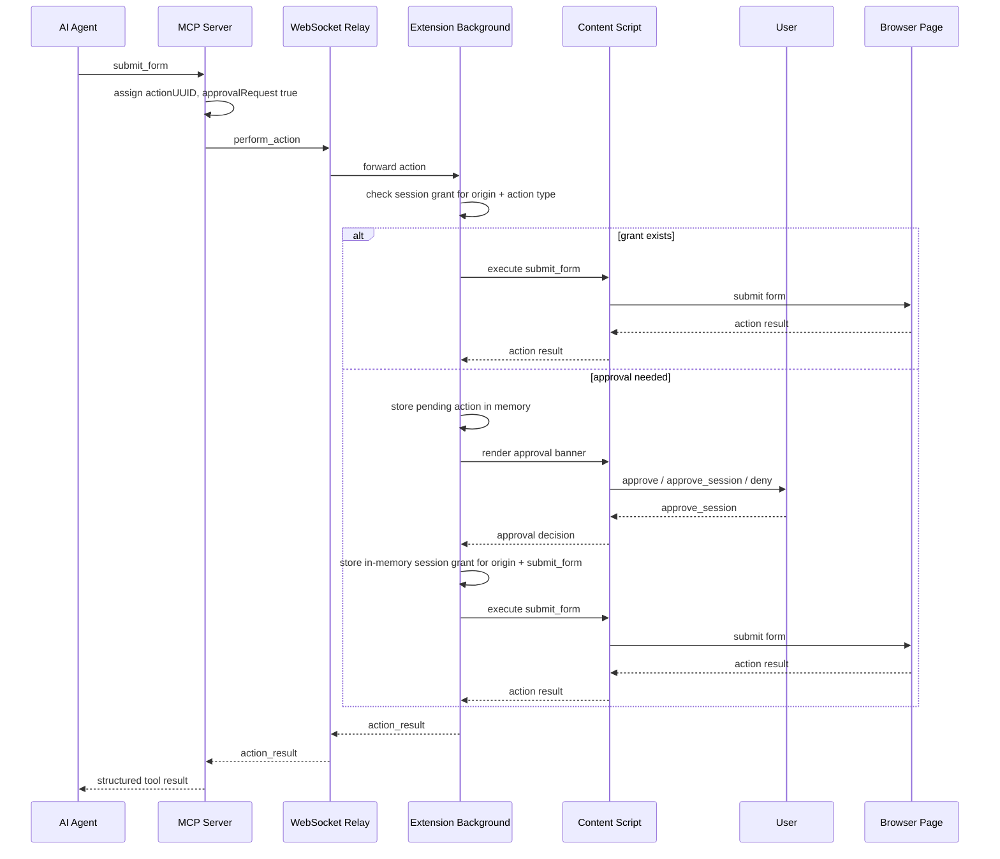

# Security and Trust Model

Brijio is built around explicit control and minimal trust. The browser session a user already controls stays local and remains the source of truth; remote agents only gain access through explicit, authenticated, request/response interactions. This page collects the security posture scattered across `docs/security/THREAT_MODEL.md`, `docs/security/TRUST_BOUNDARIES.md`, `docs/security/SECURITY_GUARANTEES.md`, `docs/project/CAPABILITY_MATRIX.md`, `AGENTS.md`, and ADR 0048, and points to the [Architecture Overview](architecture.md), the [Protocol and Data Model Guide](data-and-protocol.md), and the [Major Domains](domains.md) for the surrounding mechanics.

## Non-negotiable invariants

The invariants in `AGENTS.md` are the load-bearing security boundary for every change. In spirit, they require:

- The user explicitly starts and stops the browser bridge; nothing happens in the background.
- Browser state is available only while the user-controlled extension is connected.
- Every browser read or action is initiated by an explicit MCP tool or resource request — there is no continuous page, DOM, screenshot, history, or browser-state streaming.
- No silent background surveillance, cookie export, credential extraction, session cloning, or MFA interception.
- Page content is not persisted unless an accepted ADR explicitly requires it.
- Authenticated, private browser and tab routing preserves explicit request IDs, structured errors, and timeouts.
- User-visible connection state and configured client-side action approval are preserved; approval checks must not be bypassed.
- Browser permissions are kept minimal and each is documented.

The extension is reactive: it answers explicit requests and returns structured results; it does not publish ambient browser state. When evaluating any new feature, ask whether it expands trust in a party that should not be trusted — if so, it needs additional safeguards before it can be accepted.

## Core trust assumptions

From `docs/security/THREAT_MODEL.md` and the root README:

- The user explicitly starts and controls the browser connection.
- Authentication tokens are held only by authorized parties.
- The browser session belongs to the user.
- The relay transports messages without needing to inspect content.

## Security goals

The security docs describe the main goals as:

- Protect browser sessions.
- Avoid credential exposure.
- Minimize unnecessary data transfer.
- Reduce trust in relay infrastructure.
- Maintain user control.

## Threats the project plans around

The threat model calls out four classes of attacker and mitigates each with architecture rather than purely defensive code.

- **Malicious agent** — an agent that reaches beyond what was explicitly requested, exfiltrates browser state, or performs unauthorized actions. Mitigated by the explicit request/response protocol, no continuous streaming by design, user-controlled browser connection, and progressive disclosure that limits data exposure.
- **Compromised relay server** — a relay that inspects, modifies, or logs traffic. Mitigated by routing messages without requiring content access, user-controlled self-hostable infrastructure, and planned end-to-end encryption that will prevent content inspection.
- **Network attacker** — an attacker on the path between agent, relay, and browser. Mitigated by TLS on all transports, authentication tokens on all connections, and planned E2E encryption as defense in depth.
- **Malicious website** — a site that exploits the extension or injects content that misleads the agent. Mitigated by a least-privilege permission model, a structured protocol that prevents arbitrary code execution, and content that is read as structured data rather than evaluated.

The architectural mitigations recur across threats: explicit request/response flows, no continuous streaming, user-controlled browser connections, and progressive disclosure. These are design choices, not incidental hardening.

## Trust boundaries

`docs/security/TRUST_BOUNDARIES.md` traces trust across four boundaries.

| Boundary            | Trust placed / minimized                                                                                                                                           |
| ------------------- | ------------------------------------------------------------------------------------------------------------------------------------------------------------------ |
| Agent ↔ MCP server  | The MCP server relays requests accurately; it does not trust the agent to self-limit and validates all requests against the protocol.                              |
| MCP server ↔ relay  | Separate tokens authenticate each side; the relay routes messages without needing to inspect payloads.                                                             |
| Relay ↔ extension   | A pairing token authenticates the extension; the extension does not trust the relay for confidentiality (E2E planned).                                             |
| Extension ↔ session | The extension runs inside the user's browser with granted permissions and does not trust page content — it reads structured DOM, never executing or evaluating it. |

Trust is placed in the pairing token for browser identity, the separate MCP auth token for agent authorization, the relay only for routing, the user for connection state, and the extension for structured page extraction. Trust is minimized at the agent→browser boundary (explicit protocol, no streaming), the relay→payload boundary (no inspection, E2E planned), the website→extension boundary (read-only extraction), and the agent→credentials boundary (no cookie, password, or MFA export). Trust is explicitly not assumed for the network (TLS required), cloud relay privacy (transport, not data processor), agent intent (all requests validated), and website content (read as data, never executed).

## Explicit non-goals

The capability matrix marks several capabilities `🚫 Intentionally unsupported`. These are deliberate product boundaries, not missing features:

- Cookie export — violates the authenticated-session model; the browser is the source of truth.
- Session cloning — the browser remains the source of truth for authenticated state.
- Browser mirroring — Brijio is not remote desktop software.
- Continuous screenshots — privacy and token efficiency; screenshots only on explicit request (planned).
- Continuous DOM streaming — data is exchanged only on explicit request.
- Background surveillance — the bridge is inactive until the user connects.
- Browser history collection — outside project scope.
- Credential extraction — password fields return `browser_error` on fill attempts.
- MFA interception — MFA challenges belong to the user.

These non-goals line up with the `SECURITY_GUARANTEES.md` guarantees: no cookie export, no session cloning, no remote-desktop/mirroring, no continuous monitoring, no credential collection, the relay is intended as transport only, and user control comes first (the user can disconnect at any time).

## Client-side action approval as a security control

ADR 0048 (Accepted) adds client-side action approval as an explicit security control that preserves the core privacy boundary: the extension is user-controlled, browser state is only available while the bridge is connected, and agents must not gain silent background authority. See the [action-approval workflow page](workflows/action-approval.md) for the mechanics in detail.

### Approval-gated operations

The approval-gated operation set is hardcoded for the first implementation, evaluated behind a small `requiresApproval(operation)`-style function so policy can later move to configurable local policy and an enterprise policy API without changing the execution pipeline:

- `submit_form` requires approval (both as a standalone tool and as a batch action).
- `fetch_resource` requires approval.
- `download_file` requires approval.
- Other actions do not require approval.

The shared protocol gates this with `getApprovalActionType`, which returns the action type only for these three operations; everything else is treated as non-gated. `ApprovalMetadata` (`actionUUID` and `approvalRequest`) is carried by every action payload type via `Perform*Action` and by `DownloadFileRequest`/`FetchResourceRequest`. The MCP server assigns a unique `actionUUID` to each approval-gated request (and to every batch action) and marks it `approvalRequest: true`. For batches, every item receives an `actionUUID`; only `submit_form` items also carry `approvalRequest: true`.

### Approval state is in-memory only

Pending actions and approval grants are held in extension/background memory only. They are not stored in page `localStorage`, extension storage, IndexedDB, or any other persistent store. Grants are cleared when the bridge disconnects, the extension reloads, or the browser session ends — concretely, the background controller clears its `approvalSessionGrants` set on disconnect. This keeps policy state outside the webpage and avoids persisting action payloads.

### Approval decisions and session grants

The user chooses between three decisions, rendered as an approval banner injected into the active page by the extension content script:

- `approve` — approve only the current action.
- `approve_session` — approve this action and future matching actions during the same bridge connection.
- `deny` — reject the current action.

`approve_session` is scoped to `{ origin, actionType }`. The origin is computed from the active tab URL at approval time. Before executing an approved action, the extension re-checks the active tab origin; if it changed, the action fails with `approval_origin_changed` rather than reusing the grant.

### Timeout and failure semantics

Approval-gated requests use an application-level timer owned by Brijio that must fire before the local MCP HTTP server request timeout, so Brijio returns a structured approval error instead of a generic HTTP timeout. The local server derives it as `approvalTimeoutMs = httpTimeoutMs - approvalTimeoutBufferMs` (defaults: 60000 ms HTTP timeout, 5000 ms buffer → 55000 ms approval timeout). For remote or enterprise deployments behind infrastructure Brijio does not control, the timeout must be configured below the shortest expected client, proxy, gateway, or load-balancer timeout.

If the timer fires, the extension hides the banner, cancels the pending approval, and returns a structured error. Approval-specific error codes are:

- `approval_denied` — user denied the action.
- `approval_timeout` — user did not respond before the computed approval timeout.
- `approval_unavailable` — the extension could not render the approval UI (e.g. missing `actionUUID`, no approval adapter, no active-tab origin, or banner injection fails on a restricted page).
- `approval_origin_changed` — the active tab origin changed before execution.

Errors include `actionUUID` when available; batch errors follow existing `aborted` conventions.

### Batch behavior

Approval-aware batches execute actions in order and treat each action independently. A matching session grant executes the action without prompting; otherwise the banner is shown for that action only, and the batch continues to the next action only after the current one succeeds, is denied, or times out. Denial is a focused per-action outcome (`approval_denied`) and does not abort the whole batch; approval timeout returns a partial `batch_result` with focused errors for the timed-out and unexecuted actions. `continueOnError` continues to apply to execution failures after approval, and page navigation still aborts remaining actions because previously read IDs may be invalid. The background script owns the pending-action queue, approval timers, session grants, batch sequencing, and final result assembly.

## Change guidance

If you change authentication, routing, browser-state exposure, page-reading behavior, or the approval-gated operation set, re-check the security docs and ADR 0048 first. Many design choices here are security choices, not just implementation choices:

- Changes to authentication, authorization, privacy, storage, or a trust boundary require an ADR before implementation (per `AGENTS.md`).
- Keep the approval-gated list behind the local `requiresApproval`-style function so it can move to configurable or enterprise policy without touching the action execution pipeline.
- Do not bypass approval checks or persist approval grants across bridge connections.
- Preserve explicit per-call `browserInstanceId`/`tabId` targeting, structured errors, and timeouts; do not introduce hidden selected-browser or selected-tab session state.
- Re-read page context after navigation or a DOM mutation that can invalidate short-lived target IDs (stale-target handling is itself a safety property, not just a UX feature).

## Related pages and sources

- [Architecture Overview](architecture.md) — the explicit request/response chain.
- [Protocol and Data Model Guide](data-and-protocol.md) — envelope, auth, and `ApprovalMetadata` shapes.
- [Major Domains](domains.md) — ownership boundaries mirrored from `AGENTS.md`.
- Action-approval workflow page — `workflows/action-approval.md`.
- `docs/security/THREAT_MODEL.md`, `docs/security/TRUST_BOUNDARIES.md`, `docs/security/SECURITY_GUARANTEES.md`
- `docs/project/CAPABILITY_MATRIX.md`
- `docs/architecture/decisions/0048-client-side-action-approval.md`
- `AGENTS.md`, `README.md`
