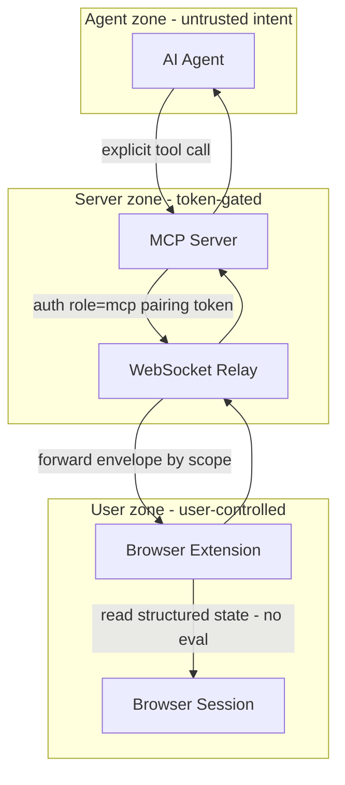

# Security and Trust Model

Brijio is built around explicit control and minimal trust. It connects remote AI agents to the browser session a user already controls, and it refuses to become a remote-desktop, session-cloning, or credential-extraction tool. The security posture is mostly architectural — explicit request/response flows, no continuous streaming, user-controlled connections, and progressive disclosure — rather than defensive code added on top.

The authoritative intent lives in `docs/security/THREAT_MODEL.md`, `docs/security/TRUST_BOUNDARIES.md`, and `docs/security/SECURITY_GUARANTEES.md`; the product contract that encodes the boundaries is `docs/project/CAPABILITY_MATRIX.md`. This page summarizes that intent and ties it to the runtime behavior that enforces it. For the runtime chain and request flow, see [Architecture](architecture.md); for the wire protocol shapes, see [Data and Protocol](data-and-protocol.md).

## Core trust assumptions

From `docs/security/THREAT_MODEL.md` and the root `README.md`:

- The user explicitly starts and controls the browser connection. The extension connects and disconnects only on explicit user action; there is no background auto-connect.
- Authentication tokens are held only by authorized parties and are kept secret by them.
- The browser session belongs to the user; Brijio operates on the session the user is already signed into, never a cloned one.
- The relay transports messages without needing to inspect content. It is intended as transport, not a data processor.

These assumptions are non-negotiable product invariants (see `AGENTS.md`): browser state is available only while the user-controlled extension is connected, every read or action is initiated by an explicit MCP tool or resource request, and no continuous page, DOM, screenshot, history, or browser-state streaming is added.

## Trust boundaries

The system has three trust zones separated by token-gated authentication and by the explicit request/response protocol. The relay sits in the middle but is trusted only to route, not to read.

Trust zones and the token-gated, read-only path between agent and browser session.

At each boundary:

- **Agent ↔ MCP server.** The agent is not trusted to limit itself to appropriate requests. The MCP HTTP server requires a bearer token (`MCP_HTTP_AUTH_TOKEN`) on every request and optionally enforces an origin allowlist (`MCP_HTTP_ALLOWED_ORIGINS`); unauthorized requests get `401` and disallowed origins get `403`. All tool/resource requests are validated against the protocol specification.
- **MCP server ↔ relay.** Both authenticate to the relay with the same pairing token (`BRIJIO_PAIRING_TOKEN`, plus optional `additionalPairingTokens`) but in two roles: `extension` and `mcp`. The relay trusts the MCP server only as an authorized consumer and trusts the MCP server's claim of the target browser.
- **Relay ↔ browser extension.** The extension authenticates with the pairing token (role `extension`). The relay routes between authenticated parties by request id; it does not need to inspect payloads. The extension does not trust the relay for confidentiality — end-to-end encryption is planned to make this boundary stronger.
- **Extension ↔ browser session.** The extension runs in the user's browser with only the permissions the user granted. It does not trust web page content: page data is read as structured context, never executed or evaluated.

## Security goals

The threat model lists the goals the design is optimized for:

- Protect browser sessions (keep authenticated state local and user-controlled).
- Avoid credential exposure (no password/passkey/MFA collection).
- Minimize unnecessary data transfer (progressive disclosure, no streaming).
- Reduce trust in relay infrastructure (relay is transport, not a data processor).
- Maintain user control (explicit connect/disconnect, explicit per-call requests).

## Threat classes and mitigations

The threat model (`docs/security/THREAT_MODEL.md`) names four attacker classes. The mitigations are architectural and are enforced in the runtime.

### Malicious agent

An agent that attempts to access data beyond what was explicitly requested, exfiltrate browser state, or perform unauthorized actions.

Mitigations:

- Explicit request/response protocol — no data flows without an explicit MCP tool or resource call.
- No continuous streaming by design — the extension is reactive and answers specific requests.
- User-controlled browser connection — the bridge is inactive until the user connects and can be disconnected at any time.
- Progressive disclosure limits data exposure — structured context first, larger content only when requested.
- Client-side action approval for sensitive actions (e.g. form submission) — the controller requests user approval before executing approval-gated actions and returns `approval_denied` when the user denies.

### Compromised relay server

A relay that attempts to inspect, modify, or log traffic between agents and browsers.

Mitigations:

- The relay routes messages without requiring content access; it selects a browser by `target.browserInstanceId` and forwards the full envelope, correlating responses by request id.
- Authentication is per-connection and token-scoped: the relay derives a sha256 scope key from the accepted token and isolates presence and routing per scope, so one token's browsers are not visible to another.
- User-controlled infrastructure allows self-hosting (local relay, daemon, or Docker).
- Future end-to-end encryption will prevent content inspection by the relay.

### Network attacker

An attacker on the network path between agent, relay, and browser.

Mitigations:

- TLS for all transports (production deployments).
- Authentication tokens for all connections (pairing token for the relay, bearer token for MCP HTTP).
- Future E2E encryption will add defense in depth.

### Malicious website

A website that attempts to exploit the extension or inject content that misleads the agent.

Mitigations:

- The extension follows a least-privilege permission model and requests regular page-access permission at runtime (Chrome) or grants broad host access at install (Safari).
- The structured protocol prevents arbitrary code execution — the extension reads DOM as data and performs discrete, validated actions.
- Content is read, not evaluated: readable-content extraction skips `script`, `style`, `template`, `noscript`, hidden elements, and form control values; page context reports form controls with a `sensitive` flag (email, password, tel, number, search) and a `valueState` of `empty`/`filled`/`unknown` rather than the value itself.

## Explicit non-goals

These are product boundaries, not missing features. The capability matrix marks each as 🚫 Intentionally unsupported. Brijio intentionally does not aim to provide:

- **Cookie export** — no authentication cookies, session cookies, or browser storage are exported; the browser session remains local.
- **Session cloning** — Brijio operates on the session the user already controls, not a duplicate authenticated environment.
- **Browser mirroring / remote desktop** — no window mirroring, desktop streaming, or remote desktop access.
- **Continuous screenshots** — screenshots, where planned, are explicit and logged, never automatic.
- **Continuous DOM streaming** — data is exchanged only on explicit request; agents poll via `read_current_page`.
- **Background surveillance** — the bridge is inactive until the user connects; keepalive messages carry no browser state.
- **Credential extraction** — passwords, passkeys, and MFA codes are never collected. Password fields are not writable: `fill_input`/`perform_write_text` against a `type="password"` control returns `unsupported_control`, and readonly/disabled controls return `target_readonly`/`target_disabled`.
- **MFA interception** — MFA challenges belong to the user.
- **Browser history collection** — outside project scope.

## Authentication and authorization model

The two token boundaries are the primary security controls; IP allowlists are explicitly not the boundary.

- **Relay pairing token** (`BRIJIO_PAIRING_TOKEN`, legacy alias `BRIJIO_TOKEN`). Both the extension (role `extension`) and the MCP server (role `mcp`) authenticate to the WebSocket relay with this token. The relay accepts a set of tokens (the configured token plus optional `additionalPairingTokens`), rejects unknown tokens with `auth_failed`, and on success derives a sha256 scope key from the accepted token. Presence and pending-request routing are keyed by scope, so browsers and requests under different tokens are isolated.
- **MCP HTTP bearer token** (`MCP_HTTP_AUTH_TOKEN`). Every MCP HTTP request must carry `Authorization: Bearer <token>`; the server rejects missing or mismatched tokens with `401 unauthorized`. An optional origin allowlist (`MCP_HTTP_ALLOWED_ORIGINS`, supporting exact and `*.host` wildcard matches) rejects disallowed origins with `403`.
- **Token generation and persistence.** Auto-generated tokens are ephemeral and change on restart unless persisted. For persistent or production setups, set `BRIJIO_PAIRING_TOKEN` and `MCP_HTTP_AUTH_TOKEN` explicitly (via env, `.env`, or the daemon's `~/.brijio/.env`). Never commit real tokens or user credentials.

## Change guidance

If you change authentication, routing, browser-state exposure, or page-reading behavior, re-check the security docs first. Many design choices are security choices, not just implementation choices:

- **Authentication / authorization changes** (new roles, token handling, approval flows) require an ADR and a review of `docs/security/THREAT_MODEL.md` and `docs/security/TRUST_BOUNDARIES.md`.
- **Routing changes** (scope keys, browser selection, `target.browserInstanceId`/`tabId` semantics) affect which parties can see which browsers; keep per-call explicit targeting and do not introduce hidden session-level selected-browser or selected-tab state.
- **Browser-state exposure changes** (new read surfaces, screenshots, downloads, network metadata) must preserve the explicit-request model and progressive disclosure; evaluate whether they expand trust in the relay or the agent.
- **Page-reading behavior changes** must keep content read-not-evaluated and must not begin streaming or exporting credentials, cookies, or history.

When a change alters a security boundary or guarantee, update `docs/security/*` and `docs/project/CAPABILITY_MATRIX.md` alongside the code, per `AGENTS.md`.

## Related pages

- [Architecture](architecture.md) — runtime chain and request flow.
- [Data and Protocol](data-and-protocol.md) — envelope, auth, presence, and payload contract.
- [Domains](domains.md) — domain ownership and cross-domain change ordering.

## Related source files

- `docs/security/THREAT_MODEL.md`
- `docs/security/TRUST_BOUNDARIES.md`
- `docs/security/SECURITY_GUARANTEES.md`
- `docs/project/CAPABILITY_MATRIX.md`
- `AGENTS.md`
- `README.md`
- `servers/websocket/src/server.ts` — relay auth, scope keys, presence, routing.
- `servers/websocket/src/protocol.ts` — `createScopeKey` (sha256).
- `servers/mcp/src/http-server.ts` — MCP HTTP bearer auth and origin allowlist.
- `packages/shared/src/page-context.ts` — `sensitive` flag, `valueState`, readable-content exclusion.
- `packages/shared/src/content-handler.ts` — password/readonly/disabled control rejection.
- `packages/shared/src/background-controller.ts` — keepalive (no state) and action approval.
