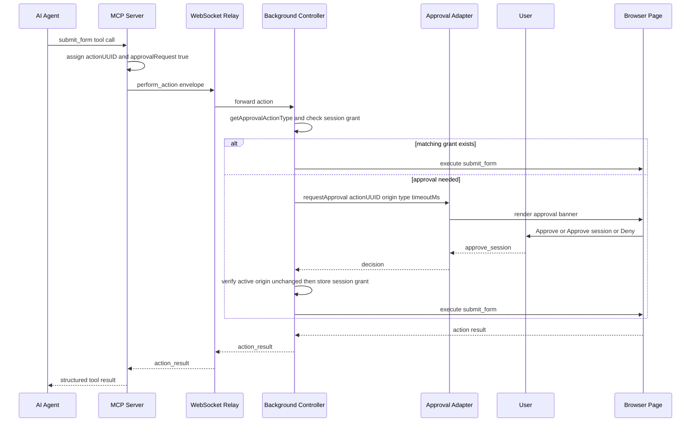

# Client-Side Action Approval Workflow

Brijio does not let agents silently exercise the user's authenticated browser
session. A small, hardcoded set of browser-mutating operations must be
explicitly approved by the user before they execute inside the connected
extension. This page documents that approval-gated workflow as specified by
[ADR 0048](../../docs/architecture/decisions/0048-client-side-action-approval.md):
which operations require approval, the `actionUUID` / `approvalRequest`
protocol that carries an approval-gated action from the MCP server to the
extension, the `approve_session` grant model, the in-page approval banner, and
the in-memory-only approval state that must never be persisted.

This lives on top of the [MCP ↔ WebSocket ↔ Extension flow](../architecture/mcp-extension-flow.md)
and the [WebSocket relay](../architecture/websocket-relay.md). The shared data
shapes are defined in `packages/shared` and described in the [Protocol and Data
Model Guide](../data-and-protocol.md); the security rationale belongs to the
[Security and Trust Model](../security.md).

## Why approval exists

The user explicitly starts and controls the bridge, and the browser session
belongs to the user. Form submission, authenticated resource fetching, and
download initiation can send user-entered data to a site, trigger navigation,
or start side-effecting server interactions. ADR 0048 adds a client-side
approval step for those operations so an agent cannot perform them in the
background. `AGENTS.md` records the invariant directly: preserve
user-visible connection state and configured client-side action approval, and
_do not bypass approval checks_.

Approval is intentionally not required for every action. Reads (`get_page_context`,
`get_page_content`, `list_tabs`), pure DOM actions (`click`, `write_text`,
`set_checked`, `select_options`, `upload_file`), and navigation (`navigate_to_url`,
`open_tab`) execute without a prompt. Only the hardcoded approval-gated set is
paused for a user decision.

## Which operations require approval

The first implementation hardcodes three approval-gated operations:

- `submit_form`
- `fetch_resource`
- `download_file`

All other actions do not require approval. Policy evaluation is centralized in
a small local function so the set can evolve without touching the action
execution pipeline. In the shared background controller the predicate is
`getApprovalActionType`, which maps an action type to the approval-gated
`ApprovalActionType` union or `undefined`:

```ts
export type ApprovalActionType =
  "submit_form" | "fetch_resource" | "download_file";

function getApprovalActionType(type: string): ApprovalActionType | undefined {
  if (
    type === "submit_form" ||
    type === "fetch_resource" ||
    type === "download_file"
  ) {
    return type;
  }
  return undefined;
}
```

`ApprovalActionType` is the single source of truth for what counts as
approval-gated. The MCP server marks these tools with `approvalRequest: true`
(see below), and the controller gates on the same set. ADR 0048 frames this as
stage one of a three-stage evolution: a hardcoded local list (this stage), then
configurable local policy, then an enterprise policy API — all behind a
`requiresApproval(operation)`-style function.

## The protocol shape

Every approval-gated operation carries a unique `actionUUID`, and carries
`approvalRequest: true`. These live on the action payload, not on the
envelope. The WebSocket envelope `id` remains the request/response correlation
identifier; the `actionUUID` identifies the specific action within a single
action request or a batch.

The shared protocol defines this as `ApprovalMetadata`, which the gated action
interfaces extend:

```ts
export interface ApprovalMetadata {
  actionUUID?: string;
  approvalRequest?: boolean;
}

export interface PerformSubmitFormAction extends ApprovalMetadata {
  type: "submit_form";
  target: FormSubmitTarget;
}
```

`DownloadFileRequest` and `FetchResourceRequest` extend `ApprovalMetadata` too,
so the same two fields appear on the standalone download/fetch payloads. Batch
actions (`BatchAction`) all carry `ApprovalMetadata`; only the gated ones set
`approvalRequest: true`.

### Single action request

For a single `submit_form`, the MCP server assigns a fresh `actionUUID` and sets
`approvalRequest: true` before sending the envelope:

```json
{
  "type": "message",
  "id": "mcp-123",
  "payload": {
    "type": "perform_action",
    "pageContextId": 12,
    "visibleContextId": "vc_abc",
    "action": {
      "type": "submit_form",
      "actionUUID": "550e8400-e29b-41d4-a716-446655440000",
      "approvalRequest": true,
      "target": { "formId": "bb-2", "expectedLabel": "Checkout" }
    }
  }
}
```

### Batch request

For `perform_batch`, _every_ batch item gets a unique `actionUUID`, and only the
gated items additionally set `approvalRequest: true`. This keeps approved, denied,
and timed-out actions individually identifiable inside the batch:

```json
{
  "type": "message",
  "id": "mcp-456",
  "payload": {
    "type": "perform_batch",
    "pageContextId": 12,
    "visibleContextId": "vc_abc",
    "actions": [
      {
        "type": "write_text",
        "actionUUID": "f9a7b8d1-9623-4a75-87fb-8f03656dc001",
        "target": { "formId": "bb-2", "controlId": "bb-5" },
        "text": "gianni@example.com"
      },
      {
        "type": "submit_form",
        "actionUUID": "f9a7b8d1-9623-4a75-87fb-8f03656dc002",
        "approvalRequest": true,
        "target": { "formId": "bb-2", "expectedLabel": "Checkout" }
      }
    ]
  }
}
```

The MCP server's `createActionUUID()` generates `action-${Date.now()}-…` ids,
and `addBatchActionApprovalMetadata` stamps each batch item with an `actionUUID`
(preserving any caller-supplied id) and adds `approvalRequest: true` only to
`submit_form` items. For the hardcoded first implementation only `submit_form`
is approval-gated inside `perform_batch`; `fetch_resource` and `download_file`
are standalone tools, not batch actions.

### Approval response/error payloads

Approval decisions and failures are returned as structured results keyed back
to the `actionUUID`. The `ActionResultErrorResponse.error` carries an optional
`actionUUID`; batch action errors (`BatchActionError`) carry `actionUUID` and
the existing `aborted` flag. A timeout on a single `submit_form` returns:

```json
{
  "type": "message",
  "id": "mcp-123",
  "payload": {
    "type": "action_result",
    "ok": false,
    "error": {
      "code": "approval_timeout",
      "message": "Timed out waiting for user approval.",
      "actionUUID": "550e8400-e29b-41d4-a716-446655440000"
    }
  }
}
```

The approval error codes are part of the shared `ActionResultErrorCode` union:
`approval_denied`, `approval_timeout`, `approval_unavailable`, and
`approval_origin_changed`.

## The approval grant model

The user chooses between three decisions, exposed by the
`ApprovalAdapter.requestApproval` contract:

- `approve` — approve only the current action.
- `approve_session` — approve this action _and_ future matching actions during
  the same bridge connection.
- `deny` — reject the current action.

`approve_session` is scoped to the pair `{ origin, actionType }`. The origin is
computed from the active tab URL at approval time; the action type is one of the
`ApprovalActionType` values above. Grants are stored in a `Set<string>` on the
shared background controller, keyed by `createApprovalGrantKey(origin,
actionType)`, which joins the two with a `U+0000` separator. Before executing an
approved action the controller verifies the active tab still has the same origin
and the same action type; if the origin changed, the action fails with
`approval_origin_changed` rather than reusing the grant.

The gating logic lives in `ensureApprovedAction`:

1. If the action is not approval-gated (`getApprovalActionType` returns
   `undefined`) or `approvalRequest !== true`, it executes immediately.
2. If the action is gated but missing an `actionUUID`, it fails with
   `approval_unavailable`.
3. If no `ApprovalAdapter` is configured, or the active origin cannot be read,
   it fails with `approval_unavailable`.
4. If a matching session grant already exists for `{ origin, actionType }`, the
   action executes without prompting.
5. Otherwise the controller calls `requestApproval`, racing the user decision
   against `approvalTimeoutMs` (default `55000`). A timeout hides the banner,
   cancels the pending approval, and returns `approval_timeout`; a deny returns
   `approval_denied`; after a non-timeout decision the controller re-reads the
   active origin and fails with `approval_origin_changed` if it moved; an
   `approve_session` adds the `{ origin, actionType }` key to the grant set.

### Approval-gated action round trip

The sequence below shows a single `submit_form` that is not yet covered by a
session grant. (A `fetch_resource` or `download_file` follows the same shape,
just without the `perform_batch` path.)



## Approval state is in-memory only

Pending actions and session grants live in extension/background memory only.
The background controller holds `approvalSessionGrants` as a plain `Set<string>`
instance field. ADR 0048 and `AGENTS.md` both state the invariant: **do not
store pending actions or grants in page `localStorage`, extension storage,
IndexedDB, or any other persistent store.** Grants are cleared when the bridge
disconnects, the extension reloads, or the browser session ends — concretely,
`disconnect()` calls `this.approvalSessionGrants.clear()` before closing the
socket. Because the state is process memory, a reload or session end discards it
automatically.

This keeps the MCP server stateless across per-tool invocations (it is commonly
instantiated per call and must not be the long-lived holder of approval state)
and keeps the relay a dumb router. The continuity that approval needs comes from
the live extension background session, not from any durable store. Agent polling
for approval status and a WebSocket-server status registry are explicitly out
of scope for this stage.

## The approval banner UI

Both the Chrome and Safari extensions render the approval banner through a
shared content-script helper, `showBrijioApprovalBanner`, which injects a
fixed-position `<section role="dialog">` (id `brijio-approval-banner`) into the
active page. The banner labels the request as `Brijio wants to ${actionType} on
${origin}` and offers three buttons: **Approve**, **Approve session**, and
**Deny**. Clicking a button removes the banner and resolves the decision;
`hideBrijioApprovalBanner(actionUUID)` removes it on timeout or cancel.

Each extension wires its own `ApprovalAdapter`:

- **Chrome** — `createChromeApprovalAdapter(chrome)` in
  `clients/extensions/chrome/src/background.ts` injects `content.js` into the
  active tab and sends a `show_brijio_approval` message carrying `actionUUID`,
  `actionType`, `origin`, and `timeoutMs`; `hide_brijio_approval` removes it.
- **Safari** — `createSafariApprovalAdapter(browser)` in
  `clients/extensions/safari/src/background.ts` mirrors that against the Safari
  `browser.*` API.

Both adapters compute the active origin from the active tab URL and return
`undefined` when the URL is not a regular HTTP(S) page. An unparseable or
non-decision response is treated as `deny` (`parseApprovalDecision` defaults to
`deny`), so the system fails closed. Approval checks must not be bypassed: if
the banner cannot be injected on a restricted page, the controller returns
`approval_unavailable` rather than executing the action.

## Timeout behavior

Approval-gated requests use an application-level approval timer owned by
Brijio. The timer must fire _before_ the local MCP HTTP server request timeout
so Brijio can return a structured `approval_timeout` error instead of letting
the HTTP server or client produce a generic timeout. The MCP HTTP server derives
it:

```text
approvalTimeoutMs = max(1000, httpRequestTimeoutMs - approvalTimeoutBufferMs)
```

Defaults are `BRIJIO_MCP_HTTP_TIMEOUT_MS=60000` and
`BRIJIO_APPROVAL_TIMEOUT_BUFFER_MS=5000`, yielding `approvalTimeoutMs=55000`.
That derived value is threaded into the MCP page-actions config and reaches the
shared background controller as `options.approvalTimeoutMs` (which defaults to
`55000` when unset). The MCP WebSocket client uses the same budget for standalone
approval-gated tools and for `perform_batch` when any item is approval-gated.
For remote or enterprise deployments behind infrastructure Brijio does not
control, the approval timeout must be configured below the shortest expected
client, proxy, gateway, or load-balancer timeout.

When the timer fires, the controller hides the banner, cancels the pending
approval, and returns `approval_timeout`. The user-facing default is roughly
30–60 seconds depending on the configured local HTTP timeout; the exact runtime
value is the computed `approvalTimeoutMs`.

## Approval-aware batches

`perform_batch` executes actions in order and treats every action independently,
preserving ADR 0044's ordered batch semantics. For each item the background
controller's `performApprovalAwareBatch`:

1. Executes non-gated actions normally.
2. Executes gated actions that already have a matching session grant normally.
3. For a gated action with no grant, shows the approval banner for that action
   only, one prompt at a time.
4. Continues to the next action only after the current action succeeds, is
   denied, or times out.

A batch is routed to the approval-aware runner only when `hasApprovalGatedAction`
detects an item that is both `approvalRequest === true` and maps to an
`ApprovalActionType`; otherwise it takes the plain synchronous batch path.

Denial is a focused per-action outcome, not a reason to abort the whole batch: a
denied item returns `approval_denied` for its `actionUUID` with `aborted: false`,
and the runner continues. The `approval_timeout` case is different — it is
request-level for the current synchronous implementation, not multiplied per
gated action. When the timer fires while a batch is waiting for approval, the
current action records `approval_timeout`, the banner is hidden, the runner marks
the batch `aborted`, appends focused `approval_timeout` (`aborted: true`) entries
for the remaining unexecuted actions, and returns a partial `batch_result`. The
MCP WebSocket client maps a partial-failure `batch_result` to a success so the
agent can see the per-item outcomes and retry the failed/missing actions in a
later call.

The `continueOnError` flag continues to apply to execution failures _after_ an
action is approved (stale targets, unsupported controls, browser errors), not to
approval failures. Page navigation remains special: if an executed action
navigates the page, remaining actions still abort because previously read page IDs
may no longer be valid.

## What to keep in sync when editing this area

- The approval-gated set is defined once by `ApprovalActionType` and
  `getApprovalActionType` in `packages/shared`; the MCP server's
  `addBatchActionApprovalMetadata` and `createApprovalRequestOptions` must stay
  aligned with it. Adding a gated operation means updating the shared type, the
  MCP envelope construction, the controller predicate, and the adapter UI
  together.
- `actionUUID` must be present on every batch item and on every gated single
  action, and echoed back on approval errors. The protocol validators in
  `packages/shared/src/protocol.ts` (`hasValidApprovalMetadata`) reject batch
  actions missing valid metadata.
- Approval state stays in `approvalSessionGrants` on the controller and is
  cleared on `disconnect()`. Do not add persistent storage for grants or pending
  actions without an accepted ADR superseding 0048.
- The approval timeout must stay below the HTTP request timeout with a safety
  buffer; keep `getMcpHttpServerOptionsFromEnv`, the page-actions config, and
  `approvalTimeoutMs ?? 55000` consistent.

## Related docs

- [ADR 0048 — Client-Side Action Approval](../../docs/architecture/decisions/0048-client-side-action-approval.md)
- [MCP ↔ WebSocket ↔ Extension flow](../architecture/mcp-extension-flow.md)
- [WebSocket relay](../architecture/websocket-relay.md)
- [Browser adapters](../concepts/browser-adapters.md)
- [Protocol and Data Model Guide](../data-and-protocol.md)
- [Security and Trust Model](../security.md)
- [Multi-tab Workflow](multi-tab.md)
