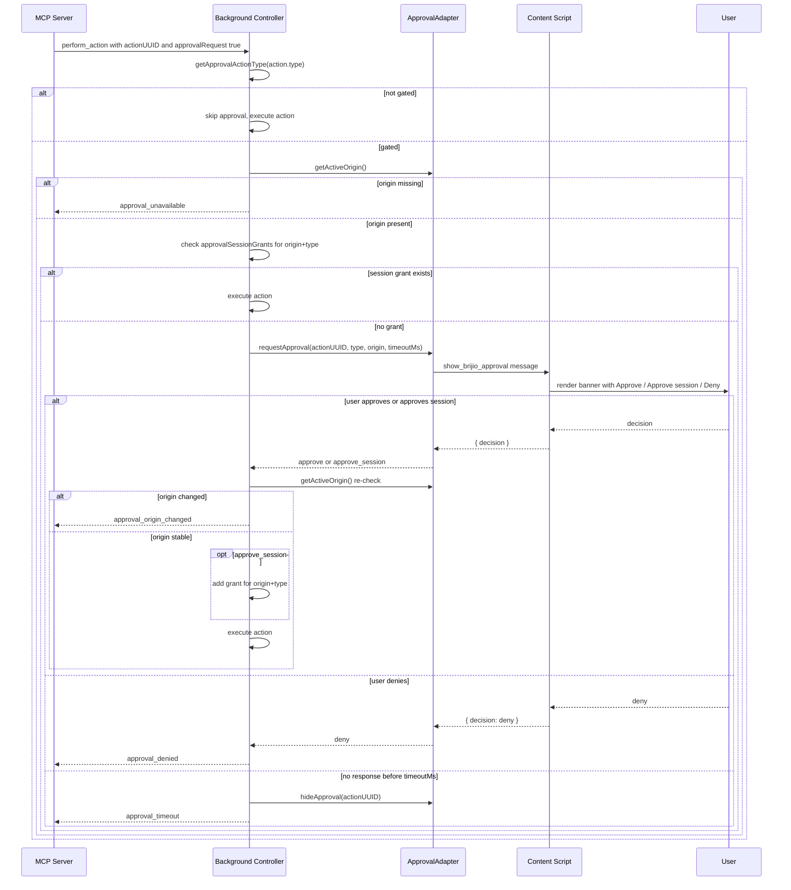
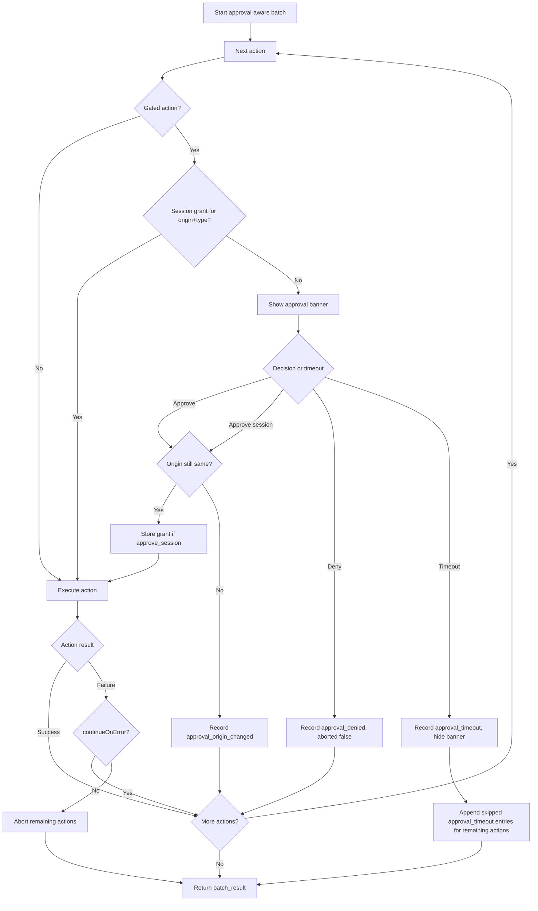

# Action Approval Workflow

Brijio requires explicit, user-visible browser-side approval before an agent
may execute a small set of high-risk actions: `submit_form`,
`fetch_resource`, and `download_file`. All other actions (`click`,
`write_text`, `set_checked`, `select_options`, `upload_file`, navigation,
reads) execute without an extra approval step. The design and motivation are
recorded in ADR 0048 (`docs/architecture/decisions/0048-client-side-action-approval.md`),
and the behavioral spec is the shared controller and its tests in
`packages/shared/src/background-controller.ts` and
`packages/shared/src/background-controller.test.ts`.

This page documents how the approval decision is requested, granted, timed
out, and surfaced to the agent, plus the extension banner UI lifecycle.

## Security invariant

From `AGENTS.md`: **preserve user-visible connection state and configured
client-side action approval. Do not bypass approval checks.** Approval policy
is hardcoded in the shared controller, and pending actions and session grants
are held in background memory only. They are never persisted to page
`localStorage`, extension storage, IndexedDB, or any other durable store, and
they are cleared when the bridge disconnects, the extension reloads, or the
browser session ends.

## Approval-gated actions

The shared controller decides whether an action is approval-gated through a
hardcoded local function, `getApprovalActionType`. It returns the action type
only for `submit_form`, `fetch_resource`, and `download_file`; every other
action type returns `undefined` and is executed directly. The MCP server is
responsible for assigning a unique `actionUUID` and setting `approvalRequest:
true` on each gated request before it forwards the action over the WebSocket.

Inside `perform_batch`, only `submit_form` is approval-gated; `fetch_resource`
and `download_file` are standalone tools, not batch actions. Each batch action
also receives its own `actionUUID` so approved, denied, or timed-out actions
can be identified individually within the batch result.

## The ApprovalAdapter contract

The shared `BrijioBackgroundController` does not know how to render UI. It
depends on a platform-provided `ApprovalAdapter` to talk to the active tab:

```ts
export type ApprovalActionType =
  "submit_form" | "fetch_resource" | "download_file";

export type ApprovalDecision = "approve" | "approve_session" | "deny";

export interface ApprovalRequest {
  actionUUID: string;
  actionType: ApprovalActionType;
  origin: string;
  timeoutMs: number;
}

export interface ApprovalAdapter {
  getActiveOrigin: () => Promise<string | undefined>;
  requestApproval: (request: ApprovalRequest) => Promise<ApprovalDecision>;
  hideApproval: (actionUUID: string) => Promise<void>;
}
```

- `getActiveOrigin` returns the active tab's origin, or `undefined` when there
  is no usable regular-page tab. The controller uses this both before
  requesting approval and again after the user decides, to detect that the
  tab navigated away.
- `requestApproval` shows the approval banner for the given `actionUUID` /
  `actionType` / `origin` and resolves to the user's decision. It must remain
  pending until the user chooses or the controller's approval timer fires.
- `hideApproval` removes a specific pending banner by `actionUUID`. The
  controller calls it on timeout so the banner does not linger after the
  request has failed.

The `ApprovalAdapter` is injected through `BrijioBackgroundControllerOptions`
(`approval?: ApprovalAdapter`, plus `approvalTimeoutMs?: number` which
defaults to `55000`). When no adapter is configured, gated actions fail with
`approval_unavailable` rather than executing silently.

## Approval decision flow

For every gated action, the shared controller calls `ensureApprovedAction`
before executing the underlying page action, download, or fetch. The decision
flow is:



The sequence above is the single-action path. `download_file` and
`fetch_resource` use the same `ensureApprovedAction` check before delegating
to the `DownloadAdapter`; `submit_form` uses it before delegating to the page
action.

## Session-scoped grants

`approve_session` lets a user avoid re-approving the same kind of action on
the same site for the rest of the bridge connection. A grant is scoped to the
pair:

```text
{ origin, actionType }
```

Internally the controller stores grants in an in-memory `Set<string>` keyed by
`` `${origin}\u0000${actionType}` `` (`approvalSessionGrants`). On the next
gated action, `ensureApprovedAction` checks this set first and short-circuits
to execution when a matching grant exists. Grants are cleared on `disconnect`
(`approvalSessionGrants.clear()`) and otherwise live only for the current
bridge connection.

The grant is not a blanket approval: before reusing it, the controller still
needs a usable active origin (it calls `getActiveOrigin` to compute the grant
key). When the user picks `approve` (not `approve_session`), no grant is
stored and the next identical action prompts again.

## Timeout and origin-change handling

The approval timeout is an application-level timer owned by the controller,
not by the MCP HTTP server. It must fire before the local MCP HTTP request
timeout so Brijio can return a structured approval error instead of a generic
HTTP timeout. ADR 0048 specifies the relationship:

```text
approvalTimeoutMs = httpRequestTimeoutMs - approvalTimeoutBufferMs
```

The controller's `waitForApprovalDecision` races
`ApprovalAdapter.requestApproval` against a `setTimeout` set to
`approvalTimeoutMs` (default `55000`). If the timer wins, it calls
`hideApproval(actionUUID)` to dismiss the banner and resolves to the
`'timeout'` sentinel, which `ensureApprovedAction` maps to the
`approval_timeout` error.

Origin change is checked separately. After a successful `approve` or
`approve_session` decision, the controller re-reads the active origin. If it
no longer matches the origin captured before the prompt, the action fails with
`approval_origin_changed` instead of executing, even though the user approved.
This makes the extension fail closed when the page navigates while a prompt is
visible. `approve` grants are not stored, so an origin change after `approve`
never creates a stale grant.

## Structured error codes

Approval failures are returned to the agent as structured action-result or
batch-result errors carrying the relevant `actionUUID`. The codes are part of
the `ActionResultErrorCode` union in `packages/shared/src/protocol.ts`:

- `approval_denied` — the user chose Deny. Message: `User denied approval for
{actionType}.`
- `approval_timeout` — the user did not respond before `approvalTimeoutMs`.
  Message: `Timed out waiting for user approval.`
- `approval_origin_changed` — the active tab origin changed between the
  prompt and execution. Message: `Active tab origin changed before approved
action could run.`
- `approval_unavailable` — the extension could not run the approval flow
  (no `ApprovalAdapter`, no active tab origin, or a missing `actionUUID`).

Errors include `actionUUID` when it is available on the request.

## Batch behavior

When a `perform_batch` contains any approval-gated action
(`hasApprovalGatedAction`), the controller routes the whole batch through
`performApprovalAwareBatch` instead of the content-script batch executor.
Actions run in order, one at a time, and each gated action is checked
independently:

1. A non-gated action executes normally.
2. A gated action with a matching session grant executes normally.
3. A gated action without a grant prompts for approval for that action only;
   the next action is not started until the current one succeeds, is denied,
   or times out.

A denial is a focused per-action outcome: the action records `approval_denied`
with `aborted: false` and the batch continues to the next action. An approval
timeout is request-level: the timed-out action records `approval_timeout` with
`aborted: true`, the banner is hidden, and the remaining unexecuted actions
are returned as failed entries with the message `Skipped because approval
timed out before this action.` The batch then returns a partial
`batch_result`. Actions already completed keep their results so the agent can
retry the rest later.

`continueOnError`, `readAfterActions`, and page-navigation abort semantics
(ADR 0044) still apply to execution failures that happen _after_ an action is
approved, such as stale targets or browser action errors. Approval denial and
timeout are handled by the approval-aware runner before those flags apply.



## Extension banner lifecycle

The `ApprovalAdapter` is platform-specific. Both Chrome and Safari implement
it the same way: query the active tab, ensure the content script is injected,
then `tabs.sendMessage` a `show_brijio_approval` message with the
`actionUUID`, `actionType`, `origin`, and `timeoutMs`. The content script
renders a fixed-position banner (`#brijio-approval-banner`) with three
buttons — **Approve**, **Approve session**, **Deny** — each tagged with
`data-brijio-approval-decision`. Clicking a button removes the banner and
sends `{ ok: true, decision }` back to the background, where it is parsed by
`parseApprovalDecision` (an unrecognized or missing decision is treated as
`deny`).

The banner lifecycle is:

- **Shown on request**: `requestApproval` injects `content.js` (idempotent)
  and sends `show_brijio_approval`. `showBrijioApprovalBanner` first removes
  any existing banner for that `actionUUID`, then prepends a fresh `section`
  to the document. The banner stores `dataset.brijioActionUuid` so it can be
  matched later.
- **Hidden on decision**: a button click removes the banner from the DOM and
  resolves the message. The controller does not need to call `hideApproval`
  on a normal decision because the content script already removed it.
- **Hidden on timeout**: when the approval timer fires, the controller calls
  `hideApproval(actionUUID)`, which sends `hide_brijio_approval`;
  `hideBrijioApprovalBanner` removes the banner element whose
  `dataset.brijioActionUuid` matches.

Safari and Chrome differ only in platform plumbing, which is platform-specific
and documented per adapter:

- Chrome uses the `chrome.*` namespace and prepends the banner to
  `document.body` (`clients/extensions/chrome/src/content-script-entry.ts`).
- Safari uses the `browser.*` namespace (per ADR 0019/0051), appends the banner
  to `document.documentElement`, and phrases the prompt as
  `Brijio wants approval to {action} on {origin}.`
  (`clients/extensions/safari/src/content-script-entry.ts`).
- Safari badges are text-only (no background or text color API); the badge
  color methods on `SafariActionBadge` are no-ops. These differences do not
  affect the approval contract or the decision values.

Both adapters share the same `parseApprovalDecision` fallback-to-`deny`
behavior and the same `show_brijio_approval` / `hide_brijio_approval`
message shapes, so the shared controller is agnostic to the platform.

## Where the pieces live

- **Decision logic and in-memory state** — `packages/shared/src/background-controller.ts`:
  `ApprovalAdapter`, `ApprovalDecision`, `ApprovalRequest`, `ApprovalActionType`,
  `ensureApprovedAction`, `waitForApprovalDecision`, `approvalSessionGrants`,
  `getApprovalActionType`, `hasApprovalGatedAction`, `createApprovalGrantKey`.
- **Error codes** — `packages/shared/src/protocol.ts` (`ActionResultErrorCode`
  includes `approval_denied`, `approval_timeout`, `approval_unavailable`,
  `approval_origin_changed`).
- **Chrome adapter and banner** — `clients/extensions/chrome/src/background.ts`
  (`createChromeApprovalAdapter`) and
  `clients/extensions/chrome/src/content-script-entry.ts`
  (`showBrijioApprovalBanner` / `hideBrijioApprovalBanner`).
- **Safari adapter and banner** — `clients/extensions/safari/src/background.ts`
  (`createSafariApprovalAdapter`) and
  `clients/extensions/safari/src/content-script-entry.ts`.
- **MCP assignment of actionUUID / approvalRequest** —
  `servers/mcp/src/websocket-client.ts` (`createActionUUID`,
  `createApprovalRequestOptions`, `addBatchActionApprovalMetadata`) and
  `servers/mcp/src/protocol.ts`.
- **Behavioral spec** — `packages/shared/src/background-controller.test.ts`
  (the approval tests named in ADR 0048: approve, deny, timeout, session-grant
  reuse, origin-changed, per-action batch denial, partial batch timeout, and
  session-grant reuse inside a batch).

For the broader request path that surrounds this flow, see
[Extension Adapters](../architecture/extension-adapters.md),
[MCP Extension Flow](../architecture/mcp-extension-flow.md), and the protocol
fields in [Data and Protocol](../data-and-protocol.md). Security intent and
trust boundaries are covered in [Security](../security.md).
