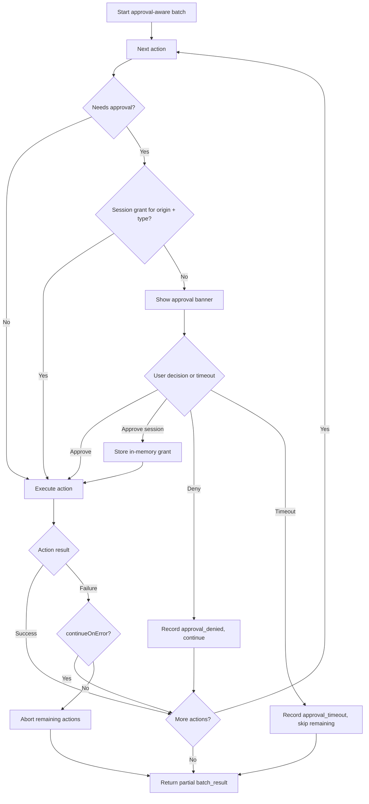

# Client-Side Action Approval Workflow

Brijio requires explicit, browser-side user approval before a small, hardcoded
set of actions that can send user-entered data to a site or trigger side
effects. Every other browser action still runs without a prompt. Approval is a
privacy boundary: the extension is user-controlled, browser state is only
reachable while the bridge is connected, and agents must not gain silent
background authority. The security rules in `AGENTS.md` make this an invariant
— _preserve user-visible connection state and configured client-side action
approval. Do not bypass approval checks._

This page covers what is gated, the end-to-end flow, the three user decisions
and their error semantics, timeout derivation, batch behavior, and where
approval state lives (and deliberately does not).

## Which actions are approval-gated

Approval is required for exactly three action types, hardcoded in the shared
background controller's `getApprovalActionType`:

- `submit_form` — can send entered data and trigger navigation or server-side side effects.
- `fetch_resource` — fetches a URL from the authenticated browser context.
- `download_file` — initiates a browser download.

Every action that is not in that set executes without a prompt. In particular,
reads (`get_page_context`, `get_page_content`, `capture_screenshot`,
`download_status`, `list_tabs`), clicks (`click`), fills (`write_text`,
`fill_input`, `fill_editable`, `set_checked`, `select_options`), file upload
(`upload_file`), navigation (`navigate_to_url`, `open_tab`), and ordinary
(non-approval-gated) batch actions are **not** approval-gated. `upload_file`
stages a payload but is not in the gated list; only `submit_form` is gated
inside `perform_batch`.

`getApprovalActionType` returns the action type only for `submit_form`,
`fetch_resource`, and `download_file`, and `ensureApprovedAction` treats any
action with `approvalRequest !== true` (or a type outside the gated set) as
immediately approved. This is the single place policy is evaluated, kept behind
a small local function so it can later delegate to local configuration or an
enterprise policy API without changing the execution pipeline.

## actionUUID and approvalRequest

Every approval-gated operation carries two protocol fields:

- `actionUUID` — a unique identifier for the specific action, assigned by the
  MCP server. For a single action it identifies the action; for
  `perform_batch` every batch item carries its own `actionUUID` so approved,
  denied, and timed-out actions are individually identifiable.
- `approvalRequest: true` — tells the extension to request user approval before
  execution.

The MCP WebSocket client assigns these. `createApprovalRequestOptions()`
generates a fresh `actionUUID` of the form `action-<timestamp>-<random>` and
sets `approvalRequest: true`; `requestSubmitForm`, `requestDownloadFile`, and
`requestFetchResource` attach it to their envelopes. For batches,
`addBatchActionApprovalMetadata` assigns an `actionUUID` to **every** batch
item and adds `approvalRequest: true` only to `submit_form` items. The
WebSocket envelope `id` remains the request/response correlation identifier;
`actionUUID` identifies the action _within_ a single or batch request and is
echoed on approval error payloads.

## End-to-end approval flow

The flow crosses four runtime boundaries — MCP server, WebSocket relay,
extension background controller, and content-script banner — before the user
decides.

```mermaid
sequenceDiagram
  participant Agent as AI Agent
  participant MCP as MCP Server
  participant WS as WebSocket Relay
  participant BG as Extension Background
  participant CS as Content Script
  participant User as User
  participant Page as Browser Page

  Agent->>MCP: submit_form (or fetch_resource, download_file)
  MCP->>MCP: assign actionUUID, approvalRequest true
  MCP->>WS: perform_action / download_file / fetch_resource
  WS->>BG: forward envelope
  BG->>BG: check session grant for origin + action type
  alt matching grant exists
    BG->>CS: execute submit_form
    CS->>Page: submit form
    Page-->>CS: action result
    CS-->>BG: action result
  else no grant, approval needed
    BG->>BG: race requestApproval vs approval timer
    BG->>CS: inject content.js, send show_brijio_approval
    CS->>User: render approval banner with Approve, Approve session, Deny
    User-->>CS: approve / approve_session / deny
    CS-->>BG: decision
    alt approve or approve_session
      BG->>BG: verify active origin unchanged; store grant if approve_session
      BG->>CS: execute submit_form
      CS->>Page: submit form
      Page-->>CS: action result
      CS-->>BG: action result
    else deny
      BG-->>WS: approval_denied
    end
  end
  alt timer fired before decision
    BG->>CS: hide_brijio_approval
    BG-->>WS: approval_timeout
  end
  WS-->>MCP: action_result
  MCP-->>Agent: structured tool result or approval error
```

_Approval flow from MCP tool call through the relay and extension background to
the content-script banner, with session-grant, deny, and timeout branches._

### Extension background: the approval owner

`BrijioBackgroundController.ensureApprovedAction` is the gate. For each action
it:

1. Resolves the action type via `getApprovalActionType`. If the type is not
   gated or `approvalRequest` is not `true`, it returns `{ ok: true }` with no
   prompt.
2. Requires a non-empty `actionUUID`. Missing or empty `actionUUID` returns
   `approval_unavailable` before any UI is shown.
3. Requires an `approval` adapter. If none is configured (the build does not
   support approval), returns `approval_unavailable`.
4. Reads the active tab origin via `approval.getActiveOrigin()`. If the origin
   is missing, returns `approval_unavailable` (the extension fails closed when it
   cannot establish a page to prompt on).
5. Checks the in-memory session grant set keyed by `origin\u0000actionType`. A
   matching grant short-circuits the prompt and executes.
6. Otherwise races `approval.requestApproval(request)` against an approval
   timer (`approvalTimeoutMs`, default `55000`). On timeout it calls
   `approval.hideApproval(actionUUID)` and returns `approval_timeout`.
7. On `deny` returns `approval_denied`.
8. On `approve`/`approve_session`, re-reads the active origin and compares it
   to the origin at prompt time. If it changed, returns
   `approval_origin_changed` and does **not** execute. If unchanged and the
   decision was `approve_session`, it records the grant before executing.

### Content-script banner

The extension background does not own the DOM. It injects the content script
and sends a `show_brijio_approval` message carrying `actionUUID`,
`actionType`, `origin`, and `timeoutMs`. The content script (`content-script-entry.ts`)
renders a fixed-position `role="dialog"` banner labeled
"Brijio wants to `<humanized actionType>` on `<origin>`" with three buttons:
`Approve`, `Approve session`, and `Deny`. A button click removes the banner and
returns `{ ok: true, decision }` to the background via the `sendResponse`
callback. The background sends a matching `hide_brijio_approval` message to
remove the banner on timeout (or once the decision resolves). The Chrome adapter
parses the response and coerces any unrecognized/missing decision to `deny`, so a
broken banner cannot silently default to approval.

## The three decisions

- **`approve`** — approve only the current action. The grant set is _not_
  updated, so the next matching action prompts again.
- **`approve_session`** — approve this action and future matching actions during
  the same bridge connection. The grant is scoped to `{ origin, actionType }`
  (for example `https://example.com` + `submit_form`), stored in
  `approvalSessionGrants`, and reused by `ensureApprovedAction`'s grant check.
  The origin is recomputed from the active tab URL at _approval_ time; before
  executing any approved action the background re-reads the origin and fails
  with `approval_origin_changed` if the user navigated away.
- **`deny`** — reject the current action. Returns `approval_denied` with the
  action's `actionUUID`; the action does not execute.

A fourth outcome, **timeout**, is not a user decision but an extension-owned
timer firing before the user responds: the banner is hidden, the pending
approval is cancelled, and `approval_timeout` is returned with `actionUUID`.

### Error codes

Approval-specific error codes are forwarded as structured action errors:

- `approval_denied` — user denied the action.
- `approval_timeout` — user did not respond before the computed approval timeout.
- `approval_unavailable` — the extension could not render the approval UI (no
  adapter, no active tab origin, or a missing `actionUUID`).
- `approval_origin_changed` — the active tab origin changed between prompt and
  execution.

Single-action errors include `actionUUID` when available; batch errors include
`actionUUID` and an `aborted` flag following existing batch result conventions.

## Timeout derivation

Approval timeout is an application-level timer owned by Brijio, not the HTTP
layer. It must fire _before_ the local MCP HTTP request timeout so Brijio can
return a structured `approval_timeout` instead of a generic HTTP timeout. The
MCP HTTP server computes it from environment:

```text
approvalTimeoutMs = httpTimeoutMs - approvalTimeoutBufferMs
```

with defaults `BRIJIO_MCP_HTTP_TIMEOUT_MS=60000` and
`BRIJIO_APPROVAL_TIMEOUT_BUFFER_MS=5000`, yielding `55000` ms (clamped to a
minimum of `1000`). The same budget is threaded into the WebSocket client as
`approvalTimeoutMs` for the gated single tools and for batches that contain a
gated action, and into the background controller (also defaulting to `55000`).
For remote or enterprise deployments behind infrastructure Brijio does not
control, the timeout must be explicitly configured below the shortest expected
client, proxy, gateway, or load-balancer timeout.

## Batch approval

`perform_batch` runs approval-gated items one at a time in the extension
background, not in the content-script batch executor. When a batch contains any
approval-gated action (`hasApprovalGatedAction`), the background routes the
whole request through `performApprovalAwareBatch`, which sequences actions and
owns the pending queue, approval timers, session grants, and final result
assembly. Non-gated batches skip this path and delegate to the content-script
`executeBatch`.

Per action in an approval-aware batch:

1. If the action does not require approval, execute it normally.
2. If it requires approval and a matching session grant exists, execute it.
3. Otherwise show the banner for that action only and wait for a decision or
   timeout before continuing.

This preserves ordered batch semantics. Denial is a focused per-action outcome,
not a batch abort: a denied action returns `approval_denied` for its
`actionUUID` and the runner continues to the next action. Approval timeout is
request-level, not multiplied per action: when the timer fires while a batch is
waiting, the current action records `approval_timeout`, the banner is hidden,
and remaining unexecuted actions are returned as skipped `approval_timeout`
entries (`aborted: true`) so the agent can retry them later. Already-completed
actions keep their results. `continueOnError` still governs _execution_
failures after approval (stale targets, unsupported controls, browser errors);
page navigation remains special — an action that navigates aborts remaining
actions because previously read page IDs may no longer be valid.



_Per-action approval sequencing inside an approval-aware `perform_batch`,
showing the focused deny/timeout outcomes that leave remaining actions
retryable._

## Where approval state lives (and does not)

The MCP server is commonly instantiated per tool invocation and must **not**
hold approval state. Continuity lives in the extension and the WebSocket relay,
which already represent the live browser session and connection-routing
boundary:

- **Pending actions and session grants are in-memory only**, in the background
  controller (`approvalSessionGrants` is a `Set`). They are never written to
  page `localStorage`, extension storage, IndexedDB, or any persistent store.
- **Grants are cleared when the bridge disconnects** (the `disconnect` path
  clears `approvalSessionGrants`), when the extension reloads, or when the
  browser session ends. Reconnecting does not restore prior approvals.
- **`approve_session` is scoped to `{ origin, actionType }` for the current
  connection only.** It is intentionally not persisted across connections.

This keeps MCP stateless across per-invocation processes while the long-lived
extension owns the policy state. The design reserves a future path (not yet
implemented) where the extension pushes approval/action state updates to the
relay, the relay keeps a session-scoped in-memory registry keyed by
`actionUUID`, and a future MCP tool polls status by `actionUUID` — still
without a long-lived MCP process or persistent approval storage.

## Security invariant

AGENTS.md states the rule directly: _preserve user-visible connection state and
configured client-side action approval. Do not bypass approval checks._ The
implementation enforces it by construction — the only execution path for a
gated action goes through `ensureApprovedAction`, which returns an error and
does not execute when the adapter, origin, or `actionUUID` is missing, when the
user denies, when the timer fires, or when the origin changes. There is no
auto-approval path based on form contents or labels, and approvals are never
persisted beyond the live bridge connection.

## Related pages

- [MCP ↔ WebSocket ↔ Extension Flow](../architecture/mcp-extension-flow.md) — the generic request/response path this approval flow rides on.
- [Browser Content Pipeline](../architecture/browser-content-pipeline.md) — how content-script actions are injected and executed.
- [Data and Protocol](../data-and-protocol.md) — envelope, `actionUUID`, and error-code definitions.
- [Security](../security.md) — the privacy boundary and approval invariant.
- [Multi-Tab Workflow](../workflows/multi-tab.md) — tab targeting that approval's active-origin check depends on.
