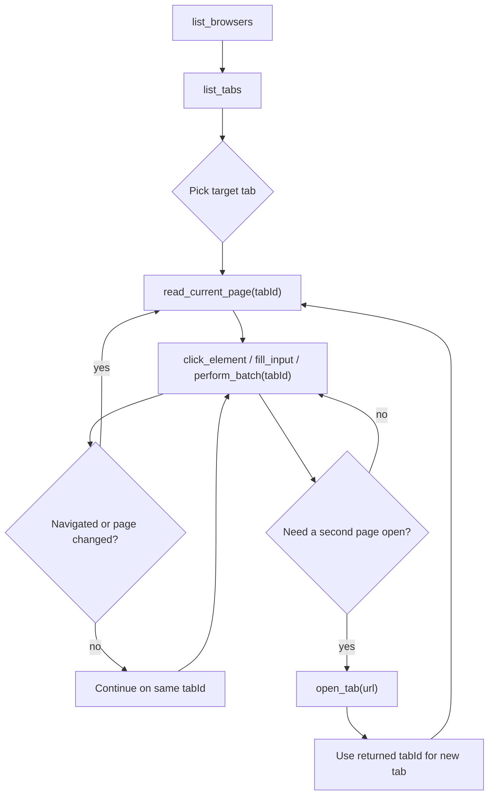

# Multi-tab Workflow

Brijio supports explicit per-call tab targeting through an optional `tabId`
parameter on the main browser interaction tools. Targeting is **per-call and
stateless**: there is no hidden "selected tab" session state, mirroring how
`browserInstanceId` works. When `tabId` is omitted, every tool falls back to the
active tab in the current window, so pre-existing single-tab workflows keep
working unchanged.

The end-to-end path of a `tabId` through the stack is covered in detail on
[MCP ↔ WebSocket ↔ Extension Flow](../architecture/mcp-extension-flow.md); this
page focuses on the agent-facing workflow, the tools that participate, and the
behavior guarantees the implementation actually provides.

## Recommended workflow

1. Call `list_browsers` to confirm a browser is connected (and note the
   `browserInstanceId` if several are connected).
2. Call `list_tabs` to discover open tabs in that browser.
3. Choose the tab you want to work on.
4. Pass that tab's `tabId` into subsequent read, action, batch, navigation,
   download, and fetch calls.
5. Keep using the same `tabId` until you intentionally switch tabs.
6. Re-read the page after navigation or any mutation that may invalidate the
   page snapshot — short-lived element IDs expire when the page changes.



_Figure: The discover → target → act → re-read cycle. `open_tab` adds a second
target without disturbing the first tab._

## Discovering tabs with `list_tabs`

The `list_tabs` MCP tool (`servers/mcp/src/list-tabs-tool.ts`, registered in
`servers/mcp/src/mcp-server.ts`) asks the connected extension for all open
tabs. Each entry carries:

| Field       | Meaning                                                          |
| ----------- | ---------------------------------------------------------------- |
| `tabId`     | Raw Chrome/Safari tab ID as a string — the targeting handle      |
| `windowId`  | Window identifier (currently reported as `'0'` by both adapters) |
| `title`     | Page title                                                       |
| `url`       | Full URL                                                         |
| `active`    | Whether this is the user's focused tab                           |
| `supported` | Always `true` for listed tabs                                    |

Both the Chrome and Safari extensions implement the shared `TabListerAdapter`
by querying **all** tabs (`tabs.query({})`) and filtering to regular HTTP/HTTPS
pages with `isRegularPageUrl()`; internal scheme pages (`chrome://`,
`about:`, `file://`, …) and tabs without an id or URL are excluded. The
controller's `handleListTabsRequest` returns a `not_supported` error when the
connected extension does not provide a `tabLister` adapter.

**`tabId` is a string**, not a number. Pass the exact value `list_tabs`
returned; tool wrappers reject an empty-string `tabId` with
`invalid_tool_input`.

## Tools that accept `tabId`

Per-call `tabId` input is registered in `servers/mcp/src/mcp-server.ts` via
the shared `tabIdInput` schema and threaded through each tool file into
`page-actions.ts` / `page-context.ts` and the WebSocket envelope's
`target.tabId`:

- `read_current_page` (and its paginated content chunks)
- `click_element`, `fill_input`, `fill_editable`, `set_checked`,
  `select_options`, `submit_form`, `upload_file`
- `perform_batch`
- `navigate_to_url`
- `download_status`, `download_file`, `fetch_resource`, `capture_screenshot`

Two tools deliberately do **not** take a `tabId`:

- `list_tabs` — it enumerates tabs rather than acting on one.
- `open_tab` — it creates a tab, so there is no target yet; it _returns_ the
  new tab's `tabId` instead.

`page-actions.ts` also supports a `config.defaultTabId` fallback (analogous to
`defaultBrowserInstanceId`) applied when the caller omits `tabId`, but the
MCP server does not populate it — the effective default is always the active
tab.

## Opening new tabs with `open_tab`

The `open_tab` tool (`servers/mcp/src/open-tab-tool.ts`) opens a new browser
tab at a given HTTP(S) URL and returns the new tab's `tabId` (plus `url` and
`title`). Use it when a workflow needs two pages open simultaneously —
comparison tasks, cross-referencing, auth flows — without disrupting the
user's current tab. `navigate_to_url` on the current tab would destroy the page
state (form input, scroll position) the agent was working on; `fetch_resource`
returns raw HTML without rendering or DOM interaction.

Behavior guarantees from the implementation:

- **URL validation happens at two layers.** The tool file rejects non-empty
  invalid URLs with `invalid_tool_input` and non-HTTP(S) schemes with
  `unsupported_scheme` before anything is sent; the extension adapters create
  the tab via `chrome.tabs.create({ url })` / `browser.tabs.create({ url })`.
- **The response returns immediately after the tab is created** — it does not
  wait for the page to load, and `title` may be empty. Always call
  `read_current_page` on the returned `tabId` to verify the page loaded, the
  same as after `navigate_to_url`.
- **The new tab may not be the active foreground tab.** Omitting `tabId` on
  subsequent calls would silently target the _active_ tab, which may be a
  different page. Always pass the returned `tabId`.
- **Errors:** `open_tab_failed` when the browser reports an error creating the
  tab (e.g. pop-up blocking), and `not_supported` when the connected extension
  does not provide the `pageOpenTab` adapter. The controller wraps adapter
  throws in an `open_tab_failed` response.
- **No lifecycle management.** There is no `close_tab` and no tab ownership
  tracking; the user closes tabs the agent opened. The agent can re-run
  `list_tabs` to discover them.

## How `tabId` flows through the stack

The relay routes by `browserInstanceId` and forwards the envelope — including
`target.tabId` — unchanged. The extension-side `BrijioBackgroundController`
(`packages/shared/src/background-controller.ts`) extracts `target.tabId` once
per message (`extractTabId`, parsing the string to a number) and threads it
into the page-context, page-content, action, batch, and navigation handlers
and their adapter interfaces. The shared `page-reader.ts` helpers
(`readActiveTabPage`, `performActiveTabAction`, `performActiveTabBatch`) use the
provided numeric tab id directly and skip the active-tab query; when it is
absent they fall back to `tabs.query({ active: true, currentWindow: true })`
and validate the URL is a regular HTTP/HTTPS page. `navigateActiveTabToUrl` in
both extensions follows the same pattern, updating the targeted tab.

One consequence worth knowing: when `tabId` **is** provided, the shared
helpers skip the `isRegularPageUrl` check they apply to the active tab — the
agent is trusted to have obtained the id from `list_tabs`, which already
filters to regular pages. If a targeted tab navigates to a restricted scheme
after discovery, content-script injection simply fails and surfaces
`content_script_unavailable` (or `regular_page_permission_required` when the
permission check fails).

## User visibility: the tab indicator

When the shared page reader acts on a tab, it sends
`show_brijio_tab_indicator` to that tab's content script (best-effort,
errors swallowed). The content script:

- prepends `● ` to `document.title` (visible in the browser tab bar even for
  background tabs) and re-applies the prefix through a `MutationObserver` if
  the page changes its own title;
- injects a persistent blue banner ("Brijio is active on this tab") into the
  page;
- auto-hides the whole indicator after 60 seconds of inactivity, restoring the
  original title.

So the user can always see which tab the agent is operating on — including
background tabs.

## Stale context and re-reads

Short-lived element IDs (`e5`, `f2`, `a1`, form IDs) from a
`read_current_page` snapshot expire on navigation or DOM updates, and actions
validate against `pageContextId` / `visibleContextId` versions
(`stale_context`, `page_navigated` errors). This protection is per-tab by
construction: each read produces its own context, so an action on tab A cannot
use a context read from tab B. After `navigate_to_url` on a specific tab,
re-read **that same tab**:

```
navigate_to_url(url: "https://example.com", tabId: "97212078")
read_current_page(tabId: "97212078")
```

## What to watch for when editing this area

- If you change any MCP tool that touches page state, confirm whether it
  should accept `tabId`, then wire it end to end: schema in `mcp-server.ts`,
  extraction in the tool file, forwarding in `page-actions.ts` /
  `page-context.ts`, `target.tabId` in `websocket-client.ts`, and extraction
  plus adapter forwarding in `background-controller.ts`.
- Update the `using-brijio` and `navigation` skills together with tool behavior
  changes — they document the agent-facing workflow and error codes.
- Keep extension adapters (Chrome and Safari `background.ts`) in sync with
  the shared `page-reader.ts` behavior; both must forward `tabId` the same way.
- Do not introduce hidden selected-tab session state. Targeting is per-call
  only; the fallback when `tabId` is omitted is the active tab, not a
  remembered tab.

## Focused tests

- `packages/shared/src/page-reader.test.ts` — covers `tabId`-targeted
  reads/actions/batches: with a `tabId` the helpers message that tab and never
  call `tabs.query`; without one they fall back to the active tab.
- `packages/shared/src/background-controller.test.ts` — covers `extractTabId`
  extraction and forwarding to every handler, plus list-tabs dispatch.
- `clients/extensions/chrome/src/background.test.ts` and
  `clients/extensions/safari/src/background.test.ts` — cover `tabLister`
  filtering (regular pages only, missing id/URL excluded, `browser_error` on
  query failure) and `navigateActiveTabToUrl` with and without `tabId`.
- `servers/mcp/src/index.test.ts`, `list-tabs-tool.test.ts`, and
  `protocol.test.ts` — cover the registered tool surface (including
  `open_tab`), tool input validation, and protocol round-trips.

## Related docs

- [MCP ↔ WebSocket ↔ Extension Flow](../architecture/mcp-extension-flow.md) — hop-by-hop trace of `tabId` through the stack
- [MCP Server](../architecture/mcp-server.md) — tool registration and skills
- [Browser Extensions](../architecture/browser-extensions.md) — adapter shape
- [Shared Package](../architecture/shared-package.md) — controller and page reader ownership
- [ADR 0060 — Explicit tab listing and selection](../../docs/architecture/decisions/0060-explicit-tab-listing-and-selection.md)
- [ADR 0062 — Thread tabId through the action stack](../../docs/architecture/decisions/0062-thread-tabid-through-action-stack.md)
- [ADR 0063 — Open tab action](../../docs/architecture/decisions/0063-open-tab-action.md)
