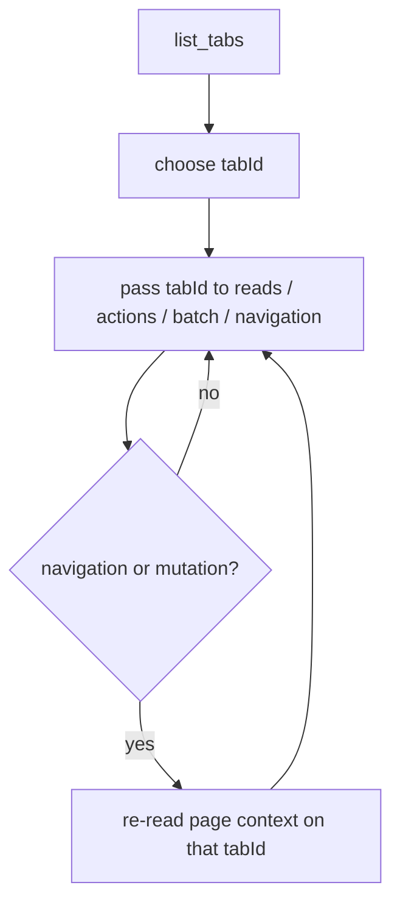

# Multi-tab Workflow

Brijio targets tabs **explicitly, per call**. Every tab-operating MCP tool
accepts an optional `tabId` input (a string, e.g. `"97212078"`) that selects
which connected browser tab the call acts on. When `tabId` is omitted the call
falls back to the browser's active foreground tab. There is deliberately no
hidden "selected tab" session state — targeting is stateless and explicit in
the same way `browserInstanceId` is, so an agent never has to worry about a
stale implicit target. This design is established by
[ADR 0060](../../docs/architecture/decisions/0060-explicit-tab-listing-and-selection.md)
(listing + per-call `tabId`) and
[ADR 0062](../../docs/architecture/decisions/0062-thread-tabid-through-action-stack.md)
(threading `tabId` end-to-end through the action stack); creating new tabs is
covered by
[ADR 0063](../../docs/architecture/decisions/0063-open-tab-action.md).

## The recommended workflow



1. **List tabs.** Call `list_tabs` to discover the connected browser's open
   tabs. Each returned tab carries a `tabId`, `windowId`, `title`, `url`, an
   `active` flag, and a `supported` flag. Only HTTP/HTTPS tabs are listed;
   `chrome://`, `chrome-extension://`, `about:`, `file://`, and incognito tabs
   are filtered out.
2. **Choose a tabId.** Pick the `tabId` for the tab you intend to work on —
   including background tabs. Pass the exact string returned by `list_tabs`;
   `tabId` is a string, not a number.
3. **Pass `tabId` to every subsequent call.** Reads (`read_current_page`,
   `read_resource`), interactions (`click_element`, `fill_input`,
   `fill_editable`, `set_checked`, `select_options`, `submit_form`,
   `upload_file`), `perform_batch`, `navigate_to_url`, and
   `capture_screenshot` all accept `tabId`. Keep using the same `tabId` until
   you intentionally switch tabs. If you also have multiple browsers
   connected, pass `browserInstanceId` too — omitting it then returns
   `ambiguous_browser_target`.
4. **Re-read after navigation or mutations.** After `navigate_to_url`, a form
   submission, a click that navigates, or any other change that invalidates the
   page snapshot, call `read_current_page` with the same `tabId` before
   touching new elements. Short-lived element IDs (`e5`, `f2`, `a1`, form IDs)
   expire when the page changes; reusing them fails with `stale_context` or
   `page_navigated`. `navigate_to_url` and `open_tab` return only URL/title
   metadata — they do **not** return fresh element IDs, so a follow-up read is
   mandatory.

## Active-tab fallback

When `tabId` is omitted, the extension resolves the active tab itself via
`tabs.query({ active: true, currentWindow: true })` and uses that tab's ID.
This fallback is implemented in the shared page reader (`readActiveTabPage`,
`performActiveTabAction`, `performActiveTabBatch`) and in each extension's
navigation adapter (`navigateActiveTabToUrl`). When `tabId` **is** provided,
the adapter skips the active-tab query and uses the given numeric ID directly,
still validating that it is a regular HTTP/HTTPS page. The fallback makes the
`tabId` parameter backward-compatible: existing single-tab workflows keep
working unchanged, while multi-tab workflows simply start passing `tabId`.

Because there is no server-side "current tab" state, omitting `tabId` is only
safe when there is no tab ambiguity. The user's focused tab is what you get —
which may be a different page than the one an agent opened in the background.

## Opening new tabs for simultaneous-page workflows

`open_tab(url)` opens a new browser tab at an HTTP(S) URL and **returns the new
tab's `tabId`**. Use it when a workflow needs two pages open at once —
comparison tasks, cross-referencing data from two sources, opening an auth flow
without losing the page you were working on — without disrupting the user's
current tab.

```
open_tab(url: "https://example.com")   → { tabId: "12345", url, title }
read_current_page(tabId: "12345")      → page context with fresh IDs
click_element(kind: "link", id: "e5", tabId: "12345")
```

Always pass the returned `tabId` to subsequent calls on the new tab. The new
tab may not be the active foreground tab, so omitting `tabId` could target the
wrong page. `open_tab` mirrors `navigate_to_url` in protocol shape but differs
in intent: `navigate_to_url` navigates an existing tab (defaulting to the
active tab) and destroys its current page state; `open_tab` creates a tab and
leaves the current one intact. The agent cannot close tabs it opens (that is
deferred); the user closes them, or the agent re-discovers them via
`list_tabs`.

`open_tab` does not wait for the new page to fully load before returning, so a
follow-up `read_current_page` on the returned `tabId` both verifies the page
loaded and yields fresh element IDs. Only HTTP/HTTPS URLs are accepted; other
schemes return `unsupported_scheme`.

## Editing guidance for this area

Keep the multi-tab contract consistent across layers when changing it:

- **Every MCP tool that touches page state should accept `tabId`.** The tool
  normalizes it (a non-empty string, else `invalid_tool_input`) and threads it
  into the WebSocket envelope's `target.tabId`. If you add a new tab-operating
  tool, add `tabId` to its input schema and forward it through `page-actions.ts`
  / `page-context.ts`.
- **Update skills and ADRs together.** The `using-brijio` skill (tool table,
  Multi-Tab Targeting, Opening New Tabs sections) and the `navigation` skill
  (`navigate_to_url` and `open_tab` workflows) must reflect any tool behavior
  change. See `servers/mcp/skills/using-brijio/SKILL.md` and
  `servers/mcp/skills/navigation/SKILL.md`.
- **Keep the extension adapters in sync.** Tab targeting lives in two optional
  adapter interfaces on `BrijioBackgroundController`: `TabListerAdapter`
  (`list_tabs`) and `PageOpenTabAdapter` (`open_tab`), plus the `tabId`-aware
  `PageReaderAdapter`, `PageActionAdapter`, `PageBatchAdapter`, and
  `PageNavigationAdapter`. Chrome and Safari must both implement any change
  with parity — both use the same `browser.tabs` / `chrome.tabs` APIs. See
  [Extension Adapters](../architecture/extension-adapters.md) for the adapter
  model.
- **When `tabLister` or `pageOpenTab` is undefined, the controller returns a
  `not_supported` error** rather than falling back — use this pattern for any
  future tab capability.

The MCP-side target (`tabId` in the envelope `target`) and the extension-side
resolution are documented in [MCP to WebSocket to Extension
Flow](../architecture/mcp-extension-flow.md); the agent-facing tool surface and
common targeting inputs (`tabId`, `browserInstanceId`) are summarized in [MCP
Tool and Skill Surface](../architecture/mcp-tool-surface.md). The protocol
shapes for `list_tabs` / `open_tab` and the `target.tabId` envelope field are
covered in [Data and Protocol](../data-and-protocol.md).
