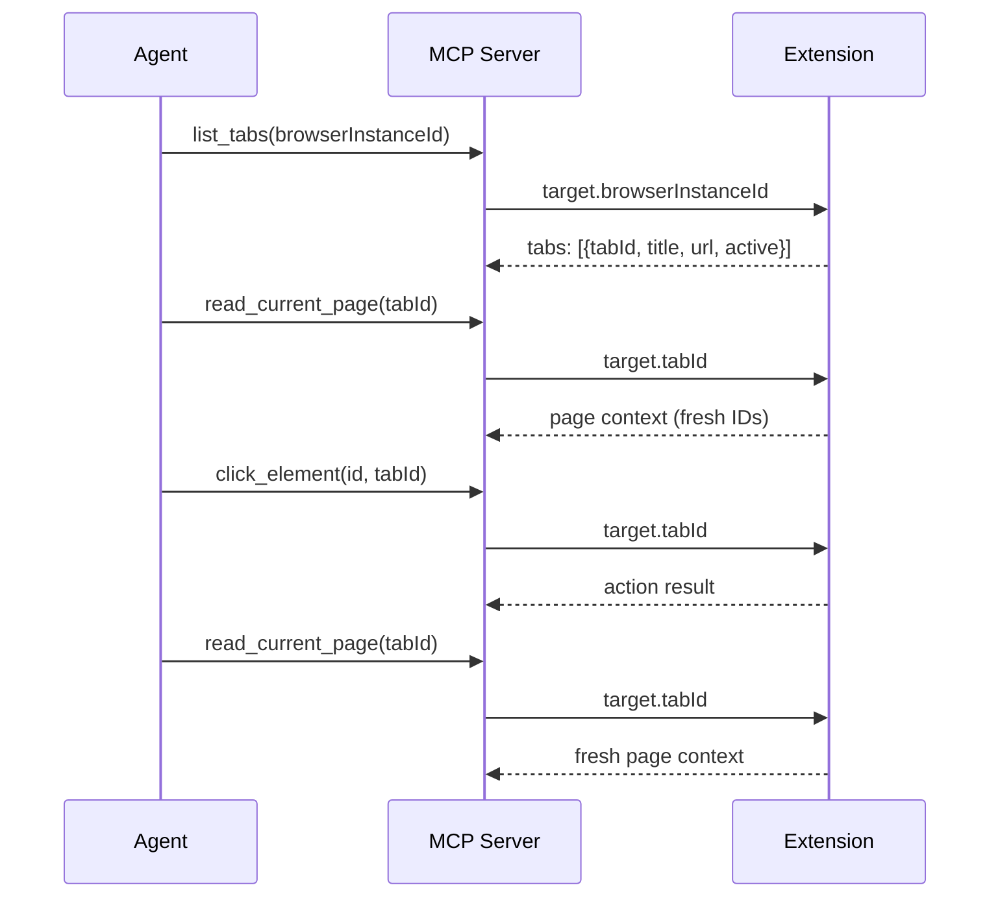
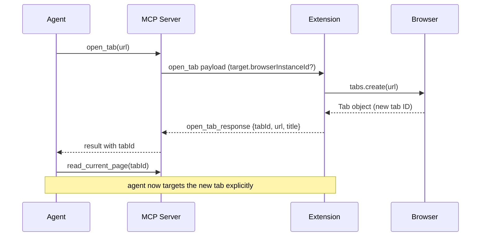

# Multi-tab Workflow

Brijio drives the browser through explicit, per-call tool invocations — there is
no streaming or background automation. The multi-tab axis lets an agent target a
specific tab on each call instead of always operating on the active foreground
tab. Targeting is **per-call and stateless**: the agent passes a `tabId` on each
tool invocation, and there is no hidden "selected tab" session state. When
`tabId` is omitted, every tool falls back to the active tab. This mirrors the
existing `browserInstanceId` pattern (stateless, explicit, no stale session) and
was introduced in [ADR 0060](../../docs/architecture/decisions/0060-explicit-tab-listing-and-selection.md),
threaded through the action stack in [ADR 0062](../../docs/architecture/decisions/0062-thread-tabid-through-action-stack.md),
and extended with tab creation in [ADR 0063](../../docs/architecture/decisions/0063-open-tab-action.md).

The transport path a `tabId` rides on (MCP tool wrapper → WebSocket relay →
extension background controller → browser adapter) is traced in
[Architecture: MCP ↔ WebSocket ↔ Extension flow](../architecture/mcp-extension-flow.md).
The full tool catalog and error-code model live in
[Browser Actions](browser-actions.md); the protocol shapes for `TabInfo`,
`list_tabs`, and `open_tab` live in [Protocol and Data Model Guide](../data-and-protocol.md).

## Recommended workflow

1. **Discover tabs.** Call `list_tabs` (optionally with `browserInstanceId` when
   more than one browser is connected) to get every open, eligible tab.
2. **Choose a tab.** Match the user's intent to a returned `tabId` by `title`,
   `url`, or the `active` flag.
3. **Thread `tabId` into every call.** Pass the chosen `tabId` to each read,
   action, batch, and navigation call that should act on that tab.
4. **Keep the same `tabId` until you intentionally switch tabs.** Reuse it across
   the workflow; do not re-resolve it on every call.
5. **Re-read after navigation or mutation.** After `navigate_to_url`,
   `click_element`, `submit_form`, or any DOM change, call `read_current_page`
   with the same `tabId` to get fresh, short-lived element IDs. Old IDs are
   invalid after the page changes.



_The agent keeps one `tabId` across the loop and re-reads after each mutation so
element IDs stay valid._

## Discovering tabs with `list_tabs`

`list_tabs` is registered alongside `list_browsers` and returns the tab list for
the connected browser instance. Each entry is a `TabInfo`:

| Field       | Type    | Meaning                                                                      |
| ----------- | ------- | ---------------------------------------------------------------------------- |
| `tabId`     | string  | Opaque tab identifier (raw Chrome/Safari tab ID as a string)                 |
| `windowId`  | string  | Opaque window identifier                                                     |
| `title`     | string  | Page title                                                                   |
| `url`       | string  | Full URL (HTTP/HTTPS only)                                                   |
| `active`    | boolean | Whether this is the user's currently focused tab                             |
| `supported` | boolean | Whether the tab is eligible for Brijio actions (always true for listed tabs) |

The extension queries all tabs across all windows and filters to regular
HTTP/HTTPS pages using `isRegularPageUrl()`. Excluded schemes include
`chrome://`, `chrome-extension://`, `about:`, `file://`, and `safari://`;
incognito tabs are also excluded. Safari private mode may return an empty list,
in which case the agent can still target the active tab by omitting `tabId`.

`tabId` values are raw browser integers exposed as strings — pass the exact
value returned by `list_tabs`. The `TabInfo.tabId` type is `string` deliberately,
so it can later be replaced with opaque UUIDs for the cloud model without a
protocol change.

> **Note:** `list_tabs` declares an optional `tabId` in its MCP input schema, but
> the handler ignores it — listing always returns all eligible tabs and does not
> filter by `tabId`. Do not rely on `tabId` to narrow a `list_tabs` result.

## Threading `tabId` through a tool call

A `tabId` travels as a string on the existing `target` field of the WebSocket
envelope, alongside `browserInstanceId`:

```ts
target: {
  browserInstanceId?: string  // existing
  tabId?: string              // multi-tab targeting
}
```

The MCP WebSocket client only adds `target` when at least one of
`browserInstanceId` or `tabId` is defined, so requests with neither remain
unchanged and hit the active tab. On the extension side,
`BrijioBackgroundController.handleSocketMessage` calls `extractTabId(message)`,
which reads `message.target.tabId`, parses it to a safe integer, and returns
`undefined` when absent. That `undefined` is the active-tab fallback signal:
handlers pass the numeric `tabId` (or nothing) down to the reader, action,
batch, and navigation adapters, which resolve the specific tab or fall back to
`chrome.tabs.query({ active: true, currentWindow: true })`.

<!-- openwiki: mermaid parse failed and this diagram was converted to a text fence so it does not break rendering. Fix the diagram source and restore the mermaid fence. Parser error: Heuristic: an unescaped angle bracket inside a label breaks rendering; rephrase the label. -->

```text
flowchart TD
    Call["Agent calls tool with tabId"] --> Wrap["*-tool.ts normalizes input"]
    Wrap --> Actions["page-actions.ts / page-context.ts<br/>tabId = input.tabId ?? config.defaultTabId"]
    Actions --> WSC["websocket-client.ts targetEnvelope<br/>sets target.tabId when defined"]
    WSC --> Ext["extractTabId parses target.tabId<br/>to number, else undefined"]
    Ext --> Target{"tabId defined?"}
    Target -->|"yes"| Specific["resolve specific tab by ID"]
    Target -->|"no"| Active["fall back to active tab"]
    Specific --> Work["read or act on that tab"]
    Active --> Work
```

_The fallback is structural: a missing `tabId` resolves to `undefined`, which the
adapter treats as "use the active tab". There is no selected-tab session state to
go stale._

`BrijioPageActionsConfig` also carries an optional `defaultTabId`, used as
`tabId ?? config.defaultTabId` by the action helpers. In normal operation
`defaultTabId` is unset, so the per-call value (or its absence) is what governs
targeting; the config default is primarily a seam for tests and pinned runtimes.

### Which tools actually thread `tabId` end-to-end

The `tabId` parameter appears in many tool schemas, but not every wrapper
forwards it. The reads and element actions thread it correctly; two navigation/
batch tools currently accept it in their schema but drop it during
normalization:

| Tool                 | `tabId` in schema | Forwarded to the tab? | Notes                                                                          |
| -------------------- | ----------------- | --------------------- | ------------------------------------------------------------------------------ |
| `read_current_page`  | yes               | yes                   | Normalized and passed to `getCurrentPageContext`/`getCurrentPageContent`.      |
| `click_element`      | yes               | yes                   | Forwarded through `clickCurrentPageElement`.                                   |
| `fill_input`         | yes               | yes                   | Forwarded through `fillCurrentPageInput`.                                      |
| `fill_editable`      | yes               | yes                   | Forwarded through the form-action helpers.                                     |
| `set_checked`        | yes               | yes                   | Forwarded through `setCurrentPageChecked`.                                     |
| `select_options`     | yes               | yes                   | Forwarded through `selectCurrentPageOptions`.                                  |
| `submit_form`        | yes               | yes                   | Forwarded through `submitCurrentPageForm`.                                     |
| `upload_file`        | yes               | yes                   | Forwarded through `uploadCurrentPageFile`.                                     |
| `perform_batch`      | yes               | **no (dropped)**      | Schema includes `tabId`, but `performBatchTool` builds its options without it. |
| `navigate_to_url`    | yes               | **no (dropped)**      | `normalizeInput` returns only `url`/`browserInstanceId`; `tabId` is ignored.   |
| `capture_screenshot` | yes               | active-tab only       | Validated against the active tab; cannot capture a background tab.             |
| `list_tabs`          | yes               | n/a                   | Listing is not filtered by `tabId`; the parameter is ignored.                  |

The two "dropped" cases are a real gap: both the `using-brijio` and `navigation`
skills instruct agents to pass `tabId` to `navigate_to_url` (e.g.
`navigate_to_url(url, tabId: "97212078")`), but the tool wrapper discards it, so
navigation targets the active tab (or `config.defaultTabId`) regardless. Until
the wrappers are fixed, `tabId` is reliable for reads and element actions but
not for `navigate_to_url` or `perform_batch`. This is the editing-guidance hazard
called out below: schema, skills, and forwarding must move together.

## Opening new tabs with `open_tab`

`open_tab` (ADR 0063) creates a new browser tab at an HTTP(S) URL and returns the
new tab's `tabId` for immediate targeting. It exists so a workflow can read or
interact with a second page **without disrupting the user's current tab** — the
gap that neither `navigate_to_url` (which overwrites the current tab's state)
nor `fetch_resource` (which returns raw HTML with no rendering or session) could
fill.



_`open_tab` returns immediately after `tabs.create()` resolves; the agent must
read the new tab to confirm it loaded._

Key behaviors and constraints:

- **Input is `url` plus optional `browserInstanceId` only.** `open_tab` does not
  take a `tabId` — it _produces_ one. It cannot navigate an existing tab.
- **URL validation.** Only `http`/`https` schemes are allowed, enforced with the
  same `parseUrl`/`unsupportedSchemeResponse` pattern as `navigate_to_url`. Any
  other scheme returns `unsupported_scheme`.
- **Returns `{ tabId, url, title }`.** `tabId` is the new tab's raw browser ID as
  a string; `title` may be empty until the page loads.
- **Does not wait for load.** The response returns as soon as `tabs.create()`
  resolves. The agent should call `read_current_page(tabId)` on the new tab to
  verify it loaded and to obtain fresh element IDs.
- **The new tab may not be the active foreground tab.** Always pass the returned
  `tabId` to subsequent calls; omitting it targets the active tab, which may be a
  different page.
- **No ownership tracking or `close_tab`.** The agent cannot close tabs it opens
  (deferred to a later milestone). The user closes them, or the agent rediscovers
  them via `list_tabs`.
- **Chrome and Safari parity.** Both extensions implement the same
  `PageOpenTabAdapter` using the standard `tabs.create({ url })` WebExtensions
  API.

Error codes from `open_tab`: `unsupported_scheme`, `open_tab_failed` (browser
reported an error, e.g. pop-up blocking), `not_supported` (the connected
extension does not implement `open_tab`), plus the usual transport codes
(`browser_unavailable`, `connection_failed`, `timeout`).

### When to use `open_tab` vs `navigate_to_url`

- Use `open_tab` to keep the current page intact while working on a second page
  (comparison, cross-referencing, opening an auth flow in parallel).
- Use `navigate_to_url` when you intentionally want to move the current tab to a
  known URL. (Note the `tabId` forwarding gap above: until fixed, `navigate_to_url`
  effectively always targets the active tab.)
- Use click navigation (`click_element`) for menu paths, breadcrumbs, or
  auth-gated/SPA routes where a direct URL would fail.

## Re-reading after navigation and mutation

Element IDs (`e5`, `f2`, `a1`, form IDs) are **ephemeral**. They expire when the
page changes — after `navigate_to_url`, a click that triggers navigation, a form
submission, or any DOM update. The navigation result tells you only the URL and
title; it does not give you elements to interact with.

The rule for multi-tab work: after any mutation on a tab, re-read **that same
tab** with `tabId` before touching elements again. Brijio also tracks visible
form state for staleness protection: if the visible form structure changes
between reading and acting, the action fails with `stale_context`, and on
`perform_batch` a navigation mid-batch sets `data.aborted: true`. In every case
the remedy is the same — `read_current_page(tabId)` against fresh context, then
retry.

## The active-tab fallback

When `tabId` is omitted (or not forwarded), the system targets the active
foreground tab via `chrome.tabs.query({ active: true, currentWindow: true })`.
This fallback is intentional and keeps single-tab workflows unchanged: an agent
that never calls `list_tabs` and never passes `tabId` behaves exactly as before.
There is deliberately **no `select_tab` session-level default** — per-call
targeting is the only mechanism, so there is no hidden "selected tab" state to
go stale or surprise the user. The only persistent default is the optional
`config.defaultTabId`, which is normally unset.

This is also why `capture_screenshot` (ADR 0064) is active-tab only by design:
`tabs.captureVisibleTab()` captures the visible tab in a window, and capturing a
background tab would require switching focus (user-disruptive). The tool accepts
a `tabId` but only validates that it matches the active tab, erroring with
`invalid_browser_target` otherwise. An agent that needs a screenshot of a
specific page should `open_tab` a dedicated tab, bring it to the foreground, and
capture it.

## User awareness: the tab indicator

When the agent targets a tab that is not the active tab, the user must be able to
see it. Two coordinated visual signals follow the existing approval-banner
injection pattern (ADR 0048):

- **Tab title prefix.** The content script prepends `● ` (U+25CF) to
  `document.title` (e.g. `● Original Page Title`), visible in the tab bar even
  for background tabs. A `MutationObserver` re-applies the prefix if the page
  changes its own title; `hide_brijio_tab_indicator` restores the original.
- **In-page banner.** A small persistent blue (`#1a56db`) banner,
  `role="status"`/`aria-live="polite"`, distinct from the amber approval banner.

When the agent targets a different tab, the extension sends
`hide_brijio_tab_indicator` to the previous tab and `show_brijio_tab_indicator`
to the new one. Banner injection may fail gracefully on restricted pages — the
action still executes, only the banner is missing. `open_tab` needs no extra
indicator: the new tab visibly appears, and the standard indicator appears once
the agent targets it with a subsequent action.

## Editing guidance

- **Any tool that touches page state should accept and forward `tabId`.** When
  adding or changing a tab-operating tool, wire `tabId` through the tool wrapper's
  `normalizeInput`, the `page-actions.ts`/`page-context.ts` helper, the
  WebSocket request options, and the background-controller handler — not just the
  Zod schema. The `navigate_to_url` and `perform_batch` gaps above are the
  cautionary example: a schema-level `tabId` that is not forwarded is a silent
  no-op that misleads agents.
- **Move schema, skills, and forwarding together.** Update the `using-brijio`
  and `navigation` skills in the same change as tool behavior, so agent
  instructions match what the code actually does.
- **Do not introduce selected-tab session state.** Keep targeting per-call and
  stateless; the absence of a `select_tab` default is a deliberate invariant.
- **Tab lifecycle races are expected.** A tab can close between `list_tabs` and a
  `tabId`-targeted action; the extension must return a clear `no_active_tab` or
  `tab_not_found` error rather than silently acting elsewhere.
- **Tests to update** when tab behavior changes: protocol validation
  (`@brijio/shared`), MCP envelope creation and `tabId` forwarding
  (`@brijio/mcp`), and extension tab listing/targeting
  (`@brijio/chrome-extension`, `@brijio/safari-extension`).

## Related docs

- [Architecture: MCP ↔ WebSocket ↔ Extension flow](../architecture/mcp-extension-flow.md)
- [Browser Actions](browser-actions.md)
- [Protocol and Data Model Guide](../data-and-protocol.md)
- [Capability Matrix](../../docs/project/CAPABILITY_MATRIX.md)
- [ADR 0060: Explicit Tab Listing and Selection](../../docs/architecture/decisions/0060-explicit-tab-listing-and-selection.md)
- [ADR 0062: Thread tabId Through the Entire Action Stack](../../docs/architecture/decisions/0062-thread-tabid-through-action-stack.md)
- [ADR 0063: Open Tab Action](../../docs/architecture/decisions/0063-open-tab-action.md)
- [ADR 0064: Visual Action Verification — Screenshot Tool](../../docs/architecture/decisions/0064-visual-action-verification.md)
