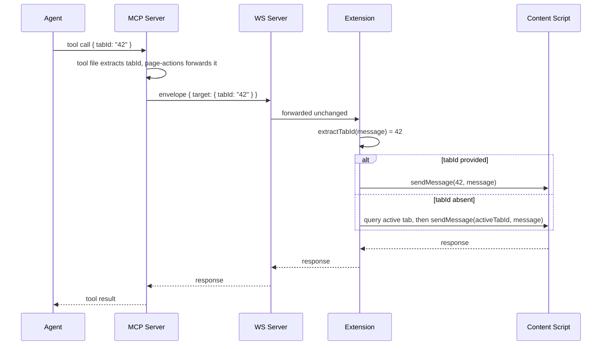
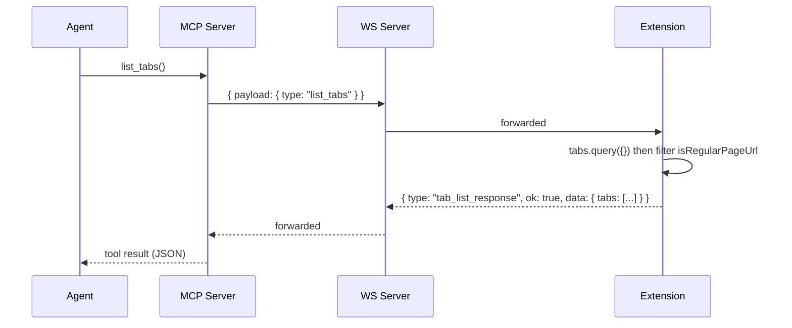
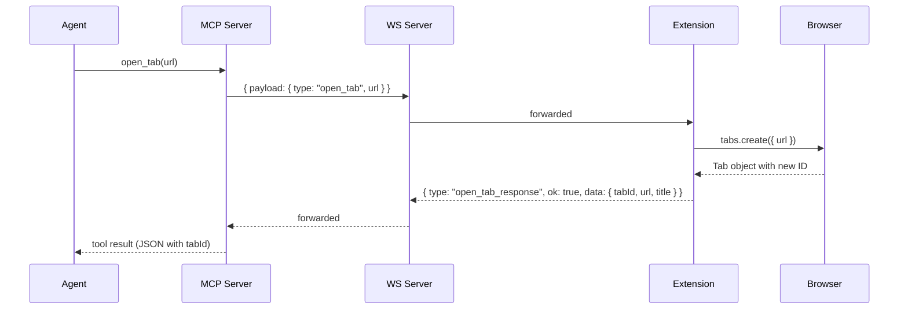

# Multi-tab Workflow

Brijio lets an agent operate on more than one browser tab in a single connected
browser. Targeting is **per-call and stateless**: every tab-operating tool
accepts an optional `tabId` input, and when `tabId` is omitted the tool falls
back to the active foreground tab. There is no hidden "selected tab" session
state — the agent re-states the target on each call, exactly as it does with
`browserInstanceId` for multi-browser targeting.

## Recommended workflow

1. Call `list_tabs` to discover connected browser tabs.
2. Choose the tab you want to work on.
3. Pass that tab's `tabId` into subsequent read, action, batch, and navigation
   calls.
4. Keep using the same `tabId` until you intentionally switch tabs.
5. Re-read page context after navigation or any other change that may
   invalidate the page snapshot — short-lived element IDs expire on navigation
   or DOM mutation.

```
→ list_tabs(browserInstanceId: "chrome-abc123")
← { tabs: [{ tabId: "97212078", title: "Brijio Demo", url: "https://brijio.dev/demo", active: false, supported: true }, ...] }

→ read_current_page(tabId: "97212078")
→ click_element(kind: "link", id: "e5", tabId: "97212078")
→ navigate_to_url(url: "https://example.com", tabId: "97212078")
→ read_current_page(tabId: "97212078")   # re-read for fresh IDs
```

The `tabId` is a string (for example `"97212078"`), not a number. Pass the
exact value returned by `list_tabs` or `open_tab`.

## How tabId flows end to end

`tabId` rides on the existing `target` field of the `WebSocketEnvelope` and is
forwarded unchanged by the WebSocket server, so the browser extension can
resolve it to a real Chrome/Safari tab.



Key layers in the path:

- **MCP tool files** (`click-element-tool.ts`, `fill-input-tool.ts`,
  `form-action-tools.ts`, `page-reading-tool.ts`, `capture-screenshot-tool.ts`,
  …) parse `tabId` from tool input via `normalizeTabId` and pass it to the
  `page-actions.ts` function for that tool.
- **`page-actions.ts`** stamps `tabId: tabId ?? config.defaultTabId` into every
  WebSocket request. `defaultTabId` is an optional config-level convenience; a
  per-call `tabId` overrides it.
- **`websocket-client.ts`** places `tabId` into `target.tabId` of the request
  envelope via the shared `buildTarget` helper, which only adds `target` when a
  `browserInstanceId` or `tabId` is present.
- **`BrijioBackgroundController.handleSocketMessage`** calls `extractTabId`
  to pull `target.tabId` off the incoming envelope and parses it to a number;
  it returns `undefined` (triggering the active-tab fallback) when the field is
  absent or not a safe integer.
- **`page-reader.ts`** (`readActiveTabPage`, `performActiveTabAction`,
  `performActiveTabBatch`) and the Chrome/Safari `navigateActiveTabToUrl` use
  the numeric `tabId` directly when provided, otherwise fall back to
  `tabs.query({ active: true, currentWindow: true })`.

## Which tools accept tabId

`tabId` is an optional input on every tool that operates on a tab. The shared
input-schema helper `tabIdInput` is reused across tool registrations in
`mcp-server.ts`.

| Tool                 | Accepts `tabId`                  | Notes                                              |
| -------------------- | -------------------------------- | -------------------------------------------------- |
| `list_browsers`      | No                               | Discovery only; no tab context.                    |
| `list_tabs`          | No (accepted in schema, ignored) | Lists tabs for a browser instance.                 |
| `read_current_page`  | Yes                              | Forwards `tabId` to context + content reads.       |
| `read_resource`      | Yes                              | Paginated page content for the targeted tab.       |
| `click_element`      | Yes                              |                                                    |
| `fill_input`         | Yes                              |                                                    |
| `fill_editable`      | Yes                              |                                                    |
| `set_checked`        | Yes                              |                                                    |
| `select_options`     | Yes                              |                                                    |
| `submit_form`        | Yes                              |                                                    |
| `upload_file`        | Yes                              |                                                    |
| `navigate_to_url`    | Yes                              | Navigates the targeted tab without stealing focus. |
| `perform_batch`      | Yes                              | All sub-actions inherit the batch's `tabId`.       |
| `capture_screenshot` | Yes                              |                                                    |
| `download_file`      | Yes                              |                                                    |
| `download_status`    | Yes                              |                                                    |
| `fetch_resource`     | Yes                              |                                                    |
| `open_tab`           | No                               | Creates a new tab; returns the new `tabId`.        |

> **Editing caution.** Two tools declare `tabId` in their schema but drop it in
> their tool-file normalizer today: `navigate_to_url` and `perform_batch`. The
> `page-actions.ts` functions they call (`navigateToCurrentPageUrl`,
> `performBatch`) and the extension layer both honor `tabId`, so the gap is in
> the tool-file plumbing, not the protocol. When editing this area, pass
> `tabId` through the normalizer like the other action tools do.

When `tabId` is omitted, every layer falls back to
`chrome.tabs.query({ active: true, currentWindow: true })` (Safari uses the
`browser.*` equivalent). This is the only "default tab" behavior — there is no
`select_tab` session-level default.

## list_tabs

The `list_tabs` tool lists every open tab in the connected browser instance.
It mirrors the `list_browsers` pattern: a `list_tabs` request flows through
the WS server to the extension, which returns a `tab_list_response`.



Each returned tab is a `TabInfo`:

```ts
interface TabInfo {
  tabId: string; // raw Chrome/Safari tab ID as string
  windowId: string;
  title: string;
  url: string; // HTTP/HTTPS only
  active: boolean;
  supported: boolean; // always true for listed tabs
}
```

The extension's `tabLister` adapter queries all tabs via `tabs.query({})` and
filters with `isRegularPageUrl()`, so only regular HTTP/HTTPS tabs are listed.
`chrome://`, `chrome-extension://`, `about:`, `file://`, and `safari://` tabs
are excluded, as are incognito tabs. Tab list is fetched on demand — the
extension does not continuously stream tab updates.

Sources: `servers/mcp/src/list-tabs-tool.ts`,
`packages/shared/src/protocol.ts` (TabInfo / `list_tabs` types),
`clients/extensions/chrome/src/background.ts` (`tabLister`).

## open_tab

The `open_tab` tool opens a **new** browser tab at a given HTTP(S) URL and
returns the new `tabId`. Use it when a workflow needs a second page open
without disrupting the user's current tab — for example comparison tasks,
cross-referencing, or opening an auth flow. The returned `tabId` should be
passed to all subsequent reads and actions on the new tab.



Behavior and constraints (ADR 0063):

- **URL validation.** Only HTTP/HTTPS URLs are allowed — the same
  `parseUrl` + `unsupportedSchemeResponse` check used by `navigate_to_url`.
  Invalid URLs return `invalid_tool_input`; non-HTTP(S) schemes return
  `unsupported_scheme`.
- **Returns the new `tabId`.** The adapter calls `tabs.create({ url })` and
  returns `String(tab.id)`, `tab.url ?? url`, `tab.title ?? ''`. The new tab may
  not be the active foreground tab, so always pass the returned `tabId` to
  subsequent calls.
- **No ownership/close tracking.** `close_tab` and ownership tracking are
  deferred. The agent can `list_tabs` to discover tabs it opened. In practice
  the user closes them.
- **Non-destructive and user-visible.** A new tab appearing is inherently
  visible; no additional banner is needed beyond the existing tab indicator
  that appears when the agent targets the new tab with a subsequent action.
- **No `tabId` input.** `open_tab` creates a tab rather than targeting one, so
  it accepts only `url` and `browserInstanceId`.
- **Does not wait for load.** The response returns immediately after
  `tabs.create()` resolves; call `read_current_page` on the new tab to verify it
  loaded, same as `navigate_to_url`.

Error codes: `unsupported_scheme`, `open_tab_failed` (browser reported an error
creating the tab), `not_supported` (the connected extension has no
`pageOpenTab` adapter), `browser_unavailable`, `connection_failed`,
`invalid_tool_input`.

Sources: `servers/mcp/src/open-tab-tool.ts`, `servers/mcp/src/page-actions.ts`
(`openNewTab`), `servers/mcp/src/websocket-client.ts` (`requestOpenTab`),
`packages/shared/src/background-controller.ts` (`PageOpenTabAdapter`,
`handleOpenTabRequest`), `clients/extensions/chrome/src/background.ts`
(`pageOpenTab`).

## Re-read after navigation or DOM mutation

Element IDs (`e5`, `f2`, `a1`, form IDs) are short-lived. They expire when the
page changes — after navigation, form submissions, or DOM updates. After any
`navigate_to_url`, `open_tab`, or click that triggers navigation, call
`read_current_page` (with the relevant `tabId`) before interacting with new
elements. Never reuse IDs from a previous page snapshot. Brijio also tracks
visible form state: if it changed between read and action, the action fails
with `stale_context` — re-read and retry.

## Multi-tab vs multi-browser targeting

`tabId` and `browserInstanceId` are orthogonal and compose:

- `browserInstanceId` selects _which connected browser_ handles the request
  (WS server routing). When multiple browsers are connected and it is omitted,
  the call returns `ambiguous_browser_target`.
- `tabId` selects _which tab within that browser_ the action targets. When
  omitted, the extension uses the active tab.

Both are per-call and stateless. Pass both to target a specific background tab
in a specific browser.

## When to use tabId

| Scenario                                              | Use `tabId`?                       |
| ----------------------------------------------------- | ---------------------------------- |
| User says "read the Brijio tab" (not the active tab)  | Yes                                |
| User refers to a background tab by name or URL        | Yes — `list_tabs` first            |
| User says "do X on the tab I have open"               | Yes — `list_tabs` first to find it |
| User says "do X on this page" (no tab ambiguity)      | No — active tab is fine            |
| Agent opened a tab via `open_tab` and continues on it | Yes — pass the returned `tabId`    |
| Navigating a background tab without stealing focus    | Yes                                |

## Choosing open_tab vs navigate_to_url

- **`navigate_to_url`** navigates the current (or `tabId`-targeted) tab. Prefer
  it when you have a precise URL and want to stay on the same tab.
- **`open_tab`** opens a new tab and returns its `tabId`. Prefer it when you
  must keep the current page intact (comparison, cross-referencing) or when the
  user asks to "open in a new tab".
- For click-through flows on auth-gated pages, prefer `click_element`
  navigation (see the [navigation skill](../../servers/mcp/skills/navigation/SKILL.md)).

## Editing this area

- If you change any MCP tool that touches page state, confirm whether it should
  accept `tabId`, and pass `tabId` through the tool-file normalizer to the
  matching `page-actions.ts` function (the `navigate_to_url` and `perform_batch`
  normalizers currently accept but drop it).
- When threading `tabId` through a new tool, add it to the `mcp-server.ts`
  input schema via `tabIdInput`, normalize with `normalizeTabId`, and forward
  it to `page-actions.ts` so it lands in `target.tabId` on the envelope.
- Update the `using-brijio` and `navigation` skills together with tool
  behavior changes so agent guidance stays in sync with the tool surface.
- Preserve the fallback: when no `tabId` is provided, every layer must fall
  back to the active tab. Do not introduce hidden selected-tab session state.
- The `index.test.ts` tool snapshot uses positional indices; adding a tool
  shifts subsequent indices and must be updated.

## Related docs

- [MCP ↔ WebSocket ↔ Extension flow](../architecture/mcp-extension-flow.md)
- [Data and protocol](../data-and-protocol.md)
- [Workflows](../workflows.md)
- [Action approval](action-approval.md)
- [Capability matrix](../../docs/project/CAPABILITY_MATRIX.md)
- [Roadmap](../../docs/project/ROADMAP.md)
