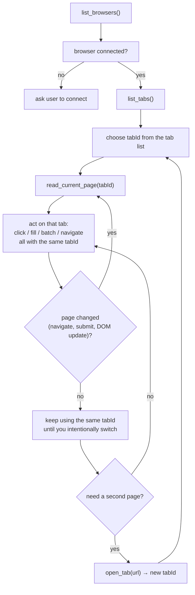

# Multi-tab Workflow

Brijio targets browser tabs **explicitly and per call**. Every browser tool that
operates on a page accepts an optional `tabId`; when it is omitted the extension
acts on the active foreground tab, and when it is present the extension targets
that specific tab (including background tabs) directly. This makes multi-tab
behavior explicit instead of implicit, so an agent can keep one stable tab
target across an entire workflow and, with `open_tab`, bring up a second page
without disturbing the page it was already working on.

The targeting model is carried in the protocol envelope's `target.tabId`, never
in hidden session state — the same stateless, per-call rule that
`browserInstanceId` follows for multi-browser targeting. ADR 0060 introduced
`list_tabs` plus the `tabId` parameter; ADR 0062 threads `tabId` end-to-end
through the extension action stack so the value the agent passes actually
reaches `chrome.tabs.sendMessage(tabId, …)` / `browser.tabs.*`; ADR 0063 adds
`open_tab` so the agent can create the tab it then targets.

## The recommended workflow



Concretely:

1. **`list_browsers`** — confirm a browser is connected. If several are online,
   note the `browserInstanceId` you mean to use (omitting it with multiple
   browsers yields `ambiguous_browser_target`).
2. **`list_tabs`** — discover the open tabs for that browser. Each returned
   `TabInfo` carries a `tabId` (string), `windowId`, `title`, `url`, `active`,
   and `supported` flag. Only regular HTTP/HTTPS tabs are listed; `chrome://`,
   `file://`, incognito, etc. are filtered out.
3. **Choose a tab** — pick the `tabId` for the tab you want to work on.
4. **Pass that `tabId` into every subsequent call** — reads, actions, batch,
   and navigation. `tabId` is a **string** (e.g. `"97212078"`), not a number;
   pass the exact value returned by `list_tabs`.
5. **Keep using the same `tabId`** until you intentionally switch tabs. There
   is no session-level "selected tab" to forget — targeting is stateless and
   per-call, mirroring `browserInstanceId`.
6. **Re-read page context after navigation or mutation** — short-lived element
   IDs (`e5`, `f2`, `a1`) expire when the page changes (navigation, form
   submission, DOM update), so after `navigate_to_url`, a click that triggers
   navigation, or a batch whose `data.aborted` is `true`, call
   `read_current_page` with the same `tabId` again before reusing any IDs.

The `using-brijio` skill encodes this discipline (read the relevant skill before
acting, check the connection first) and the `navigation` skill documents the
re-read-after-navigation rule for both click-through and direct URL navigation.

## Opening new tabs

`open_tab` opens a new browser tab at an HTTP(S) URL and returns the new
`tabId`:

```
open_tab(url: "https://example.com/dashboard") → { tabId: "12345", url, title }
```

Use it when a workflow needs two pages open at once (comparison, cross-
referencing, an auth flow in a separate tab) without navigating away from the
page the agent is working on. `open_tab` is deliberately **stateless**: it does
not wait for the new page to fully load, it returns immediately after
`tabs.create()` resolves, and there is no `close_tab` or ownership tracking
yet (deferred to P2.5). The agent verifies the load by calling
`read_current_page` with the returned `tabId`. Both Chrome and Safari implement
the same `PageOpenTabAdapter` over `chrome.tabs.create()` /
`browser.tabs.create()`; when the adapter is absent the controller reports
`not_supported`.

Always pass the returned `tabId` to the calls that follow. The new tab is not
necessarily the active foreground tab, so omitting `tabId` on a subsequent
`read_current_page` could target the wrong page.

## The active-tab fallback

When a tool call omits `tabId`, the extension falls back to the active
foreground tab by resolving `chrome.tabs.query({ active: true, currentWindow:
true })` (or the Safari `browser.tabs` equivalent). This is what makes the
`tabId` parameter backward compatible: every existing caller that omits it
keeps working unchanged.

The fallback is a deliberate, preserved invariant of the design (ADR 0060
constraint 1: per-call targeting, not session state). On the MCP side,
`page-actions.ts` expresses the same fallback as `tabId: tabId ??
config.defaultTabId` when building the WebSocket request; the shared
`readActiveTabPage` / `performActiveTabAction` / `performActiveTabBatch` helpers
implement it on the extension side by branching on whether `tabId` was
provided. It must be preserved unless an ADR changes it — if a tool should
work on a background tab it must accept `tabId` and must not assume the active
tab.

## How tabId threads through the stack

`tabId` travels on the envelope's `target`, not in the payload, and the relay
forwards the whole envelope unchanged so the field survives end-to-end:

- **MCP input** — every browser tool registers an optional `tabId` string
  (`z.string().optional()`) in `mcp-server.ts`. Tool modules normalize it with
  `normalizeTabId` (non-empty string or `undefined`) and pass it down.
- **MCP page actions** — `page-actions.ts` threads `tabId` into each
  `request*` options object (`tabId: tabId ?? config.defaultTabId`), and
  `page-context.ts` does the same for reads.
- **WebSocket client** — `targetEnvelope` merges `tabId` into
  `envelope.target.tabId` only when present, so the field is absent when
  omitted rather than carried as `undefined`.
- **WebSocket relay** — forwards the entire envelope unchanged; no
  `tabId`-specific routing lives here.
- **Extension controller** — `BrijioBackgroundController.handleSocketMessage`
  calls `extractTabId(message)` to read `message.target.tabId`, validate it as
  a non-empty string, and parse it to a number, then forwards the numeric
  `tabId` into each handler and adapter call.
- **Shared helpers** — `readActiveTabPage` / `performActiveTabAction` /
  `performActiveTabBatch` in `page-reader.ts` use the numeric `tabId` directly
  as `resolvedTabId` for `scripting.executeScript({ target: { tabId:
resolvedTabId } })` and `deps.tabs.sendMessage(resolvedTabId, …)` when
  `tabId` is present, and fall back to
  `deps.tabs.query({ active: true, currentWindow: true })` when it is absent.
  `navigateActiveTabToUrl(url, tabId)` mirrors this and updates the resolved
  tab with `chrome.tabs.update(tab.id, { url })`.

The same threading applies on Safari through its adapters; both extensions
implement the same `PageReaderAdapter` / `PageActionAdapter` /
`PageBatchAdapter` / `PageNavigationAdapter` / `PageOpenTabAdapter` /
`TabListerAdapter` interfaces, each taking an optional numeric `tabId`.

### Where tabId is currently a gap

Two tool modules accept `tabId` in their input schema but do not yet forward
it into the action call, so the value is dropped before it reaches the
envelope:

- **`navigate_to_url`** — `navigate-to-url-tool.ts` normalizes `url` and
  `browserInstanceId` but calls `navigateToCurrentPageUrl(config, url,
browserInstanceId)` without the `tabId` argument, so `page-actions.ts`'
  `navigateToCurrentPageUrl` receives `undefined` and falls back to
  `config.defaultTabId` (the active tab). The input schema still lists `tabId`,
  and the `navigation` skill documents targeting a background tab via
  `navigate_to_url(url, tabId)`, but the tool module does not yet wire it
  through.
- **`perform_batch`** — `mcp-server.ts` registers `tabId` and `batch-tool.ts`
  declares `tabId` on its input, but the handler destructures only `actions`,
  `continueOnError`, `readAfterActions`, `pageContextId`,
  `visibleContextId`, and `browserInstanceId` into the `performBatch` call;
  `input.tabId` is never read. The underlying `page-actions.ts`'
  `performBatch` accepts and forwards `tabId`, so the gap is in the tool
  module wiring, not the action layer.

Until those are fixed, passing `tabId` to `navigate_to_url` or
`perform_batch` will silently act on the active tab. Reads (`read_current_page`,
page-content resources) and the other action tools (`click_element`,
`fill_input`, `fill_editable`, `set_checked`, `select_options`, `submit_form`,
`upload_file`, `capture_screenshot`, `download_*`, `fetch_resource`) thread
`tabId` correctly. `open_tab` intentionally does not take `tabId` because it
creates a new tab and returns one.

## Stale IDs and re-reading

Short-lived element IDs are per-page and expire on any page change. The
action tools also accept `pageContextId` and `visibleContextId`: if the page
navigated since the last read the action fails with `page_navigated`; if
visible form state changed, with `stale_context`. `perform_batch` sets
`data.aborted: true` and stops when a navigation invalidates the remaining
IDs. In every case the recovery is the same: re-call `read_current_page` with
the same `tabId` to get a fresh `PageContext` with fresh IDs before retrying.
Targeting a tab never exempts a caller from this rule — the re-read must use
the same `tabId`.

## Visual indicator

When the agent targets a tab that is not the active tab, the extension sends
`show_brijio_tab_indicator` (and `hide_brijio_tab_indicator` to the previous
tab). The content script injects a `● ` title prefix visible in the browser
tab bar (re-applied by a `MutationObserver` if the page changes its title) and
a persistent blue in-page banner reading "Brijio is active on this tab".
Indicator state lives on `globalThis.__brijioIndicatorStates` so it survives
content-script re-injection. This is the user-awareness half of the
multi-tab design (ADR 0060 constraint 3) and is the same on Chrome and Safari.

## Keeping this area in sync

When a browser-interfacing MCP tool's behavior changes, update its tests, its
MCP registration in `mcp-server.ts`, the relevant `SKILL.md` files
(`using-brijio` and `navigation` for tab-targeting behavior), the
[Capability Matrix](../../docs/project/CAPABILITY_MATRIX.md), and this page
together. The two tool-level `tabId` gaps above are the most common place for
drift to hide: if you wire `tabId` through `navigate_to_url` or
`perform_batch`, update this page's "Where tabId is currently a gap" section
at the same time.

## Related docs

- [MCP ↔ WebSocket ↔ Extension Flow](../architecture/mcp-extension-flow.md) — the end-to-end relay path that carries `target.tabId`.
- [MCP Tool and Skill Surface](../concepts/mcp-tool-surface.md) — the registered tools, the shared `tabId` input schema, and the skill system.
- [Browser Extension Adapters](../concepts/browser-adapters.md) — how Chrome and Safari implement the tab-listing/targeting adapters.
- [Data and Protocol](../data-and-protocol.md) — the `WebSocketEnvelope.target.tabId` contract and `TabInfo` shape.
- [ADR 0060 — Explicit Tab Listing and Selection](../../docs/architecture/decisions/0060-explicit-tab-listing-and-selection.md)
- [ADR 0062 — Thread tabId Through the Action Stack](../../docs/architecture/decisions/0062-thread-tabid-through-action-stack.md)
- [ADR 0063 — Open Tab Action](../../docs/architecture/decisions/0063-open-tab-action.md)
