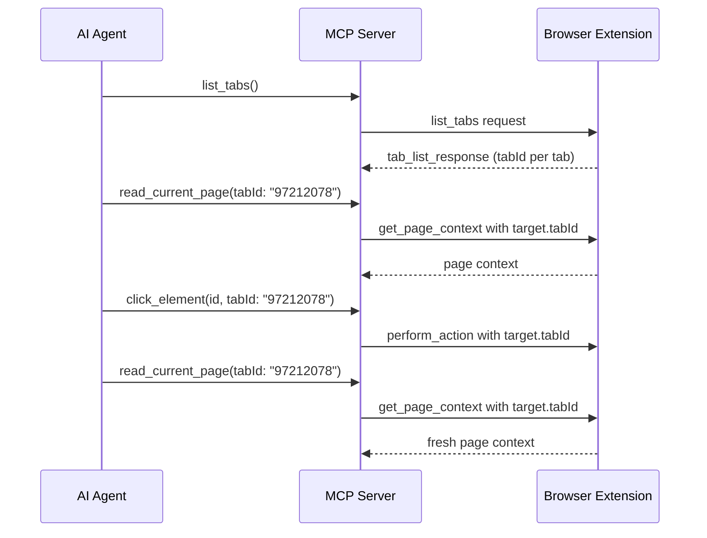

# Multi-tab Workflow

Brijio lets an agent target a specific browser tab on every call through an
optional `tabId` parameter, instead of always operating on the implicit active
foreground tab. Tab targeting is **per-call and stateless**: there is no hidden
"selected tab" session state. When `tabId` is omitted, every tool falls back to
the active tab (the result of `chrome.tabs.query({ active: true,
currentWindow: true })`). This mirrors how `browserInstanceId` works for
multi-browser targeting and is the design basis for ADRs [0060](../../docs/architecture/decisions/0060-explicit-tab-listing-and-selection.md)
(explicit tab listing and selection) and [0062](../../docs/architecture/decisions/0062-thread-tabid-through-action-stack.md)
(threading `tabId` through the action stack).

## Recommended workflow

1. Call `list_tabs` to discover the connected browser's open tabs (each returns a
   `tabId`, `title`, `url`, `active`, and `supported` flag; only HTTP/HTTPS tabs
   are listed).
2. Choose the tab you want to work on and note its `tabId` (a string such as
   `"97212078"`, not a number — pass the exact value returned by `list_tabs`).
3. Pass that `tabId` into subsequent read, action, batch, and navigation calls.
4. Keep using the same `tabId` until you intentionally switch tabs.
5. Re-read page context (`read_current_page` with the same `tabId`) after
   navigation or any mutation that may invalidate short-lived element IDs.



The sequence above shows the list_tabs → choose tabId → read/act with tabId →
re-read after mutation loop that keeps a stable tab target across a workflow.

## How tabId flows end to end

The `tabId` is threaded from MCP tool input, through the WebSocket request
envelope, into the extension, down to the browser APIs.

1. **MCP tool input → tool function.** Tools that accept `tabId` normalize it
   (`normalizeTabId` requires a non-empty string) and pass it to the
   `page-actions.ts` / `page-context.ts` functions. `read_current_page`,
   `click_element`, `fill_input`, `fill_editable`, `set_checked`,
   `select_options`, `submit_form`, `upload_file`, and `capture_screenshot`
   thread `tabId` all the way through.
2. **WebSocket envelope.** `websocket-client.ts` builds the request envelope via
   `targetEnvelope`, which adds `target.tabId` (alongside `target.browserInstanceId`)
   only when the value is defined; when both are absent no `target` is attached.
3. **Extension routing.** `BrijioBackgroundController.handleSocketMessage` calls
   `extractTabId(message)`, which reads `message.target.tabId`, parses it to a
   number with `Number.parseInt`, and forwards that numeric `tabId` to each
   handler (`handlePageContextRequest`, `handlePerformActionRequest`,
   `handleNavigateToUrlRequest`, `handlePerformBatchRequest`, etc.).
4. **Tab resolution.** In `page-reader.ts`, `readActiveTabPage`,
   `performActiveTabAction`, and `performActiveTabBatch` use the provided
   `tabId` directly as the Chrome/Safari tab id for `executeScript({ target:
{ tabId } })` and `tabs.sendMessage(tabId, message)`. When `tabId` is
   `undefined`, they fall back to `tabs.query({ active: true, currentWindow: true })`
   and validate the active tab's URL with `isRegularPageUrl` (HTTP/HTTPS only).
5. **User awareness.** When a non-active tab is targeted, the content script
   shows a tab-level indicator (a `●` title prefix) and an in-page banner so the
   user can see which background tab Brijio is acting on.

### Fallback to the active tab

The active-tab fallback is the default, not a special mode. Every adapter
function (`PageReaderAdapter`, `PageActionAdapter`, `PageBatchAdapter`,
`PageNavigationAdapter`) accepts an optional `tabId`; when it is absent the
handler queries the active foreground tab. Do not assume the system remembers a
"current tab" between calls — each call resolves its target independently.

## Opening new tabs

The `open_tab` tool opens a new browser tab at a given HTTP(S) URL and returns
the new `tabId` (`open_tab` itself takes no `tabId` — it _creates_ a tab). Use it
when a workflow needs two pages open simultaneously (comparison tasks,
cross-referencing) without disrupting the user's current tab. The returned
`tabId` must be passed to all subsequent reads and actions on the new tab,
because the new tab may not be the active foreground tab — omitting `tabId`
would silently target whichever tab is active instead.

```
open_tab(url: "https://example.com")          → { tabId: "12345", url, title }
read_current_page(tabId: "12345")             → page context with fresh IDs
click_element(kind: "link", id: "e5", tabId: "12345")
```

`open_tab` validates the URL scheme (only `http`/`https`) and returns
`unsupported_scheme` for anything else. There is no `close_tab` or tab-ownership
tracking — `list_tabs` is how the agent discovers tabs it has opened. See ADR
[0063](../../docs/architecture/decisions/0063-open-tab-action.md) for the design.

## Current tabId coverage

Most page-state tools accept and forward `tabId`. Two tools declare `tabId` in
their input schema but do not yet thread it through to the underlying action
function, so the parameter is currently a no-op for them:

- `navigate_to_url` — `navigate-to-url-tool.ts` accepts `tabId` in its input but
  does not normalize or pass it to `navigateToCurrentPageUrl`, so navigation
  always targets the active tab regardless of the supplied `tabId`. (The
  `navigation` skill and the using-brijio skill both document `tabId` for
  `navigate_to_url`; the implementation has not yet caught up.)
- `perform_batch` — `batch-tool.ts` accepts `tabId` in its input but does not
  pass it to `performBatch`, so batched write actions target the active tab.

If you change any MCP tool that touches page state, confirm whether it should
accept `tabId`; when you do, thread it from the tool input through
`page-actions.ts` / `page-context.ts` into the WebSocket envelope, and update the
`using-brijio` and `navigation` skills together with the tool behavior change.

## When to use tabId

| Scenario                                                      | Use `tabId`?                                           |
| ------------------------------------------------------------- | ------------------------------------------------------ |
| User says "read the Brijio tab" (not the active tab)          | Yes                                                    |
| User refers to a background tab by name or URL                | Yes                                                    |
| User says "do X on the tab I have open"                       | Yes — call `list_tabs` first to find the right `tabId` |
| User says "do X on this page" (no tab ambiguity)              | No — active tab is fine                                |
| Agent opened a tab via `open_tab` and wants to continue on it | Yes — pass the returned `tabId` to subsequent calls    |

## Related docs

- [Architecture: MCP ↔ WebSocket ↔ Extension flow](../architecture/mcp-extension-flow.md)
- [Data and Protocol](../data-and-protocol.md)
- [Workflows](../workflows.md)
- [Capability matrix](../../docs/project/CAPABILITY_MATRIX.md)
- [Roadmap](../../docs/project/ROADMAP.md)
